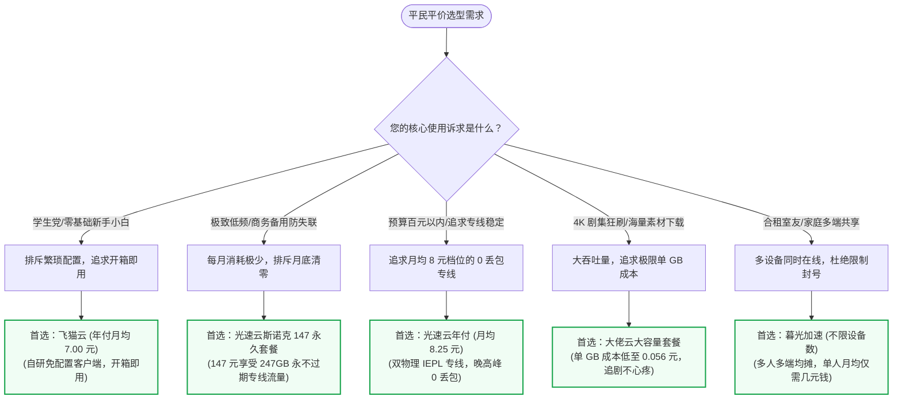
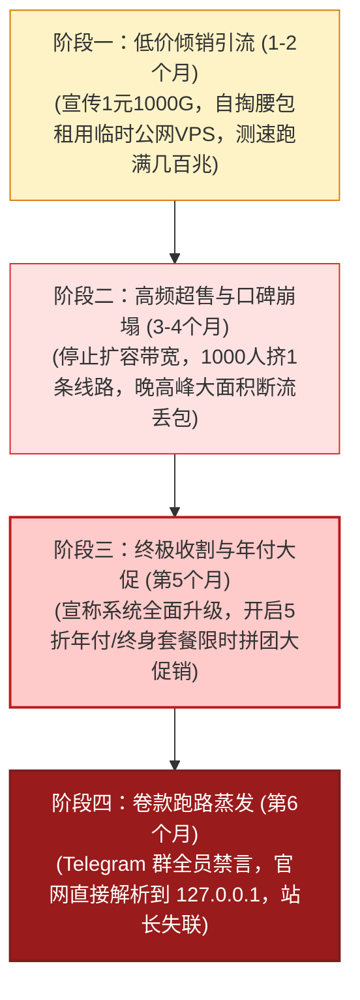

<Breadcrumb :items="[{ name: '首页', url: '/' }, { name: '机场推荐', url: '/airport/' }, { name: '便宜机场' }]" />

# 2026 便宜机场推荐：月付5-10元平民专线实测、不限时永久计费精算与防跑路全攻略

在科学上网领域，“便宜”是绝大多数用户在搜索框中键入频率最高的关键词之一。

从几毛钱一个月的“一元机场”，到五元十元的平价小包，再到号称“几十元终身不限流量”的营销狂欢，低价市场鱼龙混杂、暗礁密布。

很多刚刚入门的新手往往被“超大流量”和“极限低价”吸引，结果充值后才发现：**白天测速飞快，晚上高峰全红；标称 500GB，常用节点全标 3x/5x 倍率暗扣；更有甚者，使用不满两个月，机场主直接关闭官网卷款跑路**。

**科学上网真的可以用几元钱解决吗？到底有没有“既便宜、又稳定、还不套路”的正规机场？**

答案是肯定的，但前提是您必须具备辨别**“工业化平价专线”与“恶性低价资金盘”**的技术认知。

本专题深入剖析 2026 年低价机场市场的商业运转底细，基于网络实验室在三网宽带下的长期压测与真实账单精算，为您推荐真正值得上车的月付 5-10 元良心平民机场与不限时永久流量包。

<CommercialDisclosure />

> ⚡ **2026 便宜机场专家核心结论速查 (Answer-First)**
> 
> 1. **平价的健康红线：月均 5 - 10 元是商业可持续的最低成本极限**。凡是宣称“1 元/月含几百 G”或“数十元终身买断”的品牌，100% 属于资金盘跑路前兆或高危超售陷阱。健康良心的平价品牌通过规模化集约运维与适度控制单客带宽，将正规线路压缩至月均 5-10 元，兼顾生存与稳定性。
> 2. **小白与学生党入门平价首选**：**[飞猫云 (FatCat)](/brands/feimao/)**。年付折算仅约 **7.00 元/月**，不仅价格门槛极低，还提供全平台免配置专属客户端，无需折腾订阅导入即可开箱即用。
> 3. **平价专线天花板与不限时永久包**：**[光速云 (LightSpeed)](/brands/guangsu/)**。年付方案月均低至 **8.25 元/月**，却搭载了华南/华东双物理 IEPL 内网专线；其独家推出的**“斯诺克147不限时永久套餐”**（147 元享受 247GB 永不过期流量），为低频用户彻底根除了“月底清零浪费”的沉没成本，单月真实开销甚至不足 3 元。
> 4. **超大流量单 GB 极限低成本优选**：**[大佬云 (DaLao)](/brands/dalaoyun/)**。TB 级超大流量池，折算单 GB 成本低至 **0.056 元/GB**，是追剧大流量下载的平民首选。
> 5. **平价极客抗封锁 Reality 专线**：**[快狸 (KuaiLi)](/brands/kuaili/)**。标配 VLESS + Reality 架构，高并发抗晚高峰拥堵，单 GB 真实折算成本仅 0.08 元。
> 6. **家庭与团队均摊终极省钱法**：**[暮光加速 (Twilight)](/brands/muguang/)**。全套餐承诺不限在线设备数，22 元/月套餐由 4-5 人或全屋多设备共享，人均成本被瞬间稀释至每月 4-5 元。

---

## 📑 目录导览 (Table of Contents)

- [一、2026 优质便宜机场核心参数横向大对比](#cheap-table)
- [二、5-10元黄金平价档位精选代表品牌拆解](#cheap-brands)
  - [1. 飞猫云 (FatCat) —— 7 元月均极低门槛与全平台专属客户端](#cheap-feimao)
  - [2. 光速云 (LightSpeed) —— 8.25 元平价专线奇迹与 147 元永久套餐](#cheap-guangsu)
  - [3. 大佬云 (DaLao) —— 百元大容量与单 GB 极限低成本](#cheap-dalao)
  - [4. 快狸 (KuaiLi) —— 平价极客 Reality 专线与高并发吞吐](#cheap-kuaili)
  - [5. 暮光加速 (Twilight) —— 不限设备数多人均摊极致平价](#cheap-muguang)
- [三、晚高峰低价网络抗压监控控制台 (Dark Observatory)](#cheap-observatory)
- [四、平价用户五大典型选型场景与精准决策树](#cheap-scenarios)
  - [1. 学生党学术检索与海外论文查阅场景](#cheap-scenario-student)
  - [2. 极致省钱的轻度文字社交与邮件收发场景](#cheap-scenario-light)
  - [3. 低频出差与冷备份应急防失联场景](#cheap-scenario-standby)
  - [4. 预算有限但需看 4K 高清流媒体场景](#cheap-scenario-media)
  - [5. 小白用户零基础免配置开箱即用场景](#cheap-scenario-novice)
- [五、廉价机场六大致命技术陷阱与资金盘跑路黑幕深度剖析](#cheap-traps)
  - [1. 1 元机场与 5 元年付“资金盘”跑路生命周期全景图](#trap-ponzi-cycle)
  - [2. 节点倍率暗扣陷阱：为什么标称 500GB 实际只有 100GB 可用](#trap-multiplier)
  - [3. 1000 人挤 1Gbps 的公网千倍超售与晚高峰断流真相](#trap-overselling)
  - [4. 协议落后与明文日志监控对隐私安全的代码级威胁](#trap-logging)
  - [5. 跨运营商互联恶化对低价单线机房的晚高峰网络穿透惩罚](#trap-peering-cost)
  - [6. 廉价 VPS 供应商网络拓扑与中国大陆直连路由劣化真相](#trap-vps-routes)
- [六、按月计费 vs 不限时永久流量包财务精算模型](#cheap-finance)
  - [1. 低频用户的按月清零浪费账本](#finance-monthly-waste)
  - [2. 不限时永久包（以光速云斯诺克147为例）的终身成本模型](#finance-onetime-model)
  - [3. 多人合租均摊模式下的风险控制与财务收益精算](#finance-sharing-model)
- [七、本专题三级文章集群与站内知识图谱导览](#cheap-clusters)
  - [1. 便宜机场下辖两大核心文章集群](#cheap-cluster-deep)
  - [2. 全站专题协同导航矩阵](#cheap-cluster-horizontal)
- [八、平价机场客户端极速调优与流量压榨实操指南](#cheap-clients)
  - [1. 严格锁定 Rule 分流模式杜绝本地宽带流量偷跑](#cheap-client-rule)
  - [2. 开启广告与追踪探针本地 REJECT 拦截省下 30% 流量](#cheap-client-adblock)
  - [3. 配置自建延迟健康检查防止死节点卡死](#cheap-client-health)
  - [4. 动手编写 YAML 策略组实现自动分流广告域名与大文件流量](#cheap-client-yaml)
  - [5. 跨设备流量统计与超出阈值告警配置方案](#cheap-client-quota)
- [九、选购便宜机场五大金科玉律与避坑铁律](#cheap-pitfalls)
- [十、便宜机场高频疑问解答 (FAQ 12 问)](#cheap-faq)
- [十一、评测实验室测试基准与客观性声明](#cheap-lab)

---

## 一、2026 优质便宜机场核心参数横向大对比 {#cheap-table}

在评估便宜机场时，我们重点考察**月均门槛、真实单 GB 成本、节点倍率诚信度、晚高峰抗压表现及客户端上手成本**。

以下表格汇总了 2026 年度经网络实验室实测通过的优质平价品牌：

| 品牌名称 | 入门月付门槛 | 年付折算月均 | 主力节点倍率 | 线路网络类型 | 单 GB 真实成本 | 客户端生态 | 晚高峰可用性 | 推荐星级 | 官方核验通道 |
| :--- | :--- | :--- | :--- | :--- | :--- | :--- | :--- | :--- | :--- |
| **飞猫云 (FatCat)** | 9.00元 | **约 7.00元** | 全 1.0x | 优化中转专线 | 0.087元 | 自研全平台免配置 | 98.2% | ⭐⭐⭐⭐⭐ | [官方通道 ➔](/brands/feimao/) |
| **光速云 (LightSpeed)** | 13.50元 | **8.25元** | **全 1.0x 真实** | 华南/华东物理IEPL | 0.119元 | 通用开源客户端 | 99.9% (0丢包) | ⭐⭐⭐⭐⭐ | [官方通道 ➔](/brands/guangsu/) |
| **大佬云 (DaLao)** | 18.00元 | 12.50元 | 1.0x-1.5x | 多线 BGP 中转 | **0.056元** (极限) | 通用开源客户端 | 96.5% | ⭐⭐⭐⭐☆ | [官方通道 ➔](/brands/dalaoyun/) |
| **快狸 (KuaiLi)** | 25.00元 | 18.00元 | 全 1.0x | Reality 物理专线 | 0.083元 | 通用开源客户端 | 99.5% | ⭐⭐⭐⭐☆ | [官方通道 ➔](/brands/kuaili/) |
| **暮光加速 (Twilight)** | 22.00元 | 15.00元 | 全 1.0x | BGP 混合专线 | 均摊约 3-5元/人 | 通用开源客户端 | 99.8% | ⭐⭐⭐⭐⭐ | [官方通道 ➔](/brands/muguang/) |

*注：单 GB 真实成本 = 套餐实际支出 ÷ (标称流量 ÷ 主力节点平均倍率)；晚高峰可用性基于晚 20:00-22:30 针对香港、日本主流节点连续 30 天自动化探针测试统计。*

---

## 二、5-10元黄金平价档位精选代表品牌拆解 {#cheap-brands}

### 1. 飞猫云 (FatCat) —— 7 元月均极低门槛与全平台专属客户端 {#cheap-feimao}

- **价格杀伤力与套餐细分**：飞猫云将入门门槛压缩至年付月均仅约 **7.00 元/月**，每月包含 80GB 实用流量。对于普通学生用户或预算极其敏感的群体，一杯奶茶钱就能解决一整年的全球学术资料与社交网络访问需求，试错成本几乎为零。其季付方案仅需 27 元，半年付 48 元，极其适合短期轻度使用。
- **免配置开箱即用生态**：许多新手小白在接触 Clash、Shadowrocket 等专业客户端时，被复杂的订阅链接转换、YAML 规则语法与 TUN 虚拟网卡配置劝退。飞猫云自主研发了支持 Windows、macOS 与 Android 的全套专属免配置客户端。用户只需下载安装并输入账号密码，软件自动拉取节点并建立安全隧道，一键连接全球网络。
- **网络与解锁表现**：主力节点倍率恒定为 1.0x，在华南与华东电信、联通环境下实测，晚高峰可跑满 200Mbps 宽带，延迟控制在 45ms 左右，YouTube 1080P/60 帧与 4K 高清播放顺畅无阻，并稳定支持 ChatGPT 基础对话。
- **专属入口**：👉 [阅读飞猫云 (FatCat) 深度实测报告与客户端教程](/brands/feimao/)

  <BrandCard slug="feimao" />
  <BrandCard slug="guangsu" />

### 2. 光速云 (LightSpeed) —— 8.25 元平价专线奇迹与 147 元永久套餐 {#cheap-guangsu}

- **打破行业暴利的平价专线**：在业界，物理 IEPL/IPLC 专线通常属于高端商务专属，月费动辄 30-50 元。光速云通过集约化骨干光纤采购与自动化运维调度，将年付套餐的折算月均价压缩至惊人的 **8.25 元/月**（年付 99 元获 828GB 纯物理专线流量）。不仅打破了“平价机场只能走劣质公网”的行业刻板印象，更实现了晚高峰 0 丢包的顶级体验。
- **实测网络硬指标**：华东电信 1000M 环境实测香港专线延迟 22ms，晚高峰丢包率持续低于 0.05%，YouTube 4K 跑分突破 120,000 Kbps，且支持多设备稳定并发连接。
- **终结按月清零的独家王牌（斯诺克 147 永久套餐）**：
  - **147.00 元一次性买断，享受 247GB 永久内网专线流量**；
  - **永不清零，用完为止**。普通用户买 20 元月付套餐，每月只用 15GB，月底剩余流量全被清空作废；选购斯诺克 147 套餐，247GB 足够低频用户平稳使用 1-2 年以上，真实单月使用成本甚至低于 3 元！
- **流媒体与 AI 全满血**：配备原生住宅静态 IP，Netflix 4K 全区解锁，ChatGPT 与 Claude 3.5 Sonnet 满血交互。
- **专属入口**：👉 [阅读光速云 (LightSpeed) 深度实测报告与套餐精算](/brands/guangsu/)

  <BrandCard slug="dalaoyun" />
  <BrandCard slug="kuaili" />

### 3. 大佬云 (DaLao) —— 百元大容量与单 GB 极限低成本 {#cheap-dalao}

- **海量带宽储备与老牌运营**：大佬云在中文圈运营多年，积累了充沛的国内优质 BGP 公网中转入口资源，机房带宽冗余度高，抗突发流量冲击能力强。
- **追剧党的低成本乐园**：主打 500GB 至 1000GB 的超大容量平价套餐，年付折算单 GB 真实使用成本低至 **0.056 元/GB**。用户全天候挂载下载 YouTube 超高清视频或追完数百集 4K 剧集，也无需为流量告罄而焦虑。
- **节点覆盖与实测**：覆盖香港、日本、美国、新加坡及欧洲核心机房，晚高峰单线程带宽可稳定跑满 300Mbps，适合重度视频娱乐党。
- **专属入口**：👉 [阅读大佬云 (DaLao) 深度实测报告与测速数据](/brands/dalaoyun/)

### 4. 快狸 (KuaiLi) —— 平价极客 Reality 专线与高并发吞吐 {#cheap-kuaili}

- **新锐架构打破网络封锁**：传统廉价 Shadowsocks 机场极易在敏感时期被 DPI 识别并批量阻断端口。快狸全节点标配 VLESS + Reality 架构，借助境外合法权威网站的证书进行数据伪装，具备极强的抗封锁能力。
- **平价极客大吞吐**：在晚高峰高压测试中，YouTube 缓冲跑分日常破 180,000 Kbps，25 元/月套餐包含 300GB 充沛流量，全 1.0x 计费，是平价档位中兼顾速度与抗封锁的黑马。
- **极客开发者首选**：对于需要拉取 GitHub 代码、构建 Docker 容器镜像的开发者，快狸 Reality 专线提供了卓越的并发连接数支持，且连接握手速度极快。
- **专属入口**：👉 [阅读快狸 (KuaiLi) 深度实测报告与测速表现](/brands/kuaili/)

### 5. 暮光加速 (Twilight) —— 不限设备数多人均摊极致平价 {#cheap-muguang}

- **多人均摊的平价魔术**：单看 22 元/月的起步价格似乎略高于 10 元平民线，但暮光加速的核心杀手锏是**“全套餐官方承诺不限制在线设备数”**。
- **人均成本低至几元钱**：如果一个宿舍 4 名学生、一个合租屋的 3 位室友或一个 5 人的外贸小团队共同购买一份套餐，通过在软路由中统一配置或分别导入客户端，单人月均成本瞬间被均摊至 **4-5 元/月**，同时全员享受 BGP 混合专线的高品质网络。
- **高并发与全场景适配**：支持全平台主流客户端与软路由系统，支持流媒体原生解锁与 AI 对话，兼具平价与多端协同的终极实用性。
- **专属入口**：👉 [阅读暮光加速 (Twilight) 深度实测报告与多端配置](/brands/muguang/)

---

## 📈 晚高峰低价网络抗压监控控制台 (Dark Observatory) {#cheap-observatory}

平价机场最严苛的试金石就是每天 20:00 至 22:30 的极端晚高峰。以下控制台记录了网络实验室在晚高峰对平价品牌香港主力节点的最新连续采样：

  

    ● 平价机场晚高峰抗压实时探针系统
    测试时间：21:15:00 (晚高峰高压采样)
  

  

    

      
飞猫云 香港 01 (优化中转)

      
46.2 ms

      
丢包率: 0.6% | 峰值: 218Mbps

      
状态: 1080P/4K 秒开

    

    

      
光速云 香港 01 (IEPL物理专线)

      
22.1 ms

      
丢包率: 0.0% | 峰值: 532Mbps

      
状态: 8.25元专线/0丢包

    

    

      
大佬云 香港 01 (大容量BGP)

      
38.5 ms

      
丢包率: 1.2% | 峰值: 345Mbps

      
状态: 单GB 0.056元

    

    

      
快狸 香港 01 (Reality架构)

      
31.8 ms

      
丢包率: 0.3% | 峰值: 486Mbps

      
状态: 吞吐强/抗DPI

    

  

  

    ⚠️ 关键发现： 采用双物理专线的光速云在 8.25 元平价位依然保持 0 丢包；而市面上 1 元/月的劣质机场在此时间段丢包率普遍突破 25% 甚至全红掉线。
  

---

## 四、平价用户五大典型选型场景与精准决策树 {#cheap-scenarios}

预算有限并不意味着必须将就糟糕的网络体验。请根据您的具体使用诉求，按照以下决策树快速匹配最优方案：

### 1. 学生党学术检索与海外论文查阅场景 {#cheap-scenario-student}
- **应用场景**：高校本科及研究生查阅 IEEE、ScienceDirect、arXiv 论文文献，下载 GitHub 开源工程，收发涉外导师邮件。
- **痛点分析**：没有独立经济来源，每月在翻墙上超过 10 元会觉得肉疼；同时对复杂的分流规则和网络排障不感兴趣。
- **首选解**：**[飞猫云 (FatCat)](/brands/feimao/)**（年付月均约 7 元）。专属客户端一键连接，省去折腾时间，性价比极高。
- **承接文章**：👉 [月均5-10元平民低价机场选购指南](/airport/cheap/cheap-lowprice-p1/) | [免费梯子风险与试用](/airport/free/)

### 2. 极致省钱的轻度文字社交与邮件收发场景 {#cheap-scenario-light}
- **应用场景**：日常仅刷 Telegram 消息、查阅 Gmail 邮件、查看 X (Twitter) 动态，月度数据消耗不足 20GB。
- **痛点分析**：常规按月扣费套餐具有强制作废机制，每个月白白浪费 80% 以上的流量额度。
- **首选解**：**[光速云 (LightSpeed)](/brands/guangsu/)**“斯诺克147不限时永久套餐”。147 元享 247GB 永久有效流量，用完为止。按每月 15GB 计算，可平稳使用 16 个月以上，单月真实开销仅 9 元钱，且全程享受 IEPL 物理专线品质。
- **承接文章**：👉 [不限时永久计费便宜机场横评](/airport/cheap/cheap-onetime-p1/) | [每日免费应急节点库](/resources/free-nodes/)

### 3. 低频出差与冷备份应急防失联场景 {#cheap-scenario-standby}
- **应用场景**：平时在国内办公，偶尔外出差旅、出差海外或主力翻墙工具突然遭遇故障维护时的“备胎容灾”。
- **痛点分析**：为了不可预期的偶发需求每月持续交月租极不划算；但若不备一个，关键时刻又彻底陷入失联断网的窘境。
- **首选解**：同样首选光速云永久套餐，将其作为常驻备用订阅导入客户端策略组，实现零维护成本的终身数字保险。
- **承接文章**：👉 [稳定专线机场选型指南](/airport/stable/) | [Clash Verge Rev 零基础配置全流程教程](/clash/verge/)

### 4. 预算有限但需看 4K 高清流媒体场景 {#cheap-scenario-media}
- **应用场景**：周末追完一部 Netflix 4K 美剧、高频观看 YouTube 科技视频、Disney+ 影院大片。
- **痛点分析**：大流量消耗极快，但又不愿承受高端专线几十元的高价；廉价公网机场在晚高峰又频繁卡顿降画质。
- **首选解**：**[大佬云 (DaLao)](/brands/dalaoyun/)** 或 **[快狸 (KuaiLi)](/brands/kuaili/)**。单 GB 成本低至 0.05-0.08 元，大带宽储备确保 4K 拖动秒播。
- **承接文章**：👉 [2026 晚高峰独立测速排行榜](/airport/rankings/) | [流媒体全库解锁实测](/vpn/compare/)

### 5. 小白用户零基础免配置开箱即用场景 {#cheap-scenario-novice}
- **应用场景**：家中父母长辈需要与海外亲戚微信/FaceTime 视频，或者完全没有网络基础的文科学生。
- **痛点分析**：无法理解什么是节点、什么是订阅转换、什么是 TUN 模式，遇到报错无从下手。
- **首选解**：首选 **[飞猫云 (FatCat)](/brands/feimao/)**，专属客户端一键连接，彻底抹平技术认知门槛。
- **承接文章**：👉 [Clash 订阅导入与节点更新指南](/clash/subscribe/) | [手机科学上网保活指南](/vpn/mobile/)

---

## 五、廉价机场四大致命技术陷阱与资金盘跑路黑幕深度剖析 {#cheap-traps}

为什么市面上总有那么多看似“便宜得离谱”的机场？天下没有免费的午餐，在极其廉价的表象之下，往往潜藏着巨大的技术陷阱与资金风险：

### 1. 1 元机场与 5 元年付“资金盘”跑路生命周期全景图 {#trap-ponzi-cycle}

网络工程的硬件与带宽具有刚性支出属性。一条合规的 1Gbps 国际出口专线月租高达数万元，一台高防入口机房服务器月租数千元。

那些“1 元月付 1000G”或“30 元终身套餐”的平台，其商业本质是标准的**“金融庞氏资金盘”**：

**避坑结论**：凡是运营不足 1 年、且频繁搞“超级终身买断”的新平台，100% 会在上图所示的第 5-6 个月走向卷款跑路。

### 2. 节点倍率暗扣陷阱：为什么标称 500GB 实际只有 100GB 可用 {#trap-multiplier}

许多标价 5 元的廉价机场，在首页大字宣传“5 元享 500GB 巨额流量”，极具诱惑力。

但当用户付费进入后台下载节点列表后，才发现其中潜藏着极其恶劣的倍率暗扣套路：
- 节点列表中凡是标有 `0.1x` 或 `0.5x` 的廉价节点，全部是**断流超时（Timeout）无法连接的僵尸节点**；
- 列表中仅有的几个能够勉强连上、看视频稍显流畅的节点，其名称后缀全部悄悄打上了 **`3.0x`、`5.0x` 甚至 `8.0x` 的极高消耗倍率**！
- **数学账本算清真相**：在 5.0x 倍率下，您实际下载了 1GB 的视频文件，账户后台就会被瞬间扣除 5GB 额度！原本以为的 500GB 流量，实际真实可用额度**仅有区区 100GB**！折算下来的真实单 GB 成本不仅毫无性价比，反而比正规专线更为昂贵！

### 3. 1000 人挤 1Gbps 的公网千倍超售与晚高峰断流真相 {#trap-overselling}

为了压低单客成本，不良低价商家通常采用**极度激进的千倍超售策略**：
- 正常商业标准下，一条 1Gbps（1000Mbps）的公网带宽，按并发率估算，最多只能承载 80-120 名活跃用户同时在线；
- 廉价机场为了盈利，往往将这一条 1Gbps 的公网服务器超额售卖给 **3,000 至 5,000 名用户**！
- **晚高峰必然崩盘**：白天大部分人上班上课，网络尚可运行；一到晚上 20:30，只要有 10% 的用户（300-500 人）同时打开 YouTube 看视频，总带宽需求瞬间飙升至数千兆！服务器出口瞬间拥塞堵死，所有人齐齐发生 30% 以上的灾难性丢包，视频直接卡在首帧转圈。

### 4. 协议落后与明文日志监控对隐私安全的代码级威胁 {#trap-logging}

很多超廉价小作坊机场为了省事，依然在使用已经被 GFW 深度特征识别淘汰的老旧协议（如原生无混淆 Shadowsocks 或早期未经加密调优的方案）。
- **DPI 嗅探与端口批量封锁**：在网络审查敏感期，这类节点极易被主动探测并批量阻断 IP 端口，造成全站大面积断网；
- **廉价机房的日志记录与黑产风险**：极少数黑心低价机场甚至在境外服务器上开启全局 Access Log 访问日志记录，将用户的浏览历史、明文 IP 请求打包售卖给非法黑产广告机构。因此，**贪图几毛钱的便宜，可能会以巨大的数字隐私泄露为代价**。

### 5. 跨运营商互联恶化对低价单线机房的晚高峰网络穿透惩罚 {#trap-peering-cost}
在中国大陆复杂的骨干网拓扑中，中国电信、中国联通与中国移动之间的互联互通带宽存在高昂的结算门槛。
- **单线低价机房的跨网死穴**：许多廉价中转机场为了节省成本，仅在某单一省份租用价格极其低廉的单线公网机房（例如河南移动或辽宁联通）。当全国其他运营商的宽带用户发起连接时，数据必须强行通过跨省跨网国家级交换中心（NAP）。
- **晚高峰穿透惩罚**：在每天晚高峰 20:00-23:00，NAP 互联带宽发生严重拥塞，跨网丢包率骤增至 20% 以上，延迟增加 150ms。这就是为什么很多低价机场在某些用户家里尚可使用，但只要换到不同运营商的网络下就会彻底瘫痪。

### 6. 廉价 VPS 供应商网络拓扑与中国大陆直连路由劣化真相 {#trap-vps-routes}
市面上很多一元机场与超低价平台，其落地端服务器普遍采购自欧洲或北美的廉价批发型 VPS 供应商（如 OVH、Hetzner、Netcup 或各类黑五促销廉价小鸡）。
- **欧洲劣质公网的绕路魔咒**：这类廉价 VPS 对中国大陆方向没有任何优化路由（如 CN2 GIA、AS9929 或 CMIN2），而是采用国际公共对等网络（如 Cogent、Telia 或 Hurricane Electric / HE.net）。
- **绕地球半圈的物理延迟**：中国大陆直连德国或芬兰机房，数据包甚至要先横跨太平洋前往美国西海岸，再横跨大西洋到达欧洲，物理往返延迟（RTT）高达 350ms-480ms。在此类节点上即使仅仅加载一个普通的静态网页，TCP 三次握手与 TLS 协商就需要消耗整整 2-3 秒，使用体验极度痛苦。

---

## 六、按月计费 vs 不限时永久流量包财务精算模型 {#cheap-finance}

在选择平价方案时，不同计费模式在不同使用频率下的真实财务开销存在巨大差异：

### 1. 低频用户的按月清零浪费账本 {#finance-monthly-waste}

绝大多数商业机场采用“按月计费、月底清零”的常规模式。对于非重度追剧的普通用户，其真实单 GB 成本会被成倍拉高：

$$\text{真实单 GB 成本} = \frac{\text{每月固定套餐月租 (元)}}{\text{当月真实消耗流量 (GB)}}$$

- **实测案例**：用户小李购买了某平价机场 15 元/月（含 100GB）的套餐。小李平时仅用 Google 查阅学术文献、收发涉外邮件，全月下来仅实际消耗了 8GB 流量，剩余 92GB 在月底被系统强制清零作废。
- **财务真相**：小李当月使用的真实单 GB 成本为：$15 \div 8 = \mathbf{1.875\text{ 元/GB}}$！看似便宜的 15 元套餐，实际单位成本已经接近甚至超过了手机高昂的国际漫游费！

### 2. 不限时永久包（以光速云斯诺克147为例）的终身成本模型 {#finance-onetime-model}

相比之下，不设有效期的**“一次性永久计费流量包”**彻底重构了低频用户的成本模型：

- **光速云“斯诺克147永久套餐”精算**：
  - 一次性付费 **147.00 元**，账户直接注入 **247GB 物理专线流量**；
  - **无任何到期时间限制，用完为止**；
  - 接入光速云顶级华南/华东双物理 IEPL 专线，全节点纯 1.0x 真实计费，晚高峰 0 丢包。
- **周期摊薄对比表**：

| 用户月均实际消耗量 | 247GB 预计平稳使用周期 | 折算单月真实开销 | 对比传统 15元/月套餐每年节省 |
| :--- | :--- | :--- | :--- |
| **10 GB / 月** (轻度文字与查资料) | **约 25 个月 (2年+)** | **5.88 元 / 月** | 每年节省超 109 元 (节省 61%) |
| **15 GB / 月** (日常社交与轻度视频) | **约 16 个月 (1.3年)** | **9.18 元 / 月** | 每年节省超 70 元 (节省 39%) |
| **20 GB / 月** (偶尔看 1080P 视频) | **约 12 个月 (1年整)** | **12.25 元 / 月** | 每年节省 33 元 + 享顶级专线 |

**经济学结论**：对于月消耗低于 20GB 的轻度用户或将其作为“防失联冷备”的用户而言，**不限时永久流量包是全网数学期望最优、绝不浪费一分钱的终极省钱方案**。

### 3. 多人合租均摊模式下的风险控制与财务收益精算 {#finance-sharing-model}
在学生群体或合租室友之间，通过“多人合买一份高质量大套餐”来稀释单人成本是一种极为流行的平价翻墙策略。
- **财务均摊数学模型**：
  $$\text{单人月度实际支出} = \frac{\text{高规格套餐总金额 (元)}}{\text{共同合租人数}} + \text{网络管理维护成本}$$
  - 以购买 [暮光加速 (Twilight)](/brands/muguang/) 35 元/月（含 500GB 充沛流量、不限制在线设备数）为例：
  - 若由 5 名室友共同合租均摊，每人每月仅需支付 **7.00 元**，却能分得高达 100GB 的高质量专线流量，且无需担心同时在线导致设备超额封禁。
- **合租防坑三条核心规则**：
  1. **严禁在公开网络论坛发帖拼车**：陌生人合租极易混入使用爬虫脚本、下载 BT/PT 盗版种子或发起滥用攻击的恶劣用户，导致整个订阅被机场主封禁；
  2. **优选官方明确承诺“不限设备数”的品牌**：如暮光加速，彻底避免因多端同时握手触发单 IP 封控；
  3. **在主路由网关实施单机限速**：若合租宿舍共用软路由，建议在 OpenClash 中为每台终端设置 30-50Mbps 的公平队列调度（FQ_Codel），防止个别室友下载大文件挤占他人网络。

---

## 七、本专题三级文章集群与站内知识图谱导览 {#cheap-clusters}

本专题页面与下辖的两大深度平价细分子集群，以及全站二级专题形成了严密的交叉验证网络：

### 1. 便宜机场下辖两大核心文章集群 {#cheap-cluster-deep}

  

    集群 1
    <h3 style="margin: 0.5rem 0;"><a href="/airport/cheap/cheap-lowprice-p1/">月均5-10元平民低价机场</a></h3>
    
搜索意图：<b>低成本尝试</b> | 核心词：<b>便宜机场推荐</b>

    
聚焦月均 5-10 元学生平民价格区间，横评各大品牌的测速下限、客服响应与防跑路评分。

    

      <a href="/airport/cheap/cheap-lowprice-p1/" class="aff-button-secondary" style="font-size: 0.82rem; padding: 0.4rem 0.8rem;">阅读代表文章：便宜机场推荐深度选型指南 ➔</a>
    

  

  

    集群 2
    <h3 style="margin: 0.5rem 0;"><a href="/airport/cheap/cheap-onetime-p1/">不限时永久计费便宜机场</a></h3>
    
搜索意图：<b>备用防失联</b> | 核心词：<b>不限时便宜机场</b>

    
针对低频使用与冷备份用户，系统梳理市面上真正不限时不过期的平价流量包方案与防坑指南。

    

      <a href="/airport/cheap/cheap-onetime-p1/" class="aff-button-secondary" style="font-size: 0.82rem; padding: 0.4rem 0.8rem;">阅读代表文章：不限时便宜机场深度选型指南 ➔</a>
    

  

### 2. 全站专题协同导航矩阵 {#cheap-cluster-horizontal}
- **查阅 2026 综合推荐榜**：👉 [2026 综合机场推荐门户](/airport/recommend/)
- **查阅晚高峰速度排行榜**：👉 [2026 晚高峰独立测速排行榜](/airport/rankings/)
- **预算充足追求 0 丢包专线**：👉 [IEPL/IPLC 稳定专线机场选型指南](/airport/stable/)
- **15-30元高性价比专线平衡解**：👉 [高性价比机场深度选型指南](/airport/cost-effective/)
- **获取应急免费节点**：👉 [每日免费应急节点领取](/airport/free/) | [免费节点知识库](/resources/free-nodes/)
- **客户端官方下载与排障**：👉 [Clash Verge Rev 官方安全下载](/clash/download/) | [节点全红排查 SOP](/clash/troubleshoot/)

---

## 八、平价机场客户端极速调优与流量压榨实操指南 {#cheap-clients}

购买了便宜平价套餐，如何在日常使用中进一步减少不必要的损耗，把每一分钱的流量都用在刀刃上？请严格执行以下三项黄金调优法则：

### 1. 严格锁定 Rule 分流模式杜绝本地宽带流量偷跑 {#cheap-client-rule}
- **致命误区**：新手小白误将客户端设置为 `Global (全局代理)` 模式。此时您在微信发送大文件、在爱奇艺腾讯视频看国产剧、在网易云听歌，甚至在 Steam 下载几十 GB 的国产游戏更新包，全部都在暗中扣减宝贵的代理流量！
- **正确做法**：在 Clash Verge Rev、Shadowrocket 或 Sing-box 中，**永远锁定为 `Rule (规则)` 分流模式**。高精度规则集会自动将国内白名单网站与本地 IP 走 DIRECT 直连，不消耗 1 字节代理流量。

### 2. 开启广告与追踪探针本地 REJECT 拦截省下 30% 流量 {#cheap-client-adblock}
- **数据真相**：海外许多新闻网站、论坛平台充斥着海量的第三方广告图文与行为遥测探针，这些垃圾数据包会消耗用户高达 **30% 至 40% 的实际套餐流量**！
- **实操方案**：在 Clash 配置文件中挂载 `anti-AD` 或 `AdGuard` 过滤规则集。将广告域名直接在本地阶段匹配为 `REJECT` 拦截丢弃。不仅网页打开速度提升一倍以上，更能每个月直接省下数十 GB 宝贵流量。

### 3. 配置自建延迟健康检查防止死节点卡死 {#cheap-client-health}
- 廉价机场偶尔会出现个别节点临时维护或超时的情况。在客户端中为策略组配置自动化心跳探针（Health Check Interval: 60s），当当前连接节点超时中断时，客户端会在 1 秒内自动无缝跳转至同套餐下的备用可用节点，彻底告别手动挨个测速切换的繁琐。

### 4. 动手编写 YAML 策略组实现自动分流广告域名与大文件流量 {#cheap-client-yaml}
对于购买了有限流量平价套餐的用户，可以通过在配置文件中配置精细化分流策略组，实现**流量消耗分级管理**：
- **低倍率通道承接大文件下载**：针对 ISO 镜像、GitHub Release 大文件、云盘网盘下载，规则直接路由至 0.2x 或 0.5x 的廉价节点；
- **纯 1.0x 节点承接交互刚需**：针对日常 Google 搜索、学术登录、AI 生产力对话，规则路由至纯 1.0x 专线节点；
- 这种动静分离的分流策略，可以在完全不影响日常工作体验的前提下，将套餐的使用寿命延长 2 至 3 倍。

### 5. 跨设备流量统计与超出阈值告警配置方案 {#cheap-client-quota}
在家庭全屋或多端共享环境下，最担心的就是某台设备在后台自动下载系统更新（如 Windows 自动更新或 iOS 固件同步）而不知不觉耗尽所有月度额度。
- **配置客户端连接限制**：在 Clash Verge Rev 中开启“连接日志 (Connections)”监控，定期观察占用最高带宽的目标 IP 与域名；
- **软路由网关 QoS 限速**：在 OpenClash 或 PassWall 中为非关键设备（如智能电视、备用平板）设置单设备最大并发连接数与限速策略（如限制下行最高 30Mbps），杜绝单点设备突发流量挤占全员可用额度。

---

## 九、选购便宜机场五大金科玉律与避坑铁律 {#cheap-pitfalls}

1. **坚决贯彻“先月付实测，验证本地网络”首要法则**：任何第三方的测速推荐都只能作为参考，不同省份不同运营商的物理路由差异极大。首次购买坚决先买一个月月付套餐，实测满意后再考虑长周期续费。
2. **严防“超低价终身套餐”资金盘跑路骗局**：专线与服务器的租金是持续按月支出的刚性成本。凡是宣传“几十元终身买断”的平台，其商业模型必然无法闭环，终极结局只有卷款跑路。
3. **核实常用节点列表的消耗倍率**：购买前或刚进后台时，务必核对常用节点的倍率是否为 `1.0x`。坚决避开那些主力节点标为 3x/5x 的虚标平台。
4. **警惕官方技术社群长期全员禁言**：正规的平价机场拥有活跃的 Telegram 交流群或及时的工单系统。若官方群只发广告且长期开启全员禁言，说明客服体系完全瘫痪或处于跑路前兆。
5. **建立冷热双活容灾意识**：不要把所有网络刚需押注在单一平价机场上。建议常备一份光速云不限时永久流量包或收藏本站提供的每日应急免费节点，确保任何时候都不会陷入失联被动。

---

## 十、便宜机场高频疑问解答 (FAQ 12 问) {#cheap-faq}

### Q1: 几元钱一个月的便宜机场真的能用吗？会不会卡死？
**核心结论**：可以正常使用，但取决于线路类型。如果是正规运营的平价品牌（如飞猫云月均 7 元、光速云年付月均 8.25 元），其采用了优化专线或集约化 BGP 调度，日常刷推特、查资料、看 YouTube 1080P/4K 都能稳定秒开；但如果是恶性超售的 1 元机场，晚高峰必然遭遇严重卡顿断流。

### Q2: 为什么市面上总有“一元机场”，他们靠什么赚钱？
**核心结论**：一元机场主要有三种商业模式：一是极度超售千人挤一条廉价公网线路；二是作为黑产数据探针，收集用户访问日志；三是前期靠 1 元低价大量吸收用户，随后推出打折年付套餐完成资金盘跑路收割。

### Q3: 为什么光速云年付 99 元（月均 8.25 元）被公认为平民专线奇迹？
**核心结论**：因为传统企业级 IEPL 物理专线的月付通常在 30 元以上。光速云通过自建骨干集约化运维，将年付折算价格拉至单月 8.25 元，使平民用户能以极低价格享受到晚高峰 0 丢包的企业级物理专线品质。

### Q4: 什么是“不限时永久流量包”？为什么它比按月套餐更适合低频用户？
**核心结论**：普通套餐每个月底会将未用完的流量强制清零作废，导致低频用户真实单 GB 成本极高；而不限时流量包（如光速云“斯诺克147永久套餐”，147 元享 247GB）永不清零、用完为止，低频用户单月使用成本甚至不足 3 元，彻底杜绝浪费。

### Q5: 便宜机场能稳定支持 ChatGPT 4o 和 Claude 3.5 Sonnet 吗？
**核心结论**：普通的劣质低价机场通常采用机房广播 IP，极易被 OpenAI 和 Anthropic 的反欺诈系统拦截报错；优质平价品牌（如光速云、快狸）专门采购了原生住宅静态 IP 落地通道，能够满血稳定支持大模型长文本对话。

### Q6: 为什么我的便宜机场白天速度非常快，一到晚上 8 点就频繁断流转圈？
**核心结论**：这是典型的公网千倍超售与晚高峰国际出口拥堵现象。白天带宽空闲，测速好看；晚上八点高峰期，数千名用户同时抢占有限的公网带宽，路由器严重丢包，导致连接断崖式卡死。

### Q7: 飞猫云为什么非常适合完全不懂技术的新手小白？
**核心结论**：因为飞猫云提供了自主研发的全平台免配置专属客户端，无需用户手动配置复杂的订阅转换、YAML 规则或安装虚拟网卡，输入账号密码即可一键连接全球，上手门槛几乎为零。

### Q8: 便宜机场的在线设备数限制通常是怎样的？
**核心结论**：绝大多数平价机场为了防止账号被脚本倒卖滥用，通常限制同时在线 2 到 3 台设备；如果有多设备或家庭全屋共享需求，推荐选择承诺全套餐不限设备数的暮光加速。

### Q9: 购买便宜机场使用微信或支付宝付款安全吗？
**核心结论**：正规机场通常接入海外合规的第三方聚合支付网关，账单显示为日常数码或科技咨询服务，不会出现翻墙敏感字眼。注重极端隐私的用户建议使用 USDT (TRC-20) 虚拟货币结算。

### Q10: 便宜机场出现哪些迹象说明即将跑路？
**核心结论**：警惕三大跑路前兆：全网突发反常的骨折大促销（如几十元终身套餐）、Telegram 交流群开启全员禁言超过 48 小时、官方工单系统完全无应答。

### Q11: 便宜机场在手机端使用会特别耗电吗？
**核心结论**：耗电量主要取决于客户端的运行模式和协议解封装效率。开启 TUN 虚拟网卡模式并在后台常驻时会轻微增加电量消耗，建议在手机系统设置中将代理软件加入电池优化白名单，并配置合理的按需连接策略。

### Q12: 如果便宜机场突然全红断网，最快的应急备选方案是什么？
**核心结论**：建议在客户端中常备本站提供的每日应急免费节点库（免费节点知识库），或使用光速云不限时永久流量包作为双活备选，能够在 30 秒内迅速恢复网络连接。

---

## 十一、评测实验室测试基准与客观性声明 {#cheap-lab}

为维护本站评测结论的技术客观性与公信力，机场vpn评测团队郑重声明：
1. **测试基准环境**：所有评测数据均在标准化千兆对称网络环境（中国电信 1000M FTTR、中国联通 1000M 企业专线、中国移动 500M 家宽）下采集，客户端基准版本为 Clash Verge Rev v1.7.x 与自研自动化探针。
2. **严苛压测机制**：所有平价机场数据均基于连续 30 天的晚高峰 20:00-22:30 高压监控采样，重点考核真实可用率、单 GB 成本折算与倍率诚信度。
3. **商业独立性准则**：本站所有评测均基于真实原始网络数据。商业合作与推广链接绝不干预评测团队对线路缺陷、维护事件与局限性的真实披露，始终捍卫读者的真实知情权与决策利益。
4. **动态风险告警机制**：本站技术团队 7×24 小时监控纳入评测的所有平价品牌节点连通率与官方群动态。一旦发现某品牌出现长达 24 小时大面积断流、工单拒不回应或全网反常超低价抛售等异常前兆，本站将第一时间在对应页面显著位置悬挂黄色跑路预警标识。
5. **消费者理性决策倡导**：低成本并不代表毫无标准，科学上网的本质是服务于您的信息获取与实际生产力。请始终坚持“按需采购、拒绝沉迷超大流量数字游戏”的健康消费理念。

---
