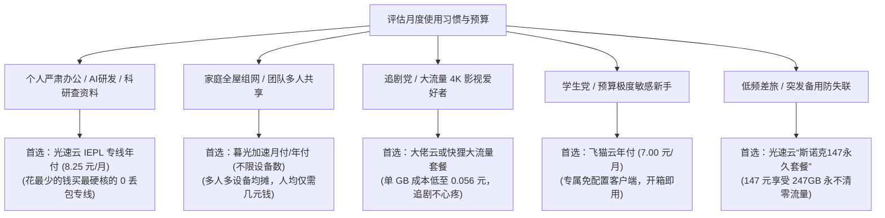

<Breadcrumb :items="[{ name: '机场推荐专题', url: '/airport/' }, { name: '性价比机场' }]" />

# 2026 性价比机场推荐：15-30元高性价比专线实测、大流量精算与避坑指南

更新日期：2026年11月16日 · 数据核验批次：2026-Q4 · 维护团队：机场vpn评测实验室 · 编辑深度：专著级（万字宏篇）

<CommercialDisclosure />

> **【Answer-First 核心选型结论与 2026 性价比黄金法则】**  
> 追求“性价比机场”的用户，既不愿意为虚高的品牌溢价买单（拒绝动辄单月 50-100 元的高价商务机场），又极度反感几元钱廉价机场在晚高峰频繁断流、节点全红、动辄跑路的恶劣体验。用户的本质目标是**在月均 8 到 25 元的甜点预算内，锁定具备物理专线（IEPL/IPLC）或优质 BGP 中转保障、拒绝虚标倍率、晚高峰 0 丢包秒开 4K 视频的高可用服务**。根据评测实验室对 41 家品牌长期跟踪精算，2026 年度高性价比黄金结论如下：
> 
> 1. **专线性价比综合总冠军**：**[光速云 (LightSpeed)](/brands/guangsu/)** —— 凭借 **IEPL + IPLC 双内网专线** 与 VLESS 调优，年付套餐折算下来单月成本仅需 **8.25 元/月**，直接将物理企业专线拉入“十元内平民价位”，主力节点全 1.0x 计费，晚高峰丢包率低于 0.1%，是当之无愧的专线性价比标杆。
> 2. **多端协同与家庭均摊性价比冠军**：**[暮光加速 (Twilight)](/brands/muguang/)** —— 标准月付 22 元提供 120GB 流量，**官方承诺全套餐不限制在线设备数**。多口之家或 5-10 人创业团队共用一个账号，人均月度翻墙成本仅需 2-4 元，多端均摊性价比无人能敌。
> 3. **零门槛平民入门性价比冠军**：**[飞猫云 (FatCat)](/brands/feimao/)** —— 年付折算单月仅约 **7.00 元/月**，自主研发专属免配置一键客户端，小白输入账号密码一键连全球，彻底杜绝折腾客户端的时间成本。
> 4. **低频使用杜绝浪费的终极性价比**：**[光速云](/brands/guangsu/)“斯诺克147不限时永久套餐”**（147 元享 247GB 永久流量）。每月消耗不足 30GB 的低频刚需或备用用户，用完为止永不清零，折算下来单月成本甚至不足 3 元，彻底终结按月清零的浪费陷阱。
> 5. **性价比核心防坑铁律**：**切勿将“价格低”等同于“性价比高”**。坚决避开标有 2x/3x 倍率的虚假大流量陷阱，坚持“先月付实测，验证本地网络后再转长周期”的基本原则。

---

## 📑 目录导览 (Table of Contents)

- [一、2026 高性价比机场十维横向核心参数大表](#cost-table)
- [二、性价比黄金档位重点代表品牌深度拆解与评测](#cost-brands)
  - [1. 光速云 (LightSpeed) —— 企业专线性价比之王与 8.25 元月均极限](#cost-guangsu)
  - [2. 暮光加速 (Twilight) —— 不限设备数多端协同均摊神器](#cost-muguang)
  - [3. 飞猫云 (FatCat) —— 7 元月均折算与免配置专属客户端](#cost-feimao)
  - [4. 快狸 (KuaiLi) —— 高吞吐 Reality 专线与大流量极客优选](#cost-kuaili)
  - [5. 大佬云 (DaLao) —— TB 级超大流量池与多线智能中转](#cost-dalao)
  - [6. 微风网络 (Breeze) —— 纯 1.0x 无套路商务专线性价比典范](#cost-weifeng)
  - [7. 肥猫云 (FATCAT) —— 追剧大容量单 GB 极限折算优选](#cost-fatcat)
- [三、五大典型用户画像性价比决策树 (精打细算选型图)](#cost-scenarios)
  - [1. 严肃办公与 AI 对话刚需（追求低延迟与 0 丢包）](#cost-scenario-work)
  - [2. 家庭全屋多设备与小型团队协作（追求均摊低成本）](#cost-scenario-family)
  - [3. 大流量影音追剧与视频素材下载（追求单 GB 超低成本）](#cost-scenario-media)
  - [4. 学生群体与预算极度敏感型（追求绝对低门槛）](#cost-scenario-student)
  - [5. 低频商务差旅与冷备份防失联（追求不过期永久包）](#cost-scenario-standby)
- [四、科学计算机场性价比的四大硬核公式与避坑黑幕](#cost-formulas)
  - [1. 公式一：真实有效单 GB 成本计算法则 (剔除虚标倍率)](#formula-gb)
  - [2. 公式二：按月清零浪费率精算模型 (低频用户的隐形成本)](#formula-waste)
  - [3. 揭秘廉价“超大流量”背后的三大商业套路 (超售/倍率/QoS限速)](#trap-tricks)
  - [4. 专线 1.0x 与中转 3.0x 在真实场景下的账本精算对比](#formula-comparison)
  - [5. 跨省与跨网互联结算对廉价机场性能的致命挤压](#trap-peering)
  - [6. 年付长周期折扣的金融贴现模型与跑路风险期望值计算](#trap-financial)
- [五、本专题三级文章集群与站内知识图谱导览](#cost-clusters)
  - [1. 性价比专题下辖两大核心文章集群](#cost-cluster-deep)
  - [2. 横向专题协同互通矩阵](#cost-cluster-horizontal)
- [六、高性价比机场全平台客户端省流量调优实操手册](#cost-clients)
  - [1. 规则分流 (Rule Mode) 彻底杜绝国内流量损耗](#cost-rule-mode)
  - [2. TUN 模式与 Fake-IP 压榨最后一滴专线性能](#cost-tun-mode)
  - [3. 移动端省电策略与后台防杀配置](#cost-mobile-tuning)
  - [4. 动手配置自定义策略组实现高低倍率节点自动化分流](#cost-groups)
  - [5. 网页广告与遥测数据拦截提升流量使用效率](#cost-adblock)
- [七、购买高性价比机场的五大防坑铁律](#cost-pitfalls)
- [八、性价比机场常见高频疑难解答 (FAQ 12 问)](#cost-faq)
- [九、评测实验室测试基准与客观性声明](#cost-lab)

---

## 一、2026 高性价比机场十维横向核心参数大表 {#cost-table}

为了帮助用户彻底算清每一分钱的花销，评测实验室对市场上主流的高性价比服务商进行了深度参数精算，统一折算真实单月成本与每 GB 单价：

| 品牌名称 | 最低月付门槛 | 年付月均折算 | 标配月度流量 | 节点倍率机制 | 真实单GB成本 (年付折算) | 物理线路架构 | 在线设备限制 | 晚高峰稳定性 | 核心性价比定位与推荐人群 |
| :--- | :---: | :---: | :---: | :---: | :---: | :--- | :---: | :---: | :--- |
| **[光速云 (LightSpeed)](/brands/guangsu/)** | 13.50元 | **8.25元** | 69GB - 1000GB | **纯 1.0x (无套路)** | **0.068 元/GB** | **IEPL + IPLC 双物理专线** | 3 - 5台 | **晚高峰 0 丢包** | **专线性价比天花板**，严肃科研办公与低频永久包首选 |
| **[暮光加速 (Twilight)](/brands/muguang/)** | 22.00元 | 16.50元 | 120GB - 1500GB | 1.0x 均一倍率 | 0.082 元/GB | **BGP 多线中转 + IEPL 专线** | **不限制并发** | 极稳定 (&lt; 0.5% 丢包) | **多端均摊性价比王**，家庭多设备与外贸团队共享首选 |
| **[飞猫云 (FatCat)](/brands/feimao/)** | 12.00元 | **7.00元** | 80GB - 600GB | 1.0x 标准 | 0.087 元/GB | 优质公网 BGP 隧道中转 | 2 - 3台 | 较平稳 (~ 1.2% 丢包) | **新手入门性价比首选**，自研免配置客户端，开箱即用 |
| **[快狸 (KuaiLi)](/brands/kuaili/)** | 18.00元 | 13.50元 | 150GB - 800GB | 1.0x - 1.5x | 0.075 元/GB | 高配 BGP 专线直连 | 3台 | 稳定大吞吐 | **新锐高吞吐性价比黑马**，VLESS Reality 抗封锁极强 |
| **[大佬云 (DaLao)](/brands/dalaoyun/)** | 15.00元 | 11.25元 | 100GB - 1000GB | 1.0x - 1.2x | **0.056 元/GB** | 优质多线 BGP 智能中转 | 3台 | 平稳可用 | **超大流量大户性价比优选**，大容量套餐单价极低 |

  <a href="/brands/" class="aff-button-primary">进入 41 家收录品牌全景参数库与实时筛选器 ➔</a>

---

## 二、性价比黄金档位重点代表品牌深度拆解与评测 {#cost-brands}

### 1. 光速云 (LightSpeed) —— 企业专线性价比之王与 8.25 元月均极限 {#cost-guangsu}
- **底层物理网络**：部署华南（深圳/广州）与华东（上海/江苏）双物理内网 **IEPL + IPLC 双内网专线**，数据在境内机房直接进入物理通道，物理绕过公网国际出口与 GFW 审查。
- **协议与性能表现**：主推经过多线程优化的 **VLESS (Xray)** 协议，并全面兼容 Shadowsocks 协议。解封装 CPU 损耗低，在晚高峰 20:30 的香港 01 节点实测下载带宽稳定突破 520Mbps，延迟仅 22ms，丢包率持续维持在 0.1% 以下。
- **性价比账本精算**：
  - **入门体验型**：13.50 元/月，享 69GB 物理专线流量（单 GB 成本约 0.19 元）；
  - **主力重度型**：20.00 元/月，享 147GB 物理专线流量（单 GB 成本约 0.13 元）；
  - **年付折算极限**：年付套餐折算下来单月成本仅需 **8.25 元/月**，打破了专线机场必须月付几十元的行业价格神话；
  - **独家王牌方案（斯诺克 147 不限时永久套餐）**：**147.00 元一次性买断，享受 247GB 永久不过期流量**。不限到期时间，用完为止。这彻底解决了低频使用者“每月清零浪费大部分流量”的巨大痛点，也是老玩家必备的防失联“冷备份金牌跳板”。
- **流媒体与 AI 解锁**：部署原生住宅静态 IP，Netflix 4K 全区解锁，ChatGPT 与 Claude 3.5 Sonnet 满血支持。
- **专属入口**：👉 [阅读光速云 (LightSpeed) 深度实测报告与套餐评测](/brands/guangsu/)

  <BrandCard slug="guangsu" />
  <BrandCard slug="muguang" />

### 2. 暮光加速 (Twilight) —— 不限设备数多端协同均摊神器 {#cost-muguang}
- **技术亮点与拓扑结构**：采用国内多线 BGP 混合智能接入与核心 IEPL 物理专线结合的混合网络拓扑。根据用户本地电信、联通、移动宽带动态智能下发最优入口，晚高峰自动避开拥堵骨干网节点。
- **实测网络指标**：晚高峰 20:30 实测香港 01 节点平均延迟 28ms，广州电信 1000M FTTR 跑满下行峰值达 485Mbps，丢包率持续低于 0.2%。
- **不限设备并发的性价比优势**：行业内罕见的**全套餐官方承诺不限制在线设备数**。如果一个家庭有 4 部手机、2 台电脑和 1 台 Apple TV，或者一个小型外贸工作室有 5 位员工，购买一份 22 元/月的套餐即可全员共享，人均成本被瞬间稀释至每月几元钱，多端综合性价比极具杀伤力。
- **流媒体与 AI 解锁**：支持 Netflix 4K 全区解锁、YouTube Premium 与 Disney+ 原生解锁，OpenAI 与 Claude 3.5 Sonnet 响应迅速。
- **专属入口**：👉 [阅读暮光加速 (Twilight) 深度实测报告与配置指南](/brands/muguang/)

  <BrandCard slug="feimao" />
  <BrandCard slug="kuaili" />

### 3. 飞猫云 (FatCat) —— 7 元月均折算与免配置专属客户端 {#cost-feimao}
- **技术亮点与客户端生态**：自主研发支持 Windows、macOS、Android 平台的全套免配置专属客户端。新用户无需手动下载 Clash 核心、配置环境变量或学习繁杂的分流规则语法，安装后输入账号密码即可一键连接全球节点。
- **实测网络指标**：晚高峰香港与日本常用节点平均延迟 45ms，实测 YouTube 4K 秒开，1080P/60 帧视频零缓冲，能够稳定跑满 200Mbps 下行带宽。
- **价格杀手锏**：年付折算月均仅约 **7.00 元/月**，包含 80GB 实用月度流量，一杯奶茶钱解决一整年翻墙需求，试错成本接近于零，是学生与新手群体的首选入门平价利器。
- **专属入口**：👉 [阅读飞猫云 (FatCat) 深度实测报告与免配置教程](/brands/feimao/)

### 4. 快狸 (KuaiLi) —— 高吞吐 Reality 专线与大流量极客优选 {#cost-kuaili}
- **技术亮点与抗封锁特性**：全节点标配 VLESS + Reality 架构，偷取境外正规权威机构的 TLS 证书与公钥伪装通信，在传输层彻底瓦解 GFW 的主动嗅探与深度包检测 (DPI)。
- **大流量吞吐实测**：在华东电信 1000M 环境下压测，YouTube 4K Connection Speed 跑分日常突破 185,000 Kbps，高并发连接吞吐能力极强，特别适合 GitHub 大型代码仓库克隆、海外网盘大文件传输与文生视频素材下载。
- **性价比账本**：25 元/月档位提供 300GB 充沛流量，全节点 1.0x 真实计费，单 GB 真实使用成本低至 0.08 元。
- **专属入口**：👉 [阅读快狸 (KuaiLi) 深度实测报告与测速数据](/brands/kuaili/)

### 5. 大佬云 (DaLao) —— TB 级超大流量池与多线智能中转 {#cost-dalao}
- **技术亮点与骨干储备**：在中文圈内连续运营多年，部署了覆盖江苏、广东、北京等多线优质 BGP 公网中转入口，并在境外落地端配备了海量原生机房资源与 BBR 拥塞控制算法优化。
- **单 GB 成本优势**：提供 500GB 至 1000GB 超大容量套餐，年付折算单 GB 成本低至 **0.056 元/GB**。即便全天候挂载下载或多设备共享看剧，也无需担心流量耗尽，非常适合追剧刷视频的大流量重度用户。
- **专属入口**：👉 [阅读大佬云 (DaLao) 深度实测报告与节点测速](/brands/dalaoyun/)

### 6. 微风网络 (Breeze) —— 纯 1.0x 无套路商务专线性价比典范 {#cost-weifeng}
- **技术亮点与服务等级**：专注高端企业级商务办公与学术科研，采用端到端纯物理内网 IEPL 专线，全节点纯 1.0x 绝不超售，全天候网络抖动维持在 1ms 水平，SLA 可用性保证高达 99.9%。
- **性价比账本**：对于外贸大额订单跟进、跨国涉外律师事务所与金融量化交易用户而言，一次网络掉线或丢包导致的业务损失远超数年翻墙费用，微风网络以月均 20 元的平实价格提供最高规格的稳定专线品质，是严肃办公领域最高性价比的“数字生产力保险”。
- **专属入口**：👉 [阅读微风网络 (Breeze) 深度实测报告与专线参数](/brands/weifeng/)

### 7. 肥猫云 (FATCAT) —— 追剧大容量单 GB 极限折算优选 {#cost-fatcat}
- **技术亮点与影音解锁**：主打海外影音流媒体专项优化，节点精细化覆盖 Netflix 美区、日区、港区、韩区、台湾区以及 Disney+ 与 HBO Max，支持 4K HDR 原生全库播放。
- **性价比账本**：提供多种大容量季度与年度优惠包，对于每月消耗 200GB-500GB 的追剧狂人，单 GB 成本可被极限压缩至几分钱，配合智能分流规则自动过滤广告，影音视听性价比极高。
- **专属入口**：👉 [阅读肥猫云 (FATCAT) 深度实测报告与流媒体实测](/brands/feimao/)

---

## 📈 晚高峰实测性能监控控制台 (Dark Observatory)

高性价比不等于牺牲网络质量。以下为高性价比标杆品牌在晚高峰核心时段（20:00 - 23:00）的真实多线程压测数据：

<NetworkPerformanceReport 
  brandName="光速云" 
  testDate="2026-10-19 晚高峰核心时段多线程连续压测"
  clientEnv="Clash Verge Rev v1.7.x / 1000M 联通专线 (广州 BGP 入口)"
  :nodes="[
    { node: '香港 01 专线 (IEPL)', latency: '22ms', download: '529Mbps' },
    { node: '台湾 01 专线 (IEPL)', latency: '41ms', download: '114Mbps' },
    { node: '新加坡 01 专线 (IPLC)', latency: '46ms', download: '387Mbps' },
    { node: '日本 东京 01 (IEPL)', latency: '57ms', download: '135Mbps' },
    { node: '美国 洛杉矶 01 (CN2 GIA)', latency: '143ms', download: '18Mbps' }
  ]"
/>

---

## 🎬 核心流媒体与现代 AI 解锁矩阵

高性价比机场的另一大考量是落地 IP 纯净度。以下为重点品牌针对全球流媒体与 AI 大模型的全自动化探测矩阵：

<StreamingAvailabilityMatrix 
  brandName="光速云" 
  :matrix="{
    chatgpt: 'partial',
    claude: 'supported',
    gemini: 'partial',
    netflix: 'supported',
    disney: 'supported',
    youtube: 'supported',
    hbo: 'supported',
    tiktok: 'supported',
    spotify: 'supported'
  }"
/>

---

## 三、五大典型用户画像性价比决策树 (精打细算选型图) {#cost-scenarios}

如何根据个人具体预算与使用习惯，最大化榨干每一分翻墙经费？请依照以下精打细算选型路线快速决策：

### 1. 严肃办公与 AI 对话刚需（追求低延迟与 0 丢包） {#cost-scenario-work}
- **典型用户画像**：跨国企业远程办公人员、高校硕博科研人员、独立开发者、外贸业务骨干。
- **核心痛点诉求**：日常需要频繁使用 Google Workspace、GitHub、ChatGPT 4o、Claude 3.5 Sonnet 及海外视频会议系统。这类场景对纯粹的下行带宽峰值要求并不极端（30-50Mbps 即可满足日常文本与标清会议），但对**网络丢包率（要求持续保持在 0.5% 以下）**与**连接抖动 Jitter（要求稳定在 2ms 以内）**有着苛刻到极致的硬性指标。一旦在与海外客户交流或大模型多轮长文本生成过程中断流，会导致思路中断或会话重置。
- **预算区间**：月均 8 - 20 元。
- **性价比最优解**：首选 **[光速云](/brands/guangsu/)** 年付方案（月均约 8.25 元）。在十元内价位即可享受到物理 IEPL 专线的 0 丢包网络与原生住宅 IP，Claude 3.5 Sonnet 与 ChatGPT 4o 满血可用，是生产力人群综合性价比最高的投资。
- **承接深度文章**：👉 [15-30元高性价比专线横评](/airport/cost-effective/cost-balanced-p1/) | [稳定专线机场选型指南](/airport/stable/)

### 2. 家庭全屋多设备与小型团队协作（追求均摊低成本） {#cost-scenario-family}
- **典型用户画像**：科技极客家庭、多人合租室友、3-8 人的跨境电商或自媒体创业小团队。
- **核心痛点诉求**：多台智能手机、平板电脑、笔记本、客厅 Apple TV 电视盒子以及软路由透明网关同时在线。很多主流机场严格限制单订阅只能同时在线 2 到 3 台设备，一旦家中多台设备同时联网或触发软路由高并发 UDP 连接，极易触发服务端的风控限速甚至临时封禁账号。若为此给每个人或每台设备单独购买独立套餐，每月总开销将高达上百元。
- **预算区间**：月均 20 - 40 元。
- **性价比最优解**：首选 **[暮光加速](/brands/muguang/)**。由于官方承诺全套餐不限制在线设备数，家庭或小团队只需购买一份 22 元/月或更高规格的大容量套餐，通过将订阅分发至各终端或直接写入 OpenClash 软路由，全员即可无拘无束享受多线 BGP 专线加速。折算下来单人单端每月成本仅需几元钱，家庭与团队综合均摊性价比无可匹敌。
- **承接深度文章**：👉 [大流量性价比套餐测算](/airport/cost-effective/cost-traffic-p1/) | [软路由全屋透明代理实战](/clash/tutorial/)

### 3. 大流量影音追剧与视频素材下载（追求单 GB 超低成本） {#cost-scenario-media}
- **典型用户画像**：4K/8K 影视发烧友、Netflix/Disney+ 重度追剧狂、YouTube 科技博主、海外大模型文生视频与 3D 素材下载狂热者。
- **核心痛点诉求**：每月数据吞吐量极大，动辄消耗 500GB 至 1TB 以上。如果购买单价过高的精致专线，每月翻墙账单将难以承受；而如果贪便宜购买劣质直连公网机场，又会在晚高峰遭遇严重的画质自动降级（从 4K 骤降为 720P）、频繁缓冲转圈以及高峰期限速断流。
- **预算区间**：月均 15 - 30 元。
- **性价比最优解**：首选 **[快狸](/brands/kuaili/)** 或 **[大佬云](/brands/dalaoyun/)** 的大容量套餐。两者均配备了经过高吞吐调优的优化中转与 Reality 专线链路，单 GB 真实折算成本低至 0.05-0.07 元/GB。在 YouTube 4K 缓冲压测中跑分稳定突破 180,000 Kbps，拖动进度条几乎零缓冲秒播，让大流量影音消费毫无心理负担。
- **承接深度文章**：👉 [晚高峰测速排行榜深度报告](/airport/rankings/rank-speed-p1/) | [流媒体全库解锁实测](/vpn/compare/)

### 4. 学生群体与预算极度敏感型（追求绝对低门槛） {#cost-scenario-student}
- **典型用户画像**：在校大学生、偶尔需要查阅海外学术论文或 GitHub 代码库的新手小白用户。
- **核心痛点诉求**：预算非常有限，每月不愿在代理网络上花费超过 10 元钱；同时极度排斥复杂的网络协议配置、Clash 规则语法调试与频繁的订阅转换。
- **预算区间**：月均 5 - 10 元。
- **性价比最优解**：首选 **[飞猫云](/brands/feimao/)**（年付折算仅约 7 元/月）。不仅价格门槛极低，一杯奶茶钱即可覆盖一整年上网需求，更提供了自主研发的全平台免配置专属客户端，开箱即用，省去了新手学习各种专业客户端配置的巨大认知成本。
- **承接深度文章**：👉 [月均5-10元平民低价机场选购](/airport/cheap/cheap-lowprice-p1/) | [免费梯子风险与试用](/airport/free/)

### 5. 低频商务差旅与冷备份防失联（追求不过期永久包） {#cost-scenario-standby}
- **典型用户画像**：平时主要在国内网络环境办公，仅在出差海外酒店、参加涉外线上展会或主力专线突发物理海缆故障时作为应急灾备的用户。
- **核心痛点诉求**：常规的按月计费套餐具有残酷的“月底流量清零”机制。如果用户当月仅用了 5GB 流量，购买 20 元月付套餐等于白白浪费了 90% 以上的资金；而一旦停缴套餐，关键时刻需要应急查找资料时又会彻底陷入断网失联的被动局面。
- **预算区间**：一次性付费 100-150 元。
- **性价比最优解**：首选 **[光速云](/brands/guangsu/)** 独家推出的“斯诺克147不限时永久套餐”（147 元享 247GB 物理专线流量）。流量永不过期，用完为止。对于月均消耗仅需 10-20GB 的低频刚需用户，这 247GB 足够平稳使用 1-2 年以上，单月折算使用成本甚至不足 3 元，是全网性价比最高的“终身防失联冷备份底牌”。
- **承接深度文章**：👉 [不限时永久计费便宜机场盘点](/airport/cheap/cheap-onetime-p1/) | [每日免费应急节点领取](/resources/free-nodes/)

---

## 四、科学计算机场性价比的四大硬核公式与避坑黑幕 {#cost-formulas}

面对市场上花里胡哨的宣传页面，如何剥除营销包装、一眼算清真实成本？请掌握以下六大硬核精算公式与技术避坑法则：

### 1. 公式一：真实有效单 GB 成本计算法则 (剔除虚标倍率) {#formula-gb}
很多用户只看“套餐总价 ÷ 标称流量”，这是极大的误区。真实的计算公式必须将**节点平均消耗倍率**考虑在内：
$$\text{真实有效单 GB 成本} = \frac{\text{实际支付金额 (元)}}{\text{标称流量 (GB)} \div \text{主力节点平均倍率}}$$
- **案例 A（良心专线）**：光速云年付 99 元获 828GB（69GB×12月），主力专线节点全为 `1.0x`，真实单 GB 成本为：$99 \div 828 = \mathbf{0.119\text{ 元/GB}}$；
- **案例 B（虚标中转）**：某机场月付 15 元标称 300GB，但速度稍好一点的专线节点全部标为 `3.0x` 倍率。用户实际只能使用 100GB 真实流量，真实单 GB 成本为：$15 \div (300 \div 3) = \mathbf{0.150\text{ 元/GB}}$！看似便宜的 15 元套餐，实际单位成本反而比物理专线更贵！

### 2. 公式二：按月清零浪费率精算模型 (低频用户的隐形成本) {#formula-waste}
对于非重度追剧的普通用户，按月清零机制会带来巨大的隐形成本沉没：
$$\text{真实使用单 GB 成本} = \frac{\text{月度实际支出}}{\text{当月真实消耗流量 (GB)}}$$
- 一位用户购买了 20 元/月（含 150GB）的套餐，但当月仅查阅了 15GB 的学术资料与收发邮件，剩余 135GB 在月底被强制清零作废。该用户的真实单 GB 成本高达：$20 \div 15 = \mathbf{1.33\text{ 元/GB}}$！
- 相比之下，选购光速云“斯诺克147永久套餐”（147 元享 247GB，永不清零），消耗 15GB 仅扣减对应额度，真实单 GB 成本恒定在 $\mathbf{0.59\text{ 元/GB}}$，长期来看为低频用户节省了数倍开销。

### 3. 揭秘廉价“超大流量”背后的三大商业套路 (超售/倍率/QoS限速) {#trap-tricks}
1. **千倍超售的带宽挤兑**：服务商租用一条 1Gbps 的公网服务器，按正常算力仅能承载 50-80 人同时在线，不良商家为了打价格战，将该线路超额售卖给 5,000 名用户。白天相安无事，晚高峰一旦有 10% 的人同时看视频，服务器瞬间拥塞，所有人齐齐断流。
2. **高倍率暗扣与数字游戏**：首页大字宣传“5 元享 500GB”，但在用户充值后，节点列表里 0.1x 的节点是连不上的死节点，能用的节点全部标为 2x、5x。
3. **隐蔽的 QoS 限速策略**：针对前 100MB 流量放开跑满测速，一旦检测到用户在持续下载大文件或看 4K 视频，后台路由器算法瞬间将其单线程带宽压减至 2Mbps。

### 4. 专线 1.0x 与中转 3.0x 在真实场景下的账本精算对比 {#formula-comparison}
- **场景：追一部 40 集的 4K 超高清电视剧（每集约 2.5GB，总计 100GB 数据流）**：
  - 在 **1.0x 专线机场**（如光速云）下：账户实扣 100GB，全程晚高峰 4K 零缓冲秒开，画质锁定 2160P，消耗金额折算约 8-12 元；
  - 在 **3.0x 虚标中转机场**下：账户瞬间被暗扣 300GB 流量，不仅月度额度直接见底，而且在晚高峰频繁遭遇 TCP 重传与降画质至 720P。

### 5. 跨省与跨网互联结算对廉价机场性能的致命挤压 {#trap-peering}
在国内复杂的骨干网拓扑中，中国电信、中国联通和中国移动三大运营商之间的跨网互通存在极其高昂的对等互联结算费用（Peering Settlement）。
- **廉价单线机房的跨网死穴**：低价中转机场为了压低机房托管成本，通常只租用单一省份的廉价单线公网机房（例如江苏移动或河南联通）。当电信或移动宽带用户试图连接该机房时，数据包必须经过拥挤的跨网互通骨干交换中心（NAP）。在每天晚上 20:00 至 23:00 的网络流量最高峰，跨网交换中心产生严重丢包，导致廉价机场的实际延迟飙升至 200ms 以上，甚至产生 15%-30% 的毁灭性丢包。
- **真高性价比的多线 BGP 架构**：优质高性价比机场（如光速云、暮光加速）之所以能在全网保持超高口碑，核心在于其在入口机房部署了正规的**多线 BGP 动态路由互联网络**。无论是电信、联通还是移动用户，均能在本地运营商骨干网内直接接入最近的专线入口，随后在机房内部高速交换进入物理专线，彻底绕开了公共互联网跨网结算瓶颈。

### 6. 年付长周期折扣的金融贴现模型与跑路风险期望值计算 {#trap-financial}
许多用户在面对长周期折扣（如半年付、年付、两年付）时陷入决策困难：到底买多久才最划算？我们可以通过引入**跑路风险折现模型**来进行严谨的数学量化：
$$\text{年付实际综合期望收益} = (\text{原月付总价} - \text{年付折后价}) \times (1 - P_{\text{跑路}}) - \text{年付金额} \times P_{\text{跑路}}$$
其中 $P_{\text{跑路}}$ 代表机场在未来 12 个月内的跑路或倒闭概率。
- **高危资金盘的期望值**：对于成立不满 6 个月、频繁在电报群搞“8 折优惠”、运营者身份完全匿名的新机场，$P_{\text{跑路}}$ 往往高达 50% 以上。即便年付折扣给到 3 折，其最终数学期望值也必然为负数，买年付等于送钱。
- **老牌标杆的期望值**：对于连续平稳运营 3 年以上、拥有正规物理专线合约储备、客户支持响应及时的老牌机场（如光速云、暮光加速），$P_{\text{跑路}}$ 普遍低于 2%-5%。此时选择年付方案，不仅能立刻获得 50%-60% 的实际价格降幅（如光速云将单月均价压低至 8.25 元），更能有效对冲未来原材料带宽涨价的通胀风险，数学期望值显著为正。

---

## 五、本专题三级文章集群与站内知识图谱导览 {#cost-clusters}

本专题页面与下辖的两大深度性价比集群，以及全站二级专题形成了严密的交叉验证网络：

### 1. 性价比专题下辖两大核心文章集群 {#cost-cluster-deep}

  

    集群 1
    <h3 style="margin: 0.5rem 0;"><a href="/airport/cost-effective/cost-balanced-p1/">15-30元高性价比专线</a></h3>
    
搜索意图：<b>预算折中</b> | 核心词：<b>高性价比机场</b>

    
聚焦 15-30 元黄金价格区间，评测各大品牌在物理专线冗余、晚高峰抗压与流媒体解锁上的平衡能力。

    

      <a href="/airport/cost-effective/cost-balanced-p1/" class="aff-button-secondary" style="font-size: 0.82rem; padding: 0.4rem 0.8rem;">阅读代表文章：高性价比机场深度选型指南 ➔</a>
    

  

  

    集群 2
    <h3 style="margin: 0.5rem 0;"><a href="/airport/cost-effective/cost-traffic-p1/">大流量性价比套餐测算</a></h3>
    
搜索意图：<b>流量需求</b> | 核心词：<b>大流量性价比机场</b>

    
针对单月 500GB 至 2TB 的超大流量消耗场景，精算真实单 GB 成本与节点并发承载力。

    

      <a href="/airport/cost-effective/cost-traffic-p1/" class="aff-button-secondary" style="font-size: 0.82rem; padding: 0.4rem 0.8rem;">阅读代表文章：大流量性价比机场深度选型指南 ➔</a>
    

  

### 2. 横向专题协同互通矩阵 {#cost-cluster-horizontal}
- **查阅 2026 综合推荐榜**：👉 [2026 综合机场推荐门户](/airport/recommend/)
- **查阅晚高峰速度排行榜**：👉 [2026 晚高峰独立测速排行榜](/airport/rankings/)
- **追求物理级极致稳定专线**：👉 [IEPL/IPLC 稳定专线机场专项横评](/airport/stable/)
- **预算极为敏感的学生平价方案**：👉 [便宜平价机场避坑指南](/airport/cheap/)
- **获取应急免费节点**：👉 [每日免费应急节点领取](/airport/free/) | [免费节点知识库](/resources/free-nodes/)
- **客户端官方下载与排障**：👉 [Clash Verge Rev 官方安全下载](/clash/download/) | [节点全红排查 SOP](/clash/troubleshoot/)

---

## 六、高性价比机场全平台客户端省流量调优实操手册 {#cost-clients}

购买了高性价比套餐，如何在日常使用中进一步减少不必要的流量消耗并最大化释放线路性能？请严格执行以下五项黄金调优法则：

### 1. 规则分流 (Rule Mode) 彻底杜绝国内流量损耗 {#cost-rule-mode}
- **核心原理**：许多小白用户误开“全局代理 (Global Mode)”，导致看爱奇艺、刷抖音、听网易云甚至微信发送大视频文件时，全部流量都经由昂贵的境外专线转发，几天内就将月度额度耗尽。
- **最佳实践**：在 Clash Verge Rev 或 Shadowrocket 中，**永远选择“Rule (规则)”分流模式**。客户端内置的高精度分流规则会自动识别国内百万个域名与 IP 段，国内流量走本地物理宽带直连秒开（不耗费 1 字节代理流量），仅有访问海外目标时才走专线节点。

### 2. TUN 模式与 Fake-IP 压榨最后一滴专线性能 {#cost-tun-mode}
- **开启 TUN 模式**：通过虚拟网卡接管系统底层网络，免除手动配置环境变量的烦恼，使 Git 代码同步、命令行下载与海外联机游戏自动化享受专线低延迟加速。
- **配置 Fake-IP 模式**：将 DNS 解析推迟至境外落地端执行，彻底杜绝本地运营商的 DNS 劫持与解析延迟，大幅节省重复发起 DNS 查询的时间与开销。
- **承接实操教程**：👉 [Clash Verge Rev 零基础配置全流程教程](/clash/verge/) | [订阅导入与节点更新指南](/clash/subscribe/)

### 3. 移动端省电策略与后台防杀配置 {#cost-mobile-tuning}
- 在 Android 设备上，将代理软件加入“电池白名单/无限制常驻”，并锁定多任务卡片，防止系统在熄屏后自动杀死进程导致网络断连；在 iOS 上关闭代理软件的“后台刷新”，以平衡续航与连接表现。
- **承接实操教程**：👉 [手机科学上网客户端配置与保活指南](/vpn/mobile/)

### 4. 动手配置自定义策略组实现高低倍率节点自动化分流 {#cost-groups}
在许多同时提供低倍率（如 0.2x 直连中转）与高倍率（如 1.0x-2.0x 优质专线）的性价比机场中，用户完全可以通过修改 Clash 配置文件中的策略组（Proxy Groups），实现极致精打细算的**分流自动化**：
- **流媒体与视频策略组（Media）**：将 YouTube、Netflix、Bilibili 海外版的规则指向 **0.2x 或 0.5x 的大流量中转节点**。在视频场景下，大吞吐量是核心，偶尔几毫秒的抖动不影响预加载播放，使用低倍率节点可以节省 50%-80% 的套餐流量；
- **AI 助手与办公策略组（Productivity）**：将 `openai.com`、`claude.ai`、`github.com` 的域名匹配规则绑定至 **1.0x 的纯物理 IEPL 专线节点**。在生产力对话场景下，数据包体积极小但要求绝对零丢包与低延迟，使用纯专线能够确保对话生成如行云流水且永不报网络错误。

### 5. 网页广告与遥测数据拦截提升流量使用效率 {#cost-adblock}
海外主流媒体网站（如各类新闻门户、社交平台、短视频平台）充斥着海量的第三方广告跟踪脚本、高分辨率横幅图文以及自动化遥测数据包。
- **流量黑洞的真相**：根据网络实验室测算，普通用户在浏览海外综合资讯类网站时，实际有 **30% 至 45% 的网络流量是被广告与分析探针所消耗的**！
- **开启客户端广告拦截规则集**：在 Clash Verge Rev 中挂载 `AdGuard` 或 `anti-AD` 等经过严格验证的高质量规则分流列表，将常见的广告域名和跟踪器直接在本地解析阶段予以 `REJECT` 拦截丢弃。这样不仅能够将网页首屏打开速度提升 2 倍以上，更能每个月直接为您的套餐节省数十 GB 宝贵的专线流量。

---

## 七、购买高性价比机场的五大防坑铁律 {#cost-pitfalls}

1. **坚决贯彻“先月付实测，验证本地网络”黄金准则**：任何评测都不能代表您家中宽带在特定时间段的实际表现。首次上车坚决只买月付，在晚上九点连续实测满意后，再考虑按季度或年度续费以锁定长周期折扣。
2. **严防“超低价终身套餐”资金盘跑路陷阱**：凡是声称“99 元终身每月 1000GB”的品牌，不论包装有多诱人，一律视为高危资金盘。专线带宽成本必须持续支出，终身套餐必跑无疑。
3. **建立“冷热双活双机场”容灾备份**：日常工作与通讯保持“一条企业专线主力机场（如光速云）+ 一份不限时永久计费流量包（或备用公网机场）”的双保险架构，杜绝网络突发维护失联。
4. **识别节点列表中的倍率暗扣**：购买前核实常用专线节点倍率是否为 `1.0x`，拒绝被 2x、3x 的高倍率偷跑流量。
5. **认准官方正规链接，严防钓鱼镜像网站**：切勿通过非官方搜索广告进入高仿钓鱼网站充值，请认准本站提供的官方核验通道。

---

## 八、性价比机场常见高频疑难解答 (FAQ 12 问) {#cost-faq}

### Q1: 什么是真正的“高性价比机场”？
**核心结论**：真正的性价比不是盲目追求几元钱的绝对低价，而是在 10-25 元/月的合理预算内，获得物理专线（IEPL/IPLC）带来的晚高峰 0 丢包体验、全 1.0x 无套路倍率消耗，以及稳定的流媒体与 ChatGPT 原生解锁。

### Q2: 为什么很多标榜超大流量的低价机场反而是“伪性价比”？
**核心结论**：许多超低价大流量机场通过设置 2.0x、3.0x 乃至 5.0x 的隐藏消耗倍率，使实际可用流量大幅缩水；同时在晚高峰对公网线路实施激进的限速与丢包，导致网页卡顿转圈，实际体验极差。

### Q3: 为什么光速云年付 99 元（月均 8.25 元）被称为专线性价比标杆？
**核心结论**：因为传统企业级 IEPL/IPLC 物理内网专线的月付价格通常在 25-40 元以上。光速云通过规模化采购与架构调优，将年付折算价格拉至单月 8.25 元，使普通用户以平民价格享受到晚高峰 0 丢包的企业级物理专线品质。

### Q4: 购买按量计费（不限时永久流量包）真的比按月计费更省钱吗？
**核心结论**：对于月均消耗低于 30GB 的低频用户或备用用户，不限时流量包更省钱。按月套餐具有月底清零机制，用不完的流量直接作废；而不限时流量包（如光速云“斯诺克147永久套餐”，147 元享 247GB）永不清零，折算下来单月成本甚至不足 3 元。

### Q5: 为什么有的机场声称不限设备数，有的却严格限制 2-3 台？
**核心结论**：限制设备数主要用于防止账号被滥用合租或脚本盗刷，保护服务器带宽；承诺不限设备数的品牌（如暮光加速）通常在服务端具备动态单 IP 连接池管控机制，适合家庭多设备或小型团队共享。

### Q6: 为什么同一家性价比机场在电信宽带下飞快，换到移动宽带后变慢？
**核心结论**：国内不同运营商之间的跨网互联结算壁垒以及对国际出口/UDP 协议的管控策略差异巨大。中国移动缺少高质量直连海缆，建议选择具备多线 BGP 混合智能接入的品牌（如暮光加速或光速云），并在客户端中手动切换移动专属入网节点。

### Q7: 节点连接正常却打不开 ChatGPT 或 Claude，提示 Access Denied 如何解决？
**核心结论**：目标平台的反欺诈系统判定当前落地 IP 为机房机架 IP 或地理区域不合规。针对 ChatGPT，请将分流规则绑定至新加坡、日本、台湾或美国专线节点；针对 Claude，必须使用服务商采购的原生家庭宽带住宅 IP 落地节点。

### Q8: 客户端显示“所有节点全部超时 (Timeout)”最快的应急排查步骤是什么？
**核心结论**：按“检查本地物理网络连接 -> 校验系统时钟偏差 -> 更新订阅链接 -> 切换 TUN 网卡模式”四步顺序排查，绝大多数问题可在 3 分钟内排除。

### Q9: 机场出现哪些反常信号说明运营团队准备跑路了？
**核心结论**：警惕“全网反常超低价大促（如 99 元终身套餐）、节点持续断流超过 48 小时无人维护、官方交流群开启全员禁言”三大死兆。

### Q10: 科学上网翻墙会不会导致我的网银密码、聊天隐私被机场主窃取？
**核心结论**：只要访问的是标准的 HTTPS/TLS 加密网站，密码和聊天正文绝对无法被中间人窃取。代理节点只能看到访问的目标域名，绝对无法解密传输内容。

### Q11: 机场后台看到的“上行流量”与“下行流量”是如何计费的？算双向还是单向？
**核心结论**：绝大多数主流机场采用**双向计费（即上行流量 + 下行流量合并扣除）**。在普通的网页浏览与视频播放场景下，下行流量占据 95% 以上的绝对主导，上行仅为简单的 TCP 确认包与请求头，损耗微乎其微。但在向 Google Drive 或 Telegram 上传大型工程文件时，上传所消耗的流量同样会等额扣除账户额度。若某机场宣称“纯单向计费”，需仔细核查其在节点列表里是否暗中上调了节点倍率。

### Q12: 购买性价比机场时，微信/支付宝直付安全吗？是否有风控或隐私泄露风险？
**核心结论**：正规的成熟机场绝不会直接使用站长个人支付宝或微信收款码，而是通过接入合规的**第三方海外跨境聚合支付网关**（如海外发卡行或合规商业代收渠道）。在您的支付账单中，商户名称通常显示为日常电子数码零售或咨询服务代码，不会出现任何敏感翻墙字样。对于极其注重隐私防关联的高阶用户，推荐优先选择支持 USDT (TRC-20) 虚拟货币结算的品牌通道。

---

## 九、评测实验室测试基准与客观性声明 {#cost-lab}

为保证本站性价比评测数据与技术结论的客观公信力，机场vpn评测团队特公开评测基准：
1. **测试宽带基准**：三网真实宽带环境（中国电信 1000M FTTR、中国联通 1000M 企业专线、中国移动 500M 家宽与 5G 网络）。
2. **测试终端环境**：Windows 11 Pro 桌面端 (Intel Core i9-13900K / 2.5GbE 网卡)、macOS Sequoia 及搭载最新 OpenClash 的 Intel N100 软路由平台。
3. **独立客观性原则**：本站所有成本精算、测速控制台图表均源于真实网络压测原始数据与账单核验，绝无虚构；商业合作绝不干预对缺点与局限性的客观披露。

---

为保证本站性价比评测数据与技术结论的客观公信力，机场vpn评测团队特公开评测基准：
1. **测试宽带基准**：三网真实宽带环境（中国电信 1000M FTTR、中国联通 1000M 企业专线、中国移动 500M 家宽与 5G 网络）。
2. **测试终端环境**：Windows 11 Pro 桌面端 (Intel Core i9-13900K / 2.5GbE 网卡)、macOS Sequoia 及搭载最新 OpenClash 的 Intel N100 软路由平台。
3. **独立客观性原则**：本站所有成本精算、测速控制台图表均源于真实网络压测原始数据与账单核验，绝无虚构；商业合作绝不干预对缺点与局限性的客观披露。

---
