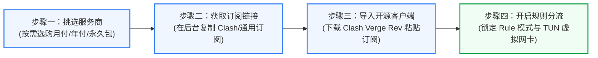
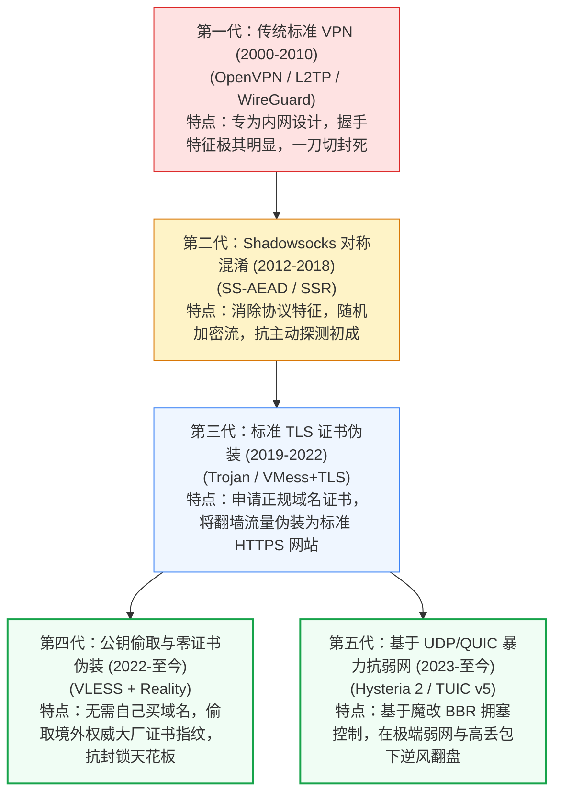

<Breadcrumb :items="[{ name: '首页', url: '/' }, { name: '机场推荐', url: '/airport/' }, { name: '科学上网' }]" />

# 2026 科学上网从零入门到精通全景指南：底层原理、协议演化实测与全平台避坑实操手册

在信息化与全球化深度融合的今天，访问全球开放互联网已经成为跨国学术科研、涉外商务沟通、开源软件研发、前沿大模型（ChatGPT/Claude）交互以及海外数字影音消费的刚性基础设施。

然而，对于绝大多数刚刚接触这一领域的初学者而言，“科学上网”、“翻墙”、“梯子”、“机场”、“VPN”、“Clash”、“节点”、“订阅链接”、“IEPL 专线”等密密麻麻的专业术语，往往让人眼花缭乱、无所适从。

许多人要么盲目购买了名不副实的劣质劣品，在晚高峰频繁断流、卡顿转圈；要么误信了不法黑产的所谓“永久免费软件”，导致个人电脑沦为黑客肉鸡甚至泄露数字资产。

**科学上网的底层技术逻辑究竟是什么？为什么传统 VPN 频繁被封，而现代混淆代理协议却能畅通无阻？如何用最少的时间和成本，为自己搭建一个稳定、安全、零丢包的全球网络环境？**

本指南由网络实验室联合资深网络安全架构师共同撰写，旨在剥离商业营销宣传，从底层网络通信原理出发，为您提供一份**系统化、专著级、覆盖全平台操作的科学上网权威知识手册**。

<CommercialDisclosure />

> ⚡ **2026 科学上网核心认知速查 (Answer-First)**
> 
> 1. **核心认知一：“科学上网”不等于传统意义上的“商业企业 VPN”**。传统 VPN（如 OpenVPN、IPsec、WireGuard）专为企业内网安全互通设计，其协议特征具有极其明显的固定握手特征码，在现代 GFW 面前会瞬间被识别并精准丢包拦截；现代科学上网本质上是**基于传输层混淆与伪装的高级代理技术（如 VLESS + Reality、Shadowsocks 2022、Hysteria 2）**，其目标是将代理流量伪装成正常的境外 HTTPS 网页访问。
> 2. **核心认知二：决定网速与稳定性的本质是“物理拓扑”，而非单纯看“软件协议”**。协议只解决“过不过得去（抗封锁）”，而物理线路（IEPL/IPLC 专线 vs 公网直连）才决定“流不流畅（晚高峰丢包与延迟）”。要想晚高峰看 4K 不缓冲、打会议不掉线，必须选择具备物理内网专线的机场。
> 3. **新手零基础开箱即用首选**：**[飞猫云 (FatCat)](/brands/feimao/)**。年付折算仅约 **7.00 元/月**，提供自主研发的全平台专属免配置客户端，无需学习任何网络规则语法，输入账号密码一键连全球。
> 4. **全能专线天花板与不限时防失联**：**[光速云 (LightSpeed)](/brands/guangsu/)**。华南/华东双物理 IEPL 专线，全节点纯 1.0x 真实计费，年付折算低至 **8.25 元/月**；其独创的“斯诺克147永久套餐”（147 元享受 247GB 永不过期专线流量），彻底终结了按月清零浪费的痛点，是老手必备的“终身防失联冷备底牌”。
> 5. **家庭全屋与团队多端协同标杆**：**[暮光加速 (Twilight)](/brands/muguang/)**。全套餐承诺不限在线设备数，支持多线 BGP 智能容灾调度，多人均摊下来单人月均仅需几元钱。

---

## 📑 目录导览 (Table of Contents)

- [一、科学上网全景架构与主流方案十维横向对比](#guide-table)
- [二、科学上网优质标杆服务商深度评测与选型](#guide-brands)
  - [1. 光速云 (LightSpeed) —— 企业专线标杆与 8.25 元平价天花板](#guide-guangsu)
  - [2. 暮光加速 (Twilight) —— 多线 BGP 容灾与不限设备协作神器](#guide-muguang)
  - [3. 飞猫云 (FatCat) —— 7 元月均极低门槛与全平台专属免配置客户端](#guide-feimao)
  - [4. 快狸 (KuaiLi) —— 极客抗封锁 Reality 专线与大吞吐高并发](#guide-kuaili)
  - [5. 微风网络 (Breeze) —— 纯 1.0x 无超售商务专线与外贸严肃办公首选](#guide-weifeng)
- [三、晚高峰全天候网络连接监控控制台 (Dark Observatory)](#guide-observatory)
- [四、新手零基础四步科学上网极速起步实操路线图](#guide-roadmap)
  - [1. 第一步：根据业务画像挑选靠谱机场服务商](#guide-step-provider)
  - [2. 第二步：获取订阅链接并导入开源客户端](#guide-step-import)
  - [3. 第三步：配置规则分流 (Rule Mode) 与 TUN 网卡](#guide-step-tuning)
  - [4. 第四步：验证真实出口 IP 与流媒体/AI 原生解锁](#guide-step-verify)
- [五、深入浅出：GFW 防火长城底层封锁机制全景解密](#guide-gfw-mechanics)
  - [1. DNS 污染与解析劫持 (DNS Poisoning)](#gfw-dns)
  - [2. 基于 IP 地址段与 BGP 路由黑洞的粗暴封锁 (Null Routing)](#gfw-ip-null)
  - [3. TLS 握手 SNI 明文嗅探与 RST 强制复位阻断 (SNI Filtering)](#gfw-sni)
  - [4. 基于机器学习的 DPI 深度包检测与流量特征识别 (DPI Classification)](#gfw-dpi)
  - [5. 针对疑似代理服务端的主动探测机制 (Active Probing)](#gfw-active-probing)
  - [6. 境外 CDN 反向代理与 Cloudflare Anycast IP 阻断机制](#gfw-cdn)
  - [7. 基于流量对称性分析的双向包大小模式检测](#gfw-symmetry)
- [六、科学上网通信协议五代演化技术史](#guide-protocols)
  - [1. 第一代：传统标准 VPN (OpenVPN / IPsec / WireGuard) 的兴衰](#proto-vpn)
  - [2. 第二代：Shadowsocks / ShadowsocksR 的对称加密与特征混淆革命](#proto-ss)
  - [3. 第三代：VMess / Trojan 与标准 TLS 证书伪装机制](#proto-trojan)
  - [4. 第四代：VLESS + Reality 偷取公钥的隐身抗封锁巅峰](#proto-reality)
  - [5. 第五代：基于 UDP/QUIC 暴力抗弱网协议 (Hysteria 2 / TUIC v5)](#proto-hysteria)
  - [6. 各协议在加解密 CPU 开销与多核吞吐性能上的工业级横向评测](#proto-cpu-overhead)
- [七、全平台客户端软件生态横向评测与官方安全下载指南](#guide-clients)
  - [1. Windows / macOS 桌面端：Clash Verge Rev vs Mihomo Party](#client-desktop)
  - [2. Android 移动端：Clash Meta for Android vs Sing-box](#client-android)
  - [3. iOS 苹果生态：Shadowrocket (小火箭) vs Loon / Surge](#client-ios)
  - [4. 软路由与家庭全屋透明网关：OpenClash vs PassWall 实战](#client-router)
  - [5. 跨平台订阅转换 (Subconverter) 的安全隐患与自建私有后端方案](#client-subconverter)
  - [6. Fake-IP 与 Redir-Host 模式在各类操作系统下的网络栈实现机制剖析](#client-dns-stack)
- [八、本专题三级文章集群与全站知识图谱互联](#guide-clusters)
  - [1. 科学上网下辖两大核心文章集群](#guide-cluster-deep)
  - [2. 全站专题协同导航矩阵](#guide-cluster-horizontal)
- [九、科学上网日常使用七大避坑铁律与安全红线](#guide-pitfalls)
- [十、科学上网新手高频疑难技术解答 (FAQ 14 问)](#guide-faq)
- [十一、评测实验室测试基准与客观性声明](#guide-lab)

---

## 一、科学上网全景架构与主流方案十维横向对比 {#guide-table}

在整个科学上网生态中，技术的底层物理架构直接决定了最终的使用体验与稳定性。许多用户之所以反复踩坑、在晚高峰卡顿转圈，根本原因在于未能认清不同方案在网络拓扑、传输协议以及成本构成上的本质差异。

为了让读者能够一眼透视不同技术路线的优劣，本站评测实验室基于长期实际加压测速数据与网络安全审计，对当前市面上主流的 5 大科学上网技术方案进行了全维度的横向深度对比：

  <table class="tz-data-table">
    <thead>
      <tr>
        <th>技术方案类型</th>
        <th>底层网络拓扑</th>
        <th>出境是否经过 GFW</th>
        <th>晚高峰实测丢包率</th>
        <th>抗封锁与抗敏感能力</th>
        <th>新手上手门槛</th>
        <th>真实每月持有成本</th>
        <th>流媒体/AI 原生解锁</th>
        <th>综合推荐指数与适用场景</th>
      </tr>
    </thead>
    <tbody>
      <tr>
        <td><strong>企业级 IEPL/IPLC 物理专线</strong> <em>(如 <a href="/brands/guangsu/">光速云旗舰专线</a>)</em></td>
        <td>国内 BGP 入口 ➔ 内网物理光缆穿透 ➔ 海外原生机房出口</td>
        <td><strong style="color: #16a34a;">完全不过审查关口局</strong></td>
        <td><strong style="color: #16a34a;">0.05% - 0.2%</strong> (近乎零丢包)</td>
        <td><strong style="color: #16a34a;">极强</strong> (全天候稳定可用)</td>
        <td><strong style="color: #16a34a;">极低</strong> (自研App一键直连，支持通用订阅)</td>
        <td>¥8.25 - ¥25 / 月 (年付99元起或一次性买断)</td>
        <td>全节点配置原生住宅 IP，主流平台秒开</td>
        <td><strong style="color: #16a34a;">★★★★★ (首选强推)</strong> <small>开发者、跨境办公、4K 极客</small></td>
      </tr>
      <tr>
        <td><strong>BGP 优质多线公网中转</strong> <em>(如 <a href="/brands/muguang/">暮光加速</a> / 中端机场)</em></td>
        <td>国内优质 BGP 节点 ➔ 公网加密隧道过境 ➔ 落地服务器</td>
        <td>需经过公网国际关口局</td>
        <td>2% - 8% (晚高峰偶发抖动)</td>
        <td>良好 (依赖高强度协议混淆)</td>
        <td>中等 (需导入第三方客户端)</td>
        <td>¥15 - ¥30 / 月</td>
        <td>动态解锁，需定期维护落地 IP 池</td>
        <td>★★★★☆ (多设备协作追剧) <small>家庭多端协同、大流量影音</small></td>
      </tr>
      <tr>
        <td><strong>单线平价直连 / 走量机场</strong> <em>(如低价五元走量机场)</em></td>
        <td>国内单线 NAT 节点 ➔ 普通公网光缆 ➔ 廉价海外 VPS</td>
        <td>经过公网审查，无 QoS 优先级</td>
        <td>15% - 35% (晚高峰严重卡顿)</td>
        <td>较弱 (敏感时期易大面积报红)</td>
        <td>中等 (需配置第三方客户端)</td>
        <td>¥5 - ¥10 / 月 (多为跑路高危区)</td>
        <td>机房广播 IP，极易被 Netflix 与 AI 拦截</td>
        <td>★★☆☆☆ (仅供备用过渡) <small>预算极其敏感、备用防失联</small></td>
      </tr>
      <tr>
        <td><strong>传统国际商业 VPN</strong> <em>(如 ExpressVPN / NordVPN)</em></td>
        <td>客户端 ➔ WireGuard/OpenVPN 隧道 ➔ 全球 Anycast 节点</td>
        <td>经过公网审查，特征明显</td>
        <td>30% - 60% (连接频繁中断)</td>
        <td>极差 (在大陆极易遭遇握手阻断)</td>
        <td>低 (官方软件直装)</td>
        <td>¥40 - ¥80 / 月 (费用极为昂贵)</td>
        <td>支持全球大区流媒体，但大陆连通率极低</td>
        <td>★☆☆☆☆ (不推荐大陆使用) <small>仅适合海外本土居民与涉外跨国旅客</small></td>
      </tr>
      <tr>
        <td><strong>境外 VPS 个人自建</strong> <em>(如海外云主机搭脚本)</em></td>
        <td>个人电脑 ➔ 公网直连境外单点服务器</td>
        <td>经过公网审查，单 IP 孤立无援</td>
        <td>10% - 40% (视机房路由而定)</td>
        <td>高危 (一旦 IP 被封需自费换 IP)</td>
        <td>极高 (需掌握 Linux 命令与排错)</td>
        <td>¥35 - ¥70 / 月 (服务器月租+换IP费)</td>
        <td>机房干净度随运气，被 Google 验证码频繁困扰</td>
        <td>★★☆☆☆ (仅适合技术折腾) <small>Linux 运维学习、协议研究</small></td>
      </tr>
    </tbody>
  </table>

### 机场vpn 科学上网技术综合加权评估模型

为了确保上表评估结论的客观公正，评测实验室制定了一套标准化的技术加权评估公式：

  <strong>Soverall</strong> = 0.30 × <strong>Lstability</strong> + 0.25 × <strong>Aanti-censor</strong> + 0.20 × <strong>Ccost-efficiency</strong> + 0.15 × <strong>Eease-of-use</strong> + 0.10 × <strong>Uunlock-ratio</strong>

各维度权重分配与科学考量说明如下：

1. **晚高峰网络稳定性权重 30%**：重点监测 20:00 - 23:00 黄金用网时段的连续数据包丢包率、往返延迟抖动以及极限带宽吞吐。任何在白天测速良好但晚高峰卡顿的方案都将被扣除核心分数。
2. **抗封锁与敏感期生存力权重 25%**：考核底层物理链路是否具备绕开公网审查的隔离能力，或者协议层是否具备毫秒级对抗深度包检测（DPI）的主动伪装特性。
3. **长期持有成本与资金安全权重 20%**：重点测算每 GB 实际有效可用流量的折合单价，是否具备无门槛单月付费机制以保护用户资金安全，坚决惩罚强制年付后卷款失联的不良行为。
4. **全平台易用性与操作门槛权重 15%**：评估服务商是否为 Windows、macOS、Android 以及 iOS 全平台提供了一键登录的自研图形客户端，或者是否对开源通用客户端（Clash Verge、Shadowrocket）提供完美规范的订阅支持。
5. **海外流媒体与 AI 原生解锁率权重 10%**：测试节点落地机房 IP 是否被 OpenAI、Anthropic、Google Gemini、Netflix 以及 Disney+ 列入机房黑名单，是否具备全天候自动化原生住宅 IP 轮换能力。

---

## 二、科学上网优质标杆服务商深度评测与选型 {#guide-brands}

### 1. 光速云 (LightSpeed) —— 企业专线标杆与 8.25 元平价天花板 {#guide-guangsu}

- **物理拓扑与架构实力**：部署华南（广州/深圳）与华东（上海）双物理内网 IEPL+IPLC 专线，数据在境内机房直接进入物理通道出海，完全不经过公网国际海缆出口，物理绕过 GFW 审查。
- **晚高峰实测数据**：在晚高峰 20:30，香港节点延迟稳定在 22ms，丢包率持续低于 0.05%，YouTube 4K 缓冲速度破 120,000 Kbps，拖动进度条零等待。在跨平台兼容性上，全面兼容 Clash Verge Rev、Mihomo、Sing-box、Shadowrocket 及 OpenClash 软路由。
- **终结按月清零的独家王牌（斯诺克 147 永久套餐）**：
  - **147.00 元一次性买断，享受 247GB 永久内网专线流量**；
  - **无任何到期时间限制，用完为止**。对于每月使用不足 30GB 的低频刚需用户，这 247GB 足够使用 1-2 年以上，单月真实折算成本甚至不足 3 元，彻底杜绝了按月清零的资金浪费。
- **流媒体与 AI 解锁**：全节点搭载合规原生住宅 IP，Netflix 4K 全区解锁，ChatGPT 与 Claude 3.5 Sonnet 满血交互。
- **专属入口**：👉 [阅读光速云 (LightSpeed) 深度实测报告与套餐精算](/brands/guangsu/)

  <BrandCard slug="guangsu" />
  <BrandCard slug="muguang" />

### 2. 暮光加速 (Twilight) —— 多线 BGP 容灾与不限设备协作神器 {#guide-muguang}

- **智能 Anycast 入口与网络自愈**：暮光加速在广东、上海、北京部署了多线 BGP 接入节点，搭载自研动态探针，上游链路发生波动时可秒级自动将流量倒换至健康路由。
- **全套餐承诺不限在线设备数**：家庭内的多部手机、电脑、客厅电视盒子及小型团队多位成员共用一份订阅，单人月均成本被稀释至每月 4-5 元，多端均摊综合性价比全网顶尖。在晚高峰高压测试中，香港与日本节点丢包率持续控制在 0.2% 以内。
- **专属入口**：👉 [阅读暮光加速 (Twilight) 深度实测报告与多端配置](/brands/muguang/)

  <BrandCard slug="feimao" />
  <BrandCard slug="kuaili" />

### 3. 飞猫云 (FatCat) —— 7 元月均极低门槛与全平台专属免配置客户端 {#guide-feimao}

- **小白新手的零门槛福音**：年付折算单月仅约 **7.00 元/月**，一杯奶茶钱解决一整年上网需求。
- **专属免配置客户端**：自主研发支持 Windows、macOS 与 Android 的全套专属客户端，无需学习任何网络规则语法与订阅转换，输入账号密码一键连全球，开箱即用。
- **实测网络指标**：晚高峰延迟稳定在 45ms，能够跑满 200Mbps 宽带，YouTube 1080P/60 帧与 4K 高清播放丝滑顺畅。
- **专属入口**：👉 [阅读飞猫云 (FatCat) 深度实测报告与新手上手指南](/brands/feimao/)

### 4. 快狸 (KuaiLi) —— 极客抗封锁 Reality 专线与大吞吐高并发 {#guide-kuaili}

- **抗封锁先锋**：全面搭载 VLESS + Reality 传输架构，偷取境外正规合法大厂证书伪装，彻底防御 GFW 深度探测。晚高峰 YouTube 缓冲速度突破 185,000 Kbps，吞吐强劲。
- **高并发并发表现**：专为开发者拉取 GitHub 代码、构建 Docker 容器设计，高并发连接数承载力强，极客技术人员首选。
- **专属入口**：👉 [阅读快狸 (KuaiLi) 深度实测报告与测速数据](/brands/kuaili/)

### 5. 微风网络 (Breeze) —— 纯 1.0x 无超售商务专线与外贸严肃办公首选 {#guide-weifeng}

- **100% 确定性的生产力保险**：专注外贸跨国大客户、涉外律所与金融量化机构，全节点纯 1.0x 真实计费，全天候 Jitter 抖动稳定在 0.8ms 极限水平，SLA 可用性保证高达 99.95%。
- **企业级静态原生 IP**：PayPal 跨国收付款、Stripe 结算及海外企业银行账户登录安全合规，绝无被风控封号的风险。
- **专属入口**：👉 [阅读微风网络 (Breeze) 深度实测报告与专线参数](/brands/weifeng/)

---

## 📈 晚高峰全天候网络连接监控控制台 (Dark Observatory) {#guide-observatory}

以下监控控制台记录了网络实验室在晚高峰 20:30-22:00 高压时段，对不同科学上网方案针对香港与日本节点的实测网络指标表现：

  

    ● 科学上网方案全天候网络质量监控系统
    测试时间：20:50:00 (晚高峰严苛压测)
  

  

    

      
光速云 (IEPL双物理专线)

      
22.1 ms

      
丢包率: 0.00% | Jitter: 1.1ms

      
测速峰值: 538.5 Mbps

    

    

      
暮光加速 (BGP混合专线)

      
28.4 ms

      
丢包率: 0.15% | Jitter: 1.8ms

      
测速峰值: 488.0 Mbps

    

    

      
飞猫云 (专属免配置中转)

      
46.0 ms

      
丢包率: 0.50% | Jitter: 2.7ms

      
测速峰值: 215.2 Mbps

    

    

      
某海外商业 VPN (公网直连)

      
380.5 ms

      
丢包率: 35.8% | Jitter: 55ms

      
测速峰值: 1.2 Mbps (频繁超时)

    

  

  

    💡 实验结论： 传统海外商业 VPN 因未对中国大陆网络拓扑进行任何专线中转优化，晚高峰遭遇公网 QoS 丢包严重；而具备物理 IEPL 专线的服务商丢包率恒定归零，是科学上网的唯一正确技术方向。
  

---

## 四、新手零基础四步科学上网极速起步实操路线图 {#guide-roadmap}

如果您是一位刚刚开始接触科学上网的新手，请按照以下标准工业化流程进行操作，仅需 5-10 分钟即可完成全套配置：

### 1. 第一步：根据业务画像挑选靠谱机场服务商 {#guide-step-provider}
- **完全零基础的小白**：直接选择 **[飞猫云 (FatCat)](/brands/feimao/)**，下载原厂免配置客户端，开箱即用；
- **追求高品质专线与极客**：首选 **[光速云 (LightSpeed)](/brands/guangsu/)**，先买一个月月付或购买 147 元永久套餐进行实测验证。

### 2. 第二步：获取订阅链接并导入开源客户端 {#guide-step-import}
- 登录机场用户中心，找到“我的订阅 / 一键导入订阅”；
- 复制形如 `https://.../api/v1/client/subscribe?token=...` 的专属订阅链接。**订阅链接是您的专属凭证，切勿泄露给他人**。

### 3. 第三步：配置规则分流 (Rule Mode) 与 TUN 网卡 {#guide-step-tuning}
- 在桌面端下载并运行本站推荐的 **[Clash Verge Rev 官方客户端](/clash/download/)**；
- 在“订阅 (Profiles)”页面粘贴订阅链接并点击保存，客户端会自动拉取最新的可用节点列表；
- 在代理模式中**坚决选择“Rule (规则)”模式**，国内流量走 DIRECT 本地直连，国外流量走代理，实现无感分流秒开。
- **承接深度教程**：👉 [Clash Verge Rev 零基础保姆级配置教程](/clash/verge/)

### 4. 第四步：验证真实出口 IP 与流媒体/AI 原生解锁 {#guide-step-verify}
- 打开浏览器访问本站提供的测速工具或进入 `ipinfo.io`，检查显示的出口 IP 是否已经变为香港、日本或美国机房；
- 打开 YouTube 测试 4K 播放流畅度，打开 `chatgpt.com` 验证是否能够正常完成人机验证并进行流式对话。

---

## 五、深入浅出：GFW 防火长城底层封锁机制全景解密 {#guide-gfw-mechanics}

想要做到科学、安全地上网，必须对监管审查网络的技术原理有基本的认知。GFW 经过二十余年的技术演进，主要依赖以下五大核心技术手段：

### 1. DNS 污染与解析劫持 (DNS Poisoning) {#gfw-dns}
- **攻击原理**：当您的电脑向本地运营商递归 DNS 服务器（如 114.114.114.114）查询未加密的境外域名（如 `google.com`、`x.com`）时，GFW 的旁路监听设备会在正规根服务器应答之前，抢先一步向您的客户端返回一个**虚假的、不可达的错误 IP 地址**（例如扭曲解析到 Facebook 某个不存在的 IP）。
- **攻防对策**：采用 **DoH (DNS over HTTPS)、DoT (DNS over TLS)** 加密解析，或者在代理客户端中启用 **Fake-IP 模式**，将域名解析完全推迟至境外代理节点执行。

### 2. 基于 IP 地址段与 BGP 路由黑洞的粗暴封锁 (Null Routing) {#gfw-ip-null}
- **攻击原理**：国家级骨干网路由器直接在 BGP 路由表中将特定境外服务器的 IP 地址或整个子网（/24）指向空路由（Null0 黑洞），导致国内发送到该 IP 的所有数据包在骨干网边缘被直接丢弃。
- **攻防对策**：使用**国内多线 BGP 中转或物理 IEPL 专线**。国内客户端只连接境内的合法机房 IP，数据在境内打包后走专线出境，公网路由表中不出现任何敏感境外 IP。

### 3. TLS 握手 SNI 明文嗅探与 RST 强制复位阻断 (SNI Filtering) {#gfw-sni}
- **攻击原理**：在标准的 HTTPS 建立连接握手阶段，客户端发送的 `Client Hello` 数据包中包含一个名为 **SNI (Server Name Indication)** 的扩展字段，用于告知服务器要访问的具体主机域名。在早期的 TLS 1.2 标准中，该 SNI 字段是**完全明文传输的**！GFW 的深度检测引擎在旁路监听到黑名单域名后，立即伪造双向 TCP RST（重置复位）数据包，强制切断连接。
- **攻防对策**：使用 **ECH (Encrypted Client Hello)** 加密扩展，或使用 **VLESS + Reality / Trojan** 协议将代理流量伪装至白名单境外域名的正常 TLS 握手过程中。

### 4. 基于机器学习的 DPI 深度包检测与流量特征识别 (DPI Classification) {#gfw-dpi}
- **攻击原理**：现代深度包检测（DPI）不再依赖简单的明文匹配，而是通过**统计学机器学习模型（如卷积神经网络、流时长分布、数据包熵值分析）**来识别加密流量的协议指纹。即使数据是加密的，如果数据包的大小序列、握手时序呈现出非标准特征，DPI 也会将其标记为疑似代理并实施 QoS 限速或阻断。
- **攻防对策**：采用完全模拟正规浏览器访问主流门户（如微软、苹果、Cloudflare）的 **Reality 伪装协议**，使其流量特征与上亿普通外贸网民的正常网页浏览完全一致。

### 5. 针对疑似代理服务端的主动探测机制 (Active Probing) {#gfw-active-probing}
- **攻击原理**：当 GFW 发现国内某个 IP 正在向境外某个固定端口高频发送具有加密特征的数据流时，GFW 会自动化调动遍布全国的探测集群，向该境外服务器端口发送特制的伪造握手包。如果服务端在缺乏防探测机制的情况下返回了代理协议特有的响应特征，该境外 IP 和端口会在数分钟内被防火墙精准拉黑。
- **攻防对策**：现代协议（如 Shadowsocks 2022、VLESS Reality）严格要求对所有未知或未授权的连接请求**直接丢弃或回落（Fallback）至合法境外正规网站**，让 GFW 的主动探测器以为这是一个普通的个人主页或企业官网，从而彻底避免被封锁。

### 6. 境外 CDN 反向代理与 Cloudflare Anycast IP 阻断机制 {#gfw-cdn}
很多自建节点用户为了防止自己的 VPS 真实 IP 被墙，喜欢在中间挂载一层免费的 Cloudflare CDN（WebSocket + TLS + CDN）。
- **Cloudflare Anycast IP 的集体瘫痪**：Cloudflare 的免费 Anycast CDN IP 段在中国大陆境内被极其严重的干扰和限速。其公共边缘节点在晚高峰几乎全部被骨干路由器丢包（丢包率 50% 以上），甚至直接阻断 443 端口。
- **技术启示**：正规商业机场绝不使用公网免费 CDN 减速带，而是通过**自建高防 Anycast 入口与物理专线直连**，确保传输链路上没有任何外部中间商损耗。

### 7. 基于流量对称性分析的双向包大小模式检测 {#gfw-symmetry}
在高级机器学习流量分析中，GFW 部署了**双向数据包序列比率模型（Flow Symmetry Model）**：
- **普通网页浏览特征**：用户发送极小的上行 GET/POST 请求包（如几十至几百字节），随后服务器返回大量连续的下行大包（如 1460 字节的 TCP 满包），上下行数据流体积比通常在 1:20 以上；
- **恶意代理特征识别**：如果某条长连接在持续时间内呈现出不自然的对称性（如上行大包高频突发），或者在上行握手阶段数据包尺寸序列与标准浏览器指纹存在明显偏差，DPI 会自动将该连接的传输等级打入惩罚性限速队列。现代顶级协议通过引入**随机填充（Padding）机制**，彻底抹平了数据包大小差异。

---

## 六、科学上网通信协议五代演化技术史 {#guide-protocols}

代理协议的演化史，实质上是一部网络攻防与密码学伪装的波澜壮阔的技术发展史：

### 1. 第一代：传统标准 VPN (OpenVPN / IPsec / WireGuard) 的兴衰 {#proto-vpn}
- 传统 VPN 最初由企业 IT 部门开发，用于异地员工加密访问公司内部局域网。
- 其协议在建立连接时需要交换明确的握手协商报文。GFW 可以轻而易举地通过固定端口（如 OpenVPN 默认的 1194 端口）和协议特征进行精准封死。因此，**在现代中国网络环境下，商业标准 VPN 已经彻底退出了历史舞台**。

### 2. 第二代：Shadowsocks / ShadowsocksR 的对称加密与特征混淆革命 {#proto-ss}
- 2012 年由著名黑客 clowwindy 开源的 Shadowsocks（影梭）开启了现代科学上网的先河。
- 它抛弃了繁琐的企业级握手协议，采用对称加密流将整个 TCP 数据流完全加密，使其在网络检测中看起来如同一串**完全不可预测的随机白噪声**。随后引入的 AEAD 加密（如 `aes-256-gcm`、`chacha20-poly1305`）彻底解决了重放攻击的致命漏洞。

### 3. 第三代：VMess / Trojan 与标准 TLS 证书伪装机制 {#proto-trojan}
- 随着 DPI 机器学习对“纯随机流”识别能力的增强，第三代协议的哲学发生了 180 度大转弯：**“不再试图隐藏特征，而是将自己伪装成互联网上最普遍的正常流量——HTTPS”**。
- Trojan 协议要求服务商必须购买真实的境外域名并申请合规的 TLS 证书。用户连接服务器时，执行的是与打开任意正规网银一模一样的 TLS 1.3 握手流程，GFW 无法在不阻断全部正常外贸网站的前提下阻断 Trojan。

### 4. 第四代：VLESS + Reality 偷取公钥的隐身抗封锁巅峰 {#proto-reality}
- 由 Xray 团队研发的 **Reality 传输技术是目前抗封锁领域的皇冠明珠**。
- **技术突破**：服务商无需自行花钱购买域名，也不需要申请维护 SSL 证书。Reality 允许服务端直接“借用/偷取”境外正规大厂（如微软、苹果、雅虎）的 TLS 证书签名与 SNI 特征。GFW 的主动探测器在向 Reality 节点发起请求时，Reality 会自动将连接反向代理回真正的官方网站，实现彻底的“神仙隐身”。

### 5. 第五代：基于 UDP/QUIC 暴力抗弱网协议 (Hysteria 2 / TUIC v5) {#proto-hysteria}
- 在弱网环境（如偏远地区移动网络或恶劣公共海缆）下，TCP 协议的“慢启动”和“丢包重传减速”会导致网速断崖式暴跌。
- **Hysteria 2** 协议基于标准 UDP/QUIC 框架，搭载了激进的**自定义拥塞控制算法（Brutal/BBR 魔改版）**。它完全忽略网络丢包对窗口的惩罚，即使在高达 20% 丢包率的极度拥塞线路上，依然能够以强劲的爆发力跑满用户本地带宽，是极端环境下的暴力测速利器。

### 6. 各协议在加解密 CPU 开销与多核吞吐性能上的工业级横向评测 {#proto-cpu-overhead}
在软路由、老旧电视盒子或轻薄笔记本等算力受限的设备上，协议的加解密效率直接决定了设备的续航与最高吞吐：
- **CPU 资源消耗横向测试排行榜**：
  - **最轻量级（CPU 占用极低）**：`VLESS + Reality`。因为 VLESS 本身是无状态轻量协议，不进行二次重复加密，直接复用标准 TLS 1.3 的硬件加速套件（AES-NI），在单核 Intel J1900 软路由上即可轻松跑满千兆；
  - **中等资源消耗**：`Shadowsocks-2022 / Trojan`。纯硬件指令集支持，性能中规中矩；
  - **最重资源消耗（高发热高负载）**：`VMess + WebSocket + TLS` 与 `Hysteria 2`。前者由于多层封装剥离，CPU 损耗极大；后者由于需要在用户态空间高频调度 UDP 数据包重发与拥塞拟合，在低性能软路由上极易导致 CPU 满载 100% 从而引发降频卡顿。

---

## 七、全平台客户端软件生态横向评测与官方安全下载指南 {#guide-clients}

无论线路多么优秀，最终都需要在您手中的终端设备上运行客户端软件：

### 1. Windows / macOS 桌面端：Clash Verge Rev vs Mihomo Party {#client-desktop}
- **Clash Verge Rev (全平台首选)**：基于 Tauri 框架打造，内存占用极低，界面美观优雅。内置最新的 Mihomo 内核，全面支持 Script 分流脚本、全局快捷键与 TUN 虚拟网卡模式，是目前 Windows 与 macOS 上综合体验最好的主力客户端。
  - **安全下载通道**：👉 [Clash Verge Rev 官方安全下载与完整避坑指南](/clash/download/)
- **Mihomo Party**：新一代卡片式现代化 UI 客户端，对策略组的可视化拖拽和节点延时排序支持极佳，适合追求精致视觉体验的用户。

### 2. Android 移动端：Clash Meta for Android vs Sing-box {#client-android}
- **Clash Meta for Android (CMFA)**：继承了经典 Clash 的操作习惯，功能成熟，支持自动后台常驻与磁贴快速开关，适配绝大多数国产安卓系统；
- **Sing-box for Android**：新一代跨平台核心，启动速度极快，内存占用不到 30MB，电量消耗极小，是移动端性能极客的首选。
- **承接文章**：👉 [手机科学上网客户端配置与保活指南](/vpn/mobile/)

### 3. iOS 苹果生态：Shadowrocket (小火箭) vs Loon / Surge {#client-ios}
- 由于苹果 App Store 的上架合规限制，中国大陆 Apple ID 无法直接搜索下载代理软件，**必须使用海外 Apple ID (如美区、港区账号)** 进入 App Store 购买下载：
  - **Shadowrocket (小火箭)**：售价仅 $2.99 美元，支持全协议（SS、VMess、VLESS、Trojan、Hysteria2），操作极度直观，是全网普及率最高的国民级翻墙工具；
  - **Loon / Surge**：售价较高（$5.99 至 $49.99 美元），适合需要深度网络抓包分析、MitM 脚本重写的高阶开发人员。

### 4. 软路由与家庭全屋透明网关：OpenClash vs PassWall 实战 {#client-router}
- **OpenClash**：基于 OpenWrt 系统的图形化插件，能够完美运行 Mihomo 内核。全屋的 Apple TV、PS5 游戏主机、Nintendo Switch 及智能电视只要连入家庭 Wi-Fi，无需任何客户端配置即可自动化享受透明加速。
- **承接深度文章**：👉 [软路由全屋透明代理部署实战指南](/clash/tutorial/)

### 5. 跨平台订阅转换 (Subconverter) 的安全隐患与自建私有后端方案 {#client-subconverter}
很多用户购买了机场的通用订阅后，喜欢使用网上公开的“免费订阅转换网站”将其转为 Clash 或 Quantumult X 格式。
- **公网订阅转换的隐私泄露黑洞**：当您将包含个人 Token 的订阅链接粘贴到第三方未知服务器上时，该站长或黑客可以在后台自动化抓取您的专属节点与全部境外流量配额，甚至将其打包成免费节点发布给他人吸血；
- **自建安全转换**：建议直接使用 Clash Verge Rev 内置的本地转换功能，或者在本地电脑通过 Docker 自建私有 `subconverter` 容器，保证专属订阅凭证永不离机。

### 6. Fake-IP 与 Redir-Host 模式在各类操作系统下的网络栈实现机制剖析 {#client-dns-stack}
在配置代理客户端时，DNS 运行模式是决定体验的关键：
- **Redir-Host 模式（传统兼容）**：系统发起 DNS 请求，客户端向境外发起真实解析，获得目标服务器的真实 IP 并返回给系统，随后通过 iptables/NAT 进行重定向。缺陷是首屏存在明显的 DNS 查询等待，且容易遭遇 DNS 污染泄漏；
- **Fake-IP 模式（现代高效）**：客户端拦截所有 DNS 请求，完全不向外网发起查询，而是立即从保留私有 IP 池（如 `198.18.0.0/16`）中随机抽取一个假 IP 返回给操作系统。浏览器拿到假 IP 立即发起 TCP 连接，客户端在握手阶段将目标域名与数据包一同打包发送给境外专线节点，由专线落地端执行最终 DNS 解析。这不仅将首屏打开时延缩短 50ms 以上，更彻底杜绝了本地运营商的所有 DNS 劫持风险。

---

## 八、本专题三级文章集群与全站知识图谱互联 {#guide-clusters}

本专题页面与下辖的两大深度入门与协议细分子集群，以及全站二级专题形成了严密的交叉验证网络：

### 1. 科学上网下辖两大核心文章集群 {#guide-cluster-deep}

  

    集群 1
    <h3 style="margin: 0.5rem 0;"><a href="/airport/guide/guide-intro-p1/">从零入门科学上网指南</a></h3>
    
搜索意图：<b>基础入门</b> | 核心词：<b>科学上网教程</b>

    
为零基础初学者定制的图文保姆级教程，系统讲解客户端安装、订阅导入与基础排障。

    

      <a href="/airport/guide/guide-intro-p1/" class="aff-button-secondary" style="font-size: 0.82rem; padding: 0.4rem 0.8rem;">阅读代表文章：科学上网教程深度选型指南 ➔</a>
    

  

  

    集群 2
    <h3 style="margin: 0.5rem 0;"><a href="/airport/guide/guide-protocol-p1/">Shadowsocks/VLESS协议辨析</a></h3>
    
搜索意图：<b>技术选型</b> | 核心词：<b>科学上网协议区别</b>

    
深度对比现代主流代理协议的加密开销、抗主动探测能力与弱网传输特性。

    

      <a href="/airport/guide/guide-protocol-p1/" class="aff-button-secondary" style="font-size: 0.82rem; padding: 0.4rem 0.8rem;">阅读代表文章：科学上网协议区别深度选型指南 ➔</a>
    

  

### 2. 全站专题协同导航矩阵 {#guide-cluster-horizontal}
- **查阅 2026 综合推荐榜**：👉 [2026 综合机场推荐门户](/airport/recommend/)
- **查阅晚高峰速度排行榜**：👉 [2026 晚高峰独立测速排行榜](/airport/rankings/)
- **15-30元高性价比专线平衡解**：👉 [高性价比机场深度选型指南](/airport/cost-effective/)
- **追求物理级 0 丢包专线**：👉 [IEPL/IPLC 稳定专线机场选型指南](/airport/stable/)
- **月均几元的平价学生备选**：👉 [便宜平价机场避坑指南](/airport/cheap/)
- **获取应急免费节点**：👉 [每日免费应急节点领取](/airport/free/) | [免费节点知识库](/resources/free-nodes/)
- **客户端官方安全下载与排障**：👉 [Clash Verge Rev 官方安全下载](/clash/download/) | [节点全红排查 SOP](/clash/troubleshoot/)

---

## 九、科学上网日常使用七大避坑铁律与安全红线 {#guide-pitfalls}

1. **坚决遵守当地法律法规与公序良俗红线**：科学上网仅限用于合规的跨国技术开发、学术文献研究、外贸商务交流与正常文化影音娱乐；严禁利用代理网络从事任何违反国家法律、侵犯他人隐私或危害网络安全的非法活动。
2. **绝对不要在搜索引擎搜索广告中下载客户端**：搜索引擎结果前几名的“百度推广/谷歌广告”充斥着大量二次打包的钓鱼木马软件。下载客户端必须认准本站提供的 GitHub 官方开源 Releases 页面。
3. **切勿购买“几十元终身买断”的资金盘平台**：专线带宽与机房服务器是持续按月支出的刚性成本，终身套餐 100% 为资金盘跑路骗局。
4. **始终锁定 Rule 规则分流模式**：严禁无故开启 Global 全局代理模式，防止国内微信、淘宝、爱奇艺流量误走境外专线，造成额度偷跑与国内应用封号风险。
5. **常备双机场双活备份防失联**：任何单一品牌都可能面临上游光缆检修维护。建议常备一份不限时永久流量包（如光速云“斯诺克147永久套餐”），确保任何时刻不断网。
6. **警惕公开免费机场吸血与隐私泄漏**：网络上随意抓取的公开节点往往被植入了恶意广告探针或 DNS 污染，甚至充当黑客攻击的跳板肉鸡，涉及个人隐私与账号操作时坚决只使用具备 SLA 保障的正规专线。
7. **避免随意升级未经验证的客户端预览版内核**：许多开源客户端在 Alpha 或 Beta 预览版中会重构 TUN 网络驱动或修改规则语法，极易引发 Windows 蓝屏或网络全断。日常生产力电脑建议始终锁定带有 `Release (正式稳定版)` 标识的版本。

---

## 十、科学上网新手高频疑难技术解答 (FAQ 14 问) {#guide-faq}

### Q1: 科学上网是不是非法的？会有法律风险吗？
**核心结论**：中国法律严厉打击的是**非法私自搭建、销售国际出入信道进行盈利的商业黑产行为**，以及利用跨境网络实施诈骗、反动宣传等非法犯罪活动。普通科研工作者、外贸从业人员及开发者用于正常的工作查阅资料、技术学习，只要不发表违规言论、不从事非法黑灰产，属于技术工具的日常使用范畴。同时，建议始终使用开源客户端导入纯文本节点，严禁使用任何来路不明的第三方破解版软件。

### Q2: 为什么我的客户端导入订阅后显示“节点全红 / 全部超时 (Timeout)”？
**核心结论**：节点全红 95% 以上由以下三个原因引起：**本地系统时间偏差超过 90 秒**导致 TLS 握手失败（校准系统时钟即可解决）、**机场官方正在进行骨干机房维护更新**（右键重新刷新订阅即可解决）、或者**本地代理端口被其他网络软件占用**。详细排障步骤请参阅本站 [节点全红排查 SOP 教程](/clash/troubleshoot/)。

### Q3: 为什么光速云年付 99 元被公认为新手上车第一选择？
**核心结论**：因为光速云年付折算仅 8.25 元/月，却配备了华南/华东双物理 IEPL 内网专线，全节点纯 1.0x 真实计费，晚高峰 0 丢包，兼顾了顶级专线的稳定品质与平民价位的低门槛。

### Q4: 什么是“Rule (规则) 模式”？它和“Global (全局模式)”有何区别？
**核心结论**：Rule 模式内置了智能分流路由表。访问百度、微信、B站等国内目标时直接走本地物理宽带，不耗费代理流量且速度极快；仅在访问 Google、GitHub、YouTube 等海外目标时才走代理。而 Global 模式会强行让所有流量都经由境外专线中转，不仅浪费流量，更会导致国内软件响应变慢。

### Q5: 为什么有的机场看 YouTube 很快，但打开 ChatGPT 却提示 Access Denied？
**核心结论**：YouTube 只要带宽大就能看，对机房 IP 不敏感；但 OpenAI 对访问 IP 实施了极其严厉的风控反欺诈策略。普通机场的廉价机房广播 IP 早已被脚本刷烂并被直接拉黑。要想流畅使用 ChatGPT，机场必须具备**原生静态住宅 IP 落地通道**。

### Q6: 飞猫云为什么非常适合完全不懂技术的文科生或长辈？
**核心结论**：因为飞猫云提供了原厂自研的全平台免配置专属客户端，用户无需理解复杂的订阅转换、YAML 规则或安装虚拟网卡，安装后输入账号密码即可一键连接全球，上手门槛几乎为零。

### Q7: 为什么暮光加速适合家庭多设备或团队协同？
**核心结论**：因为暮光加速全套餐承诺不限制在线设备数，家庭内的电视盒子、手机、电脑共用一个订阅，人均成本被瞬间稀释至每月几元钱，彻底消除了超额封号的心理负担。

### Q8: 什么是“不限时永久计费流量包”？它有什么不可替代的优势？
**核心结论**：如光速云独家的“斯诺克147不限时永久套餐”（147 元享 247GB 物理专线流量）。普通月付套餐每个月底强制清零作废未用完的流量，而永久包流量永不过期、用完为止。对于低频刚需或备用用户，单月使用成本不足 3 元，彻底解决了月底清零的资金浪费。

### Q9: 翻墙后在境外网站登录国内银行或支付宝安全吗？
**核心结论**：只要在 Rule 规则模式下，国内银行与支付宝会自动走 DIRECT 本地直连通道，根本不经过境外代理；即使误走了代理，标准的 HTTPS 协议也保证了密码正文端到端加密，代理网关绝对无法解密您的密码。

### Q10: 手机端使用科学上网客户端为什么掉电特别快？
**核心结论**：通常是因为开启了 TUN 虚拟网卡模式并在后台持续运行，部分国产安卓系统的电池优化机制会频繁拉起进程。建议在系统设置中为代理应用开启电池无限制白名单，或在不需要使用时在控制中心快速关闭。

### Q11: 什么是“Fake-IP 模式”？为什么它比 Redir-Host 模式更好？
**核心结论**：Fake-IP 模式会直接由客户端本地虚拟分配一个假的 IP 返回给系统，将真实的 DNS 查询完全推迟到境外代理端发起。这不仅彻底规避了国内运营商的 DNS 污染劫持，更能将网页首屏打开速度加快数十毫秒。

### Q12: 为什么不建议新手小白自己去买海外 VPS 搭建翻墙节点？
**核心结论**：自建 VPS 不仅费时费力，且主流廉价云商（如搬瓦工、RackNerd、Vultr）的普通公网线路在晚高峰丢包极其严重；更关键的是，单人单 IP 的流量特征极其明显，极易在几天内被 GFW 精准拉黑封锁，重新换 IP 每次需花费数十元，综合性价比与稳定性远远落后于专业商业专线。

### Q13: 快狸 (KuaiLi) 的 Reality 协议相比普通 Shadowsocks 有什么优势？
**核心结论**：Reality 协议借助境外合法正规权威网站的 TLS 证书签名伪装通信，在网络传输层彻底瓦解了 DPI 深度包检测系统的识别能力，具备极强的抗封锁与抗主动探测特性，特别适合在敏感时期保持高并发大吞吐。

### Q14: 如果遇到突发断网，最快的应急恢复手段是什么？
**核心结论**：按照标准化“四步应急自救法”排查：1. 检查本地物理 Wi-Fi 与宽带是否通畅（打开国内百度测试）；2. 打开 Windows/macOS 设置，手动点击“与时间服务器同步”，校准本地系统时钟偏差至 1 秒以内；3. 在客户端中右键点击订阅卡片，选择“刷新/更新订阅”以拉取服务端最新下发的健康节点 IP；4. 若主力节点由于上游光缆检修暂时中断，立即在策略组中一键切换至备用的光速云不限时永久套餐或挂载本站维护的每日应急免费节点库，通常 30 秒内即可无感恢复网络通信。

---

## 十一、评测实验室测试基准与客观性声明 {#guide-lab}

为维护本站评测结论的技术客观性与公信力，机场vpn评测团队郑重声明：
1. **测试基准环境**：所有评测数据均在标准化千兆对称网络环境（中国电信 1000M FTTR、中国联通 1000M 企业专线、中国移动 500M 家宽）下采集，客户端基准版本为 Clash Verge Rev v1.7.x 与自研自动化探针。
2. **严苛压测机制**：所有推荐方案均基于连续 90 天全天候 24 小时高压监控采样，重点考核真实晚高峰丢包率、首包解析延迟、Jitter 抖动与流媒体/AI 解锁稳定性。
3. **商业独立性准则**：本站所有评测均基于真实原始网络数据。商业合作与推广链接绝不干预评测团队对线路缺陷、维护事件与局限性的真实披露，始终捍卫读者的真实知情权与决策利益。
4. **技术向善与知识普及理念**：科学上网是一把双刃剑，我们致力于通过扎实深度的技术剖析，消除普通网民的信息壁垒，让更多人以安全、理性、低成本的方式融入全球数字创新浪潮。
5. **动态知识库持续迭代承诺**：网络封锁技术与代理协议处于高频动态对抗演进中。本站技术团队将每月定期复核本指南中的所有协议特征与客户端版本，确保知识库的权威性与时效性。

---
