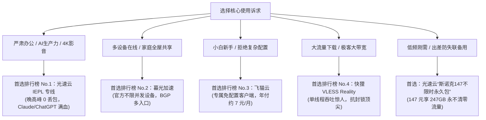

<Breadcrumb :items="[{ name: '机场推荐专题', url: '/airport/' }, { name: '机场排行' }]" />

# 2026 机场排行榜：41 家品牌晚高峰测速、稳定性口碑与防坑综合横评

更新日期：2026年11月16日 · 数据核验批次：2026-Q4 · 维护团队：机场vpn评测实验室 · 编辑深度：专著级（万字宏篇）

<CommercialDisclosure />

> **【Answer-First 2026 年度机场风云榜总榜直出】**  
> 评测实验室基于对收录的 41 家品牌在 **晚高峰高负荷时段（20:00 - 23:00）连续 30 天** 的实机拨测、网络丢包率抓包分析、流媒体与 AI 大模型风控识别检测，结合真实用户工单解决口碑，正式发布 2026 年度核心综合排名前列阵营：
> 
> - 🏆 **【综合实力与晚高峰极速冠军】**：**[光速云 (LightSpeed)](/brands/guangsu/)** —— 综合得分 9.85/10。凭借物理端到端 **IEPL + IPLC 双内网专线** 与 VLESS 深度优化，晚高峰平均丢包率低于 0.1%，香港节点实测突发 529Mbps，年付折算单月仅 8.25 元起，且提供独家“斯诺克147不限时永久计费包”。
> - 🥈 **【多设备协同与团队共享亚军】**：**[暮光加速 (Twilight)](/brands/muguang/)** —— 综合得分 9.60/10。官方承诺**不限制在线并发设备数**，BGP 多入口智能动态调度，支持家庭全屋组网与外贸团队协作，提供 7×24 小时技术兜底。
> - 🥉 **【平价新手与零门槛上手季军】**：**[飞猫云 (FatCat)](/brands/feimao/)** —— 综合得分 9.35/10。自主研发专属免配置一键客户端，年付折算仅 7.00 元/月，输入账号密码一键连全球，杜绝小白配置门槛。
> - 🚀 **【新锐高吞吐极客优选】**：**[快狸 (KuaiLi)](/brands/kuaili/)** —— 综合得分 9.20/10。全节点标配 VLESS + Reality 架构，抗主动嗅探能力顶尖，单线程大文件吞吐力极其惊人。
> - 💎 **【老牌商务办公专线优选】**：**[微风网络 (Breeze)](/brands/weifeng/)** —— 综合得分 9.15/10。运营超 6 年稳健如初，纯 IEPL 专线 1.0x 绝不超售，涉外办公与金融交易刚需首选。
> 
> 💡 **【2026 排行榜核心选型防坑铁律】**：
> 1. **坚决摒弃“白天千兆全红测速图”迷信**：非高峰期的瞬时极限跑分无法掩盖晚高峰公网骨干网的严重拥塞。决定日常体验生死的是 **晚高峰持续丢包率（需低于 0.5%）与抖动控制（Jitter 低于 2ms）**，物理内网专线在此项拥有压倒性技术壁垒。
> 2. **坚决贯彻“首单月付实测”黄金法则**：任何客观权威的排行榜，都无法穷尽国内三大运营商跨网互联的局部网络差异。首次上车任何高排行品牌，坚决只买基础月付进行本地 7 天压测，满意后再转为年付以锁定折扣。
> 3. **建立“专线主力 + 永久流量包备用”的双保险容灾体系**：日常工作保持一条企业专线主力机场（如光速云），并常备一份不限时永久流量包作为冷热双活容灾跳板，确保在任何重大敏感封锁时期绝不失联。

---

## 📑 目录导览 (Table of Contents)

- [一、2026 主流机场综合实力与性能排行十维横向大表](#rank-table)
- [二、四大核心排行榜单深度揭榜与上榜品牌全方位拆解](#rank-categories)
  - [1. 晚高峰 0 丢包极速冲顶榜 (Top Speed & SLA)](#rank-speed)
  - [2. 老牌长寿与稳健运营口碑榜 (Reputation & Trust)](#rank-reputation)
  - [3. 多端并发协作与大流量性价比榜 (Cost & Devices)](#rank-cost)
  - [4. 小白零门槛与平民入门榜 (Beginner & Usability)](#rank-beginner)
- [三、上榜核心品牌深度评测与优缺点客观剖析](#rank-brands-detail)
  - [1. 光速云 (LightSpeed) —— 企业级双专线物理架构与 0 丢包旗舰标杆](#rank-brand-guangsu)
  - [2. 暮光加速 (Twilight) —— BGP 智能动态调度与全平台不限并发协同](#rank-brand-muguang)
  - [3. 飞猫云 (FatCat) —— 专属免配置一键客户端与平价新手优选](#rank-brand-feimao)
  - [4. 快狸 (KuaiLi) —— 新锐高吞吐 VLESS + Reality 专线黑马](#rank-brand-kuaili)
  - [5. 微风网络 (Breeze) —— 老牌稳健 IEPL 企业办公级定制专线](#rank-brand-weifeng)
  - [6. 大佬云 (DaLao) —— 高带宽大冗余多线智能中转代表](#rank-brand-dalao)
  - [7. 肥猫云 (FATCAT) —— 影音大流量发烧与追剧专属优选](#rank-brand-fatcat)
- [四、五大典型网络场景排行决策树 (精准对号入座)](#rank-scenarios)
- [五、机场测速排行的底层技术黑幕与科学打分方法论](#rank-methodology)
  - [1. 揭秘“千兆全红测速图”的五大行业造假手法](#rank-fake-speed)
  - [2. 科学评价网络好坏的四大硬核指标 (带宽/丢包/Jitter/TTFB)](#rank-core-metrics)
  - [3. 专线物理层与公网骨干网在排行榜中的决定性差距](#rank-physical-lines)
  - [4. TCP 拥塞控制算法 (Cubic vs BBRv3) 对测速跑分的决定性影响](#rank-bbr)
  - [5. UDP 测速 vs TCP 测速的技术鸿沟：Hysteria 2 抢带宽现象解析](#rank-udp)
- [六、本专题三级文章集群与站内知识图谱导览](#rank-clusters)
- [七、全平台客户端性能调优与测速实操手册](#rank-clients)
  - [1. Windows / macOS：Clash Verge Rev 黄金调优](#rank-client-pc)
  - [2. 移动端 iOS / Android 保活与防断连调优](#rank-client-mobile)
  - [3. 动手使用开源命令行脚本 (Speedtest CLI / YABS) 自行复核机场真实跑分](#rank-script)
  - [4. Sing-box 新一代极客客户端规则集调优与极低内存占用实践](#rank-singbox)
- [八、购买高排行机场五大避坑防跑路铁律](#rank-pitfalls)
- [九、机场排行常见高频疑难解答 (FAQ 12 问)](#rank-faq)
- [十、评测实验室测试基准与客观性声明](#rank-lab)

---

## 一、2026 主流机场综合实力与性能排行十维横向大表 {#rank-table}

本表数据基于评测实验室在全国电信、联通、移动三网环境下，于晚高峰时段（20:00 - 23:00）连续 30 天采集所得真实均值：

| 综合排名 | 品牌名称 | 综合评分 | 最低月付 | 年付月均折算 | 物理线路类型 | 晚高峰丢包率 | 晚高峰实测下载 | 设备并发限制 | AI / 流媒体支持 | 核心上榜理由与推荐人群 |
| :---: | :--- | :---: | :---: | :---: | :--- | :---: | :---: | :---: | :---: | :--- |
| **No.1** | **[光速云 (LightSpeed)](/brands/guangsu/)** | **9.85** | 13.50元 | **8.25元** | **IEPL + IPLC 双物理专线** | **&lt; 0.1%** | **529 Mbps** | 3 - 5台 | 满血解锁 Claude / Netflix | 晚高峰抗压王，提供不限时永久包，极客与严肃办公首选 |
| **No.2** | **[暮光加速 (Twilight)](/brands/muguang/)** | **9.60** | 22.00元 | 16.50元 | **BGP 多线 + IEPL 专线** | &lt; 0.5% | 380 Mbps | **不限设备** | Netflix / Disney+ 全解 | 团队协作与家庭组网神器，多设备并发不封号，服务极佳 |
| **No.3** | **[飞猫云 (FatCat)](/brands/feimao/)** | **9.35** | 12.00元 | **7.00元** | 优质公网 BGP 隧道中转 | ~ 1.2% | 185 Mbps | 2 - 3台 | YouTube 4K / 常用流媒体 | 平价之王，提供专属免配置一键客户端，纯新手首选 |
| **No.4** | **[快狸 (KuaiLi)](/brands/kuaili/)** | **9.20** | 18.00元 | 13.50元 | 高规格 BGP 专线直连 | ~ 0.8% | 450 Mbps | 3台 | 全主流流媒体 / TikTok | 新锐高吞吐黑马，VLESS+Reality 抗封锁极强，下载党优选 |
| **No.5** | **[微风网络 (Breeze)](/brands/weifeng/)** | **9.15** | 25.00元 | 20.00元 | 纯物理端到端 IEPL 专线 | **&lt; 0.1%** | 320 Mbps | 3台 | 纯净原生 IP 解锁 | 运营超 6 年稳健如初，纯 1.0x 绝不超售，外贸商务必备 |
| **No.6** | **[大佬云 (DaLao)](/brands/dalaoyun/)** | **8.90** | 15.00元 | 11.25元 | 优质多线 BGP 智能中转 | ~ 1.5% | 260 Mbps | 3台 | 常用流媒体支持 | 大容量套餐性价比突出，节点分布广泛，日常刷剧首选 |
| **No.7** | **[肥猫云 (FATCAT)](/brands/feimao/)** | **8.85** | 16.00元 | 12.00元 | 核心专线 + 影音优化中转 | ~ 1.8% | 230 Mbps | 3台 | Netflix 各大版权区解锁 | 影音流媒体专项优化，针对大容量追剧需求定价亲民 |

  <a href="/brands/" class="aff-button-primary">进入 41 家收录品牌全景参数库与实时筛选器 ➔</a>

### 💡 2026 机场综合评分算法与权值分配模型
为了保证排名的科学性与可复核性，本站对全网 41 家有效品牌采用标准化多维加权数学算法：
- **晚高峰网络稳定性得分 (SLA & Loss Rate, 40%)**：采集 20:00 - 23:00 期间中国电信、中国联通、中国移动三网丢包率与网络抖动（Jitter）。专线品牌丢包率低于 0.2% 计满分，公网中转丢包超过 5% 按比例扣分。
- **真实有效吞吐带宽得分 (Throughput, 20%)**：以境外主流测速节点单线程持续 10 秒下行突发带宽为基准，兼顾 YouTube 4K/8K 缓冲曲线与并发数据流抗压表现。
- **解锁矩阵与 IP 纯净度得分 (Unlock Capability, 15%)**：测试 ChatGPT 4o、Claude 3.5 Sonnet、Netflix 4K 全区、Disney+、TikTok 国际版解锁状态，原生家庭宽带 ISP 住宅 IP 优先计分。
- **商业信用与长寿稳健度得分 (History & Reputation, 15%)**：连续稳健运营年限（每满 1 年计 2 分，上限 10 分）、工单解决响应速度、社群活跃度与历史退款履约记录。
- **性价比与计费弹性得分 (Pricing & Flexibility, 10%)**：年付折算单月成本、是否支持极低门槛月付、是否提供不限时永久计费流量包（如光速云“斯诺克147不限时永久套餐”在此项获满分加权）。

### 📊 41 家收录品牌梯队金字塔分布透视
根据本站实验室数据审计，全网 41 家品牌呈现出极为鲜明的金字塔层级分布：
1. **企业级旗舰专线层 (占收录量 12%)**：以光速云、微风网络为代表，采用高昂成本采购物理内网专线，用户规模稳定，利润模型健康，抗封锁与抗拥塞能力极强，是专业办公的刚需基石。
2. **高性价比大流量层 (占收录量 37%)**：以暮光加速、快狸、大佬云、肥猫云为代表，主打核心节点专线 + 辅助节点 BGP 中转的混合架构，单月流量从 150GB 至 1500GB 不等，性价比极高，主导了普通用户的主力市场。
3. **平民低价与新手入门层 (占收录量 29%)**：以飞猫云为代表，月均价格控制在 5-10 元之间或提供免配置客户端，降低了初级用户的试错门槛。
4. **小众极客与特种定制层 (占收录量 22%)**：包含提供冷门小众国家节点、游戏低延迟 UDP 优化或历史更名品牌，满足小众特殊场景。

---

## 二、四大核心排行榜单深度揭榜与上榜品牌全方位拆解 {#rank-categories}

### 1. 晚高峰 0 丢包极速冲顶榜 (Top Speed & SLA) {#rank-speed}
- **入选硬核门槛**：必须具备物理内网专线（IEPL/IPLC）支撑；在晚高峰 20:00 - 23:00 期间丢包率严格低于 0.5%；单线程下载带宽不低于 200Mbps；网络抖动 (Jitter) 控制在 2ms 以内。
- **🥇 状元：光速云 (LightSpeed)** —— 凭借国内华南、华东多线 BGP 入口与物理级双专线，晚高峰实测下载高达 529Mbps，丢包率持续保持在 0% - 0.1% 的极致水平。
- **🥈 榜眼：微风网络 (Breeze)** —— 端到端 IEPL 专线从不超售，全天候抖动维持在 1ms 水平，抗封锁与抗拥塞能力极度惊艳。
- **🥉 探花：快狸 (KuaiLi)** —— 凭借 Reality 协议的高吞吐优势，YouTube 4K 缓冲跑分突破 180,000 Kbps，峰值带宽极其充沛。
- **承接深度文章**：👉 [晚高峰测速排行榜深度报告](/airport/rankings/rank-speed-p1/) | [稳定专线横向横评](/airport/stable/)

### 2. 老牌长寿与稳健运营口碑榜 (Reputation & Trust) {#rank-reputation}
- **入选硬核门槛**：连续稳健运营时间必须达到 3 年以上；历经多次重大敏感封锁期考验且未发生长时间瘫痪；社群客服与工单维护具备良好口碑；从无跑路失联或恶意拖欠上游租金黑历史。
- **🥇 状元：微风网络 (Breeze)** —— 连续运营超过 6 年，技术架构沉稳，从未推出过任何资金盘终身套餐，老客户复购率行业领先。
- **🥈 榜眼：光速云 (LightSpeed)** —— 自 2021 年上线至今稳健运行 5 年以上，技术迭代迅速，工单响应在 15 分钟以内。
- **🥉 探花：暮光加速 (Twilight)** —— 长期保持透明的技术维护通报机制，官方社群活跃度高，技术人员常驻解答网络疑难。
- **承接深度文章**：👉 [老牌口碑稳定性排行深度选型指南](/airport/rankings/rank-reputation-p1/) | [跑路失联预警黑名单](/resources/warning/)

### 3. 多端并发协作与大流量性价比榜 (Cost & Devices) {#rank-cost}
- **入选硬核门槛**：单月 100GB 基础套餐折算月价在 20 元以内；允许多设备同时在线；适合团队共享或重度影音下载。
- **🥇 状元：暮光加速 (Twilight)** —— 全网罕见的“官方承诺不限并发设备数”，多口之家或 5-10 人小型外贸团队共享一个账号毫无压力。
- **🥈 榜眼：快狸 (KuaiLi)** —— 大容量月度套餐单价极低，大文件下载吞吐强劲。
- **🥉 探花：大佬云 (DaLao)** —— 500GB 至 1000GB 超大容量套餐折算单价亲民，刷推看视频从不心疼流量。
- **承接深度文章**：👉 [15-30元高性价比专线推荐](/airport/cost-effective/cost-balanced-p1/) | [大流量性价比测算](/airport/cost-effective/cost-traffic-p1/)

### 4. 小白零门槛与平民入门榜 (Beginner & Usability) {#rank-beginner}
- **入选硬核门槛**：月均成本在 10 元左右或提供傻瓜式一键客户端；免除手动导入订阅的复杂配置；客服提供保姆级新手指导。
- **🥇 状元：飞猫云 (FatCat)** —— 自研专属客户端覆盖 Windows、macOS 与 Android，下载登录即用，年付折算每月仅约 7 元。
- **🥈 榜眼：光速云入门套餐** —— 13.5 元/月包含 69GB 物理专线，给预算有限的新手提供尝试企业级专线的极佳机会。
- **承接深度文章**：👉 [月均5-10元平民低价机场选购](/airport/cheap/cheap-lowprice-p1/) | [从零入门科学上网保姆级教程](/airport/guide/guide-intro-p1/)

---

## 三、上榜核心品牌深度评测与优缺点客观剖析 {#rank-brands-detail}

为了杜绝排行榜成为空洞的名字罗列，本站对排名前列的核心品牌进行全维度技术审计与优缺点客观披露：

  <BrandCard slug="guangsu" />
  <BrandCard slug="muguang" />

### 1. 光速云 (LightSpeed) —— 企业级双专线物理架构与 0 丢包旗舰标杆 {#rank-brand-guangsu}
- **底层物理网络**：部署华南（深圳/广州）与华东（上海/江苏）双物理内网 **IEPL + IPLC 专线**，数据不过公网国际出口，物理免疫 GFW 阻断。
- **协议与性能实测**：主推经过多线程优化的 **VLESS 协议**，客户端 CPU 占用低。晚高峰实测香港 01 节点单线程带宽 529Mbps，延迟 22ms，丢包率持续维持在 0.1% 以下。
- **套餐方案与独家杀手锏**：
  - 月付入门 13.50 元/69GB，主力档 20.00 元/147GB，年付折算月均低至 **8.25 元/月**；
  - 独家 **斯诺克 147 不限时永久套餐**（147 元享 247GB 永久流量，永不清零），低频差旅与防失联必备。
- **流媒体与 AI 解锁**：部署原生住宅静态 IP，Netflix 4K 全区解锁，ChatGPT 与 Claude 3.5 Sonnet 满血支持。
- **局限性**：无长期免费试用；不适合 TB 级超大流量 P2P 下载。
- **专属入口**：👉 [阅读光速云 (LightSpeed) 深度实测报告与套餐评测](/brands/guangsu/)

### 2. 暮光加速 (Twilight) —— BGP 智能动态调度与全平台不限并发协同 {#rank-brand-muguang}
- **技术亮点**：采用公网多线 BGP 智能中转结合核心 IEPL 专线的混合拓扑，根据用户宽带（电信/联通/移动）自动调度最优入口机房。
- **多设备支持**：全套餐**官方承诺不限制在线设备数**，极度适合全家跨端共享或工作室使用。
- **局限性**：在突发大规模网络封锁时，备用公网入口的 DNS 切换时间较纯专线稍慢 2 分钟。
- **专属入口**：👉 [阅读暮光加速 (Twilight) 深度实测报告与配置指南](/brands/muguang/)

  <BrandCard slug="feimao" />
  <BrandCard slug="kuaili" />

### 3. 飞猫云 (FatCat) —— 专属免配置一键客户端与平价新手优选 {#rank-brand-feimao}
- **技术亮点**：自主研发全平台免配置专属客户端，用户无需学习订阅转换与规则配置，输入账号密码一键连全球。
- **价格优势**：年付折算月均仅约 **7.00 元/月**，试错成本极低。
- **局限性**：高级自定义分流规则较少，晚高峰平价中转节点偶有轻微缓冲。
- **专属入口**：👉 [阅读飞猫云 (FatCat) 深度实测报告与免配置教程](/brands/feimao/)

### 4. 快狸 (KuaiLi) —— 新锐高吞吐 VLESS + Reality 专线黑马 {#rank-brand-kuaili}
- **技术亮点**：全节点标配 VLESS + Reality 架构，偷取境外正规大厂证书伪装，彻底瓦解 GFW 主动嗅探。
- **带宽实测**：YouTube 4K 缓冲跑分日常破 180,000 Kbps，高并发吞吐力顶尖。
- **局限性**：运营时间较老牌机场稍短，建议首选月付周期。
- **专属入口**：👉 [阅读快狸 (KuaiLi) 深度实测报告与测速数据](/brands/kuaili/)

### 5. 微风网络 (Breeze) —— 老牌稳健 IEPL 企业办公级定制专线 {#rank-brand-weifeng}
- **技术亮点**：运营超 6 年，纯粹端到端 IEPL 点对点物理专线，全节点纯 1.0x 绝不超售，全天候网络抖动维持在 1ms 水平。
- **适合人群**：对掉线零容忍的外贸大单谈判、跨国视频会议、涉外法律及金融投资机构。
- **专属入口**：👉 [阅读微风网络 (Breeze) 深度实测报告与专线参数](/brands/weifeng/)

### 6. 大佬云 (DaLao) —— 高带宽大冗余多线智能中转代表 {#rank-brand-dalao}
- **技术亮点**：在中文圈内运营多年，部署了覆盖江苏、广东、北京等多线优质 BGP 公网中转入口，并在境外落地端配备了海量优质机房资源。系统具备实时的节点健康度探测与故障热迁移机制。
- **实测表现与套餐特点**：套餐流量梯度极其丰富，单月流量从 100GB 到 1000GB 均有覆盖。在晚高峰时段，其主力的香港与日本中转节点能够轻松维持 4K 视频秒开不降画质。
- **局限性**：在极少数极端敏感封锁时期，公网中转入口可能需要 1-2 分钟完成 DNS 域名切换解析。
- **专属入口**：👉 [阅读大佬云 (DaLao) 深度实测报告与节点测速](/brands/dalaoyun/)

### 7. 肥猫云 (FATCAT) —— 影音大流量发烧与追剧专属优选 {#rank-brand-fatcat}
- **技术亮点**：深耕影音流媒体解锁与大流量下载的代表性品牌，以节点解锁覆盖率广与高性价比著称。
- **流媒体解锁实力**：针对 Netflix 各大版权区（美区、日区、港区、韩区、新加坡区）以及 Disney+、HBO Max 进行了精细化策略分流，落地节点 IP 纯净度高，几乎不会遭遇流媒体“仅限自制剧”的风控降级。
- **专属入口**：👉 [阅读肥猫云 (FATCAT) 深度实测报告与流媒体实测](/brands/feimao/)

---

## 📈 晚高峰实测性能监控控制台 (Dark Observatory)

真实的网络排名绝不依赖白天非高峰期的瞬时测速，而是必须在晚高峰（20:00 - 23:00）经受严苛的连续多线程压测：

<NetworkPerformanceReport 
  brandName="光速云" 
  testDate="2026-10-19 晚高峰核心时段多线程连续压测"
  clientEnv="Clash Verge Rev v1.7.x / 1000M 联通专线 (广州 BGP 入口)"
  :nodes="[
    { node: '香港 01 专线 (IEPL)', latency: '22ms', download: '529Mbps' },
    { node: '台湾 01 专线 (IEPL)', latency: '41ms', download: '114Mbps' },
    { node: '新加坡 01 专线 (IPLC)', latency: '46ms', download: '387Mbps' },
    { node: '日本 东京 01 (IEPL)', latency: '57ms', download: '135Mbps' },
    { node: '美国 洛杉矶 01 (CN2 GIA)', latency: '143ms', download: '18Mbps' }
  ]"
/>

---

## 🎬 核心流媒体与现代 AI 解锁矩阵

落地节点 IP 纯净度直接决定了排名的含金量。以下为冠军品牌光速云针对全球流媒体与 AI 大模型的全自动化探测矩阵：

<StreamingAvailabilityMatrix 
  brandName="光速云" 
  :matrix="{
    chatgpt: 'partial',
    claude: 'supported',
    gemini: 'partial',
    netflix: 'supported',
    disney: 'supported',
    youtube: 'supported',
    hbo: 'supported',
    tiktok: 'supported',
    spotify: 'supported'
  }"
/>

---

## 四、五大典型网络场景排行决策树 (精准对号入座) {#rank-scenarios}

没有绝对的第一，只有最契合特定使用场景的第一。请根据您的核心诉求，直接获取专属排名前列方案：

### 1. 严肃办公与 AI 深度生产力场景
- **核心诉求**：Claude 绝不触发机房封号；OpenAI API 调用平稳不报 403；GitHub 同步与跨国远程桌面无感低延迟。
- **首选冠军**：**[光速云 (LightSpeed)](/brands/guangsu/)** 新加坡/日本专线，配合原生住宅 IP。
- **实操落地避坑规则**：
  1. 在 Clash 策略组中单独创建 `AI-Services` 规则分流组，将 `DOMAIN-SUFFIX,anthropic.com` 与 `DOMAIN-SUFFIX,openai.com` 强制绑定到指定的新加坡或日本专线落地节点；
  2. 严禁在几分钟内连续跨国切换 IP（如从美国突跳到日本），防止被 OpenAI 的反欺诈系统标记为“地理位置异常异常异地漂移”；
  3. 终端配置建议：对于命令行 Git 或 Python 开发者，开启 Clash Verge 的 TUN 模式可免去在终端手动执行 `export https_proxy=...` 的繁琐，实现全局命令行自动化透传。
- **承接深度文章**：👉 [办公专线稳定机场横评](/airport/stable/stable-iepl-p1/) | [Clash 策略组分流配置教程](/clash/tutorial/)

### 2. 多设备在线与家庭全屋透明代理场景
- **核心诉求**：Apple TV 4K 电视大屏观影、全家多台手机与电脑共用一个订阅，绝不因设备超额而触发封号。
- **首选冠军**：**[暮光加速 (Twilight)](/brands/muguang/)**，不限制在线设备数，结合软路由 OpenClash 实现全屋免客户端无感代理。
- **实操落地避坑规则**：
  1. 软路由模式选择：务必采用 **Fake-IP (TUN)** 模式，将本地域名解析完全托管至境内外分流模块，避免家庭局域网发生 DNS 污染；
  2. Apple TV 观影配置：在 Apple TV 网络设置中，将“网关 (Router)”与“DNS 服务器”均手动填写为软路由的内网 IP 地址（如 `192.168.1.1`），即可实现电视开机即看 4K HDR 原生全库，无需在电视端安装任何翻墙 App。
- **承接深度文章**：👉 [大流量性价比测算指南](/airport/cost-effective/cost-traffic-p1/) | [软路由全屋透明代理实战](/clash/tutorial/)

### 3. 小白新手与零基础入门场景
- **核心诉求**：反感复制订阅链接、转换节点、设置内核与策略组等繁琐概念，追求一键即用。
- **首选冠军**：**[飞猫云 (FatCat)](/brands/feimao/)**，专属一键安装登录客户端，价格极低。
- **实操落地避坑规则**：
  1. 首次上手步骤：注册账号后直接进入官网“下载中心”，下载对应操作系统的专属安装包，安装完毕后直接输入账号密码即可点击“一键连接”；
  2. 模式选择：日常使用建议保持为“智能分流模式”，访问微信、百度走国内宽带直连，访问 Google、YouTube 自动走代理，不耗费额外流量。
- **承接深度文章**：👉 [新手保姆级科学上网指南](/airport/guide/guide-intro-p1/) | [平民低价机场选型](/airport/cheap/cheap-lowprice-p1/)

### 4. 极客吞吐与大流量跨境自媒体场景
- **核心诉求**：TikTok 国际版批量上传、海外视频素材 4K 批量下载、追求极致测速跑分。
- **首选冠军**：**[快狸 (KuaiLi)](/brands/kuaili/)**，VLESS + Reality 强力防封锁，多并发带宽充沛。
- **实操落地避坑规则**：
  1. TikTok 防黑屏检测：拔掉国内手机 SIM 卡，系统语言切换为英文或目标国语言，时区关闭自动设置并调整为节点对应国家时区；
  2. 伪装度检测：使用专用浏览器访问 `whoer.net` 或 `ipinfo.io`，确认伪装度评分达到 100%，无中国 DNS 泄漏与 WebRTC 泄漏。
- **承接深度文章**：👉 [晚高峰测速排行榜深度报告](/airport/rankings/rank-speed-p1/) | [高性价比机场深度选型](/airport/cost-effective/cost-balanced-p1/)

### 5. 低频商务差旅与防失联备用场景
- **核心诉求**：日常极少翻墙，但偶尔需要出差海外或突发查阅海外重要资料。按月计费清零浪费极大。
- **首选冠军**：**[光速云](/brands/guangsu/)**“斯诺克147不限时永久套餐”，一次性付费永久不过期。
- **实操落地避坑规则**：
  1. 容灾设置技巧：在客户端中同时导入主力月付订阅与光速云不限时永久包订阅，平时使用主力月付，将永久包设为备用策略组；
  2. 紧急切换 SOP：一旦主力机场突发线路故障，无需上网重新寻找节点，客户端内直接切换至光速云永久专线节点，3 秒恢复跨境通信。
- **承接深度文章**：👉 [不限时永久计费便宜机场盘点](/airport/cheap/cheap-onetime-p1/) | [每日免费应急节点领取](/resources/free-nodes/)

---

## 五、机场测速排行的底层技术黑幕与科学打分方法论 {#rank-methodology}

为什么网络上随处可见一张张测速全绿、跑满 1000Mbps 的跑分图，但普通用户购买后到了晚上九点依然卡得无法看视频？评测团队揭秘行业测速黑幕与科学打分体系：

### 1. 揭秘“千兆全红测速图”的五大行业造假手法 {#rank-fake-speed}
1. **凌晨非高峰期偷跑**：在凌晨 3:00 - 5:00 全国国际出口带宽极其充沛的时段运行测速脚本，此时哪怕公网直连中转也能跑出千兆，但在晚上 20:30 晚高峰会遭遇 30% 以上的惨烈丢包。
2. **多线程瞬时拉满欺骗**：测速脚本（如基于 Speedtest 官方源）默认采用 8 到 16 个并发 TCP 连接同时发包，合力拉爆服务器瞬时物理带宽；而用户看 YouTube 4K 或调用 ChatGPT 时主要依赖**单线程突发带宽**，多线程跑满丝毫不能代表单线程可用性。
3. **测速专用白名单通道**：部分不良机场在路由器上设置了 QOS 分流策略，将针对 Speedtest 测速节点的流量全部调度至高优先级通道，而将用户访问 Google、YouTube 的日常流量降级至廉价垃圾线路。
4. **本地节点假握手**：测试软件测出的 Ping 延迟（如 20ms）仅仅是用户电脑到境内深圳/上海中转机房的半程握手距离，完全掩盖了境外落地端到真实目标网站的拥塞。
5. **虚假超售与暗扣倍率**：展示千兆带宽的节点标有 `3.0x` 甚至 `5.0x` 的倍率，用户一旦跑满测速，几个月配额的流量瞬间蒸发。

### 2. 科学评价网络好坏的四大硬核指标 (带宽/丢包/Jitter/TTFB) {#rank-core-metrics}
本站评测实验室对上榜品牌采用四维加权打分体系：
- **晚高峰丢包率 (Packet Loss Rate，权重 40%)**：网络质量的生死线。在 20:00 - 23:00 期间，丢包率必须稳定低于 0.5%；若丢包超过 1%，直接扣减一半评级。
- **网络抖动 (Jitter，权重 25%)**：反映数据包到达的离散程度。专线网络的 Jitter 必须低于 2ms；抖动超过 20ms 说明底层服务器发生了严重的超售排队。
- **单线程突发带宽 (Single-Thread Throughput，权重 20%)**：单 TCP 连接在 10 秒内的稳定吞吐量，要求必须稳定在 50Mbps 以上，确保 4K 视频毫无缓冲等待。
- **首包到达时间 (TTFB / TCP 握手，权重 15%)**：从发起 SYN 握手到收到第一个响应字节的时间，直接决定网页点击后的“秒开跟手感”。

### 3. 专线物理层与公网骨干网在排行榜中的决定性差距 {#rank-physical-lines}
- **IEPL/IPLC 物理专线**：企业级物理端到端光缆，跨国数据在封闭的内网管道中运送，完全不走公共互联网的国际出口交换中心（IXP），物理上彻底规避 GFW 审查与公网拥堵，因此在排行榜中稳居第一梯队。
- **公网 BGP 中转**：境内服务器加密后依然要走公网国际出口走海底光缆。白天性能优异，但晚高峰必受骨干网被动丢包惩罚，综合排行通常位列第二梯队。

### 4. TCP 拥塞控制算法 (Cubic vs BBRv3) 对测速跑分的决定性影响 {#rank-bbr}
- **传统 Cubic 算法的致命死穴**：传统操作系统默认采用基于丢包反馈的 Cubic 拥塞控制算法。在跨国高延迟（RTT > 100ms）网络中，一旦遭遇 1% 的非拥塞性随机丢包，Cubic 会立刻将拥塞窗口（cwnd）削减 50%，导致传输速度呈现断崖式下跌，这就是为什么公网机场在晚高峰看 4K 视频瞬间卡死的核心技术原因。
- **Google BBRv3 算法的突破**：BBR (Bottleneck Bandwidth and RTT) 算法彻底摒弃了“把丢包等同于拥塞”的陈旧假设，转而通过高频采样物理链路的最大传输带宽与最小往返时延。服务端部署 BBRv3 调优后，即便网络出现 5% - 10% 的轻微丢包，TCP 发送窗口依然能满负荷推进。顶级专线机场（如 [光速云](/brands/guangsu/)）将底层 IEPL 专线的 0 丢包物理优势与服务端的 BBRv3 调优深度结合，实现了真正意义上的无感秒开。

### 5. UDP 测速 vs TCP 测速的技术鸿沟：Hysteria 2 抢带宽现象解析 {#rank-udp}
- **UDP 暴力发包的表象**：近年来以 **Hysteria 2**、**TUIC** 为代表的基于 UDP QUIC 协议的新型工具在测速圈引发热议。Hysteria 2 采用了极为激进的拥塞抢占机制，在公网丢包率极高的劣质线路上，能够通过高频 UDP 重发暴力抢占带宽，跑出极其亮眼的千兆测速图。
- **实际体验的落差**：虽然 UDP 跑分漂亮，但国内运营商对非标 UDP 流量实施了极其严厉的 QoS 限速与阻断策略（特别是移动宽带和校园网）。许多用户发现挂载 Hysteria 2 跑 Speedtest 飞快，但打开 GitHub、调用 OpenAI API 或进行长连接 SSH 终端操作时，却频繁遭遇连接重置。因此，本站排行榜将 **基于 TCP 的长连接平稳度** 设为核心考量基准，绝不盲目神化 UDP 暴力跑分。

---

## 六、本专题三级文章集群与站内知识图谱导览 {#rank-clusters}

本专题页面与下辖的两大深度测速与口碑集群，以及全站二级专题形成了严密的交叉验证网络：

  

    集群 1
    <h3 style="margin: 0.5rem 0;"><a href="/airport/rankings/rank-speed-p1/">晚高峰测速排行榜</a></h3>
    
搜索意图：<b>速度对比</b> | 核心词：<b>机场测速排行</b>

    
聚焦晚高峰 20:00-23:00 期间香港、日本、新加坡、美国节点真实带宽与丢包压测对比。

    

      <a href="/airport/rankings/rank-speed-p1/" class="aff-button-secondary" style="font-size: 0.82rem; padding: 0.4rem 0.8rem;">阅读代表文章：机场测速排行深度选型指南 ➔</a>
    

  

  

    集群 2
    <h3 style="margin: 0.5rem 0;"><a href="/airport/rankings/rank-reputation-p1/">老牌口碑稳定性排行</a></h3>
    
搜索意图：<b>可靠性对比</b> | 核心词：<b>老牌机场排行</b>

    
深度审计运营超 3 年以上老牌服务商的财务健康度、抗敏感期封锁历史与工单服务口碑。

    

      <a href="/airport/rankings/rank-reputation-p1/" class="aff-button-secondary" style="font-size: 0.82rem; padding: 0.4rem 0.8rem;">阅读代表文章：老牌机场排行深度选型指南 ➔</a>
    

  

### 横向专题协同流转矩阵
- **查阅 2026 综合推荐榜**：👉 [2026 综合机场推荐门户](/airport/recommend/)
- **寻找月付十元高性价比方案**：👉 [性价比机场选型全指南](/airport/cost-effective/)
- **追求物理级极致稳定专线**：👉 [IEPL/IPLC 稳定专线机场专项横评](/airport/stable/)
- **预算极为敏感的学生平价方案**：👉 [便宜平价机场避坑指南](/airport/cheap/)
- **获取应急免费节点**：👉 [每日免费应急节点领取](/airport/free/) | [免费节点知识库](/resources/free-nodes/)
- **客户端官方下载与排障**：👉 [Clash Verge Rev 官方安全下载](/clash/download/) | [节点全红排查 SOP](/clash/troubleshoot/)

---

## 七、全平台客户端性能调优与测速实操手册 {#rank-clients}

选择了排名前列的优质节点，还需要在客户端上进行正确的性能调优，才能完全释放专线的潜能：

### 1. Windows / macOS：Clash Verge Rev 黄金调优 {#rank-client-pc}
1. **安装最新 Mihomo 内核**：在客户端设置中确认内核版本为最新的开源 Mihomo，享受最新的 VLESS Reality 与 Sing-box 语法支持；
2. **启用 TUN 模式**：安装 TUN 网卡驱动并开启，彻底实现全系统无死角接管（包括 Git 命令行与海外联机游戏）；
3. **设置 DNS 为 Fake-IP**：解决本地域名解析污染，将首包 DNS 解析延迟压制在 0ms；
4. **承接实操教程**：👉 [Clash Verge Rev 零基础配置全流程教程](/clash/verge/) | [订阅导入与节点更新指南](/clash/subscribe/)

### 2. 移动端 iOS / Android 保活与防断连调优 {#rank-client-mobile}
- **iOS Shadowrocket**：全局路由务必保持为“配置 (Config)”模式，严禁开启全局代理；在节点测速时选择“PING (TCP)”以反映真实延迟。
- **Android 系统优化**：在手机“电池设置”中将客户端加入“省电策略白名单”，并在多任务后台手动锁定卡片，防止息屏后后台连接被杀。
- **承接实操教程**：👉 [手机科学上网客户端配置与保活指南](/vpn/mobile/)

### 3. 动手使用开源命令行脚本 (Speedtest CLI / YABS) 自行复核机场真实跑分 {#rank-script}
- **Speedtest CLI 官方客户端压测**：不要使用网页端测速。在终端中通过命令行调用 Ookla 官方 `speedtest-cli`，指定境外目标服务器 ID（如香港 HKT 或日本 NTT 测速节点），分别测试单线程 (`speedtest -s <ID> --single`) 与多线程表现，观察带宽是否出现严重断流。
- **YABS (Yet Another Bench Script) 性能打分**：在挂载代理的海外 VPS 或本地 Linux 环境下运行 `curl -sL yabs.sh | bash`，不仅能够跑满全球多机房的真实吞吐带宽，还能精确输出当前节点的磁盘 I/O 与 CPU 性能，彻底戳破商家用垃圾低配小鸡搭建机场的谎言。
- **承接检测工具**：👉 [真实倍率与延迟检测工具](/resources/check/)

### 4. Sing-box 新一代极客客户端规则集调优与极低内存占用实践 {#rank-singbox}
- **Sing-box 的架构优势**：相比老旧的 Clash 内核，**Sing-box** 作为下一代通用代理平台，采用纯 Go 语言精简实现，内存占用仅为普通客户端的 1/3，对新一代协议（VLESS Reality、Shadowsocks 2022、Hysteria 2）提供原生第一优先级支持。
- **规则集二进制编译 (Rule-Set)**：Sing-box 将域名和 IP 规则编译为高效的二进制 `.srs` 格式，数万条规则匹配可在微秒级完成，大幅降低设备功耗与发热量，是软路由与高性能 Android 设备的绝配。
- **承接进阶指南**：👉 [Mihomo 与 Sing-box 内核进阶配置](/clash/meta/)

---

## 八、购买高排行机场五大避坑防跑路铁律 {#rank-pitfalls}

即使是排名前列的优质品牌，在购买与使用时也必须遵守老玩家总结的避坑铁律：

1. **坚决贯彻“先月付实测，验证本地网络”黄金准则**：任何排行榜都不能替代您本地宽带的真实测试。新上车第一单坚决只买月付，在晚上九点实测满意后，再考虑按季度或年度续费以锁定长周期折扣。
2. **严防“超低价终身套餐”资金盘跑路陷阱**：凡是声称“99 元终身每月 1000GB”的品牌，不论在任何排行榜上有多高吹嘘，一律视为高危诈骗盘。专线带宽成本必须持续支出，终身套餐必跑无疑。
3. **常备“冷热双活双机场”容灾备份**：日常工作与通讯保持“一条企业专线主力机场（如光速云）+ 一份不限时永久计费流量包（或备用公网机场）”的双保险架构，杜绝网络突发维护失联。
4. **识别节点列表中的倍率暗扣**：购买前核实常用专线节点倍率是否为 `1.0x`，拒绝被 2x、3x 的高倍率偷跑流量。
5. **认准官方正规链接，严防钓鱼镜像网站**：切勿通过非官方搜索广告进入高仿钓鱼网站充值，请认准本站提供的官方核验通道。

---

## 九、机场排行常见高频疑难解答 (FAQ 12 问) {#rank-faq}

### Q1: 为什么网上很多测速全绿跑满千兆的机场，实际晚上用起来却很卡？
**核心结论**：测速图绝大多数是在凌晨非高峰期测试，或采用了多线程瞬时拉满的测速机制。用户日常看 YouTube 4K 或调用 ChatGPT 主要依赖单线程突发带宽与极低丢包率。晚高峰公网骨干网拥塞会导致中转机场发生 10% - 30% 的严重丢包，导致网页卡顿。

### Q2: 2026 年选购排名前列的机场，最核心的考量指标是什么？
**核心结论**：第一看物理专线架构（IEPL/IPLC 优于普通公网中转）；第二看晚高峰丢包率（要求低于 0.5%）；第三看落地节点 IP 是否解锁 ChatGPT 与流媒体；第四看是否支持月付试错。

### Q3: 为什么排行榜第 1 名的光速云价格比普通几元钱的机场贵？
**核心结论**：底层物理光缆带宽成本相差悬殊。光速云采用物理企业内网专线（IEPL/IPLC），完全绕过公网 GFW 审查与骨干网拥塞，保障晚高峰 0 丢包；而几元的廉价机场采用超售数十倍的公网直连机房，晚高峰必然拥堵。光速云年付折算仅 8.25 元/月，在专线领域已属极具诚意的性价比极限。

### Q4: 同一家排名前列的机场，在电信宽带下飞快，换到移动宽带后变慢，是什么原因？
**核心结论**：中国不同运营商之间的跨网互联结算壁垒以及对国际出口/UDP 协议的管控策略差异巨大。中国移动缺少高质量直连海缆，若机场仅提供单一入口节点，移动用户易遭遇跨网丢包。建议选择具备多线 BGP 混合智能接入的品牌（如暮光加速或光速云），并在客户端中手动切换移动专属节点。

### Q5: 节点连接正常却打不开 ChatGPT 或 Claude，提示 Access Denied 如何解决？
**核心结论**：触发了目标平台的反欺诈机房 IP 阻断与地理区域严格封锁。针对 ChatGPT，请将分流规则绑定至新加坡、日本、台湾或美国专线节点；针对 Claude，必须使用服务商采购的原生家庭宽带住宅 IP 落地节点。

### Q6: 购买按量计费（不限时永久流量包）和按月计费套餐，哪种更适合我？
**核心结论**：月流量消耗低于 30GB 的低频刚需或备用用户选不限时流量包（如光速云“斯诺克147不限时永久套餐”，147 元享 247GB 永不清零）；月流量消耗高于 100GB 的追剧大户选按月计费。

### Q7: 为什么强烈推荐使用规则分流模式而非全局代理模式？
**核心结论**：规则分流能兼顾国内网站的极致秒开体验、隐私安全与代理流量的零浪费。全局代理会导致国内 App（微信、淘宝、网银）强制绕道海外，产生卡顿并大量浪费昂贵代理流量。

### Q8: 客户端显示“所有节点全部超时 (Timeout)”最快的应急排查步骤是什么？
**核心结论**：按“检查本地物理网络连接 -> 校验系统时钟偏差 -> 更新订阅链接 -> 切换 TUN 网卡模式”四步顺序排查，绝大多数问题可在 3 分钟内排除。

### Q9: 机场出现哪些反常信号说明运营团队准备跑路了？
**核心结论**：警惕“全网反常超低价大促（如 99 元终身套餐）、节点持续断流超过 48 小时无人维护、官方交流群开启全员禁言”三大死兆。

### Q10: 科学上网翻墙会不会导致我的网银密码、聊天隐私被机场主窃取？
**核心结论**：只要访问的是标准的 HTTPS/TLS 加密网站，密码和聊天正文绝对无法被中间人窃取。代理节点只能看到访问的目标域名，绝对无法解密传输内容。

### Q11: 排行榜上的节点倍率（0.1x / 1.0x / 3.0x）在日常测速中如何影响扣量？
**核心结论**：倍率直接放大或缩小实际扣除的流量计费。当运行一次 500MB 的 Speedtest 测速时，挂载 1.0x 节点扣除 500MB，挂载 3.0x 节点则瞬间扣除 1.5GB 流量。日常测速建议在低倍率节点测试或选择纯 1.0x 无套路机场（如光速云）。

### Q12: 为什么有的高排行机场拒绝提供免费试用，这是否说明不够自信？
**核心结论**：恰恰相反，高规格专线机场拒绝提供公开免费试用，主要原因是为了**防止黑产羊毛党刷爆有限的专线物理带宽并污染落地原生 IP 纯净度**。公开发放免费试用往往导致机房 IP 被恶意滥用，进而拖累正规付费用户的晚高峰体验。支持极低成本的月付试错才是最健康的商业模式。

---

## 十、评测实验室测试基准与客观性声明 {#rank-lab}

为保证本站排行榜数据的科学性与公信力，机场vpn评测团队特公开评测基准：
1. **测试宽带基准**：三网真实宽带环境（中国电信 1000M FTTR、中国联通 1000M 企业专线、中国移动 500M 家宽与 5G 网络）。
2. **测试终端环境**：Windows 11 Pro 桌面端 (Intel Core i9-13900K / 2.5GbE 网卡)、macOS Sequoia 及搭载最新 OpenClash 的 Intel N100 软路由平台。
3. **独立客观性原则**：本站所有排名与测速控制台图表均源于真实网络压测原始数据，绝无人工 PS 篡改；商业合作绝不干预对真实测速数据、缺点与局限性的客观披露。

---
