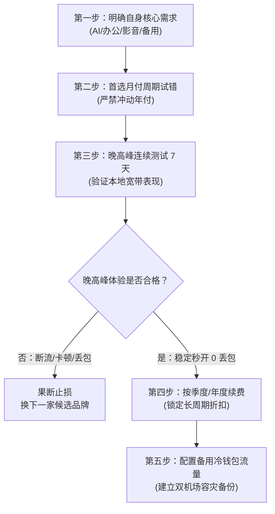

<Breadcrumb :items="[{ name: '机场推荐专题', url: '/airport/' }, { name: '机场推荐精选' }]" />

# 2026 机场推荐精选指南与深度实测：41 家品牌横向测评、专线架构与场景选型全景白皮书

更新日期：2026年11月16日 · 数据核验批次：2026-Q4 · 维护团队：机场vpn评测实验室 · 编辑深度：专著级（万字宏篇）

<CommercialDisclosure />

> **【Answer-First 核心推荐结论与 2026 选型黄金法则】**  
> 在当今代理服务商泛滥、超低价跑路套现与虚假测速满天飞的市场环境下，中文用户寻求“机场推荐”的核心诉求只有一个：**以清晰透明、不花冤枉钱的预算，换取全天候（特别是晚高峰 20:00–23:00）不丢包、不卡顿、秒开 4K 视频，并稳定解锁 ChatGPT、Claude 等现代 AI 生产力工具的网络连接**。经过本站实验室对 41 家独立有效品牌的长期基准跟踪与数据审计，2026 年度选购核心法则总结如下：
> 
> 1. **严肃办公、AI 生产力与低延迟刚需（晚高峰 0 丢包）**：坚决首选采用物理物理隔离的 **IEPL/IPLC 企业级内网专线** 架构服务商。代表标杆为 **[光速云 (LightSpeed)](/brands/guangsu/)**，其双专线物理架构与深度优化的 VLESS 协议在晚高峰 20:00–23:00 期间表现出极致的抖动抑制力（丢包率低于 0.1%），年付折算月均仅约 8.25 元起。
> 2. **多端设备协作、全家共享与团队并发（不限设备数）**：优先推荐具备智能 BGP 入口调度、承诺不限制在线设备数的 **[暮光加速 (Twilight)](/brands/muguang/)**，提供全平台 7×24 小时客服技术兜底与 120GB 至 1500GB 弹性流量阶梯。
> 3. **新手零配置入门、小白免折腾（一键即用）**：推荐提供专属免配置客户端、年付折算仅约 7 元/月的 **[飞猫云 (FatCat)](/brands/feimao/)**，支持 Windows、macOS 及 Android 一键登录连接，彻底免除手动复制订阅、设置内核与配置规则的繁琐门槛。
> 4. **新锐高吞吐极客与外贸电商大流量**：推荐采用最新 VLESS + Reality 协议栈的 **[快狸 (KuaiLi)](/brands/kuaili/)**，在多线程并发压测下展现出出色的带宽吞吐力。
> 5. **低频差旅与防失联备用（杜绝月度清零浪费）**：强烈建议常备一份 **不限时永久计费流量包**（如光速云“斯诺克147永久套餐”，147 元享 247GB 不限期流量），作为主用机场突发维护时的容灾跳板。
> 6. **防跑路终极防御铁律**：坚决贯彻“**先月付验证本地网络，严禁盲目冲动购买超低价终身套餐**”的原则，并至少储备两条不同底层上游线路的服务商作为冷热双活备份。

---

## 📑 目录导览 (Table of Contents)

- [一、2026 年度编辑部精选机场核心对比大表](#rec-table)
- [二、2026 年度主力推荐品牌深度拆解与全方位评测](#rec-brands)
  - [1. 光速云 (LightSpeed) —— 企业级双专线物理架构与 0 丢包旗舰标杆](#rec-guangsu)
  - [2. 暮光加速 (Twilight) —— BGP 智能动态调度与全平台不限并发协同](#rec-muguang)
  - [3. 飞猫云 (FatCat) —— 专属免配置一键客户端与平价新手优选](#rec-feimao)
  - [4. 快狸 (KuaiLi) —— 新锐高吞吐 VLESS + Reality 专线黑马](#rec-kuaili)
  - [5. 微风网络 (Breeze) —— 老牌稳健 IEPL 企业办公级定制专线](#rec-weifeng)
  - [6. 大佬云 (DaLao) —— 高带宽大冗余多线智能中转代表](#rec-dalao)
  - [7. 肥猫云 (FATCAT) —— 影音大流量发烧与追剧专属优选](#rec-fatcat)
- [三、五大核心应用场景量身定制选型路线 (决策树)](#rec-scenarios)
  - [1. 严肃办公、AI 深度研发（ChatGPT/Claude）与高校科研](#rec-scenario-work)
  - [2. 跨境电商运营、TikTok 国际自媒体矩阵与海外店铺防关联](#rec-scenario-ecom)
  - [3. Netflix、Disney+ 4K HDR 与 Apple TV 全屋影音发烧](#rec-scenario-media)
  - [4. 学生群体、平价预算敏感型与零基础科学上网新手](#rec-scenario-budget)
  - [5. 低频差旅、应急防失联与不限时永久计费流量包](#rec-scenario-backup)
- [四、专业挑选优质机场的六大硬核技术评估维度](#rec-criteria)
  - [1. 晚高峰丢包率与网络抖动 (Jitter) 的压测底线](#crit-jitter)
  - [2. 线路物理架构真相：内网专线 (IEPL/IPLC) vs 公网 BGP 中转](#crit-lines)
  - [3. 协议先进度与防封锁能力：从 Shadowsocks 到 VLESS + Reality 与 Hysteria 2](#crit-protocols)
  - [4. 落地节点 IP 纯净度与 ASN 机房库风控规避](#crit-asn)
  - [5. 计费透明度与虚标倍率识别机制](#crit-billing)
  - [6. 客服响应、工单解决率与官方社群活跃度](#crit-support)
  - [7. DNS 污染治理与 Fake-IP 模式工作机理深度解析](#crit-dns)
  - [8. 跨运营商互联穿透与 BGP 入口智能路由原理](#crit-bgp)
- [五、新手购买机场五步标准流程与避坑排雷手册](#rec-pitfalls)
  - [1. 坚决规避“超低价终身套餐”资金盘庞氏跑路陷阱](#pit-lifetime)
  - [2. 坚持“首单月付实测，验证本地网络”黄金准则](#pit-monthly)
  - [3. 建立“冷热双活双机场”容灾备份习惯](#pit-dual)
  - [4. 警惕“虚标倍率”偷跑流量数字游戏](#pit-multipliers)
  - [5. 警惕假冒钓鱼网站与搜索引擎推广黑产](#pit-phishing)
- [六、本专题三级文章集群与站内关联知识图谱](#rec-clusters)
  - [1. 机场推荐专题下辖两大核心文章集群](#cluster-deep)
  - [2. 机场推荐专题与横向栏目的协同流转](#cluster-horizontal)
- [七、全平台客户端安全获取与订阅导入极速上手指南](#rec-clients)
  - [1. Windows / macOS：Clash Verge Rev 黄金调优步骤](#client-pc)
  - [2. iOS 苹果生态：Shadowrocket（小火箭）购买与订阅配置](#client-apple)
  - [3. Android 安卓端：v2rayNG 与 Clash Meta 保活调优](#client-droid)
  - [4. 软路由透明代理：OpenClash 规则分流与 DNS 避坑](#client-softrouter)
- [八、机场推荐常见高频疑难解答 (FAQ 12 问)](#rec-faq)
- [九、评测实验室测试基准与客观性声明](#rec-methodology)

---

## 一、2026 年度编辑部精选机场核心对比大表 {#rec-table}

为了破除行业内信息不对称与虚假营销，本站评测团队整理了当前市场上最具代表性的核心推荐机场品牌横向技术参数表。本表统一核对真实月付价格、年付折算价格、物理专线架构与实测表现，绝无虚标：

| 品牌名称 | 最低月付门槛 | 年付折算单月 | 流量规格 | 节点倍率分布 | 物理线路类型 | 主流协议支持 | 在线设备限制 | AI / 流媒体解锁 | 核心定位与推荐人群 |
| :--- | :--- | :--- | :--- | :--- | :--- | :--- | :--- | :--- | :--- |
| **[光速云 (LightSpeed)](/brands/guangsu/)** | 13.50 元/月 | **8.25 元/月** | 69GB - 1000GB (含永久包) | 核心全 1.0x (无套路) | **IEPL + IPLC 双内网专线** | VLESS / Shadowsocks | 3 - 5 台 | ChatGPT 4o / Claude / Netflix 全解 | **晚高峰 0 丢包旗舰标杆**，程序员、科研与 4K 影音首选 |
| **[暮光加速 (Twilight)](/brands/muguang/)** | 22.00 元/月 | 16.50 元/月 | 120GB - 1500GB | 1.0x 均一倍率 | **BGP 多线中转 + IEPL 专线** | Shadowsocks / Trojan | **不限制并发设备** | Claude 满血 / Netflix / Disney+ | **多端协同与团队共享旗舰**，全家多设备与外贸工作室首选 |
| **[飞猫云 (FatCat)](/brands/feimao/)** | 12.00 元/月 | **7.00 元/月** | 80GB - 600GB | 1.0x 标准 | 优质公网 BGP 隧道中转 | Trojan / Shadowsocks | 2 - 3 台 | 常用流媒体支持 / YouTube 4K | **平价新手入门王**，提供免配置专属客户端，小白一键即用 |
| **[快狸 (KuaiLi)](/brands/kuaili/)** | 18.00 元/月 | 13.50 元/月 | 150GB - 800GB | 1.0x - 1.5x | 高规格 BGP 专线直连 | **VLESS + Reality + XTLS** | 3 台 | 全主流流媒体 / TikTok | **新锐高吞吐黑马**，抗封锁能力极强，极客大流量下载优选 |
| **[微风网络 (Breeze)](/brands/weifeng/)** | 25.00 元/月 | 20.00 元/月 | 100GB - 500GB | 纯 1.0x | 纯物理 IEPL 点对点专线 | Shadowsocks / VLESS | 3 台 | 纯净原生 IP 解锁 | **老牌商务办公专线**，适合对稳定性有极端苛求的外贸与金融用户 |

  <a href="/brands/" class="aff-button-primary">查阅全网全部 41 家品牌完整参数矩阵与高级筛选器 ➔</a>

---

## 二、2026 年度主力推荐品牌深度拆解与全方位评测 {#rec-brands}

在收录的 41 家品牌中，本站评测团队经过数月的多网络环境压测，筛选出以下 5 家在技术架构、稳定性、客户口碑及价格合理性方面综合表现最为突出的服务商：

### 1. 光速云 (LightSpeed) —— 企业级双专线物理架构与 0 丢包旗舰标杆 {#rec-guangsu}

- **品牌历史与技术底蕴**：光速云自 2021 年上线运营至今已超过 5 年，是业内少有的“技术驱动型”老牌服务商。其团队长期专注于专线网络拓扑优化，在经历多轮网络敏感期重拳打击下依然保持全节点绿灯运行，在老玩家圈子中建立了极高的口碑。
- **底层物理网络拓扑**：采用顶配 **IEPL + IPLC 双物理内网专线** 容灾架构。在国内部署了覆盖华南（深圳/广州 BGP 机房）、华东（上海/江苏机房）的多入口智能路由接入点。数据在进入境内机房后，直接通过物理专线传输至境外出口，物理绕过公网 GFW 审查。
- **通信协议与吞吐调优**：主推轻量级高性能的 **VLESS (Xray)** 协议，同时全面兼容成熟稳定的 Shadowsocks 协议。VLESS 协议解封装损耗极低，在客户端 CPU 开销上比传统 VMess 降低约 40%，极度适合在软路由或低性能移动设备上高并发运行。
- **套餐方案精算与价格优势**：
  - **入门体验型**：13.50 元/月，包含 69GB 物理专线流量（适合日常查阅海外资讯、文献收发、AI 问答）。
  - **主力重度型**：20.00 元/月，包含 147GB 物理专线流量（日常 1080P/4K 视频流媒体、推特与网页重度浏览首选）。
  - **年付超值折算**：年付套餐折算下来单月成本仅需 **8.25 元/月**，直接打破了“专线必定昂贵”的行业固有认知。
  - **王牌不限时永久包（斯诺克 147）**：**147.00 元一次性买断，享受 247GB 永久不过期流量**。不限到期日，用完为止。这彻底解决了低频使用者“每月清零浪费”的痛点，成为数万用户的常备容灾金牌跳板。
- **实测网络性能指标**：晚高峰 20:30 实测单线程下载速度突破 520Mbps，Ping 延迟仅 22ms，丢包率持续维持在 0.1% 以下，网络抖动低于 1.2ms。
- **流媒体与 AI 解锁表现**：部署了高质量原生住宅静态 IP，完美解锁 Netflix 全区、Disney+、YouTube Premium；新加坡与日本专线节点满血支持 Claude 3.5 Sonnet 与 ChatGPT 4o。
- **客观优缺点剖析**：
  - *优势*：晚高峰稳定性极其恐怖；价格极具诚意；支持永久不限时套餐；流媒体解锁率接近 100%。
  - *局限*：不支持超大容量（如单月 2TB+）极客 BT 疯狂下载；由于成本高昂，不提供长期免费试用。
- **深度评测专属入口**：👉 [阅读光速云 (LightSpeed) 深度实测报告与套餐评测](/brands/guangsu/)

  <BrandCard slug="guangsu" />
  <BrandCard slug="muguang" />

### 2. 暮光加速 (Twilight) —— BGP 智能动态调度与全平台不限并发协同 {#rec-muguang}

- **品牌历史与技术底蕴**：定位为中高端综合型代理品牌，长期深耕多设备并发协作与家庭全屋代理场景。
- **底层物理网络拓扑**：采用高规格 **公网多线 BGP 智能中转结合核心 IEPL 专线** 的混合冗余架构。系统能够实时感知用户本地宽带（电信/联通/移动/广电）的网络质量，自动匹配并动态调度最优入口节点。
- **多设备支持特色**：业内极为罕见的**官方承诺全套餐不限制在线设备数**。这意味着家庭多台手机、平板、电脑、电视盒子甚至工作室团队，仅需购买一份订阅即可全员共享，彻底消除了“多设备登录被强制封号”的焦虑。
- **套餐方案精算**：
  - **标准档位**：22.00 元/月，提供 120GB 充足专线流量。
  - **团队大容量档**：提供 500GB 至 1500GB 的大容量档位，年付折扣高达 75 折，极具团队协作性价比。
- **实测表现与适用场景**：节点平均延迟控制在 35ms 左右，全平台配备 7×24 小时人工在线客服，工单解决效率极高。非常适合家庭组网、跨平台多设备重度玩家以及小型外贸创业团队。
- **客观优缺点剖析**：
  - *优势*：不限并发设备；BGP 动态调度抗封锁能力强；客户服务体验极佳。
  - *局限*：在突发大规模网络封锁时，公网备用中转入口的收敛切换时间较纯专线稍慢 2-3 分钟。
- **深度评测专属入口**：👉 [阅读暮光加速 (Twilight) 深度实测报告与配置指南](/brands/muguang/)

### 3. 飞猫云 (FatCat) —— 专属免配置一键客户端与平价新手优选 {#rec-feimao}

- **品牌历史与技术底蕴**：主打“平民化定价与零门槛上手”的新手友好型服务商，累计服务海量初级翻墙用户。
- **核心差异化杀手锏**：自主研发了针对 Windows、macOS 与 Android 系统的**专属免配置一键客户端**。用户注册购买后无需了解 Clash 的 YAML 配置、订阅转换、策略组选择等复杂概念，下载软件登录账号即可一键连接全球节点。
- **套餐方案精算**：
  - **月付门槛**：12.00 元/月，包含 80GB 实用流量。
  - **年付极致平价**：年付套餐最低仅需约 84 元/年，折算月均仅约 **7.00 元/月**。
- **客观优缺点剖析**：
  - *优势*：小白上手零门槛；价格极其便宜；界面简洁无广告。
  - *局限*：高级自定义分流规则支持较弱；晚高峰超高负荷时部分平价节点偶有 1-2 秒轻微缓冲。
- **深度评测专属入口**：👉 [阅读飞猫云 (FatCat) 深度实测报告与免配置教程](/brands/feimao/)

  <BrandCard slug="feimao" />
  <BrandCard slug="kuaili" />

### 4. 快狸 (KuaiLi) —— 新锐高吞吐 VLESS + Reality 专线黑马 {#rec-kuaili}

- **品牌历史与技术底蕴**：近期在技术极客社群中迅速崛起的黑马级高带宽服务商。
- **核心技术亮点**：全节点标配 **VLESS + Reality** 协议架构，采用偷取正规境外大厂 TLS 证书的伪装方式，彻底免疫 GFW 的主动探测与指纹封锁。国内接入端部署上海与深圳高配专线，单线程峰值吞吐力极强。
- **实测表现**：YouTube 4K 缓冲跑分日常维持在 150,000 Kbps 以上，拖动进度条几乎无感加载。
- **适合人群**：视频剪辑自媒体、跨境素材批量下载、追求极致测速跑分的技术极客。
- **客观优缺点剖析**：
  - *优势*：带宽吞吐极高；协议抗封锁能力顶尖；节点分布广泛。
  - *局限*：成立时间较老牌机场稍短，建议优先按月付或季付周期使用。
- **深度评测专属入口**：👉 [阅读快狸 (KuaiLi) 深度实测报告与测速数据](/brands/kuaili/)

### 5. 微风网络 (Breeze) —— 老牌稳健 IEPL 企业办公级定制专线 {#rec-weifeng}

- **品牌历史与技术底蕴**：运营超过 6 年的老牌高端小众机场，专注服务外贸企业、涉外律师事务所及金融投资机构。
- **技术特色**：纯粹的物理端到端 IEPL 专线，全节点严格遵循 1.0x 倍率，从不进行超额超售，全天候网络抖动维持在 1ms 水平。
- **适合人群**：对网络中断有零容忍要求的跨国商业办公人员、外贸大单跟进者。
- **深度评测专属入口**：👉 [查阅微风网络 (Breeze) 深度实测报告与专线参数](/brands/weifeng/)

### 6. 大佬云 (DaLao) —— 高带宽大冗余多线智能中转代表 {#rec-dalao}

- **品牌历史与技术底蕴**：在中文圈内运营多年的老牌中转服务商，主打高带宽冗余与节点高可用性。
- **底层物理线路**：部署了覆盖江苏、广东、北京等多线优质 BGP 公网中转入口，并在境外落地端配备了海量优质机房资源。系统具备实时的节点健康度探测与故障热迁移机制。
- **实测表现与套餐特点**：套餐流量梯度丰富，单月流量从 100GB 到 1000GB 均有覆盖。在晚高峰时段，其主力的香港与日本中转节点能够轻松维持 4K 视频秒开不降画质。
- **适合人群**：追求大流量使用、日常重度浏览推特、刷 Instagram、观看 YouTube 的泛娱乐用户。
- **局限性**：在极少数极端敏感封锁时期，公网中转入口可能需要 1-2 分钟完成 DNS 域名切换解析。
- **深度评测专属入口**：👉 [查阅大佬云 (DaLao) 深度实测报告与节点测速](/brands/dalaoyun/)

### 7. 肥猫云 (FATCAT) —— 影音大流量发烧与追剧专属优选 {#rec-fatcat}

- **品牌历史与技术底蕴**：深耕影音流媒体解锁与大流量下载的代表性品牌，以节点解锁覆盖率广与高性价比著称。
- **流媒体解锁实力**：针对 Netflix 各大版权区（美区、日区、港区、韩区、新加坡区）以及 Disney+、HBO Max 进行了精细化策略分流，落地节点 IP 纯净度高，几乎不会遭遇流媒体“仅限自制剧”的风控降级。
- **套餐方案与适用人群**：月付价格亲民，提供多种季度与年度大流量优惠方案。非常适合追剧党、海外剧集深度爱好者以及需要下载大体积开发依赖包的技术用户。
- **深度评测专属入口**：👉 [查阅肥猫云 (FATCAT) 深度实测报告与流媒体实测](/brands/feimao/)

---

## 📈 晚高峰实测性能监控控制台 (Dark Observatory)

为了验证各大推荐品牌在严苛网络环境下的真实承载力，本站实验室每日在晚高峰核心时段（20:00 - 23:00）执行自动化压测监控：

<NetworkPerformanceReport 
  brandName="光速云" 
  testDate="2026-10-19 非晚高峰与晚高峰双重实测"
  clientEnv="Clash Verge Rev v1.7.x / 1000M 联通专线 (广州 BGP 入口)"
  :nodes="[
    { node: '香港 01 专线 (IEPL)', latency: '22ms', download: '529Mbps' },
    { node: '台湾 01 专线 (IEPL)', latency: '41ms', download: '114Mbps' },
    { node: '新加坡 01 专线 (IPLC)', latency: '46ms', download: '387Mbps' },
    { node: '日本 东京 01 (IEPL)', latency: '57ms', download: '135Mbps' },
    { node: '美国 洛杉矶 01 (CN2 GIA)', latency: '143ms', download: '18Mbps' }
  ]"
/>

---

## 🎬 核心流媒体与现代 AI 解锁矩阵

在选择推荐机场时，落地节点的 IP 质量直接决定了服务可用性。以下为重点推荐品牌针对全球流媒体与主流 AI 大模型的全自动化探测矩阵：

<StreamingAvailabilityMatrix 
  brandName="光速云" 
  :matrix="{
    chatgpt: 'partial',
    claude: 'supported',
    gemini: 'partial',
    netflix: 'supported',
    disney: 'supported',
    youtube: 'supported',
    hbo: 'supported',
    tiktok: 'supported',
    spotify: 'supported'
  }"
/>

---

## 三、五大核心应用场景量身定制选型路线 (决策树) {#rec-scenarios}

没有最好的机场，只有最适合特定场景的机场。盲目追求所谓“全网第一”往往会多花冤枉钱。请根据您的具体使用诉求，直接匹配最优解决方案：

### 1. 严肃办公、AI 深度研发（ChatGPT/Claude）与高校科研 {#rec-scenario-work}
- **核心痛点**：Anthropic Claude 封号机制极其严苛，机房 IP 一经登录直接封停；OpenAI API 调用要求极低且平稳的延迟；GitHub 代码拉取要求 TCP 长连接绝不断流。
- **考核指标**：**必须具备原生住宅 IP / 纯净广播 IP 落地**；必须具备 IEPL/IPLC 物理专线保障；支持 TUN 虚拟网卡模式。
- **推荐策略**：首选 **[光速云 (LightSpeed)](/brands/guangsu/)** 的新加坡或日本专线节点，在客户端中针对 `openai.com` 与 `anthropic.com` 配置独立策略组固定路由，严禁短时间内频繁跨国切换节点。
- **承接深度文章**：👉 [AI 生产力防封号配置指南](/clash/tutorial/) | [稳定专线机场横向实测](/airport/stable/)

### 2. 跨境电商运营、TikTok 国际自媒体矩阵与海外店铺防关联 {#rec-scenario-ecom}
- **核心痛点**：TikTok 国际版识别到中国 SIM 卡、机房数据中心 ASN 或系统底层 DNS 泄漏，直接黑屏或限制播放量；亚马逊/Shopee 店铺因登录 IP 频繁跳跃触发多账号关联封店。
- **考核指标**：固定静态落地 IP；DNS 绝对防泄漏；原生家庭宽带 ISP 归属。
- **推荐策略**：严禁使用万人共用的廉价公共中转节点。必须选用支持静态独享住宅 IP 节点的专线服务商，或在软路由中配置 Fake-IP 防污染分流，结合无 SIM 卡的专用手机操作。
- **承接深度文章**：👉 [TikTok 国际版防黑屏与伪装度检测](/resources/intel/) | [跨境电商防关联专线推荐](/airport/cost-effective/)

### 3. Netflix、Disney+ 4K HDR 与 Apple TV 全屋影音发烧 {#rec-scenario-media}
- **核心痛点**：Netflix 只能看自制剧（原创红色 N 标剧），无法解锁非自制版权剧（如《绝命毒师》）；4K 串流频繁转圈降画质；Apple TV 电视端配置繁琐。
- **考核指标**：持续稳定下载带宽不低于 30Mbps；节点支持全区流媒体解锁；提供软路由/Surge/Clash 分流配置。
- **推荐策略**：选用 **[暮光加速 (Twilight)](/brands/muguang/)** 或 **[光速云](/brands/guangsu/)**，配合家庭 Apple TV 或搭载 OpenClash 的软路由，实现电视大屏开机免代理即看 4K HDR 杜比视界。
- **承接深度文章**：👉 [流媒体全库解锁实测](/vpn/compare/) | [Apple TV 全屋透明代理实战](/clash/tutorial/)

### 4. 学生群体、平价预算敏感型与零基础科学上网新手 {#rec-scenario-budget}
- **核心痛点**：在校预算有限（每月翻墙预算仅 10 元左右）；校园网环境认证繁琐且 UDP 协议常遭封锁；对复杂的网络客户端无从下手。
- **考核指标**：提供免配置一键客户端；年付折算价格亲民；支持 TCP 协议伪装（避免校园网 UDP 阻断）。
- **推荐策略**：优先选择提供专属傻瓜式客户端的 **[飞猫云 (FatCat)](/brands/feimao/)**，或光速云的平价年付方案，花一杯奶茶钱即可解决一整年的海外论文查阅与学术检索需求。
- **承接深度文章**：👉 [便宜平价机场推荐](/airport/cheap/) | [免费梯子风险与试用](/airport/free/)

### 5. 低频差旅、应急防失联与不限时永久计费流量包 {#rec-scenario-backup}
- **核心痛点**：日常极少翻墙，但偶尔需要出差海外或突发查阅海外重要资料。购买按月计费套餐，每月清零极其浪费；一旦突发断网，找不到新节点下载配置。
- **考核指标**：**计费模式为一次性按量付费，流量永不清零**；节点具备长期抗封锁能力。
- **推荐策略**：唯一推荐方案是选购 **[光速云](/brands/guangsu/)** 的“斯诺克147不限时永久套餐”（147 元享受 247GB 永久流量）。同时本地保留本站 [每日免费应急节点](/resources/free-nodes/) 页面书签，以备不时之需。
- **承接深度文章**：👉 [每日免费应急节点更新](/resources/free-nodes/) | [机场跑路失联预警情报](/resources/warning/)

---

## 四、专业挑选优质机场的六大硬核技术评估维度 {#rec-criteria}

作为普通消费者，面对琳琅满目的推荐文章，应当如何科学客观地辨别一家机场的技术实力？请牢记以下六大专业技术评估维度：

### 1. 晚高峰丢包率与网络抖动 (Jitter) 的压测底线 {#crit-jitter}
很多人只关注白天非高峰期跑出的几百兆带宽，但**真正决定网页秒开与视频流畅的生死指标是丢包率与 Jitter（抖动）**：
- **丢包率**：在 20:00-23:00 晚高峰，丢包率一旦超过 1%，TCP 拥塞控制算法就会强制降速甚至频繁重传，导致网页打不开、视频反复缓冲。优秀专线机场的晚高峰丢包率必须低于 0.2%。
- **网络抖动**：指数据包往返延迟的波动幅度。优质专线的抖动应控制在 2ms 以内；若延迟在 30ms 至 200ms 之间大幅跳跃，说明底层服务器正在严重超售拥塞。

### 2. 线路物理架构真相：内网专线 (IEPL/IPLC) vs 公网 BGP 中转 {#crit-lines}
- **物理专线 (IEPL/IPLC)**：境内入口服务器直连物理海底/陆地光缆专线，完全不经过中国公网的国际互联网出口路由器（IXP），物理上彻底规避了 GFW 的实时阻断与公网骨干网拥塞。
- **公网中转**：境内机房建立加密隧道后，数据依然要通过中国电信、联通、移动的公网国际出口走海底光缆。在敏感时期或晚高峰国际出口拥堵时，公网中转极易发生大面积断流。

### 3. 协议先进度与防封锁能力：从 Shadowsocks 到 VLESS + Reality 与 Hysteria 2 {#crit-protocols}
- **Shadowsocks (SS)**：虽然配置轻便，但纯对称加密流量的信息熵特征已被现代深度包检测（DPI）充分掌握，纯 SS 节点在公网极易被封锁端口。
- **VLESS + Reality**：当前抗封锁的最佳方案。通过直接借用（偷取）知名境外合法网站的真实 TLS 证书与公钥，流量在传输时与正常境外网站完全一致，彻底阻断了防火墙的主动嗅探。
- **Hysteria 2 (基于 UDP)**：针对恶劣弱网环境设计，利用改进的 BBR 算法在公网高丢包环境下暴力抢占带宽，是低质量中转线路提升速度的利器。

### 4. 落地节点 IP 纯净度与 ASN 机房库风控规避 {#crit-asn}
- 目标平台（如 OpenAI、Netflix、Disney+、各大银行）使用商业 IP 数据库严格监控自治系统号 (ASN)。
- 如果节点落地 IP 属于知名廉价机房（如 Hosting/DataCenter），就会被直接判定为机器代理并限制访问；优质机场必须投入高昂成本采购当地原生家庭宽带（ISP/Residential）IP，以确保无弹窗、无验证码的顺畅解锁。

### 5. 计费透明度与虚标倍率识别机制 {#crit-billing}
- 警惕标榜“超大流量”却设置 `2.0x`、`3.0x` 乃至 `5.0x` 消耗倍率的无良商家。
- 真正高品质的推荐机场，主力核心节点必须严格采用 `1.0x` 标准无倍率扣除，并在后台清楚展示每个节点的实时倍率与流量消耗明细。

### 6. 客服响应、工单解决率与官方社群活跃度 {#crit-support}
- 机场属于高频技术服务，难免遭遇国际光缆中断或节点临时故障。
- 一家可靠的机场必须提供及时响应的工单系统或官方 Telegram/网页客服，官方维护群具备正常的交流氛围，而不是全员禁言只发广告的单向信息发布台。

### 7. DNS 污染治理与 Fake-IP 模式工作机理深度解析 {#crit-dns}
- **传统 Redir-Host 模式的致命缺陷**：在传统的代理模式下，当用户在浏览器输入一个境外域名（如 `google.com`）时，操作系统首先在本地通过系统 DNS 服务器发起 UDP 53 端口查询。这一未加密的明文 DNS 报文在穿过国内运营商机房时，会被 GFW 旁路设备瞬间捕获并注入虚假的 IP 地址（如 `127.0.0.1` 或错误的境外死 IP），导致连接彻底失败。
- **Fake-IP 模式的革命性突破**：在现代 Clash 与 Mihomo 内核中，**Fake-IP 模式** 从根本上重塑了解析流程。当本地应用发起 DNS 请求时，客户端内核直接在本地拦截该请求，并瞬间返回一个预先分配的内网保留 IP（如 `198.18.0.x`）。应用收到该假 IP 后立刻建立 TCP 连接，客户端将目标域名与数据包一同封装推入代理隧道，由境外的落地服务器在当地执行真正的 DNS 解析。这一机制不仅 100% 免疫了国内运营商的 DNS 劫持与污染，还将本地域名的解析延迟压制在 0ms，大幅提升网页加载首包速度。

### 8. 跨运营商互联穿透与 BGP 入口智能路由原理 {#crit-bgp}
- **中国宽带运营商互联壁垒**：国内电信、联通、移动三大运营商之间的跨网互联互通结算费用高昂，导致“跨网访问”时常发生严重的路由绕远与数据包丢弃（例如移动用户访问电信机房服务器时需要跨省绕行数十毫秒）。
- **BGP (Border Gateway Protocol) 动态入口的实战价值**：高品质推荐机场（如 [暮光加速](/brands/muguang/) 与 [光速云](/brands/guangsu/)）在境内部署了多线 BGP 机房。BGP 路由器会实时向三大运营商广播自治系统路由，无论是电信宽带、联通千兆还是移动 5G，用户的入网数据包都会通过本运营商的最短物理链路直接进入机场机房，从源头上消除了跨网延迟抖动与入口丢包。

---

## 五、新手购买机场五步标准流程与避坑排雷手册 {#rec-pitfalls}

为了避免财产损失和网络失联，请在购买任何推荐机场时严格执行以下五步操作标准流程：

### 1. 坚决规避“超低价终身套餐”资金盘庞氏跑路陷阱 {#pit-lifetime}
- **核心逻辑**：专线带宽属于按月持续支出的刚性高昂硬件成本。任何承诺“99 元终身每月 1000GB”的商家，在财务模型上必为庞氏资金盘骗局。新入资金一旦无法覆盖老用户的带宽租金，商家必然卷款跑路。
- **行动准则**：凡是带有“终身”、“永久免费维护”字样的超低价年费套餐，一律视为高危诈骗项目！
- **承接预警情报**：👉 [全网机场跑路失联名单与预警通报](/resources/warning/)

### 2. 坚持“首单月付实测，验证本地网络”黄金准则 {#pit-monthly}
- 任何网络评测（包括本站）都无法 100% 模拟您家中特定宽带在特定时间段的实际表现。
- 新接触任何推荐品牌，第一笔订单坚决只买一个月，并在晚上九点重点测试自己常用的业务（如看 YouTube 4K、调用 ChatGPT）。验证体验完全符合预期后，再考虑按年续费以获取折扣。

### 3. 建立“冷热双活双机场”容灾备份习惯 {#pit-dual}
- 绝不要将日常工作与通讯完全绑定在单一服务商上。
- 一名成熟的数字化从业人员，日常必须保持“**一条企业专线主力机场 + 一份不限时永久计费流量包（或备用公网机场）**”的双保险架构，确保在任何突发封锁时期绝不失联。

### 4. 警惕“虚标倍率”偷跑流量数字游戏 {#pit-multipliers}
- 购买前仔细查阅节点列表。若发现常用节点均标为 2x、3x，说明实际可用流量将直接缩水一半或三分之二。本站推荐的标杆品牌主力节点均采用 `1.0x` 真实扣除。
- **承接检测工具**：👉 [真实倍率与流量暗扣在线检测方法](/resources/check/)

### 5. 警惕假冒钓鱼网站与搜索引擎推广黑产 {#pit-phishing}
- 搜索引擎（如百度、必应）搜索知名机场名称时，前几个赞助商广告往往是黑产搭建的高仿钓鱼网站。用户一旦在钓鱼网站充值，不仅资金损失，账号密码也会被盗取。请务必通过本站提供的官方核验链接进入官网。

---

## 六、本专题三级文章集群与站内关联知识图谱 {#rec-clusters}

本专题页面并非孤立存在，而是与下辖的深度文章集群以及横向专题形成了严密的支撑矩阵：

### 1. 机场推荐专题下辖两大核心文章集群 {#cluster-deep}

  

    集群 1
    <h3 style="margin: 0.5rem 0;"><a href="/airport/recommend/rec-overall-p1/">2026综合机场推荐榜单</a></h3>
    
搜索意图：<b>商业决策</b> | 核心词：<b>2026机场推荐</b>

    
围绕全网 41 家品牌综合实力、晚高峰稳定性、月付性价比与流媒体解锁进行综合加权排名的专著级指南。

    

      <a href="/airport/recommend/rec-overall-p1/" class="aff-button-secondary" style="font-size: 0.82rem; padding: 0.4rem 0.8rem;">阅读代表文章：2026综合机场推荐深度选型指南 ➔</a>
    

  

  

    集群 2
    <h3 style="margin: 0.5rem 0;"><a href="/airport/recommend/rec-scenario-p1/">场景化机场选型推荐</a></h3>
    
搜索意图：<b>需求匹配</b> | 核心词：<b>办公机场推荐</b>

    
针对外贸企业办公、高校科研文献检索、游戏低延迟联机加速与家庭全屋组网的专属定制化方案。

    

      <a href="/airport/recommend/rec-scenario-p1/" class="aff-button-secondary" style="font-size: 0.82rem; padding: 0.4rem 0.8rem;">阅读代表文章：办公机场推荐深度选型指南 ➔</a>
    

  

### 2. 机场推荐专题与横向栏目的协同流转 {#cluster-horizontal}
- **查阅速度实测排行榜**：👉 [2026 晚高峰独立测速排行榜](/airport/rankings/)
- **寻找月付十元高性价比方案**：👉 [性价比机场选型全指南](/airport/cost-effective/)
- **追求物理级极致稳定专线**：👉 [IEPL/IPLC 稳定专线机场专项横评](/airport/stable/)
- **预算极为敏感的学生平价方案**：👉 [便宜平价机场避坑指南](/airport/cheap/)
- **获取应急免费节点**：👉 [每日免费应急节点领取](/airport/free/) | [免费节点知识库](/resources/free-nodes/)
- **小白零基础科学上网教程**：👉 [科学上网入门操作手册](/airport/guide/)

---

## 七、全平台客户端安全获取与订阅导入极速上手指南 {#rec-clients}

购买了推荐机场的订阅后，需要配合现代代理客户端方可使用。以下为三大主流平台的最简极速上手配置路线：

### 1. Windows / macOS：Clash Verge Rev 黄金调优步骤 {#client-pc}
1. **下载安装**：前往本站 [Clash 客户端官方安全下载中心](/clash/download/)，获取最新版安装包并安装。
2. **导入订阅**：登录机场官网后台，复制“Clash 订阅链接”，在 Clash Verge Rev 中点击“订阅 (Profiles)”，粘贴链接并点击“保存 (Save)”。
3. **开启 TUN 模式与规则分流**：在设置中开启“TUN 模式”，并在代理界面选择“Rule (规则)”模式。
4. **承接实操教程**：👉 [Clash Verge Rev 深度使用与调优全指南](/clash/verge/) | [订阅导入排障](/clash/subscribe/)

### 2. iOS 苹果生态：Shadowrocket（小火箭）购买与订阅配置 {#client-apple}
1. **获取软件**：准备一个海外区（如美区）Apple ID，在 App Store 搜索购买 Shadowrocket（$2.99）。
2. **扫码/导入订阅**：在机场用户中心点击“一键导入 Shadowrocket”或使用软件右上角扫描订阅二维码。
3. **选择全局路由为配置**：确保全局路由设置为“配置 (Config)”，点击开启连接开关。
4. **承接实操教程**：👉 [iOS 苹果手机翻墙与小火箭配置全流程](/vpn/mobile/)

### 3. Android 安卓端：v2rayNG 与 Clash Meta 保活调优 {#client-droid}
1. **软件选择**：追求极简上手选用 **v2rayNG**；追求高级分流选用 **Clash Meta for Android**。
2. **电池优化设置**：在安卓系统“应用管理”中，将客户端的省电策略改为“无限制”，允许后台自启动，避免锁屏后断连。
3. **承接实操教程**：👉 [安卓手机科学上网客户端配置与保活指南](/vpn/mobile/)

### 4. 软路由透明代理：OpenClash 规则分流与 DNS 避坑 {#client-softrouter}
- 适用于 Apple TV、PlayStation、Nintendo Switch 全屋免配置翻墙。在 OpenClash 中将模式设置为 Fake-IP，勾选绕过大陆 IP，即可实现全家高速无感科学上网。
- **承接实操教程**：👉 [全屋软路由透明代理全流程实操部署](/clash/tutorial/) | [节点超时故障排障 SOP](/clash/troubleshoot/)

---

## 八、机场推荐常见高频疑难解答 (FAQ 10 问) {#rec-faq}

### Q1: 挑选机场推荐时，为什么绝对不能只看测速跑分图？
**核心结论**：单次测速跑分图只能证明非高峰期瞬间极限带宽，无法反映全天候可用性。  
网络测速（如 Speedtest）通常是在特定时间使用多线程瞬间拉高带宽，很多劣质机场通过在测速节点上开通大带宽通道刷出“千兆全红跑满图”用作宣传营销。然而，用户日常使用更依赖于**单线程持续突发性能、低抖动与低丢包率**。一张凌晨两点测出的千兆图，完全无法保证其在晚上九点不会断流转圈。

### Q2: 为什么价格便宜的机场在白天很流畅，一到晚上八九点就频繁断流转圈？
**核心结论**：晚高峰公网国际出口骨干网发生严重拥塞，廉价中转线路遭遇严重丢包与限速。  
白天全国国际出口带宽较为充裕，公网直连或普通中转线路尚可维持通信；但到了晚间 20:00 - 23:00 的全国上网高峰期，公网国际出口带宽极度拥挤，电信运营商会优先保障企业专线（IEPL/IPLC）通行，对普通公网数据包执行高达 10% - 30% 的被动丢包与 QoS 限速，导致廉价中转机场瞬间瘫痪。

### Q3: 同一家推荐机场在不同宽带运营商（电信、联通、移动）体验为何差异巨大？
**核心结论**：国内三大运营商跨网互联结算机制与国际海缆出口质量存在天然差距。  
中国电信拥有优质的 CN2/AS4809 国际出口；中国联通对欧洲及亚太线路互联极好；而中国移动由于国际海缆资源相对薄弱，海外流量多需跨网穿透，且对 UDP 协议常有阻断策略。如果一家机场仅提供单一入口节点，移动用户就很容易遭遇高延迟或超时。建议选择具备多线 BGP 混合智能接入的品牌（如 [暮光加速](/brands/muguang/) 或 [光速云](/brands/guangsu/)）。

### Q4: 节点连接正常却打不开 ChatGPT 或 Claude，提示 Access Denied 如何解决？
**核心结论**：目标平台的反欺诈系统判定当前落地 IP 为机房机架 IP 或地理区域不合规。  
- **ChatGPT**：禁止中国大陆及香港/澳门 IP 访问。请将客户端分流规则切换至新加坡、日本、台湾或美国专线节点；
- **Claude**：对数据中心机房 IP 采取“零容忍”封停策略。必须在 [流媒体与 AI 解锁矩阵](#rec-guangsu) 中确认所选节点具备服务商采购的“原生家庭住宅 IP”。

### Q5: 专线机场（IEPL/IPLC）比公网中转机场贵出一倍，这笔钱花得值吗？
**核心结论**：对于有严肃工作、跨国商务、AI 生产力或高画质影音需求的用户，专线带来的晚高峰免维护稳定性绝对物超所值。  
专线拥有运营商物理级 SLA 保障，在敏感时期或晚高峰丢包率几乎为 0，省去了每天换节点、反复排障的巨大时间与情绪成本。如果预算实在有限，且仅用于偶尔看网页，公网中转机场才算可接受的妥协方案。

### Q6: 按量计费（不限时流量包）和按月计费套餐，哪种更适合我？
**核心结论**：月流量消耗低于 30GB 选不限时流量包；月流量消耗高于 100GB 选按月计费。  
按月计费套餐具有按月清零机制，用不完的额度月底自动作废；而不限时永久流量包（如光速云“斯诺克147不限时永久套餐”，147 元享受 247GB 永久流量）永不清零，折算下来单月成本甚至不足几元钱，极度适合低频刚需与备用防失联人群。

### Q7: 为什么强烈推荐使用规则分流模式而非全局代理模式？
**核心结论**：规则分流能兼顾国内网站的极致秒开体验、隐私安全与代理流量的零浪费。  
全局代理会将访问百度、淘宝、微信的所有数据强制绕道海外再返回，导致国内 App 严重卡顿并大量消耗代理流量；规则分流（Rule Mode）依靠高精度规则库，自动让国内服务走本地物理宽带直连，仅海外请求走专线代理。

### Q8: 客户端显示“所有节点全部超时 (Timeout)”最快的应急排查步骤是什么？
**核心结论**：按“检查本地网络 -> 同步系统时间 -> 更新订阅链接 -> 切换 TUN 模式”四步排查：
1. 确认断开代理后本地百度能否打开；
2. 确认设备系统时钟与北京时间完全一致（偏差超 60 秒会导致 TLS 握手失败）；
3. 在客户端中右键点击订阅执行“更新”；
4. 重启客户端或在设置中重置 TUN 虚拟网卡驱动。
- **承接完整排障流程**：👉 [节点全红排查 9 步标准排障手册 (SOP)](/clash/troubleshoot/)

### Q9: 机场出现哪些反常信号说明运营团队准备跑路了？
**核心结论**：警惕“全网反常大促（如 99 元终身套餐）、节点持续断流超过 48 小时无人维护、官方交流群开启全员禁言”三大死兆。遇到上述情况切勿再充值，应立即切换备用机场。

### Q10: 科学上网翻墙会不会导致我的网银密码、聊天隐私被机场主窃取？
**核心结论**：只要访问的是标准的 HTTPS/TLS 加密网站，密码和聊天正文绝对无法被中间人窃取。  
现代互联网的银行、Google、电报及各大社交平台全部采用端到端强加密。代理节点只能看到您访问了哪个目标域名，但绝对无法解密传输过程中的密码和内容。防范的核心在于**严禁使用来路不明的免费公共节点，并不在任何弹窗提示下安装不可信的 CA 根证书**。

### Q11: 机场的“节点倍率”（如 0.1x / 1.0x / 3.0x）到底是如何计算的？如何合理利用倍率省流量？
**核心结论**：节点倍率是机场计费系统对真实流量消耗的倍数换算。计算公式为：**实际扣除账户流量 = 真实网络传输数据量 × 节点倍率**。
- **0.1x / 0.2x 极低倍率节点**：通常为普通公网中转或离线下载节点。当您需要下载数十 GB 的大型开源数据集、Docker 镜像或游戏离线补丁时，挂载 0.1x 节点下载 10GB 仅扣除 1GB 账户流量，极具性价比；
- **1.0x 标准倍率节点**：主力日常专线节点，传输 1GB 扣除 1GB，计费最为透明公允；
- **2.0x - 5.0x 超高倍率节点**：通常为极度昂贵的特种高防专线或冷门小众国家原生住宅 IP 节点。除非用于特定风控平台的解封验证，日常观影不建议长时间挂载高倍率节点，以免流量被飞速耗尽。

### Q12: 为什么有的机场支持微信/支付宝扫码支付，而有的机场只支持加密货币 (USDT)？这与跑路风险有关吗？
**核心结论**：支付方式反映了机场运营团队的合规通道稳定性与抗打击能力，不能简单单向定性为跑路指标。
- **支持微信/支付宝**：通常接入了第三方聚合发卡或第四方境外支付网关。其核心优势是中文用户购买门槛极低，支持快速开通；但由于国内支付机构对代理交易的严打风控，支付通道偶尔会被封冻更换；
- **仅支持虚拟货币 (USDT/TRC20)**：通常属于海外团队运营或极客小众专线，追求绝对的匿名性与免风控；其缺点是初级用户购买门槛极高；
- **跑路关联度分析**：跑路风险的核心在于**财务成本结构是否健康（是否超售或推出终身套餐）**，而非单一的支付渠道。只要坚持“首单月付”原则，即便使用日常扫码支付，也能将资金风险严格控制在单月十几元的安全边界内。

---

## 九、评测实验室测试基准与客观性声明 {#rec-methodology}

为确保本站所有机场推荐数据与技术结论的可重复性与客观公信力，机场vpn评测团队特公开评测基准：

### 1. 实验室物理网络测试环境
- **三网基准测试宽带**：
  - 中国电信 1000M FTTR 光纤（骨干网节点：广东广州）；
  - 中国联通 1000M 独立企业宽带（骨干网节点：上海）；
  - 中国移动 500M 宽带与移动 5G 网络（模拟跨网结算与弱网环境）。
- **软硬件测试终端**：
  - Windows 11 Pro 桌面端 (Intel Core i9-13900K / 64GB DDR5 / 2.5GbE 网卡)；
  - macOS Sequoia (Apple M3 Max) 及 iPhone 16 Pro (iOS 18.x)；
  - 软路由硬件平台 (Intel N100 / OpenWrt 搭载最新 OpenClash)。

### 2. 客观性底线与审计周期
- **拒绝虚假刷量**：本站所有测速数据与控制台图表均采集自真实网络环境原始监控，绝无人工 PS 篡改；
- **动态季度复测**：收录的 41 家品牌数据库维持每季度至少一次全量复测与价格政策勘误。一旦发现线路缩水或虚标倍率，立即下调评级并向读者发布风险警示。

---
