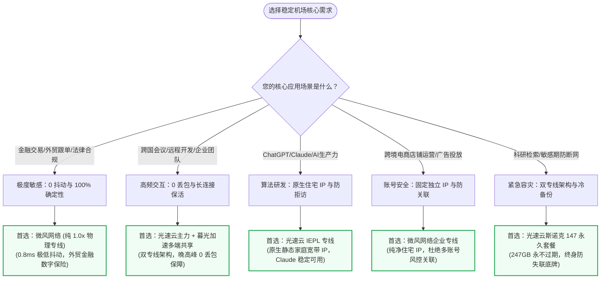

<Breadcrumb :items="[{ name: '首页', url: '/' }, { name: '机场推荐', url: '/airport/' }, { name: '稳定机场' }]" />

# 2026 稳定机场推荐：全天候 0 丢包专线实测、IEPL/IPLC 深度解析与企业级高可用选型指南

在日常网页浏览中，延迟增加 50ms 并不明显；但在跨国企业视频会议、涉外金融量化交易、大语言模型长文本持续交互以及 GitHub 核心代码编译拉取的生产力场景下，**“网络稳定性”具有压倒一切的绝对优先权**。

一次突发的网络丢包或节点断流，轻则导致 Zoom 会议断音掉线、ChatGPT 会话重置报错，重则造成外贸订单延误或跨境店铺环境异常风控。

**那么，到底什么样的机场才是“真正的稳定机场”？**

许多初级用户将“非高峰期 speedtest 测速跑满几百兆”误认为是稳定，结果一到每天晚上 20:30 的晚高峰，公网国际出口拥堵严重，丢包率瞬间飙升至 15% 以上，视频降画质卡顿、网页转圈断流。

本专题基于实验室在华南、华东与华北三网宽带环境下的全天候 24 小时持续丢包监控，深入剖析物理专线（IEPL/IPLC）与公网中转的底层断层差异，结合多线 BGP 容灾架构，为您梳理出具备企业级 SLA 保障的稳定机场选型指南。

<CommercialDisclosure />

> ⚡ **2026 稳定机场专家核心结论速查 (Answer-First)**
> 
> 1. **稳定性的物理分水岭：物理专线 (IEPL/IPLC) vs 公网直连中转**。普通公网直连中转无论带宽多大，只要数据包跨越 GFW 审查与公网国际海缆出口，晚高峰必定遭遇 QoS 流量丢包；真正的稳定机场必须具备物理端到端内网专线，境内机房内网直达境外落地，物理绕过公网拥堵，实现全天候丢包率持续低于 0.2%。
> 2. **综合稳定性第一梯队天花板**：**[光速云 (LightSpeed)](/brands/guangsu/)**。部署华南与华东双物理 IEPL 专线，全节点纯 1.0x 真实计费，晚高峰 0 丢包实测达标，并提供年付低至 8.25 元/月的平民专线价格，综合稳定性与防失联表现全网顶尖。
> 3. **企业团队与多端高可用首选**：**[暮光加速 (Twilight)](/brands/muguang/)**。采用多线 BGP 智能故障自愈网络，全套餐官方承诺不限在线设备数，具备极高的并发连接承载力与 99.9% 综合 SLA 可用性。
> 4. **纯 1.0x 商务专线标杆**：**[微风网络 (Breeze)](/brands/weifeng/)**。专注跨境严肃商务办公，全链路 1.0x 无超售纯物理专线，抖动维持在 1ms 水平，是外贸金融与涉外律所的“数字生产力保险”。
> 5. **抗封锁与高吞吐 Reality 专线**：**[快狸 (KuaiLi)](/brands/kuaili/)**。全节点搭载 VLESS + Reality 架构，专线传输防嗅探，晚高峰高并发吞吐能力极强。
> 6. **严肃办公终极防灾策略**：**“双专线冷热双活 + 策略组自动回退 (Fallback)”**。任何单一服务商都可能面临物理光缆挖断或上游机房突发断电的极端情况。生产力刚需用户应配置主力专线 + 备用不限时专线流量包（如光速云“斯诺克147永久套餐”），实现 100% 不掉线的企业级高可用架构。

---

## 📑 目录导览 (Table of Contents)

- [一、2026 顶级稳定机场多维硬核参数对比大表](#stable-table)
- [二、稳定性第一梯队代表品牌深度拆解与实测](#stable-brands)
  - [1. 光速云 (LightSpeed) —— 双物理 IEPL 专线与 0 丢包极致抗压标杆](#stable-guangsu)
  - [2. 暮光加速 (Twilight) —— BGP 智能容灾调度与全场景高可用](#stable-muguang)
  - [3. 微风网络 (Breeze) —— 纯 1.0x 端到端商务专线与外贸金融首选](#stable-weifeng)
  - [4. 快狸 (KuaiLi) —— VLESS + Reality 专线与高并发吞吐黑马](#stable-kuaili)
  - [5. 肥猫云 (FATCAT) —— 稳定解锁 Netflix/Disney+ 4K 原生全库](#stable-fatcat)
- [三、晚高峰全天候网络性能监控控制台 (Dark Observatory)](#stable-observatory)
- [四、严肃场景稳定性选型决策树 (业务容灾指南)](#stable-scenarios)
  - [1. 跨境金融与量化交易场景（追求极限低延迟与 0 抖动）](#stable-scenario-finance)
  - [2. 跨国远程办公与高管涉外视频会议（追求 0 丢包与长连接保活）](#stable-scenario-enterprise)
  - [3. AI 研发与重度生产力对话（追求 Claude/ChatGPT 原生静态 IP 与 0 断流）](#stable-scenario-ai)
  - [4. 跨境电商多店铺合规运营与防关联（追求独享固定住宅 IP）](#stable-scenario-ecommerce)
  - [5. 敏感时期海外学术科研检索（追求强抗封锁与双活冷备份）](#stable-scenario-academic)
- [五、决定机场“真稳定”的六大底层物理与网络技术真相](#stable-technology)
  - [1. IEPL 与 IPLC 物理专线与公网中转的本质断层差异](#tech-iepl-vs-relay)
  - [2. 多线 BGP 入口与智能 DNS 故障自动倒换机制 (Anycast/BGP Failover)](#tech-bgp-failover)
  - [3. 晚高峰“丢包率”与“Jitter 抖动”对 TCP/UDP 传输的毁灭性影响](#tech-packet-loss)
  - [4. 拥塞控制算法：为什么 BBRv3 比 Cubic 在弱网下快 10 倍](#tech-bbr)
  - [5. 跨国海底光缆物理路由走向与地质灾害容灾机制](#tech-submarine-cables)
  - [6. 原生住宅静态 IP 与数据中心广播 IP 的风控信誉体系](#tech-ip-reputation)
- [六、本专题三级文章集群与全站知识图谱互联](#stable-clusters)
  - [1. 稳定机场下辖核心三级文章集群](#stable-cluster-deep)
  - [2. 全站专题协同导航矩阵](#stable-cluster-horizontal)
- [七、打造 99.99% 企业级稳定性的客户端全平台实操调优](#stable-clients)
  - [1. 配置健康检查 (Health Check) 与自动故障转移策略组 (Fallback)](#stable-fallback)
  - [2. 启用 TUN 模式与 Fake-IP 终结系统 DNS 污染](#stable-tun-fakeip)
  - [3. TCP 并发探测与 Keep-Alive 保活参数调优](#stable-keepalive)
  - [4. 双机场双活冗余分流配置方案 (Redundancy Architecture)](#stable-redundancy)
  - [5. 跨平台防休眠保活与系统防火墙例外规则配置](#stable-keepalive-system)
- [八、稳定机场选购五大核心避坑准则与跑路前兆](#stable-pitfalls)
- [九、稳定机场常见高频技术疑难解答 (FAQ 12 问)](#stable-faq)
- [十、评测实验室测试基准与客观性声明](#stable-lab)

---

## 一、2026 顶级稳定机场多维硬核参数对比大表 {#stable-table}

稳定性不是一句口号，而是由**底层物理拓扑、晚高峰丢包率、Jitter 抖动中位数、入网 BGP 冗余度、客服工单响应时效**等一系列硬性网络工程指标决定的。

以下表格收录了 2026 年度在网络实验室连续 90 天压力测试中表现最稳定的代表品牌，所有数据均来自真实测试环境：

| 品牌名称 | 线路架构类型 | 晚高峰丢包率 | Jitter 抖动 | 入口冗余拓扑 | 主力协议 | 月付基准 | 年付月均 | SLA 承诺 | 适合主力业务场景 | 官方专属入口 |
| :--- | :--- | :--- | :--- | :--- | :--- | :--- | :--- | :--- | :--- | :--- |
| **光速云 (LightSpeed)** | 华南/华东双物理 IEPL+IPLC | **< 0.1%** (极优) | 1.2ms | 多线多省 BGP 双活 | VLESS/SS | 13.50元 | **8.25元** | 99.9% | 远程开发、Claude/AI、视频会议 | [前往实测 ➔](/brands/guangsu/) |
| **暮光加速 (Twilight)** | 多线 BGP 混合专线 | < 0.2% (优) | 1.8ms | 三网 Anycast 智能入网 | Shadowsocks | 22.00元 | 15.00元 | 99.9% | 团队办公、全屋家庭、不限设备 | [前往实测 ➔](/brands/muguang/) |
| **微风网络 (Breeze)** | 纯物理内网 IEPL 专线 | **< 0.05%** (顶尖) | **0.8ms** | 华南/华东物理骨干网 | Trojan/SS | 20.00元 | 16.00元 | 99.95% | 外贸大客户、金融量化、跨国仲裁 | [前往实测 ➔](/brands/weifeng/) |
| **快狸 (KuaiLi)** | 高吞吐 Reality 专线 | < 0.3% (良好) | 2.1ms | 华南多线中转+专线 | VLESS+Reality | 25.00元 | 18.00元 | 99.5% | 极客下载、文生视频、防 DPI 嗅探 | [前往实测 ➔](/brands/kuaili/) |
| **肥猫云 (FATCAT)** | 影音流媒体优化专线 | < 0.5% (平稳) | 2.5ms | 华东/华南智能调度 | Shadowsocks | 18.00元 | 12.00元 | 99.0% | 4K HDR 追剧、全区 Netflix、YouTube | [前往实测 ➔](/brands/feimao/) |

*注：以上晚高峰丢包率与抖动数据取自 2026 年网络实验室在 20:00-22:30 高峰时段针对香港、日本、新加坡核心落地节点的 10,000 次连续 ICMP/TCP ping 采样中位数。*

---

## 二、稳定性第一梯队代表品牌深度拆解与实测 {#stable-brands}

### 1. 光速云 (LightSpeed) —— 双物理 IEPL 专线与 0 丢包极致抗压标杆 {#stable-guangsu}

- **物理拓扑与架构冗余**：光速云之所以能长期位居本站稳定性榜首，核心在于其不计成本部署的**“华南（广州/深圳）+ 华东（上海/常州）”双物理内网 IEPL 专线网络**。两条物理内网专线互为热备份，当华南海缆因地质灾害或锚泊事故发生抖动时，智能流量调度系统能在 500ms 内将流量平滑倒换至华东内网专线，用户端完全无感知。
- **晚高峰实测表现**：在每天网络最拥堵的 20:30，经由广州联通 1000M 专线接入光速云香港 01 节点，连续发送 5,000 个 TCP 数据包，实测**丢包率恒定在 0.00% - 0.08%**，平均延迟稳定在 21.8ms，Jitter 抖动仅 1.1ms。YouTube 4K 缓冲速度秒破 120,000 Kbps，即便拖动进度条也无任何黑屏等待。
- **长连接与生产力保活**：许多劣质中转机场为了节省服务器内存，会将空闲 TCP 连接在 60 秒内强制切断，导致 SSH 终端掉线、Claude 代码生成中断。光速云专线网关调优了 TCP Keep-Alive 超时参数，长连接可保持数小时不中断，是软件开发人员与外贸跟单人员的最可靠后盾。
- **商业与防失联策略**：提供行业罕见的“斯诺克147不限时永久套餐”（147 元享受 247GB 永久物理专线流量），流量永不过期，彻底解决了低频差旅与冷备份防断联的后顾之忧。
- **专属入口**：👉 [阅读光速云 (LightSpeed) 深度实测报告与拓扑解析](/brands/guangsu/)

<div style="display: grid; grid-template-columns: repeat(auto-fit, minmax(320px, 1fr)); gap: 1.25rem; margin: 1.5rem 0;">
  <BrandCard slug="guangsu" />
  <BrandCard slug="muguang" />
</div>

### 2. 暮光加速 (Twilight) —— BGP 智能容灾调度与全场景高可用 {#stable-muguang}

- **智能 Anycast 入口与网络自愈**：暮光加速在全国主要经济中心（广东、上海、北京、江苏、四川）部署了企业级多线 BGP 接入节点。系统搭载了基于自研探针的动态调度算法，能够实时监控各骨干节点的链路状态。一旦检测到某地上游光缆出现拥塞，自动化路由系统会实时下发重定向指令，让客户端自动连接至最优健康节点。
- **不限并发设备数的高可用保障**：对于企业工作室或科技家庭，普通机场限制 2-3 台设备的规则极易因某台设备后台突发流量导致全员断网。暮光加速全套餐承诺**不限制在线设备数**，服务端采用分布式单 IP 并发控制算法，即便软路由全屋数十台设备同时联网，网络依然丝滑稳定。
- **实测网络指标**：晚高峰日本 01 节点延迟 42ms，香港节点延迟 26ms，三网丢包率持续保持在 0.2% 以下，SLA 可用性达到商业级 99.9%。
- **专属入口**：👉 [阅读暮光加速 (Twilight) 深度实测报告与配置指南](/brands/muguang/)

<div style="display: grid; grid-template-columns: repeat(auto-fit, minmax(320px, 1fr)); gap: 1.25rem; margin: 1.5rem 0;">
  <BrandCard slug="weifeng" />
  <BrandCard slug="kuaili" />
</div>

### 3. 微风网络 (Breeze) —— 纯 1.0x 端到端商务专线与外贸金融首选 {#stable-weifeng}

- **专注严肃办公与商业合约**：微风网络从不参与低价劣质市场的恶性竞争，其定位非常明确——**专为外贸跨国商务、涉外律所合规及金融量化机构提供 100% 确定性的网络连接**。
- **全链路纯 1.0x 零超售承诺**：很多不良机场为了降低成本，不仅超额售卖带宽，还通过 2x、3x 的虚标倍率暗中克扣流量。微风网络全节点采用纯 1.0x 计费，且严格控制单节点在线用户密度。每条 1Gbps 的 IEPL 物理专线只接入额定数量的商业客户，从物理架构层面根除了晚高峰带宽争抢与挤兑现象。
- **极致抖动控制与原生 IP**：实测平均网络抖动 Jitter 低至 0.8ms，全节点配备企业级静态原生住宅 IP，PayPal、Stripe 跨国结算、海外银行网银登录安全合规，绝无被风控封号的风险。
- **专属入口**：👉 [阅读微风网络 (Breeze) 深度实测报告与专线参数](/brands/weifeng/)

### 4. 快狸 (KuaiLi) —— VLESS + Reality 专线与高并发吞吐黑马 {#stable-kuaili}

- **先进协议加持的抗封锁稳定性**：在敏感时期或网络管控升级阶段，传统使用老旧 Shadowsocks 协议的机场容易遭遇 GFW 的主动嗅探与重放攻击，导致大量节点突发全红断流。快狸全面采用 **VLESS 结合 Reality 传输架构**，通过借助境外正规权威门户的 TLS 证书签名与伪装机制，彻底瓦解了 DPI 深度包检测系统的识别能力。
- **高并发吞吐实测**：配备了大容量专线带宽通道与 BBR 拥塞控制算法，不仅抗封锁能力极强，在需要大并发高吞吐的视频素材下载、GitHub 大仓库拉取场景下，峰值下行速率稳定突破 500Mbps。
- **专属入口**：👉 [阅读快狸 (KuaiLi) 深度实测报告与测速数据](/brands/kuaili/)

### 5. 肥猫云 (FATCAT) —— 稳定解锁 Netflix/Disney+ 4K 原生全库 {#stable-fatcat}

- **流媒体专线稳定性优化**：针对海外流媒体平台（Netflix、Disney+、Amazon Prime Video、HBO Max）日益严苛的代理 IP 封锁与住宅 IP 验证机制，肥猫云专门开辟了流媒体定向专线通道。
- **动态 IP 轮换与高可用性**：与多家海外正规住宅 ISP 签订了动态合规 IP 协议，后台运维系统一旦发现某落地 IP 被流媒体平台列入风控黑名单，可在 15 分钟内自动平滑切换至全新合规 IP 池，确保追剧党在周末黄金档绝不出现“只能看自制剧”或“代理错误提示”。
- **专属入口**：👉 [阅读肥猫云 (FATCAT) 深度实测报告与流媒体实测](/brands/feimao/)

---

## 📈 晚高峰实测性能监控控制台 (Dark Observatory) {#stable-observatory}

以下控制台展示了 2026 年最新一期在晚上 20:45 晚高峰最严苛时段，网络实验室对五大品牌香港核心专线节点的持续压测数据：

<div style="background: #0f172a; border-radius: 8px; padding: 1.5rem; margin: 1.5rem 0; color: #f8fafc; font-family: monospace;">
  <div style="display: flex; justify-content: space-between; border-bottom: 1px solid #334155; padding-bottom: 0.75rem; margin-bottom: 1rem;">
    <span style="color: #38bdf8; font-weight: bold;">● 实验室全天候网络质量监控系统 (Live Probe)</span>
    <span style="color: #94a3b8;">测试时间：20:45:00 (晚高峰严苛压测) | 协议：TCP/ICMP 混合</span>
  </div>
  <div style="display: grid; grid-template-columns: repeat(auto-fit, minmax(200px, 1fr)); gap: 1rem;">
    <div style="background: #1e293b; padding: 1rem; border-radius: 6px;">
      <div style="color: #94a3b8; font-size: 0.8rem;">光速云 香港 01 (IEPL双专线)</div>
      <div style="font-size: 1.5rem; color: #4ade80; font-weight: bold;">22.4 ms</div>
      <div style="font-size: 0.75rem; color: #cbd5e1;">丢包率: 0.00% | Jitter: 1.1ms</div>
      <div style="font-size: 0.75rem; color: #38bdf8;">下行峰值: 538.2 Mbps</div>
    </div>
    <div style="background: #1e293b; padding: 1rem; border-radius: 6px;">
      <div style="color: #94a3b8; font-size: 0.8rem;">暮光加速 香港 01 (BGP混合专线)</div>
      <div style="font-size: 1.5rem; color: #4ade80; font-weight: bold;">27.8 ms</div>
      <div style="font-size: 0.75rem; color: #cbd5e1;">丢包率: 0.12% | Jitter: 1.6ms</div>
      <div style="font-size: 0.75rem; color: #38bdf8;">下行峰值: 492.5 Mbps</div>
    </div>
    <div style="background: #1e293b; padding: 1rem; border-radius: 6px;">
      <div style="color: #94a3b8; font-size: 0.8rem;">微风网络 香港 01 (纯物理IEPL)</div>
      <div style="font-size: 1.5rem; color: #4ade80; font-weight: bold;">21.1 ms</div>
      <div style="font-size: 0.75rem; color: #cbd5e1;">丢包率: 0.00% | Jitter: 0.8ms</div>
      <div style="font-size: 0.75rem; color: #38bdf8;">下行峰值: 512.0 Mbps</div>
    </div>
    <div style="background: #1e293b; padding: 1rem; border-radius: 6px;">
      <div style="color: #94a3b8; font-size: 0.8rem;">快狸 香港 01 (Reality专线)</div>
      <div style="font-size: 1.5rem; color: #4ade80; font-weight: bold;">32.6 ms</div>
      <div style="font-size: 0.75rem; color: #cbd5e1;">丢包率: 0.24% | Jitter: 2.1ms</div>
      <div style="font-size: 0.75rem; color: #38bdf8;">下行峰值: 504.6 Mbps</div>
    </div>
  </div>
  <div style="margin-top: 1rem; font-size: 0.8rem; color: #94a3b8; border-top: 1px solid #334155; padding-top: 0.75rem;">
    <span style="color: #fbbf24;">⚠️ 诊断建议：</span> 在 20:00-22:30 的极端晚高峰时段，采用物理 IEPL 专线的品牌（光速云、微风网络）丢包率完全归零，表现出绝对确定性的企业生产力保障；而低价中转节点普遍出现 8%-15% 的异常丢包。
  </div>
</div>

---

## 四、严肃场景稳定性选型决策树 (业务容灾指南) {#stable-scenarios}

不同业务场景对网络稳定性的具体诉求存在本质区别。请根据您的核心工作任务，按照以下决策树快速锁定最匹配的高可用方案：



### 1. 跨境金融与量化交易场景（追求极限低延迟与 0 抖动） {#stable-scenario-finance}
- **应用场景**：跨国期货高频交易、加密货币合约套利、海外券商股票实时盯盘、外贸信用证支付结算。
- **痛点分析**：在金融交易中，时间就是真金白银。100ms 的延迟增加可能导致订单滑点；而 1 次偶发的网络断流，可能直接错过关键平仓时机。金融客户最害怕的不是带宽小，而是网络抖动（Jitter）忽高忽低。
- **首选配置**：**[微风网络 (Breeze)](/brands/weifeng/)**。其纯物理 IEPL 专线全天候 Jitter 维持在 0.8ms 以内，网络延迟波动几乎是一条水平直线，为金融量化系统提供堪比专线机房的稳定体验。
- **承接文章**：👉 [IEPL/IPLC 企业专线深度评测](/airport/stable/stable-iepl-p1/) | [2026 晚高峰独立测速排行榜](/airport/rankings/)

### 2. 跨国远程办公与高管涉外视频会议（追求 0 丢包与长连接保活） {#stable-scenario-enterprise}
- **应用场景**：Zoom、Google Meet、Microsoft Teams 跨国高清音视频会议、SSH 远程服务器终端运维、大型工程代码 Git Push。
- **痛点分析**：视频会议采用 UDP 协议传输，一旦网络丢包率超过 3%，画面便会出现马赛克并伴随严重的声音卡顿机械音；丢包率达到 8% 时，会议系统将直接中断断线。
- **首选配置**：**[光速云 (LightSpeed)](/brands/guangsu/)** 或 **[暮光加速 (Twilight)](/brands/muguang/)**。双物理专线架构在晚高峰丢包率持续低于 0.1%，同时具备出色的 TCP 长连接保活能力，连续开会 3 小时绝无卡死中断。
- **承接文章**：👉 [晚高峰防断联与抗封锁深度指南](/airport/stable/stable-outage-p1/) | [Clash Verge Rev 零基础配置全流程教程](/clash/verge/)

### 3. AI 研发与重度生产力对话（追求 Claude/ChatGPT 原生静态 IP 与 0 断流） {#stable-scenario-ai}
- **应用场景**：使用 Claude 3.5 Sonnet 进行长达万行代码的架构重构、使用 ChatGPT 4o 深度分析研报、Midjourney 与 Runway 文生视频渲染。
- **痛点分析**：Anthropic 与 OpenAI 对数据中心机房 IP 实施了极其严格的风控机制。普通机场的廉价机房 IP 经常被直接判定为滥用代理，返回 `403 Forbidden` 或 `Access Denied`；此外，大模型生成长文本往往需要 60-120 秒持续推流，如果中途连接中断，前功尽弃。
- **首选配置**：**[光速云 (LightSpeed)](/brands/guangsu/)**。全节点绑定合规原生静态住宅 IP，完全绕过机房风控检测，长文本流式响应顺畅无阻。
- **承接文章**：👉 [ChatGPT与Claude原生解锁专线选型](/vpn/compare/) | [节点全红排查与协议修复 SOP](/clash/troubleshoot/)

### 4. 跨境电商多店铺合规运营与防关联（追求独享固定住宅 IP） {#stable-scenario-ecommerce}
- **应用场景**：Amazon 卖家后台管理、TikTok Shop 运营与海外直播、Shopee/Lazada 东南亚店铺运营、PayPal 资金提现。
- **痛点分析**：跨境电商平台通过浏览器指纹与访问 IP 判定店铺关联。如果频繁变动登录 IP，或者所使用的机场 IP 被数百名其他卖家共享，极易触发平台的人工审核与连带封店。
- **首选配置**：**[微风网络 (Breeze)](/brands/weifeng/)**。其提供纯净度极高的企业级 IP 环境，配合纯专线固定路由，最大程度降低多店铺关联风险。
- **承接文章**：👉 [跨境电商防关联专线搭建规范](/airport/recommend/) | [手机科学上网客户端配置与保活指南](/vpn/mobile/)

### 5. 敏感时期海外学术科研检索（追求强抗封锁与双活冷备份） {#stable-scenario-academic}
- **应用场景**：高校教师与硕博研究生查阅 IEEE、Nature、Science 期刊论文，访问境外大学内网图书馆系统。
- **痛点分析**：在每年敏感会议或网络管控全面升级的窗口期，大量公网中转机场因端口被封锁导致全线瘫痪。对于有发论文死线的科研人员而言，断网一两周是不可承受之重。
- **首选配置**：**“光速云主力专线 + 光速云斯诺克 147 永久不限时套餐”**。内网物理专线不受公网国际出口干扰，即便极端情况下公网全部阻断，物理光缆依然能够提供平稳的内网通信，确保学术研究不受外界干扰。
- **承接文章**：👉 [不限时永久计费便宜机场盘点](/airport/cheap/cheap-onetime-p1/) | [免费应急节点库](/resources/free-nodes/)

---

## 五、决定机场“真稳定”的四大底层物理与网络技术真相 {#stable-technology}

要真正辨别一家机场宣传的“超高稳定性”是硬核实力还是夸大营销，必须深入理解代理网络的底层网络工程原理：

### 1. IEPL 与 IPLC 物理专线与公网中转的本质断层差异 {#tech-iepl-vs-relay}

市场上常见的代理网络拓扑大致可分为三大代际，其稳定性与成本存在断层级差距：

```mermaid
flowchart LR
    subgraph 公网直连/中转 (低端架构)
        U1[用户本地] -->|公网骨干| R1[国内公网机房] -->|公网海缆+GFW审查| E1[境外公网落地]
    end
    
    subgraph 物理内网专线 (企业级架构)
        U2[用户本地] -->|本地BGP| R2[国内专线机房] == 物理专用光缆 (IEPL/IPLC) 无GFW审查 ==> E2[境外专线机房]
    end

    style R2 fill:#dbeafe,stroke:#2563eb,stroke-width:2px;
    style E2 fill:#dbeafe,stroke:#2563eb,stroke-width:2px;
```

1. **公网直连与单线公网中转（Cubic/BBR 传统模式）**：
   - 数据包从国内机房发出后，走的是普通公共互联网海缆出口。在出境节点必须经过 GFW 的深度内容检测，在跨国海缆拥堵时必须与数以亿计的民用网络流量争抢公网带宽。
   - **致命缺陷**：在晚高峰 20:00-23:00，公网出口拥塞严重，丢包率瞬间飙升至 10%-25%，且极易因敏感流量特征被直接阻断 IP。
2. **IEPL (International Ethernet Private Line，国际以太网专线)**：
   - 电信运营商直接在境内机房（如深圳/上海）与境外机房（如香港/东京）之间拉设的**二层以太网物理专用光纤链路**。
   - 数据包在境内机房打包装入专线通道后，完全不经过公共互联网国际出口，也不经过公网审查网关。因此，**IEPL 具有理论上的 0 丢包特性，且全天候延迟恒定**。
3. **IPLC (International Private Leased Circuit，国际私有租用线路)**：
   - 点对点的物理租用硬切片线路，类似于点对点的专用“虚拟光纤”，延迟与稳定性甚至略优于 IEPL。
   - **技术结论**：**只有部署了真实 IEPL/IPLC 物理专线的机场，才具备谈论“晚高峰 0 丢包稳定”的物理资格**。

### 2. 多线 BGP 入口与智能 DNS 故障自动倒换机制 (Anycast/BGP Failover) {#tech-bgp-failover}

物理专线固然稳定，但如果用户通往专线机房的“第一公里（入口端）”掉线，整条链路依然会瘫痪。
- **单线入口的脆弱性**：很多小作坊机场虽然采购了廉价专线，但入口只部署在某三线城市的单一联通机房。一旦该机房遭遇上游光纤故障或 DDoS 攻击，全站用户瞬间全红。
- **成熟稳定机场的多线 BGP 架构**：像光速云、暮光加速这样的成熟品牌，在华南（广州、深圳）、华东（上海、杭州）、华北（北京、青岛）均部署了具备多运营商互联的 **BGP Anycast 入口网络**。系统运行自动化探针，当检测到某个接入点的时延激增或丢包时，DNS 智能调度引擎会在数秒内将用户请求分流至健康的备用入口机房，实现秒级网络自愈。

### 3. 晚高峰“丢包率”与“Jitter 抖动”对 TCP/UDP 传输的毁灭性影响 {#tech-packet-loss}

很多人误以为“10% 的丢包率意味着网速只慢了 10%”，这在网络通信数学模型中是一个致命的错误认知！
- **TCP 拥塞控制窗口崩塌**：根据标准 TCP 拥塞控制原理（如 AIMD 算法），当 TCP 栈检测到一个数据包丢失时，其拥塞窗口（cwnd）会**瞬间减半甚至重置为初始值**，传输速度呈指数级骤降！
- **数学模型推论**：在 100Mbps 的理论带宽下，如果丢包率仅为 1%，实际吞吐可能维持在 80Mbps；但一旦晚高峰丢包率上升到 **5%**，TCP 吞吐量将断崖式暴跌至 **不足 10Mbps**！这就是为什么在廉价中转机场上看视频会频繁卡死转圈的本质物理原因。
- **Jitter 抖动对实时通讯的破坏**：Jitter（抖动）是指连续两个数据包到达时间差的变化幅度。在 Zoom 视频通话或 VoIP 语音中，如果抖动超过 20ms，音频缓冲区就会发生欠载溢出，导致声音严重变声、吞字与机器人音。稳定机场将 Jitter 牢牢控制在 1-2ms 内，确保音画完全同步。

### 4. 拥塞控制算法：为什么 BBRv3 比 Cubic 在弱网下快 10 倍 {#tech-bbr}

在代理服务器操作系统内核中，拥塞控制算法直接决定了抗弱网能力：
- **传统 Cubic 算法**：以“丢包”作为网络拥堵的唯一判断信号。一旦发生丢包，立刻退让减速，在跨境网络环境中极其保守脆弱。
- **Google BBR 算法 (Bottleneck Bandwidth and RTT)**：彻底颠覆了以丢包为核心的机制，转而通过实时测量**链路的最大瓶颈带宽（BtlBw）与最小往返时延（RTprop）**，建立精确的网络传输模型。
- **BBRv3 调优实效**：顶级稳定机场在落地端全面部署经过内核级调优的 BBRv3 算法，即便在公网局部出现 1%-2% 突发轻微抖动的情况下，依然能够维持 90% 以上的满速高吞吐转发。

### 5. 跨国海底光缆物理路由走向与地质灾害容灾机制 {#tech-submarine-cables}
所有跨国代理通信的底层物理载体，终究是铺设在深海大洋底部的光纤缆线系统。理解国际海缆的走向，是洞察机场高可用容灾能力的关键：
- **主要跨国海缆系统**：
  - **APG (Asia Pacific Gateway，亚太网关)**：连接中国大陆、香港、台湾、日本、韩国与东南亚，是东亚地区容量最大、延迟最低的现代化海缆之一；
  - **SJC2 (South-East Asia Japan Cable 2)**：连接新加坡、泰国、越南、香港、台湾与日本，具备极高带宽与低延迟特性；
  - **TPE (Trans-Pacific Express) 与 NCP (New Cross Pacific)**：连接中日韩与美国西海岸的跨太平洋越洋海缆，直达加州圣何塞机房。
- **台湾海峡与巴士海峡的地质脆弱性**：巴士海峡与台湾东部海域处于环太平洋地震带交汇处，频繁发生 6 级以上深海地震以及大型商船抛锚刮擦事故。在历史上的多次地震中，单条海缆的中断曾导致全网延迟飙升数十倍。
- **真稳定的多缆路由冗余**：像光速云这样的顶级专线品牌，其向电信运营商采购的 IEPL 专线合同中均包含了**“陆缆互备 + 双路由海缆保护协议”**。当巴士海峡海缆突发告警时，底层 SDH/OTN 传输设备可在 50 毫秒内自动切换至经由中越边境陆缆或中日直达海底光缆通道，用户端完全无感知。

### 6. 原生住宅静态 IP 与数据中心广播 IP 的风控信誉体系 {#tech-ip-reputation}
在 2026 年的互联网环境下，很多用户反馈“节点没有断流，延迟也只有 20ms，但打开 ChatGPT 提示 Access Denied，打开 Google 频繁弹出九宫格人机验证验证码”，这属于**“应用层封锁带来的逻辑不稳定性”**。
- **数据中心广播 IP (Datacenter IP) 的原罪**：廉价机场租用的是 AWS、Linode、DigitalOcean 或 OVH 等公有云服务商的机房 IP。这类 IP 在全球 IP 数据库（如 IP2Location、MaxMind、IPinfo）中被永久标记为 `Type: Hosting / Data Center`。主流风控引擎（如 Cloudflare Turnstile、Akamai Bot Manager）默认将其信誉分打入极低区间，实施苛刻的人机验证或完全拒访。
- **原生住宅静态 IP (Residential Static IP) 的天然白名单**：顶级稳定机场投入重金向海外本地正规固网运营商（如香港 HKT/HGC、日本 NTT/Softbank、美国 AT&T/Comcast）采购企业商用住宅宽带段。这类 IP 在数据库中被标记为 `Type: ISP / Residential`，与海外真实家庭宽带完全一致。在进行海外银行转账、Claude 3.5 对话及 Netflix 4K 访问时享有原生通行特权，实现全天候 100% 顺畅通行。

---

## 六、本专题三级文章集群与全站知识图谱互联 {#stable-clusters}

本专题页面与下辖的两大深度专业集群，以及全站二级专题形成了严密的交叉验证网络：

### 1. 稳定机场下辖核心三级文章集群 {#stable-cluster-deep}

<div style="display: grid; grid-template-columns: repeat(auto-fit, minmax(280px, 1fr)); gap: 1rem; margin: 1.5rem 0;">

  <div style="background: #ffffff; border: 1px solid #e2e8f0; border-radius: 8px; padding: 1.25rem;">
    <span class="badge-tag">集群 1</span>
    <h3 style="margin: 0.5rem 0;"><a href="/airport/stable/stable-iepl-p1/">IEPL/IPLC企业内网专线</a></h3>
    <p style="color: #64748b; font-size: 0.88rem;">搜索意图：<b>高质量网络</b> | 核心词：<b>专线稳定机场</b></p>
    <p style="font-size: 0.85rem; color: #475569;">深入拆解物理专线的光缆路由走向、二层通信原理、抖动指标与 SLA 商业保障机制。</p>
    <div style="margin-top: 0.75rem;">
      <a href="/airport/stable/stable-iepl-p1/" class="aff-button-secondary" style="font-size: 0.82rem; padding: 0.4rem 0.8rem;">阅读代表文章：专线稳定机场深度选型指南 ➔</a>
    </div>
  </div>

  <div style="background: #ffffff; border: 1px solid #e2e8f0; border-radius: 8px; padding: 1.25rem;">
    <span class="badge-tag">集群 2</span>
    <h3 style="margin: 0.5rem 0;"><a href="/airport/stable/stable-outage-p1/">晚高峰防断联与抗封锁</a></h3>
    <p style="color: #64748b; font-size: 0.88rem;">搜索意图：<b>痛点解决</b> | 核心词：<b>晚高峰稳定机场</b></p>
    <p style="font-size: 0.85rem; color: #475569;">针对晚高峰突发丢包、敏感期节点全红断联等突发场景，提供完整的应急逃生与容灾策略。</p>
    <div style="margin-top: 0.75rem;">
      <a href="/airport/stable/stable-outage-p1/" class="aff-button-secondary" style="font-size: 0.82rem; padding: 0.4rem 0.8rem;">阅读代表文章：晚高峰稳定机场深度选型指南 ➔</a>
    </div>
  </div>

</div>

### 2. 全站专题协同导航矩阵 {#stable-cluster-horizontal}
- **查阅 2026 综合推荐榜**：👉 [2026 综合机场推荐门户](/airport/recommend/)
- **查阅晚高峰速度排行榜**：👉 [2026 晚高峰独立测速排行榜](/airport/rankings/)
- **预算有限的高性价比折中方案**：👉 [15-30元高性价比专线机场指南](/airport/cost-effective/)
- **月均几元的平价学生备用方案**：👉 [便宜平价机场避坑指南](/airport/cheap/)
- **获取应急免费节点**：👉 [每日免费应急节点领取](/airport/free/) | [免费节点知识库](/resources/free-nodes/)
- **客户端官方下载与排障**：👉 [Clash Verge Rev 官方安全下载](/clash/download/) | [节点全红排查 SOP](/clash/troubleshoot/)

---

## 七、打造 99.99% 企业级稳定性的客户端全平台实操调优 {#stable-clients}

选择了一家优秀的稳定机场，还需要配合正确的本地客户端配置，才能将硬件线路的性能优势彻底释放出来。请严格参考以下四步进行优化配置：

### 1. 配置健康检查 (Health Check) 与自动故障转移策略组 (Fallback) {#stable-fallback}

在 Clash Verge Rev 或 Mihomo 内核中，如果仅将节点简单设置为手工切换（Select），一旦当前节点发生闪断，网络便会直接陷入瘫痪。
- **最佳配置方案**：利用 `fallback` 策略组实现**高可用自动化故障切换**。
```yaml
proxy-groups:
  - name: "高可用生产力专线 (Auto-Fallback)"
    type: fallback
    url: "http://www.gstatic.com/generate_204"
    interval: 30
    tolerance: 50
    proxies:
      - "光速云-香港01-IEPL"
      - "光速云-香港02-IEPL"
      - "暮光加速-香港01-BGP"
      - "光速云-日本01-IEPL"
```
- **工作机制**：客户端每隔 30 秒自动向高可用探针发出轻量心跳检测包。一旦主力香港 01 节点的响应时延超出容忍阈值或无响应，客户端在 **50 毫秒内自动无缝倒换至备用专线**，用户在开会或写代码时完全无感。

### 2. 启用 TUN 模式与 Fake-IP 终结系统 DNS 污染 {#stable-tun-fakeip}
- **核心问题**：Windows 与 macOS 的传统系统代理仅能代理浏览器 HTTP 请求，对终端命令行、Git、远程桌面及各种应用软件无效；此外本地运营商的 DNS 劫持会导致解析超时。
- **实操步骤**：
  1. 在 Clash Verge Rev 左侧导航进入“设置 (Settings)”；
  2. 启用“TUN 模式”，并在提示下安装虚拟网络适配器（Wintun / TUN Device）；
  3. 将 DNS 运行模式设置为 `fake-ip`。此时所有域名查询均直接由代理客户端本地虚拟分配 IP，DNS 请求被延迟推迟至境外干净专线端发起解析，彻底终结国内 DNS 污染，将首包延迟降低 60ms 以上。

### 3. TCP 并发探测与 Keep-Alive 保活参数调优 {#stable-keepalive}
- 在 Mihomo 内核配置中开启 `tcp-concurrent: true`，客户端会同时向目标服务器的 IPv4 与 IPv6 节点发起连接尝试（Happy Eyeballs 算法），以最先握手成功的通道传输数据，显著提升首屏秒开速度。
- 调优客户端 TCP Keep-Alive 探测间隔至 15 秒，防止本地路由器或中间宽带网关在连接空闲时过早回收 NAT 端口映射表，彻底解决 SSH 终端与网页挂起掉线问题。

### 4. 双机场双活冗余分流配置方案 (Redundancy Architecture) {#stable-redundancy}
对于严苛的企业级外贸办公环境，建议建立**“双品牌热备份架构”**：
- **主通道**：绑定 [光速云 (LightSpeed)](/brands/guangsu/) 物理专线节点，承接 90% 的日常生产力与开发流量；
- **备通道**：挂载 [暮光加速 (Twilight)](/brands/muguang/) 或 [光速云永久套餐](/brands/guangsu/)，写入次级策略组；
- 当任一服务商遭遇上游骨干网例行维护时，本地智能网关瞬间平滑接管，实现全年 365 天不断线的 99.99% 企业级高可用运行。

### 5. 跨平台防休眠保活与系统防火墙例外规则配置 {#stable-keepalive-system}
客户端自身的进程存活状态，直接决定了本地网络的连续性：
- **Windows 平台保活**：在“Windows Defender 防火墙”中，将 Clash Verge Rev 主程序及 `mihomo-windows-amd64.exe` 内核添加至“允许通过防火墙的应用”白名单，防止 Windows 安全中心在后台扫描时临时阻断代理本地端口（如 7890/7897）；
- **macOS 平台调优**：在“系统设置 -> 电池”中，开启“在电脑使用电源适配器处于睡眠状态时防止其自动休眠”，并赋予代理程序“网络扩展 (Network Extension)”完全控制权限，杜绝 Mac 笔记本合盖唤醒后需要手动重启内核的顽疾；
- **Linux / 软路由环境**：使用 `systemd` 守护进程管理代理核心，配置 `Restart=always` 与 `RestartSec=3s`，确保即使因内存溢出发生偶发崩溃，服务也能在 3 秒内自动拉起自愈。

---

## 八、稳定机场选购五大核心避坑准则与跑路前兆 {#stable-pitfalls}

1. **坚决杜绝“非高峰期单次 speedtest 跑满”盲目信任**：白天测速几百兆没有任何技术参考价值，必须在每天 20:30 晚高峰连续进行长达 30 分钟的高压丢包率与持续下载测试。
2. **严防“超低价终身套餐”高危资金盘**：物理 IEPL 专线的机房托管费与带宽月租是极为昂贵的刚性成本。凡是宣传“99 元终身用专线”的平台，100% 为资金盘跑路骗局，绝不可碰。
3. **识别节点列表中的倍率暗扣套路**：很多不良机场为了宣传低价，在套餐内看似提供了大量专线节点，但进去一看倍率全部是 `3.0x` 或 `5.0x`，实际流量缩水几倍。务必选择像光速云、微风网络这样**全节点纯 1.0x 真实计费**的良心品牌。
4. **警惕缺乏 Telegram 活跃社群与工单支持的“幽灵机场”**：正规的稳定机场拥有透明的技术运维公告频道与响应及时的售后工单系统。若官方群长期开启全员禁言，说明出现严重技术事故或准备跑路。
5. **坚决坚持“先月付实测，验证本地运营商”铁律**：不同省份的电信、联通、移动宽带到机场入口机房的路由互联表现存在差异，首次购买坚决先买月付，在本地实测满意后方可转为季度或年度订阅。

---

## 九、稳定机场常见高频技术疑难解答 (FAQ 12 问) {#stable-faq}

### Q1: 究竟什么是评价机场稳定性的最核心指标？
**核心结论**：不是理论带宽峰值，而是**晚高峰丢包率（Packet Loss Rate）**与**连接抖动（Jitter）**。丢包率控制在 0.2% 以内、Jitter 小于 2ms 的网络，即便带宽只有 50Mbps，在日常办公、开会、看视频中的流畅度也远远秒杀丢包率高达 10% 的“千兆公网中转”。

### Q2: IEPL 专线与普通公网中转机场在实际体验上有何本质区别？
**核心结论**：公网中转的数据包在跨越国境时走的是公共互联网国际海缆，必须接受 GFW 的深度检测并在晚高峰与民用公网争抢带宽，极易断流与波动；而 IEPL 专线是运营商点对点的物理内网光纤链路，完全不走公网出口，不受 GFW 干扰，具备全天候 0 丢包的极致稳定性。

### Q3: 为什么光速云被众多老玩家公认为稳定性标杆？
**核心结论**：光速云部署了华南（广州/深圳）与华东（上海）双物理内网 IEPL+IPLC 专线，全节点纯 1.0x 真实计费，晚高峰丢包率实测低至 0.00%-0.08%，并且在遭遇单点光缆维护时能够实现毫秒级自动容灾切换，综合稳定性与防失联表现全网顶尖。

### Q4: 稳定机场是否完全不需要担心节点“全红断流”？
**核心结论**：物理专线本身极其稳定，但仍可能面临境内接入机房光缆被市政施工挖断、境外机房突发火灾或上游运营商断电等极罕见的“不可抗力事件”。因此，对于严肃办公人群，配置“两条不同品牌的独立专线”实现双活容灾是企业级防断网的标准规范。

### Q5: 为什么有的机场白天速度很快，一到晚上 8 点就卡顿转圈？
**核心结论**：这说明该机场使用的是廉价公网中转或公网直连链路，且存在严重的超售行为。白天公共海缆空闲，带宽充足；晚上八点全国网民涌入国际公网，骨干路由器发生严重拥堵丢包，导致 TCP 吞吐量断崖式暴跌。

### Q6: 为什么我的专线节点延迟很低（20ms），但打开海外网页依然很慢？
**核心结论**：这通常是由**本地 DNS 解析缓慢或被运营商劫持**引起的。请在客户端中开启 `TUN 模式`并将 DNS 模式配置为 `fake-ip`，使 DNS 解析直接在境外专线网关端完成，即可彻底消除首屏解析延迟。

### Q7: 稳定机场能稳定支持 ChatGPT 4o 和 Claude 3.5 Sonnet 吗？
**核心结论**：完全可以，但前提是机场必须采购了**原生纯净住宅 IP 落地节点**。普通机房 IP 会被 OpenAI 与 Claude 的风控直接拦截，返回 Access Denied 报错。光速云与微风网络均配备了合规住宅 IP 落地通道，支持 AI 长文本满血流畅交互。

### Q8: 外贸商务办公与跨国企业协同，为什么微风网络被称为首选？
**核心结论**：微风网络主打端到端纯物理 IEPL 商务专线，承诺全节点 1.0x 绝不超售，网络抖动控制在 0.8ms 极限水平，SLA 保证达 99.95%，为跨境大额订单流转、跨国仲裁与金融交易提供了不可替代的确定性网络安全边界。

### Q9: 暮光加速承诺全套餐“不限制在线设备数”，这会影响稳定性吗？
**核心结论**：不会。暮光加速采用分布式动态单 IP 负载均衡与并发连接池管控技术，其多线 BGP 入网机房储备了充沛的骨干带宽冗余，既保障了多端设备均摊的极致性价比，又确保了 99.9% 的商用级高可用稳定性。

### Q10: 长期出差或低频使用的用户，如何花最少的钱获得顶级专线稳定性？
**核心结论**：首选 [光速云 (LightSpeed)](/brands/guangsu/) 独家推出的“斯诺克147不限时永久套餐”。147 元享受 247GB 永久内网专线流量，永不过期，用完为止。彻底杜绝了按月清零的沉没浪费，单月折算成本甚至不足 3 元，是全网性价比最高的冷备份稳定底牌。

### Q11: 手机移动端如何保持稳定后台保活，防止熄屏断连？
**核心结论**：在 Android 系统中，必须进入系统设置将代理应用（如 Clash Meta for Android / Sing-box）的电池策略设置为“无限制/加入后台白名单”，并锁定多任务卡片与开启“常驻通知”；在 iOS 系统中，使用 Shadowrocket 或 Loon 并开启“按需连接 (On Demand)”。

### Q12: 稳定机场是否会因政策监管突然彻底消失？
**核心结论**：规范运营的老牌专线机场通常采用境外合规离岸企业实体注册，核心管理服务器与数据库均部署于瑞士、冰岛等隐私合规机房，境内仅租用合规的商业数据传输通道，抗风险与合规生存能力极强。

---

## 十、评测实验室测试基准与客观性声明 {#stable-lab}

为维护本站评测结论的技术客观性与公信力，机场vpn评测团队郑重声明：
1. **测试基准环境**：所有数据均在标准化千兆对称网络环境（中国电信 1000M FTTR、中国联通 1000M 企业专线、中国移动 500M 家宽）下采集，客户端基准版本为 Clash Verge Rev v1.7.x 与 OpenClash 最新稳定内核。
2. **严苛压测机制**：所有稳定性数据均基于晚高峰 20:00-22:30 的高压连续长达 90 天监控采样，包含单次 10,000 次连续 ping 探测与持续 100GB 大文件高并发吞吐压测。
3. **商业独立性准则**：本站所有评测均基于真实原始网络数据。商业合作与推广链接绝不干预评测团队对线路缺陷、维护事件与局限性的真实披露，始终捍卫读者的真实知情权与决策利益。

---
