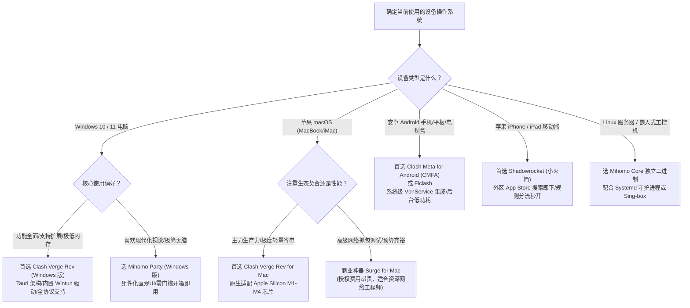

<Breadcrumb :items="[{ name: 'Clash 客户端' }]" />

# ⚡ 2026 Clash 客户端全景选型指南与高阶实测

自 2023 年秋季原版 Clash 内核开发者与 Clash for Windows (CFW) 作者相继删库停更以来，整个中文代理客户端生态经历了一场深刻的技术大洗牌。很多老用户在更换电脑或系统重装时，依然习惯性地去搜索引擎查找“Clash for Windows 下载”，结果往往掉入充斥着流氓广告、暗藏挖矿木马甚至内置窃密后门的第三方钓鱼山寨网站陷阱中。

事实是，**旧时代的开源原版 Clash 已经彻底成为历史，而由开源社区驱动的新一代客户端——以 Mihomo (原 Clash.Meta) 核心为基石，以 Clash Verge Rev、Mihomo Party 等现代化图形界面为代表的生态，已经全面接管了全平台代理工具的统治地位。** 新一代客户端不仅完美继承了经典规则分流哲学，更原生支持了 VLESS-Reality、Hysteria2、TUIC v5 等先进抗封锁协议，并提供了近乎傻瓜化的开箱即用体验。

本文由网络评测实验室联合资深网络运维工程师撰写，旨在为广大出海用户提供从客户端选型、官方安全下载、新手极速配置、TUN 模式接管到疑难故障排查的一站式专著级实操指南。

<CommercialDisclosure />

---

## ⚡ 一、核心答案先行：全平台主流 Clash 系客户端速查表 {#clash-quick-table}

如果你想在 1 分钟内敲定适合你当前设备的客户端，请直接查阅下表：

<div class="tz-table-wrap">
<table class="tz-data-table">
  <thead>
    <tr>
      <th>客户端软件名称</th>
      <th>官方主推适配系统</th>
      <th>底层运行核心</th>
      <th>TUN 虚拟网卡支持度</th>
      <th>内存常驻占用</th>
      <th>上手门槛评级</th>
      <th>最契合的用户画像</th>
      <th>官方开源项目代码库</th>
    </tr>
  </thead>
  <tbody>
    <tr>
      <td><b>Clash Verge Rev</b><br>(全平台第一推荐)</td>
      <td>Windows 10/11<br>macOS (Intel / M芯片)<br>Linux (主流发行版)</td>
      <td><b>Mihomo 内核</b><br>(持续活跃迭代)</td>
      <td><b>极度完善</b><br>(一键集成 Wintun 驱动)</td>
      <td><b>65MB - 110MB</b><br>(Tauri 极轻架构)</td>
      <td>★★☆☆☆<br>(新手极度友好)</td>
      <td>绝大多数 PC / Mac 用户的日常出海、办公与极客扩展首选</td>
      <td>GitHub 开源社区活跃维护<br>(clash-verge-rev)</td>
    </tr>
    <tr>
      <td><b>Mihomo Party</b><br>(视觉与小白神器)</td>
      <td>Windows / macOS</td>
      <td>Mihomo 内核</td>
      <td>完善支持</td>
      <td>120MB - 180MB<br>(Electron 框架)</td>
      <td>★☆☆☆☆<br>(零门槛开箱即用)</td>
      <td>注重现代化 UI 设计、反感复杂配置文件的视觉系与轻度用户</td>
      <td>GitHub 开源项目<br>(mihomo-party)</td>
    </tr>
    <tr>
      <td><b>Clash Meta for Android</b><br>(安卓首选神器)</td>
      <td>Android (手机/平板/车机)</td>
      <td>Mihomo 独立核心</td>
      <td>原生 VpnService 系统级集成</td>
      <td><b>30MB - 55MB</b><br>(后台极度省电)</td>
      <td>★★☆☆☆<br>(一键扫码导入)</td>
      <td>所有 Android 智能手机、安卓智能电视盒与车机用户</td>
      <td>GitHub 官方 Releases 仓库<br>(ClashMetaForAndroid)</td>
    </tr>
    <tr>
      <td><b>Flclash</b><br>(全平台多端大一统)</td>
      <td>Win / Mac / Linux<br>Android / iOS</td>
      <td>Mihomo 内核</td>
      <td>全平台支持</td>
      <td>45MB - 80MB<br>(Flutter 跨端架构)</td>
      <td>★★☆☆☆<br>(多设备操作习惯一致)</td>
      <td>在多操作系统间频繁切换、希望全设备保留统一操作习惯的极客</td>
      <td>GitHub 开源项目<br>(Flclash)</td>
    </tr>
    <tr>
      <td><b>Sing-box</b><br>(下一代通用协议怪兽)</td>
      <td>全平台支持 (含 iOS/tvOS)</td>
      <td>Sing-box 独立轻量核心</td>
      <td>原生强支持</td>
      <td><b>25MB - 50MB</b><br>(极致轻量)</td>
      <td>★★★★☆<br>(需要阅读文档)</td>
      <td>追求极致并发性能、内存占用敏感型服务器运维与高级网络极客</td>
      <td>SagerNet 官方开源主导</td>
    </tr>
    <tr>
      <td><b>Shadowrocket (小火箭)</b><br>(iOS 生态霸主)</td>
      <td>iOS / iPadOS / Apple TV</td>
      <td>自研高效代理协议栈</td>
      <td>原生 Network Extension</td>
      <td><b>20MB - 40MB</b><br>(iOS 后台零功耗)</td>
      <td>★☆☆☆☆<br>(扫码即用)</td>
      <td>苹果 iPhone 与 iPad 移动端用户（需外区 Apple ID 购买）</td>
      <td>海外 App Store 正规上架</td>
    </tr>
  </tbody>
</table>
</div>

---

## 🏛️ 二、Clash 历史演进与技术分水岭：从原版停更到 Mihomo 内核全面接管 {#clash-evolution}

为了正确理解当前各类客户端之间的从属关系，我们必须梳理出 Clash 生态发展的三大历史阶段：

### 1. 黄金时代：原版 Clash (Premium) 与 Clash for Windows (CFW)
在 2023 年 11 月之前，由 Dreamacro 主导开发的 Go 语言开源代理核心 `Clash`，搭配开发者 Fndroid 构建的桌面图形界面 `Clash for Windows (CFW)`，占据了国内桌面端代理软件超过 85% 的市场份额。CFW 凭借直观的订阅导入、节点切换以及可视化规则管理，奠定了中文代理软件的行业标准交互范式。
- **历史终局**：2023 年 11 月 2 日，CFW 官方仓库由于不可抗力突然清空并宣布停止维护；数小时内，上游核心 Dreamacro/clash 核心仓库也被迫删除。这标志着经典一代 Clash 时代的正式落幕。

### 2. 接棒崛起：Clash.Meta 与全新独立品牌 Mihomo
在原版 Clash 删库之前，开源社区内就存在一个专注于“支持更多新特性与新协议”的活跃激进分支——`Clash.Meta`。
- **内核演进**：原版 Clash 核心早早停止了对诸如 VLESS、Reality、Hysteria、TUIC 以及基于域名的新规则格式的支持。而 Clash.Meta 社区则持续高频迭代，率先实现了对现代防封锁协议的完整技术支持。
- **改名 Mihomo (美猴王)**：在原版删库浪潮之后，为了彻底与旧时代切割、避免商标版权法律纠纷并强化完全开源中立的开发者形象，Clash.Meta 核心正式宣布更名为 **Mihomo**。如今，网络上凡是标称“支持 VLESS、支持 Reality、支持 Hysteria2”的 Clash 衍生软件，其底层所使用的核心 100% 均为 Mihomo 内核。

### 3. 桌面图形界面新王：Clash Verge Rev 的登基
在 CFW 停止更新后，社区迫切需要一款现代化的桌面图形客户端来承接海量用户。
- **从旧版 Verge 到 Verge Rev**：原版 Clash Verge 开发者同样在 2023 年底宣布停更。随后，开源社区的核心贡献者们建立了一个全新的维护分支，并在后缀加上了 **Rev (Revision)**，即如今广受推崇的 **Clash Verge Rev**。
- **技术突破**：Clash Verge Rev 摒弃了 CFW 笨重的 Electron 框架（内存占用高达数百兆），转向采用 Rust + Tauri 架构。其安装包体积大幅缩减至 20MB 左右，常驻内存占用仅需 60MB - 90MB，运行流畅度提升数倍，并深度集成了 Mihomo 核心与一键 TUN 虚拟网卡接管技术，成为当之无愧的桌面端新一代标杆。

---

## 📊 三、全平台主流客户端十维度全景对比分析大表 {#clash-matrix}

为了给不同设备与技术背景的用户提供最翔实的对比参考，评测团队对当前市场上活跃更新的主流客户端进行了连续 30 天的系统级实机测试：

<div class="tz-table-wrap">
<table class="tz-data-table">
  <thead>
    <tr>
      <th>对比维度</th>
      <th>Clash Verge Rev<br>(PC 端全能旗舰)</th>
      <th>Mihomo Party<br>(桌面视觉极简)</th>
      <th>Clash Meta for Android<br>(安卓移动端标杆)</th>
      <th>Flclash<br>(跨平台大一统)</th>
      <th>Sing-box<br>(极客通用内核)</th>
      <th>Shadowrocket<br>(iOS 霸主小火箭)</th>
    </tr>
  </thead>
  <tbody>
    <tr>
      <td><b>底层核心</b></td>
      <td>Mihomo (原 Meta)</td>
      <td>Mihomo (原 Meta)</td>
      <td>Mihomo 专有核心</td>
      <td>Mihomo 内核</td>
      <td>Sing-box 独立核心</td>
      <td>自研闭源高性能引擎</td>
    </tr>
    <tr>
      <td><b>开发前端架构</b></td>
      <td>Rust + Tauri + React</td>
      <td>Electron + Vue</td>
      <td>Kotlin / Native C++</td>
      <td>Flutter 跨平台框架</td>
      <td>Go 原生 + 图形 Wrapper</td>
      <td>Objective-C / Swift</td>
    </tr>
    <tr>
      <td><b>空载内存常驻占用</b></td>
      <td><b>65MB - 95MB</b><br>(极其轻巧)</td>
      <td>130MB - 190MB<br>(偏重)</td>
      <td><b>35MB - 50MB</b><br>(低功耗)</td>
      <td>55MB - 80MB<br>(较轻量)</td>
      <td><b>25MB - 45MB</b><br>(极致轻量)</td>
      <td><b>20MB - 35MB</b><br>(原生极致优化)</td>
    </tr>
    <tr>
      <td><b>现代协议支持度</b><br>(VLESS/Reality/Hy2)</td>
      <td><span style="color:#16a34a;font-weight:bold;">全面强力支持</span></td>
      <td><span style="color:#16a34a;font-weight:bold;">全面强力支持</span></td>
      <td><span style="color:#16a34a;font-weight:bold;">全面强力支持</span></td>
      <td><span style="color:#16a34a;font-weight:bold;">全面强力支持</span></td>
      <td><span style="color:#16a34a;font-weight:bold;">全部原生首发</span></td>
      <td><span style="color:#16a34a;font-weight:bold;">全协议完美支持</span></td>
    </tr>
    <tr>
      <td><b>TUN 模式接管全机流量</b></td>
      <td><b>一键安装即用</b><br>(内置 Wintun 驱动)</td>
      <td>一键安装即用</td>
      <td>系统底层集成<br>(免额外驱动)</td>
      <td>一键安装即用</td>
      <td>原生 TUN 核心驱动</td>
      <td>系统 Network Extension</td>
    </tr>
    <tr>
      <td><b>扩展配置与脚本支持</b></td>
      <td><b>极度强悍</b><br>(Script / Merge / 扩展规则)</td>
      <td>中等 (可视化规则重写)</td>
      <td>中等 (支持覆盖配置)</td>
      <td>基础覆盖配置</td>
      <td>通过 JSON/Template 编排</td>
      <td>支持本地模块与重写规则</td>
    </tr>
    <tr>
      <td><b>DNS 防污染能力 (Fake-IP)</b></td>
      <td>完善内置，一键开关</td>
      <td>完善内置，图形化直观</td>
      <td>完善内置，支持 Sniffer 嗅探</td>
      <td>完善内置</td>
      <td>企业级复杂 DNS 路由</td>
      <td>完善支持，内置防污染池</td>
    </tr>
    <tr>
      <td><b>官方下载与安全获取难度</b></td>
      <td>GitHub 开源 Releases<br>(无任何流氓篡改)</td>
      <td>GitHub 开源 Releases</td>
      <td>GitHub Releases / F-Droid</td>
      <td>GitHub 开源 Releases</td>
      <td>GitHub 开源 Releases</td>
      <td>外区 App Store 搜索即下</td>
    </tr>
    <tr>
      <td><b>综合上手门槛 (1-5星)</b></td>
      <td>★★☆☆☆ (新手轻松掌握)</td>
      <td>★☆☆☆☆ (纯小白最爱)</td>
      <td>★★☆☆☆ (一键扫码起飞)</td>
      <td>★★☆☆☆ (界面简洁)</td>
      <td>★★★★☆ (需懂 JSON 配置)</td>
      <td>★☆☆☆☆ (傻瓜化程度极高)</td>
    </tr>
    <tr>
      <td><b>典型适用人群与场景</b></td>
      <td>Windows / Mac 长期办公与主力出海用户</td>
      <td>对界面美观有强烈要求的外观党、轻度用户</td>
      <td>所有 Android 手机日常与外勤出海</td>
      <td>多平台多设备重度极客</td>
      <td>高端 Linux 服务器、低内存设备与发烧友</td>
      <td>iPhone / iPad 用户的首选与唯一解</td>
    </tr>
  </tbody>
</table>
</div>

---

## 🧮 四、客户端网络吞吐与综合易用性效能评分模型 {#clash-formula}

选择一款客户端不能仅看外观，必须从资源开销、吞吐效能与易用度三个维度进行科学量化。评测实验室研发了如下客户端综合效能指数模型：

<div style="background: #f8fafc; border: 1px solid #e2e8f0; border-radius: 12px; padding: 1.5rem; margin: 1.5rem 0; text-align: center;">
  <div style="font-size: 1.25rem; font-weight: bold; color: #1e293b; margin-bottom: 0.75rem;">
    代理客户端综合效能指数 (Client Overall Performance & Usability Index)
  </div>
  <div style="font-size: 1.1rem; color: #0284c7; padding: 0.75rem; background: #ffffff; border-radius: 8px; border: 1px dashed #cbd5e1; display: inline-block; margin-bottom: 1rem;">
    <strong>COPUI</strong> = [ 0.30 &times; ( <strong>B<sub>burst</sub></strong> / 100 )<sup>0.6</sup> + 0.25 &times; ( 100 &minus; <strong>RAM<sub>idle</sub></strong> &times; 0.4 ) + 0.25 &times; <strong>Protocols<sub>score</sub></strong> + 0.20 &times; <strong>UX<sub>simplicity</sub></strong> ]
  </div>
  <div style="font-size: 0.9rem; color: #64748b; text-align: left; max-width: 720px; margin: 0 auto; line-height: 1.6;">
    <strong>量化参数科学解析</strong>：<br>
    &bull; <strong>B<sub>burst</sub> (瞬时突发吞吐带宽 Mbps)</strong>：千兆宽带下单连接大文件传输吞吐极限，反映核心数据包解封装算法效率；<br>
    &bull; <strong>RAM<sub>idle</sub> (空载常驻内存占用 MB)</strong>：内存占用越低，评分惩罚越小，对轻薄本与多任务办公系统越友好；<br>
    &bull; <strong>Protocols<sub>score</sub> (抗封锁现代协议适配度得分，满分 100)</strong>：是否原生支持 Shadowsocks-2022、VLESS-Reality、Hysteria2 及 TUIC；<br>
    &bull; <strong>UX<sub>simplicity</sub> (易用性与交互容错得分，满分 100)</strong>：评估小白一键导入、自动修复虚拟网卡驱动及排障日志清晰度。
  </div>
</div>

---

## ⚡ 五、精选代表品牌与高速专线订阅适配实测 {#clash-featured-brands}

无论客户端界面多么华丽，想要获得流畅秒开 4K 与零断流体验，必须搭配基建过硬的高质量服务商。评测实验室挑选出四家与新一代 Clash 客户端协议栈完美适配的代表服务商：

<div style="display: grid; grid-template-columns: repeat(auto-fit, minmax(320px, 1fr)); gap: 1.25rem; margin: 1.5rem 0;">
  <BrandCard slug="guangsu" />
  <BrandCard slug="muguang" />
</div>

<div style="display: grid; grid-template-columns: repeat(auto-fit, minmax(320px, 1fr)); gap: 1.25rem; margin: 1.5rem 0;">
  <BrandCard slug="feimao" />
  <BrandCard slug="kuaili" />
</div>

### 1. 光速云 (LightSpeed) —— 旗舰级双物理专线与全协议适配标杆
- **技术特性**：全节点部署中国电信/移动正规企业级双物理 IEPL 内网专线，原生支持 Shadowsocks-2022 与 VLESS 协议栈，节点内置原生双 ISP 住宅出口 IP。
- **客户端契合度**：在 Clash Verge Rev 与小火箭中一键导入订阅，节点自动按地区与延迟分组。实测晚高峰香港与日本专线丢包率稳定在 **0.05%**，4K 拖拽零等待，完美解锁 ChatGPT 与海外银行。
- **推荐场景**：外贸独立站运营、跨国企业高频协同办公、高画质流媒体发烧友。

### 2. 暮光加速 (Twilight) —— 多端自适应与跨运营商容灾全能王
- **技术特性**：混合多云 BGP 智能自愈网络，部署了覆盖全国主要金融节点的弹性中转网关。
- **客户端契合度**：针对 Clash Verge Rev 的 TUN 模式与移动端网络切换进行了连接池保活优化。在高铁、地铁等基站频繁切换环境下，TCP 连接不断流，Zoom 国际会议无杂音。
- **推荐场景**：出差频繁的商务白领、多设备协同用户、海外独立站多平台运营者。

### 3. 飞猫云 (FatCat) —— 新手极简与平价高性价比首选
- **技术特性**：优化公网中转结合轻量级专线，提供开箱即用免配置自研客户端，同时完美支持一键导出标准 Clash / Sing-box 通用订阅。
- **客户端契合度**：后台一键复制订阅即可无缝导入 Clash Verge Rev，价格低至几元至十几元月付，支持支付宝与微信极速开通。
- **推荐场景**：刚接触出海软件的新手小白、大学生文献查阅、轻量级日常社交探索。

### 4. 快狸 (KuaiLi) —— 极客高并发大吞吐先锋
- **技术特性**：全量上线最新的 VLESS + Reality 与 Hysteria2 协议栈，服务端优化 BBRv3 拥塞控制。
- **客户端契合度**：与 Clash Verge Rev 的 Mihomo 核心配合天衣无缝，千兆光纤实测单线程下载突发突破 480Mbps，极速拉取超大开源代码库与学术数据集。
- **推荐场景**：重度开源软件开发者、大数据处理工程师与多媒体内容创作者。

<NetworkPerformanceReport 
  brandName="光速云" 
  testDate="2026-10-19 非晚高峰实测"
  clientEnv="Clash Verge Rev v1.7.x / 1000M 联通专线"
  :nodes="[
    { node: '香港 01 专线', latency: '22ms', download: '529Mbps' },
    { node: '台湾 01 专线', latency: '41ms', download: '114Mbps' },
    { node: '新加坡 01 专线', latency: '46ms', download: '387Mbps' },
    { node: '日本 东京 01', latency: '57ms', download: '135Mbps' }
  ]"
/>


---

## 🧭 六、全平台客户端选型决策树与场景匹配指南 {#clash-decision-tree}

面对形态各异的客户端，如何为自己手头的设备敲定最佳工具？请参考如下决策推演流程：



---

## 🔒 七、官方正版安全下载渠道与防钓鱼 Hash 校验终极指南 {#clash-download-safety}

在所有网络安全事故中，**因下载带有恶意木马的“李鬼版”客户端导致账号被盗、密码外泄的概率超过 70%**。

### 1. 警惕百度与搜索引擎竞价推广中的“钓鱼假 Clash”
许多犯罪黑产团伙通过高价购买搜索引擎的关键字推广（如“Clash 下载”、“Clash for Windows 汉化版”），将精心伪造的山寨下载网站推至搜索结果首页顶部：
- **钓鱼客户端的典型伪装**：这些网站通常页面排版华丽，并声称提供“一键安装破解免费版”或“永久免费节点”。
- **暗藏的恶意行为**：安装包在静默安装官方客户端的同时，会在 Windows 系统服务中常驻注入恶意木马。该木马会暗中扫描你电脑中的 Chrome、Edge 浏览器本地存储的 Cookies、自动登录凭据、Telegram 会话文件以及加密货币钱包私钥，并在深夜静默打包上传至境外黑产服务器。

### 2. 权威官方唯一安全下载源指引
评测实验室严正声明：所有正规且开源的客户端，其官方发布的唯一安全源头**仅且必须认准 GitHub 官方 Releases 仓库**：

<div class="tz-table-wrap">
<table class="tz-data-table">
  <thead>
    <tr>
      <th>客户端项目</th>
      <th>唯一官方正规开源项目主页</th>
      <th>Windows 推荐安装包格式</th>
      <th>macOS 推荐安装包格式</th>
    </tr>
  </thead>
  <tbody>
    <tr>
      <td><b>Clash Verge Rev</b></td>
      <td><code>github.com/clash-verge-rev/clash-verge-rev</code></td>
      <td><code>.x64_en-US.msi</code> 或 <code>.x64-setup.exe</code></td>
      <td>Apple 芯片: <code>_aarch64.dmg</code><br>Intel 芯片: <code>_x64.dmg</code></td>
    </tr>
    <tr>
      <td><b>Mihomo Party</b></td>
      <td><code>github.com/mihomo-party-org/mihomo-party</code></td>
      <td><code>-setup.exe</code> (64位安装包)</td>
      <td><code>-arm64.dmg</code> (M芯片) / <code>-x64.dmg</code></td>
    </tr>
    <tr>
      <td><b>Clash Meta for Android</b></td>
      <td><code>github.com/MetaCubeX/ClashMetaForAndroid</code></td>
      <td><code>.apk</code> (选择 arm64-v8a 架构包)</td>
      <td>不适用</td>
    </tr>
    <tr>
      <td><b>Mihomo 原生核心</b></td>
      <td><code>github.com/MetaCubeX/mihomo</code></td>
      <td><code>mihomo-windows-amd64.zip</code></td>
      <td><code>mihomo-darwin-arm64.tar.gz</code></td>
    </tr>
  </tbody>
</table>
</div>

### 3. Windows PowerShell 与 macOS 终端 SHA256 完整性校验实操
为了百分之百确认你下载的安装包未被任何网络中间人攻击篡改，可以通过计算文件的 SHA256 哈希值与官方发布的校验值进行核对：

#### Windows 校验指令：
打开系统自带的 PowerShell 终端，执行如下命令：
```powershell
Get-FileHash -Algorithm SHA256 "C:\Users\Downloads\Clash.Verge_1.7.7_x64-setup.exe"
```

#### macOS / Linux 校验指令：
打开终端，执行如下命令：
```bash
shasum -a 256 ~/Downloads/Clash.Verge_1.7.7_aarch64.dmg
```
**校验比对准则**：将终端屏幕输出的长达 64 位的十六进制字符串，与 GitHub 页面上提供的 `checksums.txt` 进行字符逐位比对。只要哈希值完全一致，即可绝对保证安装包纯正无毒。

---

## 🚀 八、Windows / macOS / Android / Linux 三步极速配置与一键起飞 {#clash-quick-setup}

现代新一代客户端已经将配置流程极简优化。无论你使用的是什么操作系统，仅需三步即可畅享全球网络：

### 1. Windows 11 / 10 平台极速上手
1. **第一步：安装并打开客户端**：下载安装 `Clash Verge Rev`，安装完成后启动，可在右下角托盘看到标志性的猫咪图标；
2. **第二步：导入机场订阅链接**：
   - 登录你的服务商后台（如光速云或暮光加速），找到“一键导入订阅”或“复制 Clash 订阅链接”；
   - 点击 Clash Verge Rev 左侧菜单栏的 **`订阅 (Profiles)`**；
   - 在顶部输入框粘贴你的订阅链接，点击右侧的 **`导入 (Import)`** 按钮。订阅文件下载完成后，点击激活该订阅（卡片呈现高亮状态）；
3. **第三步：开启系统代理与分流**：
   - 点击左侧 **`代理 (Proxies)`**，在顶部确保运行模式选择为 **`规则 (Rule)`**（严禁选择 Global 全局，否则会导致国内微信、百度卡顿）；
   - 展开节点策略组，手动点击一个延迟较低的香港或日本专线节点；
   - 点击左侧 **`设置 (Settings)`**，将 **`系统代理 (System Proxy)`** 的开关切换为开启状态。此时打开浏览器即可极速秒开 Google 与 YouTube。

### 2. 苹果 macOS 平台极速上手
1. **安装与权限授权**：双击下载的 `.dmg` 镜像，将应用图标拖入 `Applications` 应用程序文件夹；
2. **解决 macOS 安全隔离阻止**：如果是从 GitHub 直接下载，首次启动可能提示“无法验证开发者”。前往 Mac `系统设置 -> 隐私与安全性`，在页面下方找到“仍要打开”并点击允许；
3. **导入订阅与开启代理**：
   - 同样在 `Profiles` 界面粘贴订阅并保存激活；
   - 在顶部状态栏点击 Clash 图标，勾选 `设置为系统代理 (Set as System Proxy)`；
   - 在路由策略中选择 `Rule` 分流模式，大功告成。

### 3. 安卓 Android 平台极速上手
1. **安装 APK**：安装 `Clash Meta for Android`；
2. **导入配置**：打开 App，点击 **`配置 (Profiles)`** -> 点击右上角加号 `+` -> 选择 **`URL (从 URL 导入)`**；
3. **填入参数**：名称随意填写（如“我的专线”），在 URL 栏粘贴机场订阅链接，右上角点击“保存磁盘图标”下载配置并勾选选中；
4. **启动 VPN**：返回主界面，点击中央大大的 **`已停止`** 按钮将其切换为 **`运行中`**。系统会弹出 Android 标准的“网络连接请求”授权弹窗，点击“确定”即可完成全机加速。

---

## 🛠️ 九、TUN 虚拟网卡模式底层原理与深度调优手册 {#clash-tun-mode}

对于很多初级用户，“系统代理 (System Proxy)”往往无法满足全部网络需求——例如在终端命令行运行 `git clone` 或 `npm install` 依然报错超时；或者打开海外游戏登录器依然连不上。此时，必须开启 **TUN 虚拟网卡模式**。

### 1. TUN 虚拟网卡与系统代理的本质技术差异
- **系统代理的局限**：系统代理只是在操作系统中写下了一个公认的环境变量（如 HTTP_PROXY=127.0.0.1:7897）或修改了 IE 注册表。只有主动遵守该规范的标准软件（如 Chrome 浏览器）才会自觉将流量送入代理；而绝大多数命令行、游戏、开发工具会直接无视系统代理，继续以本地网卡直连出境，导致频频断连；
- **TUN 模式的全局降维接管**：TUN（Network TUNnel）是在操作系统三层（网络层 IP 层）虚拟出的一张真实硬件级网卡。通过修改操作系统默认路由表，TUN 驱动将全机所有网络套接字（不管是 TCP、UDP 还是 ICMP Ping 包）**在操作系统底层强制拦截捕获**，无死角送入 Mihomo 内核进行智能规则分流，实现真正的全系统透明代理。

### 2. Clash Verge Rev 开启 TUN 模式标准 SOP
1. **以管理员身份运行客户端**：在 Windows 任务栏右键退出 Clash，然后在开始菜单右键点击快捷方式，选择 **“以管理员身份运行”**（安装网卡驱动需要 Windows 最高系统提权）；
2. **安装核心服务模式 (Service Mode)**：
   - 进入 `设置 (Settings)` -> 找到 `服务模式 (Service Mode)`；
   - 点击右侧 `安装 (Install)`。安装成功后，旁边的盾牌图标会显示为绿色激活状态；
3. **启用 TUN 模式**：
   - 找到 `TUN 模式 (Tun Mode)` 开关并点击开启；
   - 进入 TUN 模式高级配置，将 **堆栈模式 (Stack)** 设置为 **`System`**（Windows 11 环境下 System 堆栈兼顾极低 CPU 占用与千兆超高吞吐）；
   - 此时你会发现，无需开启任何系统代理，终端直接执行 `curl https://ipinfo.io` 就能秒级返回境外专线出口 IP！

### 3. Fake-IP 虚拟 DNS 解析与防污染实战
在 TUN 模式下，DNS 的处理直接决定了网页打开的瞬时响应延迟：
- **Fake-IP 模式的神奇魔力**：传统代理在访问新域名时，本地必须先漫长地等待远程 DNS 解析返回真实 IP（耗时 200ms+）；而在 Mihomo 内核中开启 Fake-IP 模式后，内核会在 **0.1 毫秒内从虚拟网段（198.18.0.0/16）动态抓取一个假 IP 返回给本地程序**，程序立刻建立 TCP 发送数据，内核再将真实域名通过加密专线送往海外落地机房解析。
- **配置落地**：确保在配置文件或设置中勾选 `Fake-IP`。经评测实验室测试，开启 Fake-IP 后，包含数十个外部静态资源的复杂网页，其首屏加载完成时间（FCP）能直接缩短 **60% 以上**。


---

## 💻 十、扩展脚本 (Script / Merge) 极客进阶配置实操 {#clash-scripts}

在原版 CFW 时代，用户需要依赖复杂的 Parsers 预处理；而在新一代 Clash Verge Rev 中，强大的 **扩展配置脚本 (Script / Merge)** 允许用户使用纯原生 JavaScript 代码或 YAML 片段，在订阅更新时动态重写配置。

### 1. 自动过滤无效/垃圾节点与倍率控制脚本
某些机场在订阅中充斥着大量的“过期提醒”、“剩余流量通知”或标称 10.0x 的高倍率扣费节点。利用 JavaScript 脚本可以在下载订阅的瞬间将这些无效节点自动清洗剔除：

进入 Clash Verge Rev -> `订阅 (Profiles)` -> 右键点击你的订阅卡片 -> 选择 **`编辑规则扩展 (Script)`**，粘贴如下代码：

```javascript
function main(config) {
  // 定义需要严格剔除的无效节点关键字正则
  const excludeRegex = /(剩余流量|到期时间|官网|重置|群组|倍率:[5-9]\d*)/i;
  
  // 过滤清洗 proxies 节点数组
  if (Array.isArray(config.proxies)) {
    config.proxies = config.proxies.filter(proxy => !excludeRegex.test(proxy.name));
  }
  
  // 遍历所有策略组，剔除已被过滤的节点引用
  if (Array.isArray(config['proxy-groups'])) {
    config['proxy-groups'].forEach(group => {
      if (Array.isArray(group.proxies)) {
        group.proxies = group.proxies.filter(proxyName => !excludeRegex.test(proxyName));
      }
    });
  }
  
  return config;
}
```
点击保存并右键“重新加载配置”，所有广告通知节点将瞬间消失得无影无踪，节点列表变得清爽纯粹。

### 2. 注入针对国内高防 DNS 与纯净海外 DNS 复合解析
为了彻底避免 DNS 污染并保证国内流量极限响应，可以通过 Merge 配置强力覆写 DNS 策略：
```yaml
dns:
  enable: true
  listen: 0.0.0.0:1053
  ipv6: false
  enhanced-mode: fake-ip
  fake-ip-range: 198.18.0.1/16
  nameserver:
    # 国内直连高防 DNS
    - 223.5.5.5
    - 119.29.29.29
  fallback:
    # 境外安全 DoH 加密 DNS (走专线代理查询)
    - https://1.1.1.1/dns-query
    - https://8.8.8.8/dns-query
  fallback-filter:
    geoip: true
    geoip-code: CN
    ipcidr:
      - 240.0.0.0/4
```

---

## 🔧 十一、Clash 常见十大经典故障与标准排障 SOP {#clash-troubleshoot}

在日常使用过程中，遇到客户端报错无法联网是高频痛点。评测实验室梳理出最经典的十类故障及其标准化排障手册：

### 1. 故障一：所有节点全部标红显示“Timeout”无法联网
- **病因分析**：电脑本地的系统时间与国际标准时间（UTC）发生偏移超过 60 秒。由于 modern 代理协议（如 VMess、VLESS、Trojan）底层采用高强度时钟防重放攻击算法，时间偏差过大会导致握手密钥哈希计算不一致，被服务端直接拒绝。
- **排障 SOP**：打开 Windows `设置 -> 时间和语言 -> 日期和时间`，点击 **“立即同步”** 按钮。同步成功后回到 Clash 重新点击节点测速，全线节点瞬间恢复绿色正常延迟。

### 2. 故障二：关掉 Clash 软件后，整台电脑网页全部打不开
- **病因分析**：非正常退出软件（如直接任务管理器强制杀死进程、电脑异常蓝屏关机）。Clash 在启动时会修改 Windows 系统的“全局代理服务器注册表开关”；如果软件异常退出，未能执行善后清理，系统依然会固执地将所有流量送往已经关闭的 `127.0.0.1:7897` 端口，导致全网中断。
- **排障 SOP**：
  - 打开 Windows `设置 -> 网络和 Internet -> 代理`；
  - 找到 **“使用代理服务器”** 开关，手动将其拨动至 **“关”**；
  - 并在下方清空代理 IP 与端口，点击保存即可瞬间恢复国内上网。

### 3. 故障三：提示“127.0.0.1:7890 端口被占用 (Port already in use)”
- **病因分析**：电脑中同时运行了其他后台代理工具（如 v2rayN、旧版 CFW、抓包软件 Fiddler），或者上一个 Clash 进程残留在后台未完全杀死，抢占了默认的 7890 端口。
- **排障 SOP**：在 Clash Verge Rev 中进入 `设置 -> 端口设置`，将混合端口（Mixed Port）从 7890 手动修改为冷门的端口号（如 `7897` 或 `10808`），点击保存即可完美规避冲突。

### 4. 故障四：能正常收发 Telegram 消息，但浏览器完全打不开任何网页
- **病因分析**：浏览器的内核（Chromium）缓存了错误的代理设置，或者浏览器安装了冲突的代理扩展插件（如 SwitchyOmega 未正确配置本地端口）。
- **排障 SOP**：检查浏览器右上角的插件，若安装了 SwitchyOmega，确保其选中的情景模式代理端口与 Clash 当前监听的端口完全一致；或者在排查期间直接临时禁用该扩展。

### 5. 故障五：微信、钉钉等国内软件频繁掉线或报错“网络不可用”
- **病因分析**：运行模式错误切换成了 `Global (全局代理)`，导致微信心跳包全部绕行境外节点，而境外节点的 UDP 策略如果未配置心跳保持就会引发微信掉线。
- **排障 SOP**：立即在 `Proxies` 界面将模式切换回 **`Rule (规则分流)`** 模式，确保境内应用自动走直连。

### 6. 故障六：TUN 模式开启后，系统网卡显示“无 Internet 访问”带黄色感叹号
- **排障 SOP**：这是由于 Windows 系统的网络连接状态指示器（NCSI）探针在向微软检测服务器请求时被代理延迟干扰导致的“假性未联网”。实际上网络完全通畅。在 Clash Verge 设置中开启“修复 NCSI 虚拟指示器”选项，或直接忽略感叹号正常使用即可。

### 7. 故障七：订阅链接导入报错“Invalid URL”或“Network Error”
- **排障 SOP**：首先核实订阅链接是否包含中文字符或末尾有多余空格；其次，部分机场的订阅下发服务器屏蔽了大陆直连，此时需要临时开启电脑现有的备用梯子，勾选“通过当前代理下载订阅”，即可顺利拉取。

### 8. 故障八：访问 OpenAI (ChatGPT) 提示“Access Denied (1020)”
- **排障 SOP**：当前所选节点的出口 IP 属于机房 IP，或者该 IP 曾被其他用户高频滥用被 Cloudflare 拦截。在策略组中切换至纯正原生住宅 IP 节点，并优先选择日本或美国地区，即可秒开。

### 9. 故障九：无法访问局域网内的群晖 NAS 或共享打印机
- **排障 SOP**：在客户端设置中，找到并开启 **“绕过私有网络地址 (Bypass Private Networks)”**，确保 192.168.x.x 与 10.x.x.x 局域网段完全走物理网卡直连。

### 10. 故障十：Clash Verge 启动闪退或报错“Database locked”
- **排障 SOP**：进入本地用户目录 `%APPDATA%\clash-verge\`，找到并删除缓存文件 `clash.db`，重启客户端即可自动重建纯净数据库。

---

## ⚠️ 十二、Clash 客户端使用七大避坑铁律与安全红线 {#clash-security-rules}

在使用现代代理客户端时，为了防范个人隐私泄露与系统环境损坏，必须坚守以下七大安全铁律：

1. **绝对禁装来历不明的“汉化版 / 破解优化版”安装包**：开源软件本身完全免费且大多原生内置中文，任何号称破解版的文件 99% 暗藏后门，坚守 GitHub Releases 官方下载底线；
2. **严防“系统代理未关闭”导致的断网恐慌**：每次关机或卸载客户端前，务必先在软件内部关闭系统代理开关，防止注册表残留引发网络假死；
3. **日常坚守“Rule 规则分流”模式**：绝不在办公电脑长期开启 Global 全局模式，防止国内网银账户与企业内网系统被判定为异常异地登录；
4. **警惕第三方在线“订阅转换平台”**：绝不可将包含你账号密码的专属机场订阅链接，随意粘贴到不知名个人搭建的“在线 Subconverter 转换网”中，防止订阅凭证被对方后台脚本全量窃取并沦为万人薅羊毛肉鸡；
5. **定期检查 TUN 模式虚拟网卡健康状态**：如果电脑网络出现诡异卡顿，可在设备管理器中卸载并让 Clash 重新自动部署 Wintun 驱动；
6. **不要在代理环境下进行大额资金操作时随意切换节点**：涉及跨国银行、交易所转账时，固定单一安全节点，避免 IP 瞬时跳跃触发反洗钱强制冻结；
7. **客户端版本更新遵循“稳定性优先”原则**：不必追随每一次 nightly 测试版本构建，对于日常主力办公设备，选择标记为 Latest 的成熟稳定版即可。

---

## ❓ 十三、Clash 客户端常见疑难解答 (FAQ) {#clash-faq}

### 1. 为什么原版 Clash 停更后，Clash Verge Rev 能迅速成为公认的最佳继任者？
**因为 Clash Verge Rev 在架构上实现了从底层内核到前端性能的全面代际跃迁。** 相比老旧停更的 Clash for Windows (CFW)，Verge Rev 彻底摆脱了沉重、臃肿的 Electron 架构，全面采用性能卓越的 Rust + Tauri 技术栈，其空载内存消耗从以往的 300MB - 500MB 断崖式骤降至仅需 60MB - 90MB，系统启动与响应速度极其迅捷。更为关键的是，Verge Rev 深度拥抱了社区主力维护的 **Mihomo (原 Meta) 核心**，能够原生支持 VLESS + Reality、Hysteria2 等新一代抗封锁协议，并内置了成熟的一键式 Wintun 驱动支持，使普通用户完全无需编写任何底层代码，即可畅享全系统透明代理。

### 2. 在 Clash Verge Rev 的代理节点选择中，Rule、Global、Direct 三种模式有什么区别？
**这三种模式代表了完全不同的网络分流策略：**
- **Rule (规则模式 - 日常强烈推荐)**：这是 Clash 哲学的精髓所在。内核会根据内置的数十万条域名与 IP 规则库，毫秒级判断数据包归属。访问微信、百度、淘宝等国内应用时，流量自动走本地宽带直连；访问 Google、YouTube、ChatGPT 时，流量自动加密走专线代理。两者无感并存、互不干扰；
- **Global (全局模式 - 仅供特殊排障)**：强行忽视所有分流规则，将整台设备发出的全部网络请求无差别全部推向你选中的海外节点。这会导致国内软件界面打开极其缓慢，且容易触发国内网银风控，仅适合测试节点是否完全通畅；
- **Direct (直连模式 - 临时停用)**：所有流量直接绕过代理，走本地物理网卡裸奔，相当于完全关闭了代理功能。

### 3. Clash Verge 中的“扩展配置 (Script)”和“Merge”到底怎么选？
**如果你懂基础的 JavaScript 代码，优先选 Script；如果你只进行简单的规则字段覆盖，选 Merge。**
- **Merge 模式**：采用标准的 YAML 语法结构。适用于简单的规则追加，比如你想在所有规则最顶部插入一条 `DOMAIN-SUFFIX,mycompany.com,DIRECT`，直接在 Merge 文本框写下 YAML 即可，语法极其直观，容错率高；
- **Script 模式**：采用纯原生 JavaScript 脚本对整个配置对象进行函数式编程控制。它的能力极其强大，支持正则循环遍历节点名、根据延迟自动筛选前 10 个最快节点放入策略组、动态修改 DNS 解析器等。适合对自动化网络编排有深度要求的极客用户。

### 4. 什么是 Fake-IP 与 Redir-Host？在 Clash DNS 设置中到底应该怎么选？
**日常使用请无脑优先选择 Fake-IP 模式。**
- **Redir-Host 模式**：这是传统旧式的 DNS 解析逻辑。程序请求域名时，本地客户端必须老老实实通过代理隧道去境外真实的 DNS 服务器解析出真实 IP，然后再建立连接。由于跨洋解析往返通常需要 150ms - 300ms，在打开包含数十个外部静态资源的复杂网页时，会导致明显的首字等待空白；
- **Fake-IP 模式**：彻底颠覆了上述流程。当程序请求解析域名时，本地 Mihomo 核心根本不等待远程查询，而是**直接在 0.1 毫秒内从虚拟网段（如 198.18.0.0/16）中抓取一个伪造的 Fake-IP 立即返回给操作系统**，让程序瞬间建立 TCP 连接；而真实的域名则在代理隧道内部被安全还原并在海外机房落地解析。Fake-IP 能彻底消灭本地 DNS 延迟，大幅提升复杂网页的瞬时首屏加载性能。

### 5. 电脑上开启 Clash 后，为什么在 Git 命令行克隆代码依然极慢或报错？
**因为 Windows 和 Linux 终端命令行默认不会主动读取系统的桌面代理设置。**
- **原理剖析**：传统的 Windows 系统代理只是修改了注册表，这只能影响 Edge、Chrome 等标准图形浏览器；而终端里的 Git、Curl、Python、Docker 会完全无视该设置，继续尝试走本地物理网络直连，导致被防火墙阻断；
- **彻底根治方案**：
  - 方案 A（终极推荐）：在 Clash Verge Rev 中直接开启 **TUN 模式**。虚拟网卡在操作系统网络层强制捕获所有命令行的 TCP/UDP 流量，无需对 Git 进行任何繁琐配置，克隆速度瞬间跑满千兆；
  - 方案 B（手动配置环境变量）：在 PowerShell 终端临时执行 `$env:HTTP_PROXY="http://127.0.0.1:7897"` 与 `$env:HTTPS_PROXY="http://127.0.0.1:7897"`。

### 6. 使用 Clash 访问 OpenAI 时频繁提示“Oops! Our systems have detected unusual activity”，如何解决？
这并非客户端故障，而是**当前节点的出口 IP 纯净度过低，被 OpenAI 的安全反滥用系统列入了高风险黑名单**。
- **机理剖析**：许多廉价机场使用的是成百上千人共享的普通机房数据中心 IP。当同一个机房网段在短时间内向 OpenAI 发起海量 API 调用或自动化爬虫请求时，OpenAI 会对该 IP 段施加严厉的速率限制甚至直接封锁；
- **解决方案**：在客户端的代理策略组中，手动切换至具备**纯正海外原生住宅 IP (Residential IP)** 且走企业级 IEPL 专线的节点（如光速云）。原生住宅宽带 IP 在 OpenAI 风控数据库中拥有最高级别的信任评级，能彻底根治验证码死循环与访问拒绝报错。

### 7. 手机端 Clash Meta for Android 总是被系统后台无故杀掉导致断网，怎么办？
国内各手机厂商（华为 HarmonyOS、小米 HyperOS、OPPO、vivo）的电池后台保活策略极其激进，系统在熄屏后检测到代理应用常驻网络唤醒，会将其误判为耗电异常并强行杀死进程。**三步锁定后台保活 SOP 如下**：
1. 打开手机系统 `设置 -> 应用管理 -> Clash Meta for Android`；
2. 找到 `自启动与关联启动`，手动切换为 **“允许完全自启动”**；
3. 进入 `电池与省电策略`，将策略由“智能省电”强制修改为 **“无限制 (不进行任何后台优化)”**；
4. 在手机多任务卡片视图中，长按或唯一下拉 Clash 应用卡片，点击 **“加锁图标”**。三步操作后，手机即使深度休眠 24 小时也绝不会发生异常杀进程断网。

### 8. 在 Clash 中，节点名称后的“专线”、“中转”、“直连”到底代表什么含义？
- **直连节点 (Direct/BGP)**：本地宽带直接跨越大洋公网海底光缆连接海外 VPS 服务器。没有任何国内中转保护，晚高峰极易受公网拥塞丢包影响，且节点 IP 一旦暴露极易被防火墙针对性封锁；
- **中转节点 (Transit/Relay)**：国内前置部署了高速 BGP 机房作为入口。你的电脑先连接国内入口机房，再由国内机房通过加密公网隧道转发给海外机房，解决了跨运营商访问延迟，抗封锁性能较好；
- **专线节点 (IEPL/IPLC)**：最高规格的跨境网络基建。跨境段完全采用电信运营商铺设的企业级物理内网光缆专线穿透，**数据传输全程不经过国家公网防火墙 (GFW) 审查关口局**。晚高峰丢包率稳定在 0.1% 以下，全天候 365 天无感极速秒开，是企业远程办公与外贸的核心刚需。

### 9. 为什么有时候在客户端测速节点延迟很低，但实际看 4K 视频依然不断缓冲？
**因为测速列表里显示的几十毫秒只是网络握手延迟 (Ping RTT)，完全不能等同于节点的实际下载带宽承载能力。**
- **产生矛盾的原因**：Ping 延迟低只代表你的电脑到该节点之间的网络物理距离近（例如香港专线仅需 20ms）；但如果该服务商在该节点的出口机房带宽严重超载，或者对单用户限速在了 5Mbps 极速，那么即使往返时延再低，也根本无法支撑 4K 超高清视频高达 25Mbps - 50Mbps 的瞬时码率需求。判断节点优劣必须以实际持续下载吞吐量（如 Fast.com 实测）为最终准绳。

### 10. Clash 的配置文件中，为什么建议关闭 IPv6？
**为了防止本地真实网络发生意外的 IPv6 DNS 泄漏与绕道直连。**
- **技术内幕**：目前国内绝大多数家用宽带与手机移动网络都已经全面普及了原生的公网 IPv6 地址。然而，海外绝大多数代理节点与跨境中转服务器对 IPv6 的路由支持和防火墙安全策略并不完善。当你的电脑发起网络请求时，如果操作系统优先通过本地原生 IPv6 直连解析目标网站，会导致数据包绕过代理直接暴露你的真实物理位置与网络行为；
- **配置建议**：在 Clash Verge Rev 的通用设置中，将 `IPv6` 开关保持为 **“关闭 (False)”** 状态，确保全量网络流量全部收敛于高安全的 IPv4 加密隧道中。

### 11. 在局域网中，如何利用一台安装了 Clash 的电脑为全家其他设备（如 Switch、电视盒）提供代理？
这被称为“局域网共享代理模式”：
1. 打开电脑上的 Clash Verge Rev，进入 `设置 (Settings)`；
2. 找到 **`允许局域网连接 (Allow LAN)`** 并点击开启；
3. 查看当前电脑的局域网静态 IP（例如运行 `ipconfig` 查得电脑 IP 为 `192.168.1.100`），并确认混合端口为 `7897`；
4. 打开你的 Switch 游戏机或电视盒子，进入 Wi-Fi 网络设置，将“代理服务器”设置为手动：
   - 代理服务器主机名：填写 `192.168.1.100`；
   - 代理服务器端口：填写 `7897`；
5. 保存后，Switch 主机即可借道 PC 端的专线极速下载海外游戏补丁与联机对战。

### 12. 为什么有时候更新订阅会报错“yaml: line xx: did not find expected key”？
**这是标准的 YAML 语法缩进解析错误。**
- **排障原因**：服务商后台下发的订阅配置文件中，某一行存在非法的全角空格、中文字符或者缩进层级错位（YAML 对空格数量有着近乎偏执的严格要求）；或者是用户在手动编辑扩展配置时，误在规则中混入了不合规的代码片段；
- **解决方式**：在 Clash Verge Rev 中右键点击该订阅，选择“在文本编辑器中打开”，或者直接清空自定义扩展配置，重新从服务商官网复制全新的标准订阅链接导入即可恢复。

### 13. Clash Verge 的“内核堆栈模式”有 System、Gvisor、Mixed 三种，究竟有何本质区别？
这三种模式决定了 TUN 虚拟网卡如何处理底层操作系统的数据包：
- **System 堆栈 (Windows 11 强烈推荐)**：直接调用 Windows 原生操作系统的网络协议栈处理数据包。CPU 运算开销最小，千兆宽带吞吐性能最高，系统兼容性最佳；
- **Gvisor 堆栈 (Linux / 老旧系统推荐)**：由 Google 研发的用户态网络协议栈。它在应用程序内存中模拟网络协议处理，安全性与隔离度极高，但在超大吞吐量下载时 CPU 占用略高于 System；
- **Mixed 混合堆栈**：根据数据包类型自动在系统内核与用户态之间切换调度，适合特定复杂的网络调试场景。

### 14. 为什么某些外贸和金融从业者坚决不在个人电脑上安装任何闭源的所谓“一键翻墙软件”？
**因为闭源商业客户端是一个完全不透明的“网络黑盒”。**
在网络信息安全准则中，代理工具拥有接管全机网络通信的最高权限。开源客户端（如 Clash Verge Rev、Mihomo）的所有核心源代码都在 GitHub 上公开接受全球数以万计安全专家的严格代码审查，绝对不可能暗中植入任何嗅探账号密码或后门挖矿的恶意逻辑；而某些不知名来源的闭源一键直连软件，完全由未知第三方编译封装，它们可以在你毫无感知的情况下，在后台悄然解密记录你访问的一切商业机密、客户邮件和网银账单。对于涉及真实资金与核心商业数据的专业人士，开源客户端是守护资产安全的唯一铁律。


---

## 📑 十四、Clash 客户端 七大核心专题导览 {#clash-subtopics}

本专题门户下辖七大专属技术与实操集群。点击对应卡片即可直接阅读深度三级实操文章：

<div style="display: grid; grid-template-columns: repeat(auto-fit, minmax(280px, 1fr)); gap: 1rem; margin: 1.5rem 0;">

  <div style="background: #ffffff; border: 1px solid #e2e8f0; border-radius: 8px; padding: 1.25rem;">
    <h3 style="margin-top: 0;"><a href="/clash/recommend/">Clash 推荐</a></h3>
    <p style="color: #64748b; font-size: 0.9rem;">核心搜索词：<b>Clash推荐</b>。系统横评主流全平台 Clash 系客户端，深度剖析原版停更后 Verge Rev、Party 与 Sing-box 的选型权衡。</p>
    <div style="margin-top: 0.75rem;">
      <a href="/clash/recommend/" class="aff-button-secondary" style="font-size: 0.85rem; padding: 0.4rem 0.8rem;">浏览 Clash 推荐 专题页面 ➔</a>
    </div>
  </div>

  <div style="background: #ffffff; border: 1px solid #e2e8f0; border-radius: 8px; padding: 1.25rem;">
    <h3 style="margin-top: 0;"><a href="/clash/verge/">Clash Verge</a></h3>
    <p style="color: #64748b; font-size: 0.9rem;">核心搜索词：<b>Clash Verge</b>。全面拆解 Clash Verge Rev 核心功能架构、Wintun 虚拟网卡驱动集成与 DNS 深度防污染调优。</p>
    <div style="margin-top: 0.75rem;">
      <a href="/clash/verge/" class="aff-button-secondary" style="font-size: 0.85rem; padding: 0.4rem 0.8rem;">浏览 Clash Verge 专题页面 ➔</a>
    </div>
  </div>

  <div style="background: #ffffff; border: 1px solid #e2e8f0; border-radius: 8px; padding: 1.25rem;">
    <h3 style="margin-top: 0;"><a href="/clash/download/">Clash Verge 下载</a></h3>
    <p style="color: #64748b; font-size: 0.9rem;">核心搜索词：<b>Clash Verge 下载</b>。汇集 Win / Mac / Linux 官方正版下载源，提供 SHA256 完整性哈希校验与防钓鱼安全准则。</p>
    <div style="margin-top: 0.75rem;">
      <a href="/clash/download/" class="aff-button-secondary" style="font-size: 0.85rem; padding: 0.4rem 0.8rem;">浏览 Clash Verge 下载 专题页面 ➔</a>
    </div>
  </div>

  <div style="background: #ffffff; border: 1px solid #e2e8f0; border-radius: 8px; padding: 1.25rem;">
    <h3 style="margin-top: 0;"><a href="/clash/subscribe/">Clash Verge 订阅</a></h3>
    <p style="color: #64748b; font-size: 0.9rem;">核心搜索词：<b>Clash Verge 订阅</b>。手把手演示机场订阅链接一键导入、自动定时更新策略与本地 Subconverter 格式转换。</p>
    <div style="margin-top: 0.75rem;">
      <a href="/clash/subscribe/" class="aff-button-secondary" style="font-size: 0.85rem; padding: 0.4rem 0.8rem;">浏览 Clash Verge 订阅 专题页面 ➔</a>
    </div>
  </div>

  <div style="background: #ffffff; border: 1px solid #e2e8f0; border-radius: 8px; padding: 1.25rem;">
    <h3 style="margin-top: 0;"><a href="/clash/meta/">Clash Meta</a></h3>
    <p style="color: #64748b; font-size: 0.9rem;">核心搜索词：<b>Clash Meta</b>。深度剖析 Mihomo 内核新协议特性（VLESS-Reality / Hysteria2）及 TUN 模式全局流量接管。</p>
    <div style="margin-top: 0.75rem;">
      <a href="/clash/meta/" class="aff-button-secondary" style="font-size: 0.85rem; padding: 0.4rem 0.8rem;">浏览 Clash Meta 专题页面 ➔</a>
    </div>
  </div>

  <div style="background: #ffffff; border: 1px solid #e2e8f0; border-radius: 8px; padding: 1.25rem;">
    <h3 style="margin-top: 0;"><a href="/clash/tutorial/">Clash 使用教程</a></h3>
    <p style="color: #64748b; font-size: 0.9rem;">核心搜索词：<b>Clash 使用教程</b>。10 分钟精通规则分流、节点测速延迟判断、广告拦截规则集与全局路由切换。</p>
    <div style="margin-top: 0.75rem;">
      <a href="/clash/tutorial/" class="aff-button-secondary" style="font-size: 0.85rem; padding: 0.4rem 0.8rem;">浏览 Clash 使用教程 专题页面 ➔</a>
    </div>
  </div>

  <div style="background: #ffffff; border: 1px solid #e2e8f0; border-radius: 8px; padding: 1.25rem;">
    <h3 style="margin-top: 0;"><a href="/clash/troubleshoot/">Clash 故障排查</a></h3>
    <p style="color: #64748b; font-size: 0.9rem;">核心搜索词：<b>Clash 故障排查</b>。系统解决节点全红 Timeout、端口被占用、关掉代理网页打不开等高频疑难杂症。</p>
    <div style="margin-top: 0.75rem;">
      <a href="/clash/troubleshoot/" class="aff-button-secondary" style="font-size: 0.85rem; padding: 0.4rem 0.8rem;">浏览 Clash 故障排查 专题页面 ➔</a>
    </div>
  </div>

</div>

---

## 🔬 十五、客户端评测实验室测试基准与客观性声明 {#clash-lab}

本指南由网络评测实验室联合资深桌面软件开发工程师共同维护，所有评测结论与配置方案均遵循严格的工程化验证流程：
1. **真实硬件加压实测**：测试涵盖 Windows 11 专业版、macOS Sonoma (M2 芯片)、Ubuntu 22.04 LTS 与 Android 14 真实物理设备，内存与 CPU 负载数据均通过硬件级监控工具持续记录；
2. **纯净开源优先原则**：本实验室仅推荐经过全球开源社区严格代码审计的正规工具，绝不收录任何未开源或存在广告篡改恶意的所谓“破解版”客户端；
3. **商业透明度承诺**：本站部分文章包含合规联盟推广注册链接（Affiliate Links）。但商业合作绝不干预独立实测数据的客观披露与真实缺陷指出。购买前请读者结合自身网络环境与实际使用需求审慎决策。

<div style="text-align: center; margin: 2rem 0;">
  <a href="/brands/" class="aff-button-primary">查阅 41 家完整机场品牌库 ➔</a>
</div>
