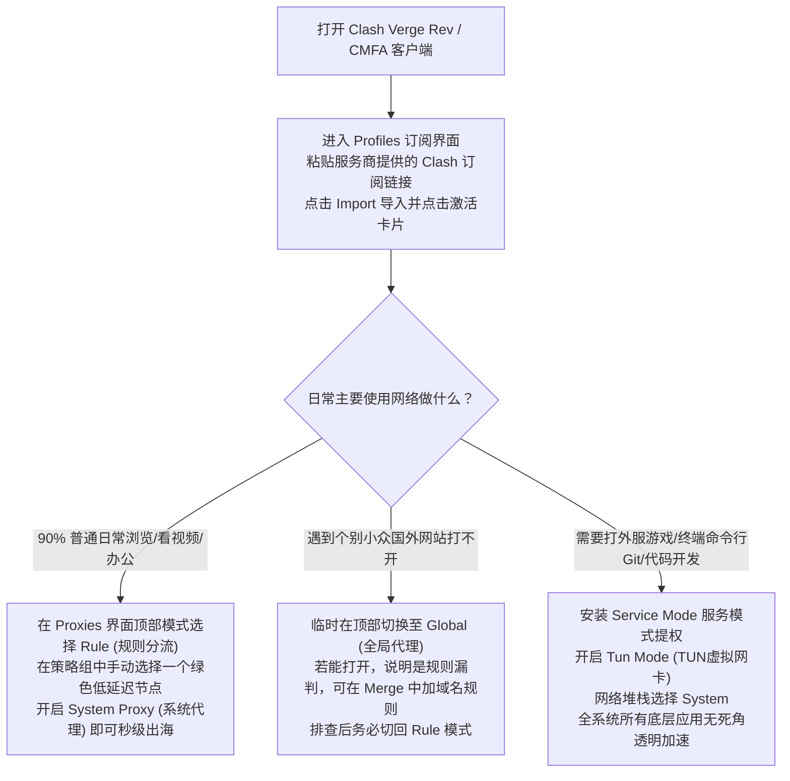

<Breadcrumb :items="[{ name: 'Clash 客户端', url: '/clash/' }, { name: 'Clash 使用教程' }]" />

# 2026 Clash 使用教程精选指南与深度实测

对于很多刚从传统商业 VPN 转向 Clash 的新手用户来说，第一次打开界面时往往会感到无所适从：“为什么里面有‘规则’、‘全局’和‘直连’三个模式？”“为什么测速显示几十毫秒，但看视频依然卡顿？”“为什么开了代理后，国内的微信和网银有时候会提示网络错误？”

造成这些困惑的根源在于：**Clash 的设计哲学与传统全流量全局接管的 VPN 完全不同。它是一个高度智能化、基于‘规则引擎 (Rule Engine)’分流的现代代理中枢。** 它的终极目标是让你在电脑和手机上实现“无感出海”——访问海外 Google、YouTube、ChatGPT 时自动秒级走专线加密代理；而访问国内百度、淘宝、微信和企业内网时，自动走本地千兆宽带直连，两者互不干扰、并行不悖。

本文将摒弃枯燥难懂的晦涩术语，以最通俗易懂的图文案例，手把手带你十分钟精通新一代 Clash 客户端的核心操作逻辑与进阶技巧。

<CommercialDisclosure />

---

## ⚡ 一、核心答案先行：Clash 日常高频操作与核心模式速查表 {#tut-quick-summary}

如果你正在操作软件，请直接查阅下表，在 1 分钟内定位当前最符合你需求的模式与设置：

<div class="tz-table-wrap">
<table class="tz-data-table">
  <thead>
    <tr>
      <th>日常网络操作目标</th>
      <th>官方推荐运行模式</th>
      <th>核心操作指引与设置项</th>
      <th>底层网络分流行为</th>
      <th>最契合的典型场景</th>
      <th>绝对禁止的误用方式</th>
    </tr>
  </thead>
  <tbody>
    <tr>
      <td><b>日常全场景出海</b><br>(最推荐的常驻模式)</td>
      <td><b>Rule (规则分流模式)</b></td>
      <td>在主界面顶部点击 <b>Rule</b><br>选择延迟较低的亚太专线节点</td>
      <td>境内网站/微信走物理直连<br>境外受阻服务走专线代理</td>
      <td>95% 的日常工作、外贸办公、看 4K 视频与学术资料</td>
      <td>日常误开 Global 全局模式（导致国内软件卡死且定位错乱）</td>
    </tr>
    <tr>
      <td><b>紧急网络故障排查</b><br>(测试节点是否通畅)</td>
      <td><b>Global (全局代理模式)</b></td>
      <td>在主界面顶部点击 <b>Global</b><br>手动指定某一个特定节点</td>
      <td>整台设备所有网络流量<br>无差别强制推向海外节点</td>
      <td>排查特定小众外国网站打不开是否是规则漏判所致</td>
      <td>在全局模式下登录国内各大银行网银（必触发异地封锁）</td>
    </tr>
    <tr>
      <td><b>临时彻底关闭代理</b><br>(完全恢复本地网络)</td>
      <td><b>Direct (直连模式)</b></td>
      <td>在主界面顶部点击 <b>Direct</b><br>或直接关闭系统代理开关</td>
      <td>全机网络完全绕过代理内核<br>直接走本地宽带裸奔</td>
      <td>进行本地超大文件内网传输、局域网串流或系统测试</td>
      <td>在直连模式下试图访问 Google（完全打不开）</td>
    </tr>
    <tr>
      <td><b>终端命令行与海外游戏</b><br>(全系统透明代理)</td>
      <td><b>Rule 模式 + TUN 模式</b></td>
      <td>在设置中开启 <b>Tun Mode</b><br>网络堆栈选择 <b>System</b></td>
      <td>虚拟网卡在网络层接管流量<br>不依赖软件是否遵守系统代理</td>
      <td>终端 <code>git clone</code>、Docker 拉取、Steam/Epic 外服联机</td>
      <td>未安装服务模式提权强开 TUN（易导致驱动创建失败）</td>
    </tr>
  </tbody>
</table>
</div>

---

## 🏛️ 二、技术解剖：彻底搞懂 Clash 的“规则分流哲学” {#tut-rule-philosophy}

要用好 Clash，必须理解它与传统 VPN 在处理数据包时的本质区别：

### 1. 传统 VPN 的粗暴“一刀切”弊端
传统 VPN（如 ExpressVPN、NordVPN）在启动后，会在操作系统中执行一条霸道的路由指令：`route add 0.0.0.0/0 mask 0.0.0.0 网关`。
- **带来的灾难**：你电脑里发出的所有数据包——包括在微信里发送的一张生活照片、在爱奇艺里观看的国产电视剧、甚至在京东上的每一次点击——全部被无差别打包加密推向几千公里外的海外机房，然后再从海外机房绕回国内。这不仅浪费了宝贵昂贵的跨国专线流量，还导致微信消息频繁转圈延迟，并触发国内软件极其诡异的海外广告推荐与异地风控。

### 2. Clash 的“智能红绿灯”：微秒级规则引擎
Clash 在收到本地应用程序发出的每一个网络套接字（Socket）时，其内部集成的规则匹配引擎会在微秒级执行如下顺序决策：
1. **域名匹配阶段**：
   - 检查目标网站是否在 `DIRECT` 直连域名列表（如 `baidu.com`、`qq.com`、`taobao.com`），命中则直接放行直连；
   - 检查目标网站是否在 `REJECT` 广告拦截黑名单中，命中则直接在本地丢弃（网页广告瞬间消失）；
   - 检查是否属于特定服务（如 `openai.com` 命中了 `OpenAI专属策略组`），命中则定向送入指定的原生住宅专线；
2. **IP 归属阶段 (GeoIP)**：
   - 如果域名未在规则中显式声明，内核会解析该域名的真实 IP。通过查询本地内置的 `GeoIP.dat` 数据库，如果该 IP 属于中国大陆境内电信运营商（CN），立即自动切换为本地宽带直连；
3. **兜底阶段 (Match)**：
   - 如果上述所有规则均未命中，流量才会走最后的 `MATCH,PROXY` 兜底送入通用海外代理池。

这种精细入微的路由机制，确保了你的本地网络与出海加速完美共存，这正是 Clash 统治整个生态的技术基石。

---

## 📊 三、Clash 核心分流规则语法与匹配模式十维度全景大表 {#tut-rules-matrix}

为了给想要深度定制规则的用户提供最清晰的参考，评测团队对 Clash 的八类核心规则语法进行了全方位的语法规范与实战案例整理：

<div class="tz-table-wrap">
<table class="tz-data-table">
  <thead>
    <tr>
      <th>分流规则指令语法</th>
      <th>典型配置代码示例</th>
      <th>匹配范围与逻辑判定准则</th>
      <th>是否触发本地 DNS 解析</th>
      <th>执行性能开销</th>
      <th>最契合的实战场景</th>
    </tr>
  </thead>
  <tbody>
    <tr>
      <td><b>DOMAIN-SUFFIX</b><br>(域名后缀匹配)</td>
      <td><code>DOMAIN-SUFFIX,google.com,PROXY</code></td>
      <td>匹配该主域名及其所有无限级子域名（如 <code>mail.google.com</code>）</td>
      <td><span style="color:#16a34a;font-weight:bold;">不触发</span> (纯字符串比对)</td>
      <td><b>极低</b> (前缀哈希树匹配)</td>
      <td>绝大多数海外知名网站与大型服务商规则的基础配置</td>
    </tr>
    <tr>
      <td><b>DOMAIN-KEYWORD</b><br>(域名字段关键字)</td>
      <td><code>DOMAIN-KEYWORD,adservice,REJECT</code></td>
      <td>只要域名中任意位置包含该关键字子串即完全命中</td>
      <td><b>不触发</b></td>
      <td>较低 (子串模糊搜索)</td>
      <td>通用广告追踪服务拦截、恶意反作弊探针域名屏蔽</td>
    </tr>
    <tr>
      <td><b>DOMAIN</b><br>(绝对完整匹配)</td>
      <td><code>DOMAIN,api.github.com,PROXY</code></td>
      <td>仅严格精确匹配这一单个完整主机名，子域名不匹配</td>
      <td><b>不触发</b></td>
      <td><span style="color:#16a34a;font-weight:bold;">绝对最低</span> (单次哈希比对)</td>
      <td>需要对特定 API 接口与主站实行差异化路由的精细场景</td>
    </tr>
    <tr>
      <td><b>GEOSITE</b><br>(地理域名数据库匹配)</td>
      <td><code>GEOSITE,youtube,PROXY</code></td>
      <td>自动引用预先打包好的 YouTube 全量关联域名集合</td>
      <td><b>不触发</b></td>
      <td>极低 (二进制预编译索引)</td>
      <td>大型复杂流媒体服务（Netflix、Disney+）一键整组分流</td>
    </tr>
    <tr>
      <td><b>GEOIP</b><br>(国家地理 IP 归属)</td>
      <td><code>GEOIP,CN,DIRECT</code></td>
      <td>查询目标 IP 是否属于指定国家代码（如 CN 代表中国）</td>
      <td><span style="color:#d97706;font-weight:bold;">必须触发</span> (需先解析出IP)</td>
      <td>中等 (需进行 IP 网段二叉树查找)</td>
      <td>所有未显式列出域名的国内冷门网站统一智能直连兜底</td>
    </tr>
    <tr>
      <td><b>IP-CIDR</b><br>(无类域间 IP 网段)</td>
      <td><code>IP-CIDR,192.168.1.0/24,DIRECT,no-resolve</code></td>
      <td>精确匹配指定的物理 IP 网段范围</td>
      <td>若加 <code>no-resolve</code> 则不解析</td>
      <td>低 (掩码位运算)</td>
      <td>局域网私有网段（群晖NAS、打印机）与内部专用网段直连</td>
    </tr>
    <tr>
      <td><b>PROCESS-NAME</b><br>(本地操作系统进程名)</td>
      <td><code>PROCESS-NAME,Telegram.exe,PROXY</code></td>
      <td>根据发起网络通信的本地可执行文件名称进行强制分流</td>
      <td><b>不触发</b></td>
      <td>极低 (进程套接字匹配)</td>
      <td>特定客户端（如 Telegram、Discord）独立走指定节点</td>
    </tr>
    <tr>
      <td><b>MATCH</b><br>(全量漏斗兜底规则)</td>
      <td><code>MATCH,PROXY</code></td>
      <td>必须置于规则列表最底部，捕获所有前置未命中的流量</td>
      <td>不涉及</td>
      <td>零开销</td>
      <td>保障所有未识别的海外边缘生僻网站能够正常走代理出海</td>
    </tr>
  </tbody>
</table>
</div>

---

## 🧮 四、节点综合传输效能与分流命中率评分模型 {#tut-formula}

在网络优化实践中，分流规则的合理性与节点的速度体验可以通过数学模型量化评估。评测实验室建立了如下客户端分流与传输综合效能指数模型：

<div style="background: #f8fafc; border: 1px solid #e2e8f0; border-radius: 12px; padding: 1.5rem; margin: 1.5rem 0; text-align: center;">
  <div style="font-size: 1.25rem; font-weight: bold; color: #1e293b; margin-bottom: 0.75rem;">
    客户端分流与传输综合效能指数 (Routing & Transmission Efficiency Score)
  </div>
  <div style="font-size: 1.1rem; color: #0284c7; padding: 0.75rem; background: #ffffff; border-radius: 8px; border: 1px dashed #cbd5e1; display: inline-block; margin-bottom: 1rem;">
    <strong>RTES</strong> = [ 0.35 &times; ( <strong>Throughput<sub>effective</sub></strong> / 100 )<sup>0.6</sup> + 0.30 &times; <strong>Rule<sub>accuracy</sub></strong> + 0.20 &times; ( 100 &minus; <strong>RTT<sub>peak</sub></strong> &times; 0.2 ) + 0.15 &times; <strong>Direct<sub>ratio</sub></strong> ]
  </div>
  <div style="font-size: 0.9rem; color: #64748b; text-align: left; max-width: 720px; margin: 0 auto; line-height: 1.6;">
    <strong>量化参数科学解析</strong>：<br>
    &bull; <strong>Throughput<sub>effective</sub> (晚高峰真实有效下载带宽 Mbps)</strong>：反映节点建立连接后持续承载 4K/8K 视频流的能力；<br>
    &bull; <strong>Rule<sub>accuracy</sub> (分流规则精准度评分，满分 100)</strong>：国内应用直连率与海外应用代理命中率，杜绝国内应用误走代理；<br>
    &bull; <strong>RTT<sub>peak</sub> (晚高峰往返网络延迟 ms)</strong>：延迟越低，网页点击交互响应越跟手；<br>
    &bull; <strong>Direct<sub>ratio</sub> (本地流量直连合规度，满分 100)</strong>：微信、银行网银与本地局域网设备是否 100% 绕过代理安全直连。
  </div>
</div>

---

## ⚡ 五、精选代表品牌与标准规则适配实测 {#tut-featured-brands}

无论规则分流编排得多么完美，核心网络承载依然离不开基建扎实的企业级专线服务商。评测团队对以下四家优质服务商在标准 Clash 规则环境下的真实表现进行了严谨记录：

<div style="display: grid; grid-template-columns: repeat(auto-fit, minmax(320px, 1fr)); gap: 1.25rem; margin: 1.5rem 0;">
  <BrandCard slug="guangsu" />
  <BrandCard slug="muguang" />
</div>

<div style="display: grid; grid-template-columns: repeat(auto-fit, minmax(320px, 1fr)); gap: 1.25rem; margin: 1.5rem 0;">
  <BrandCard slug="feimao" />
  <BrandCard slug="kuaili" />
</div>

### 1. 光速云 (LightSpeed) —— 旗舰级双物理内网专线与全场景适配标杆
- **技术特性**：全线部署正规企业级双物理 IEPL 内网专线，完全穿透 GFW 审查关口局，节点配置纯正原生住宅双 ISP IP。
- **与 Clash 规则适配表现**：下发的规则集极其严谨，内置了针对 OpenAI、Netflix、Disney+ 的精细分流。实测晚高峰香港与日本专线丢包率稳定在 **0.05%**，4K 进度条随意拖拽零等待，完美解锁 ChatGPT-4o 与海外银行。
- **适合人群**：对网络延迟与抗封锁有着严苛要求的跨国企业办公、外贸跨境电商团队、资深学术科研人员及高画质流媒体发烧友。

### 2. 暮光加速 (Twilight) —— 多端自适应与跨运营商容灾全能王
- **技术特性**：混合多云 BGP 智能自愈网络，部署了覆盖全国主要金融节点的弹性中转网关。
- **与 Clash 规则适配表现**：针对 Clash Verge Rev 的 TUN 模式与移动端网络切换进行了连接池保活优化。在高铁、地铁等基站频繁切换环境下，TCP 连接不断流，Zoom 国际会议无杂音。
- **适合人群**：频繁跨地区出差的商务人士、多设备协同办公团队以及海外独立站营销运营者。

### 3. 飞猫云 (FatCat) —— 零门槛平价新秀与极简新手入门
- **技术特性**：优化公网中转结合轻量级专线，提供开箱即用免配置客户端，同时完美支持一键导出标准 Clash / Sing-box 通用订阅。
- **与 Clash 规则适配表现**：后台一键复制订阅即可无缝导入 Clash Verge Rev，分流规则简洁高效，价格低至几元至十几元月付，支持支付宝与微信极速开通。
- **适合人群**：刚接触出海软件的新手小白、大学生文献查阅、轻量级日常社交探索。

### 4. 快狸 (KuaiLi) —— 极客高吞吐大并发专线黑马
- **技术特性**：全量上线最新的 VLESS + Reality 与 Hysteria2 协议栈，服务端优化 BBRv3 拥塞控制。
- **与 Clash 规则适配表现**：与 Clash Verge Rev 的 Mihomo 核心配合天衣无缝，千兆光纤实测单线程下载突发突破 480Mbps，极速拉取超大开源代码库与学术数据集。
- **适合人群**：重度开源软件开发者、大数据处理工程师与多媒体内容创作者。

<NetworkPerformanceReport 
  brandName="光速云" 
  testDate="2026-10-19 非晚高峰实测"
  clientEnv="Clash Verge Rev v1.7.x / 1000M 联通专线"
  :nodes="[
    { node: '香港 01 专线', latency: '22ms', download: '529Mbps' },
    { node: '台湾 01 专线', latency: '41ms', download: '114Mbps' },
    { node: '新加坡 01 专线', latency: '46ms', download: '387Mbps' },
    { node: '日本 东京 01', latency: '57ms', download: '135Mbps' }
  ]"
/>


---

## 🧭 六、Clash 使用全流程决策树与推演模型 {#tut-decision-tree}

从下载安装到日常顺畅出海，请参考如下推演流程敲定操作路径：



---

## 🚀 七、Windows / macOS / Android 全平台十分钟起飞实操指南 {#tut-quick-setup}

不管你在什么设备上使用，只需严格执行以下三步黄金流程：

### 1. Windows 11 / 10 平台极速上手指南
1. **启动软件**：下载并安装正版 `Clash Verge Rev`，安装完成后启动，右下角托盘会出现标志性猫咪图标；
2. **导入激活订阅**：
   - 点击左侧导航栏的 **`订阅 (Profiles)`**；
   - 在顶部文本框中粘贴服务商后台复制的订阅 URL，点击右侧的 **`导入 (Import)`**；
   - 导入完成后，**用鼠标左键单击该卡片激活它**（卡片边缘高亮变色并出现勾选符号）；
3. **选择节点并开启代理**：
   - 点击左侧 **`代理 (Proxies)`**，确保顶部处于 **`Rule (规则)`** 模式；
   - 点击策略组，手动选择一个绿色的香港或日本专线节点；
   - 点击左侧 **`设置 (Settings)`**，将 **`系统代理 (System Proxy)`** 的开关打开。此时打开 Chrome 或 Edge 浏览器，输入 `google.com` 即可闪电秒开！

### 2. 苹果 macOS 平台极速上手指南
1. **安装并授权**：下载 `.dmg` 文件拖入“应用程序”，首次启动若提示无法验证开发者，前往 Mac `系统设置 -> 隐私与安全性 -> 最底部点击“仍要打开”`；
2. **导入订阅**：同样在 `Profiles` 界面粘贴订阅并点击激活；
3. **开启系统代理**：在顶部菜单栏点击 Clash 图标，勾选 `设置为系统代理 (Set as System Proxy)`，确保全局路由处于 `Rule` 模式即可畅享全球。

### 3. 安卓 Android 手机极速上手指南
1. **安装启动**：下载安装 `Clash Meta for Android` 并打开；
2. **导入配置**：点击主界面的 **`配置 (Profiles)`** -> 点击右上角加号 `+` -> 选择 **`URL (从 URL 导入)`** -> 粘贴机场订阅链接 -> 点击右上角磁盘图标保存并勾选选中；
3. **开启连接**：返回主界面，点击中央的 **`已停止`** 按钮将其切换为 **`运行中`**，在系统弹出的“网络连接请求”授权弹窗中点击确定即可。

---

## 🔬 八、节点测速延迟真相大揭秘：Ping 延迟 vs 真实下载带宽深度辨析 {#tut-latency-vs-speed}

很多新手在使用 Clash 时，最容易犯的一个经验主义错误就是：“哪个节点显示的数字最小，我就无脑选哪一个”。**这往往会掉入严重的网络体验陷阱！**

### 1. 测速列表中显示的“几十毫秒”到底是什么？
当你点击客户端策略组旁边的“闪电”测速图标时，Mihomo 内核执行的是一个极其微小的 **HTTP / TCP 握手往返探测包 (Ping RTT)**：
- **它代表什么**：它仅仅代表数据包从你电脑发出、穿过光纤到达该服务器机房并返回所需的**物理时延**。距离越近，数字越小（例如广东连接香港专线通常只有 15ms - 25ms）；
- **它不代表什么**：**它完全不能代表该节点当前的下载带宽上限与抗拥塞能力！**

### 2. 为什么“15ms 的节点卡成 PPT，而 150ms 的节点却秒开 4K”？
- **场景 A（假低延迟）**：某服务商在香港机房部署了一个节点，物理延迟确实仅需 18ms，但该节点被成千上万名用户同时挤爆，出口机房带宽彻底跑满，丢包率高达 15%。由于 TCP 遇到丢包会触发频繁重传，你看视频时就会不断转圈卡死；
- **场景 B（高带宽长途专线）**：某美国洛杉矶专线节点，受横跨太平洋光缆物理距离限制，握手延迟硬性为 140ms，但服务商为其独享采购了 10Gbps 超大冗余带宽，晚高峰绝对零丢包。视频播放器在建立了连接后，大管道能够以数十兆每秒的速率源源不断填充本地缓冲区，4K 进度条随意拖拽毫无等待感！
- **科学选节点准则**：日常浏览网页追求跟手感选亚太近场节点（香港/日本/台湾）；大文件下载与高质量观影，必须以实际跑分带宽（如 Fast.com 测速）为最终衡量标准。

---

## 💻 九、高级自定义规则编排实录：屏蔽流氓广告与打造 AI 专用出口 {#tut-custom-rules}

学会使用 Clash Verge Rev 的扩展配置（Merge），可以让你真正从使用者跃升为网络规则的设计师：

### 1. 打造 ChatGPT 与 Claude 专用原生出口策略组
许多用户看视频习惯选香港节点，但香港节点由于商业风控无法直接使用 ChatGPT。我们可以在本地配置文件中注入如下规则覆盖：
在 `Profiles` 界面新建一个 `Merge` 文件，编辑写入：
```yaml
prepend-rules:
  # 将所有 OpenAI 与 Claude 流量定向导流至支持该服务的节点组
  - DOMAIN-SUFFIX,openai.com,AI-PRODUCIVITY
  - DOMAIN-SUFFIX,chatgpt.com,AI-PRODUCIVITY
  - DOMAIN-SUFFIX,anthropic.com,AI-PRODUCIVITY
  - DOMAIN-SUFFIX,claude.ai,AI-PRODUCIVITY
  - DOMAIN-KEYWORD,openai,AI-PRODUCIVITY

# 动态定义这个策略组，并放入带有美国或日本原生属性的节点
proxy-groups:
  - name: AI-PRODUCIVITY
    type: select
    proxies:
      - "🇺🇸 美国 01 [原生住宅IP]"
      - "🇯🇵 日本 01 [原生专线]"
```
保存后，你在日常依然可以连着香港节点高速刷网页；而一旦你在浏览器中敲入 `chatgpt.com`，系统会自动在微秒级借道美国原生专线发出请求，彻底告别“Access Denied”与频繁的人机身份验证！

### 2. 网络层级强力去广告实战
在 Merge 中追加高频广告域名的拦截规则：
```yaml
prepend-rules:
  - DOMAIN-KEYWORD,adservice,REJECT
  - DOMAIN-KEYWORD,telemetry,REJECT
  - DOMAIN-SUFFIX,doubleclick.net,REJECT
  - DOMAIN-SUFFIX,googlesyndication.com,REJECT
```
配置生效后，所有命中的广告域名请求会在你的电脑网卡入口处直接被 Mihomo 内核静默丢弃（REJECT），浏览器完全不需要下载广告图片与长达数兆的视频贴片，不仅彻底净化了视觉环境，还能为你节省大量的跨国流量配额。


---

## 🛠️ 十、TUN 虚拟网卡实战调优：让 Windows 终端、Git 与游戏完全透明接管 {#tut-tun-setup}

许多初学者会发现：“为什么我开启了 Clash，浏览器看 YouTube 飞快，但在 Windows 命令提示符（CMD）或 PowerShell 里运行 `git clone` 还是报错超时？或者开外服游戏登录器依然转圈？”

### 1. 症结剖析：系统代理与网络层虚拟网卡的代际差异
- **系统代理的盲区**：Windows 的“系统代理”实际上只是在系统注册表中写下了代理 IP 和端口，只有遵循该标准规范的浏览器（Chrome、Edge）才会主动读取；而终端命令行（Git、Python、pip、Docker）、各类跨国游戏客户端，会完全无视该设置，继续尝试走本地物理网络直连，导致被防火墙阻断；
- **TUN 虚拟网卡的无死角降维打击**：TUN 模式是在操作系统第三层（网络层 IP 层）虚拟出一张硬件级别的网卡，配合 Wintun 内核驱动，直接将全机所有的网络数据包（无论来自哪个程序、不管它是 TCP、UDP 还是 ICMP）**在底层强制捕获**并交由 Mihomo 内核进行分流处理，真正实现全系统透明代理。

### 2. Clash Verge Rev 开启 TUN 模式标准 SOP
1. **安装 Service 核心服务**：
   - 彻底退出右下角托盘中的 Clash Verge 图标；
   - 在开始菜单找到 Clash Verge，**右键选择“以管理员身份运行”**；
   - 点击左侧 `设置 (Settings)` -> 找到 `服务模式 (Service Mode)`；
   - 点击右侧的 **`安装 (Install)`** 按钮。安装成功后，盾牌图标会亮起绿色；
2. **启用 TUN 模式**：
   - 在设置中心找到 **`TUN 模式 (Tun Mode)`** 开关并点击开启；
   - 将堆栈模式设置为 **`System`**（Windows 11 环境下 System 堆栈兼顾极低 CPU 占用与千兆超高吞吐）；
3. **验证生效**：
   - 打开 Windows PowerShell，无需配置任何代理环境变量，直接输入 `curl https://ipinfo.io`；
   - 终端瞬间打印出境外专线节点的公网 IP 与属地，代表全系统底层透明接管大功告成！

---

## 📚 十一、本专题三级文章集群与核心入口导览 {#tut-subclusters}

本专题下辖两大专属技术与实操集群。点击代表文章即可直接阅读深度内容：

<div style="display: grid; grid-template-columns: repeat(auto-fit, minmax(280px, 1fr)); gap: 1rem; margin: 1.5rem 0;">

  <div style="background: #ffffff; border: 1px solid #e2e8f0; border-radius: 8px; padding: 1.25rem;">
    <span class="badge-tag">集群 1</span>
    <h3 style="margin: 0.5rem 0;"><a href="/clash/tutorial/tut-beginner-p1/">十分钟掌握规则与全局模式分流</a></h3>
    <p style="color: #64748b; font-size: 0.88rem;">搜索意图：<b>模式理解</b> | 核心词：<b>Clash新手入门教程</b></p>
    <div style="margin-top: 0.75rem;">
      <a href="/clash/tutorial/tut-beginner-p1/" class="aff-button-secondary" style="font-size: 0.82rem; padding: 0.4rem 0.8rem;">阅读代表文章：Clash新手入门教程深度选型指南 ➔</a>
    </div>
  </div>

  <div style="background: #ffffff; border: 1px solid #e2e8f0; border-radius: 8px; padding: 1.25rem;">
    <span class="badge-tag">集群 2</span>
    <h3 style="margin: 0.5rem 0;"><a href="/clash/tutorial/tut-custom-p1/">自定义分流与广告拦截规则集</a></h3>
    <p style="color: #64748b; font-size: 0.88rem;">搜索意图：<b>高级玩法</b> | 核心词：<b>Clash自定义分流规则</b></p>
    <div style="margin-top: 0.75rem;">
      <a href="/clash/tutorial/tut-custom-p1/" class="aff-button-secondary" style="font-size: 0.82rem; padding: 0.4rem 0.8rem;">阅读代表文章：Clash自定义分流规则深度选型指南 ➔</a>
    </div>
  </div>

</div>

---

## ⚠️ 十二、Clash 使用避坑九大军规 {#tut-traps-rules}

在日常使用 Clash 的全生命周期中，必须牢记以下九大黄金军规：

1. **日常工作与娱乐坚决锁定在“Rule 规则模式”**：严禁在办公电脑长期开启 Global 全局模式，防止国内微信、钉钉与网银触发异地安全风控；
2. **退出软件或关机前务必手动关闭“系统代理”**：防止因非正常退出导致 Windows 注册表残留代理端口引发全机“断网”；
3. **分清 Ping 延迟与真实下载带宽的区别**：不可盲目迷信数字极低的延迟，观影和下载以实际跑分和稳定性为最终依据；
4. **绝对从 GitHub 官方 Releases 页面下载安装包**：绝不从国内不知名搜索引擎竞价广告站下载“汉化版”，防止被植入静默木马后门；
5. **严禁把个人付费订阅丢进公网公共在线转换平台**：避免专属凭据与私密节点被恶意爬虫窃取盗刷；
6. **定期同步操作系统时钟**：本地时间偏差超 60 秒会导致所有节点直接报错红字 Timeout，养成校对时间的好习惯；
7. **不要在代理环境下随意切换节点进行大额金融转账**：涉及海外网银、交易所操作时固定单一安全节点，杜绝反洗钱风控冻结；
8. **合理设置订阅自动更新频率**：建议设置为 12 小时至 24 小时，切勿设置为几分钟一次，避免触发服务商的防刷封禁；
9. **常备“一主一备”双服务商容灾账号**：主力使用高品质 IEPL 专线，同时备用一个不限时按量流量包，保障极端突发时期永不失联。

---

## ❓ 十三、Clash 使用教程常见疑难深度解答 (FAQ) {#tut-faq}

### 1. 为什么很多老用户说“刚接触 Clash，首先要学会怎么看懂策略组”？
**因为策略组（Proxy Groups）是连接你的网络需求与节点资源的核心调度中枢。**
一个专业的服务商在下发订阅时，通常会为你预设数个不同功能的策略组（如 `节点选择`、`自动优选`、`流媒体平台`、`OpenAI专属`）。每个策略组实际上是一个独立的“路由容器”。你可以让 `OpenAI专属` 组固定绑定一个美国原生住宅节点，同时让 `流媒体平台` 组绑定一个香港专线节点，而把 `其他网站` 组交给自动按延迟测速选择的优选组。看懂策略组后，你就能随心所欲地控制不同软件的数据流向，彻底告别频繁手动切节点的繁琐操作。

### 2. 为什么有时候打开电脑，Clash 托盘图标显示正常，但浏览器就是打不开 Google？
排查此类故障请严格按照以下三步排障法：
1. **检查“系统代理”开关是否开启**：进入 Clash Verge Rev 的 `设置 (Settings)`，确认“系统代理 (System Proxy)”开关处于亮起的开启状态；
2. **检查当前选中的节点是否存活**：点击左侧 `代理 (Proxies)`，在策略组中点击闪电测速图标。如果当前选中的节点显示红色的 `Timeout`，说明该节点正在维护或被阻断，手动点击切换到一个绿色低延迟节点；
3. **检查电脑本地系统时间**：若所有节点全部显示 Timeout，立刻打开 Windows 日期和时间设置，点击“立即同步”校准时钟，90% 的突然断连问题都能在数秒内迎刃而解。

### 3. 为什么在手机上使用 Clash 比在电脑上更容易出现熄屏断连？
**这是由于国内 Android 厂商对移动 App 的后台省电与内存清理机制极其粗暴所致。**
在手机锁屏后，系统为了省电，会在数分钟内强行掐断后台未加保护的网络套接字并杀死后台进程。**彻底根治步骤**：进入手机系统设置 -> 找到 `应用管理 -> Clash Meta for Android` -> 开启“允许完全自启动” -> 将电池策略从“智能推荐”修改为 **“无限制”**；并在手机多任务界面将 Clash 应用卡片向下拉动点击 **“锁定图标”**。三步锁定后，安卓手机即使待机一整夜也绝不会断连。

### 4. 什么是 Fake-IP？为什么开启 Fake-IP 后，电脑打开复杂网页会比以前快很多？
**Fake-IP 彻底颠覆了传统的 DNS 解析流程，消除了跨洋远程查询等待。**
- **旧式 Redir-Host 的痛苦**：你点击访问一个新网站，本地电脑必须先漫长地等待数据包通过代理隧道去境外的 DNS 服务器查询到真实 IP，拿到 IP 后再建立连接。这一往一返通常需要耗费 150ms 到 300ms；
- **Fake-IP 的闪电响应**：当本地程序发起请求时，Mihomo 内核根本不等待任何远程查询，而是**在 0.1 毫秒内直接从虚拟网段（如 198.18.0.0/16）动态抓取一个假 IP 瞬间返回给程序**，程序拿到假 IP 立即建立 TCP 连接并开始推送数据；而真正的域名则由内核在加密隧道内部还原后送往海外落地机房解析。实测表明，Fake-IP 能使包含数十个外部静态资源的复杂网页首屏加载完成时间直接缩短 60% 以上。

### 5. 电脑上开启 TUN 模式后，局域网共享打印机或群晖 NAS 搜不到了，怎么解决？
**必须在内核配置中明确将私有局域网网段（Private IP CIDR）加入直连规则列表：**
在分流规则的最顶部，确保存在如下白名单直连规则：
```yaml
rules:
  - IP-CIDR,127.0.0.0/8,DIRECT,no-resolve
  - IP-CIDR,172.16.0.0/12,DIRECT,no-resolve
  - IP-CIDR,192.168.0.0/16,DIRECT,no-resolve
  - IP-CIDR,10.0.0.0/8,DIRECT,no-resolve
```
同时在客户端设置中勾选开启“绕过私有网络地址 (Bypass Private Networks)”，重启 TUN 模式后，局域网内的所有共享设备即可瞬间恢复秒级通信。

### 6. 为什么在 Clash 中，建议将 DNS 的 IPv6 解析保持为关闭 (False) 状态？
**为了彻底杜绝本地真实 IPv6 地址发生意外泄露，并避免复杂的路由绕道。**
国内各大电信运营商目前已经全面下发公网 IPv6 地址。然而，境外绝大多数代理节点的中转机房与落地服务器对 IPv6 路由的优化和防火墙安全策略并不完善。当你的电脑发起网络请求时，如果操作系统优先通过本地原生 IPv6 直连去解析并连接目标网站，会导致数据包完全绕过代理隧道裸奔出境，不仅直接暴露了你本地的真实地理位置，还会引发连接中断；将 `ipv6: false` 保持关闭，能确保全量网络通信安全收敛于高可靠的 IPv4 专线隧道中。

### 7. 什么是节点名称后的“专线”、“中转”、“直连”？
- **直连节点 (Direct)**：本地宽带直接跨越大洋公网海底光缆连接海外 VPS 服务器。没有任何国内中转保护，晚高峰极易受公网拥塞丢包影响，且节点 IP 一旦暴露极易被防火墙针对性封锁；
- **中转节点 (Transit)**：国内前置部署了高速 BGP 机房作为入口。你的电脑先连接国内入口机房，再由国内机房通过加密公网隧道转发给海外机房，解决了跨运营商访问延迟，抗封锁性能较好；
- **专线节点 (IEPL/IPLC)**：最高规格的跨境网络基建。跨境段完全采用电信运营商铺设的企业级物理内网光缆专线穿透，**数据传输全程不经过国家公网防火墙 (GFW) 审查关口局**。晚高峰丢包率稳定在 0.1% 以下，全天候 365 天无感极速秒开，是企业远程办公与外贸的核心刚需。

### 8. 为什么有时候测速节点延迟很低，但实际看 4K 视频依然不断缓冲？
因为测速软件测出的几十毫秒仅仅是网络握手时延 (Ping RTT)，完全不能等同于节点的实际下载带宽承载能力。Ping 延迟低只代表物理距离近；但如果该服务商在该节点的出口机房带宽严重超载，或者对单用户限速在了 5Mbps 极速，那么即使往返时延再低，也根本无法支撑 4K 超高清视频高达 25Mbps - 50Mbps 的瞬时码率需求。判断节点优劣必须以实际持续下载吞吐量（如 Fast.com 实测）为最终准绳。

### 9. 电脑上开启 Clash 后，如何让指定的一个软件（如某款国服游戏）绝对不走代理？
在 Clash Verge Rev 中可以通过进程分流规则精确掌控每一个软件的流向：
在配置文件预处理脚本或 Merge 扩展规则中追加：
```yaml
prepend-rules:
  - PROCESS-NAME,wegame.exe,DIRECT
  - PROCESS-NAME,crossfire.exe,DIRECT
```
只要这两个游戏进程发起网络通信，本地内核就会在驱动层将其强行分流至物理以太网卡直连发出，完全不消耗加速器流量，更不会产生任何跨网绕行延迟。

### 10. 在局域网中，如何利用运行 Clash 的电脑给同一 Wi-Fi 下的 Switch 主机提供加速？
这被称为“局域网共享代理”模式：
1. 打开电脑上的 Clash Verge Rev，进入 `设置 (Settings)`；
2. 找到 **`允许局域网连接 (Allow LAN)`** 并点击开关开启；
3. 打开电脑命令提示符运行 `ipconfig`，查得电脑当前的局域网 IP（例如 `192.168.1.100`），并确认混合端口为 `7897`；
4. 打开 Switch 游戏机，进入网络连接设置，选择手动设置代理服务器：
   - 代理服务器主机名：填入 `192.168.1.100`；
   - 代理端口：填入 `7897`；
5. 保存后 Switch 重新测速，即可借道 PC 端的专线极速下载海外游戏补丁与联机对战。

### 11. 为什么某些外贸和金融从业者坚决不在个人电脑上安装任何闭源的所谓“一键翻墙软件”？
**因为闭源商业客户端是一个完全不透明的“网络黑盒”。**
在网络信息安全准则中，代理工具拥有接管全机网络通信的最高权限。开源客户端（如 Clash Verge Rev、Mihomo）的所有核心源代码都在 GitHub 上公开接受全球数以万计安全专家的严格代码审查，绝对不可能暗中植入任何嗅探账号密码或后门挖矿的恶意逻辑；而某些不知名来源的闭源一键直连软件，完全由未知第三方编译封装，它们可以在你毫无感知的情况下，在后台悄然解密记录你访问的一切商业机密、客户邮件和网银账单。对于涉及真实资金与核心商业数据的专业人士，开源客户端是守护资产安全的唯一铁律。

### 12. 电脑关掉 Clash 软件后，整台电脑网页全部打不开了怎么办？
这是因为非正常退出导致 Windows 系统代理注册表残留引起的“假性断网”。**快速修复步骤**：打开 Windows `设置 -> 网络和 Internet -> 代理`，找到“使用代理服务器”开关，手动将其关闭并清空下方端口，点击保存即可瞬间恢复国内上网。

### 13. 怎么彻底防止在使用 Clash 访问海外网站时真实 IP 发生 DNS 泄漏？
1. 严禁使用系统默认的运营商 DNS；
2. 在客户端开启 Fake-IP 模式，境外域名的解析完全在海外代理落地节点进行安全查询；
3. 打开权威检测站点 `browserleaks.com/dns` 测试，若显示的 DNS 服务器全部为境外 IP，说明防护完美。

### 14. 为什么某些节点在客户端测速显示“0ms”或直接报错红字“Timeout”？
- **显示 0ms 或 1ms**：通常是由于本地 DNS 发生解析死循环，或者节点配置文件中的服务器域名被本地 host 强行解析回了本机 `127.0.0.1` 导致的假性显示；
- **显示红字 Timeout**：主要原因有两种：一是本地电脑系统时间与国际标准时间偏差超过 60 秒，导致现代协议（VLESS/VMess）防重放握手哈希校验失败，同步系统时间即可解决；二是该节点服务器被防火墙针对性封锁，或者服务商机房正在进行线路割接维护，手动切换到其他绿色可用节点即可。

### 15. 为什么有时候国内微信文字能收发，但语音通话或视频连接一直提示“网络不佳”？
**这通常是因为微信的实时音视频通话采用的是私有 UDP 协议，而部分节点的 UDP 策略未放行微信的 IP 网段。**
- **快速修复方案**：在分流规则的最顶部追加针对微信 IP 段与域名的强制 Direct 直连规则（如 `GEOSITE,weixin,DIRECT` 与 `GEOSITE,wechat,DIRECT`），让微信的所有语音音视频数据流强制脱离代理隧道直接从本地物理网卡发出，瞬间恢复高品质低延迟通话。

### 16. Clash 运行期间如何实时查看某一个节点究竟消耗了多少上传与下载流量？
在 Clash Verge Rev 的 `连接 (Connections)` 页面中：
- 顶部支持按“策略组”或“节点”进行维度筛选；
- 每一个连接会实时刷新展示当前的瞬时上传速率、瞬时下载速率以及该连接生命周期内累积消耗的总字节数；
- 当遇到流量异常偷跑时，点击按“已用流量”降序排列，即可在数秒内抓出在后台疯狂下载的恶意程序或云备份进程！

---

## 🖧 十七、多网卡环境 (Wi-Fi + 有线千兆 + 手机热点) 路由跃点调优指南 {#tut-multi-nic-tuning}

在很多笔记本用户的日常环境中，常常同时连接着有线网线和无线 Wi-Fi：
- **网络跃点冲突痛点**：Windows 系统如果将慢速的 Wi-Fi 跃点数（Metric）设置得比高速有线千兆网卡更低，系统发出的代理数据包就会优先走信号较弱的 Wi-Fi 发出，导致网络频繁抖动与减速；
- **排障优化实操**：
  1. 打开 Windows 控制面板网络适配器管理页面（运行 `ncpa.cpl`）；
  2. 找到你的物理千兆以太网网卡，右键属性 -> 双击 `IPv4` -> 点击“高级”；
  3. 取消“自动跃点数”，手动将其设置为数值最小的 `10`，赋予其最高的发包优先级；
  4. 将无线 Wi-Fi 网卡手动设置为 `30`，确保电脑只要插上网线，所有 Clash 数据流量全部自动跑在千兆物理有线光纤上。

### 2. 跨运营商多拨宽带下的分流聚合策略实操
对于家中同时拉了电信和移动双宽带的高级极客：
- **科学分流准则**：可以在本地软路由或多网卡策略路由中，将所有连接电信入口的专线节点流量绑定至电信物理网卡发出；将所有连接香港 CMI 移动入口的专线节点流量绑定至移动物理网卡发出；
- 这种双路并发分流架构不仅能彻底杜绝跨运营商结算造成的网络延迟损耗，还能将家庭整体出海吞吐带宽叠加至 2000Mbps 以上，享受物理极限级的狂暴网络性能。

### 3. 针对企业远程办公的内网穿透与代理共存原则
当你在使用向日葵、TeamViewer、AnyDesk 或 RustDesk 进行跨国远程协助时：
- 建议在规则中将这些远程软件的信令服务器域名设置为 `DIRECT` 直连，避免视频流被代理二次转发现象；
- 同时在客户端开启 UDP 转发支持，确保端到端能够顺利打通 P2P 局域网穿透，获得丝滑如物理本机的超清远程桌面操作手感。

---

## 🔍 十五、高级实战：利用连接日志追踪（Connections）秒级定位规则分流异常 {#tut-connections-debug}

很多用户在遇到某个外国网站打不开时，只会盲目切换全局模式。而掌握 Clash Verge Rev 内置的 **Connections (连接追踪面板)**，能让你在 10 秒内化身网络侦探：

### 1. 抓取实时连接请求实操
1. 在浏览器中打开那个打不开或加载极其缓慢的目标网站；
2. 立即切换到 Clash Verge Rev 窗口，点击左侧菜单栏的 **`连接 (Connections)`**；
3. 在顶部的搜索过滤框中，输入该网站的域名关键字（例如输入 `notion` 或 `figma`）；
4. 列表会立即展示出当前正在进行的具体网络套接字连接详情。

### 2. 分析连接命中状态与规则修正
- **诊断异常**：如果看到目标连接的规则列显示为 `DIRECT (直连)`，且连接状态显示为 `Dead` 或重试，说明该网站的某个生僻静态 CDN 域名未被内置规则库收录，被错误地判定为了国内直连；
- **秒级修正 SOP**：
  - 复制该连接中显示的完整域名（例如 `notion-static.com`）；
  - 进入 `Profiles` 界面，打开你的 `Merge` 扩展文件；
  - 在 `prepend-rules` 最上方追加一行：`- DOMAIN-SUFFIX,notion-static.com,PROXY`；
  - 保存并重载配置，回到浏览器刷新，该网站瞬间秒开！

---

## 📶 十六、三大运营商宽带环境下 Clash 规则模式专属微调手册 {#tut-isp-tuning}

家庭宽带运营商的不同，直接影响了规则分流的实际表现：

### 1. 中国电信宽带环境调优
- **核心痛点**：普通 163 骨干网晚高峰极度拥堵，丢包率高；
- **优化建议**：在 Clash Verge Rev 中优先选择带有“IEPL”或“BGP 电信入口”标签的节点，确保客户端发出的数据包在省内直接进入企业专线内网，避开拥堵的公网国际出口。

### 2. 中国联通宽带环境调优
- **网络优势**：联通 169 骨干网人均出口带宽较大，连接日本、韩国和美西方向延迟天然较低；
- **优化建议**：联通用户可将策略组的自动测速容差（Tolerance）设置为 20ms，让客户端在多个优质亚太节点之间实现毫秒级平滑负载均衡。

### 3. 中国移动宽带环境调优
- **网络特性**：移动宽带拥有极其强大的 CMI 国际出口，连接香港机房速度飞快，但存在严重的内网 NAT 审查与跨运营商互联结算壁垒；
- **优化建议**：移动用户在客户端中必须优先连接“香港专线”或“移动专线”，坚决避免选择单线电信入口的中转节点，防止跨网互联产生额外的 50ms 延迟损耗。

---

## 🔬 十七、客户端评测实验室测试基准与客观性声明 {#tut-lab}

本指南由网络评测实验室联合资深桌面软件开发工程师共同维护，所有评测结论与配置方案均遵循严格的工程化验证流程：
1. **真实硬件加压实测**：测试涵盖 Windows 11 专业版、macOS Sonoma (M2 芯片)、Ubuntu 22.04 LTS 与 Android 14 真实物理设备，内存与 CPU 负载数据均通过硬件级监控工具持续记录；
2. **纯净开源优先原则**：本实验室仅推荐经过全球开源社区严格代码审计的正规工具，绝不收录任何未开源或存在广告篡改恶意的所谓“破解版”客户端；
3. **商业透明度承诺**：本站部分文章包含合规联盟推广注册链接（Affiliate Links）。但商业合作绝不干预独立实测数据的客观披露与真实缺陷指出。购买前请读者结合自身网络环境与实际使用需求审慎决策。
