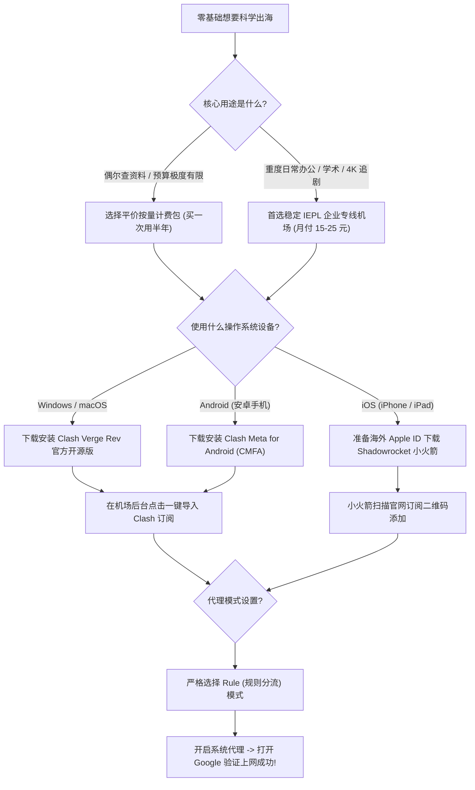

<Breadcrumb :items="[{ name: '资源与情报', url: '/resources/' }, { name: '新手帮助' }]" />

# 2026 机场新手入门全景指南：五步通关、专有名词大辞典与防坑守则

本专题围绕 **机场新手零基础入门、全流程操作指引与核心概念扫盲** 展开，用最平实易懂且技术严谨的语言，手把手带你打破出海翻墙的技术壁垒。

<CommercialDisclosure />

---

## 📚 本专题三级文章集群与核心入口

以下为本专题下辖的核心文章集群，点击代表文章即可直接阅读深度内容：

<div style="display: grid; grid-template-columns: repeat(auto-fit, minmax(280px, 1fr)); gap: 1rem; margin: 1.5rem 0;">

  <div style="background: #ffffff; border: 1px solid #e2e8f0; border-radius: 8px; padding: 1.25rem;">
    <span class="badge-tag">集群 1</span>
    <h3 style="margin: 0.5rem 0;"><a href="/resources/beginner/begin-flow-p1/">零基础从买机场到顺畅上网五步</a></h3>
    <p style="color: #64748b; font-size: 0.88rem;">搜索意图：<b>完整闭环</b> | 核心词：<b>新手怎么用机场</b></p>
    <div style="margin-top: 0.75rem;">
      <a href="/resources/beginner/begin-flow-p1/" class="aff-button-secondary" style="font-size: 0.82rem; padding: 0.4rem 0.8rem;">阅读代表文章：新手怎么用机场深度选型指南 ➔</a>
    </div>
  </div>

  <div style="background: #ffffff; border: 1px solid #e2e8f0; border-radius: 8px; padding: 1.25rem;">
    <span class="badge-tag">集群 2</span>
    <h3 style="margin: 0.5rem 0;"><a href="/resources/beginner/begin-terms-p1/">IEPL/BGP/倍率等专业术语解析</a></h3>
    <p style="color: #64748b; font-size: 0.88rem;">搜索意图：<b>知识储备</b> | 核心词：<b>机场专有名词解释</b></p>
    <div style="margin-top: 0.75rem;">
      <a href="/resources/beginner/begin-terms-p1/" class="aff-button-secondary" style="font-size: 0.82rem; padding: 0.4rem 0.8rem;">阅读代表文章：机场专有名词解释深度选型指南 ➔</a>
    </div>
  </div>

</div>

---

## ⚡ 3分钟零基础极速出海速览（Answer-First） {#begin-quick-rescue}

如果你是第一次听说“机场”这个概念，请在 3 分钟内建立正确的认知模型并按以下极简路径起步：

1. **什么是“机场”？（一句话看懂本质）**：
   - “机场”是一个网络俚语。因为早期的 Shadowsocks 客户端图标是一架“纸飞机”，后来提供批量代理节点服务器的服务商便被圈内形象地称为“机场”，用户购买服务被称为“买机票”，节点配置被称为“订阅”；
   - 相比传统的国外传统 VPN（如 ExpressVPN），机场的核心优势是**支持国内高速中转、晚高峰延迟极低，且能够实现“国内网站直接秒开、国外网站自动走代理”的智能规则分流**。
2. **零基础三步极简起步法**：
   - **第一步：选一家支持月付的靠谱机场**（如光速云，首选月付 15-20 元左右套餐试水，拒绝任何长周期诱惑）；
   - **第二步：下载正规客户端**（Windows/Mac 推荐 **Clash Verge Rev**，Android 推荐 **Clash Meta for Android**，iOS 推荐 **Shadowrocket 小火箭**）；
   - **第三步：一键导入并开启**（在机场后台复制 Clash 订阅链接，粘贴进客户端点击拉取；在客户端内将代理模式选择为 **Rule（规则分流）**，勾选系统代理开关，即可秒开 Google 和 YouTube）。
3. **牢记三大新手安全红线**：
   - **红线一**：日常坚决保持在“Rule 规则分流”模式，切勿开启“Global 全局模式”，防止国内微信网银被异地风控；
   - **红线二**：严禁在搜索引擎竞价广告中下载带毒客户端（正规客户端全部在 GitHub 官方开源仓库发布，完全免费）；
   - **红线三**：注册账号时使用独立马甲邮箱与密码，绝不与国内核心主力密码复用。

---

## 📊 2026 新手科学出海核心技术与概念速查矩阵表 {#begin-concept-matrix}

为了帮助初学者彻底扫除术语盲区，网络安全情报实验室将翻墙生态中最核心的技术模块与选型标准整理如下：

<div class="tz-table-wrap">
<table class="tz-data-table">
  <thead>
    <tr>
      <th style="white-space: nowrap !important;">核心网络概念</th>
      <th style="white-space: nowrap !important;">通俗生活化比喻</th>
      <th style="white-space: nowrap !important;">底层网络技术真相</th>
      <th style="white-space: nowrap !important;">对日常体验的直接影响</th>
      <th style="white-space: nowrap !important;">新手选购标准建议</th>
    </tr>
  </thead>
  <tbody>
    <tr>
      <td><b>IEPL 内网专线</b></td>
      <td>跨海海底高铁专用轨道 (不设安检站)</td>
      <td>国际以太网私网专线，在境内入口机房走物理内网光纤穿透至海外，完全不经过公网 GFW 审查关口</td>
      <td>晚高峰 100% 零卡顿，全天候极低延迟与零丢包</td>
      <td>追求主力办公与 4K 秒开的首要核心标准</td>
    </tr>
    <tr>
      <td><b>BGP 智能中转</b></td>
      <td>交通枢纽综合换乘站</td>
      <td>机房同时接入电信、联通、移动骨干网，根据用户当地宽带自动匹配最优低延迟内网入口</td>
      <td>消除跨运营商结算卡顿，北方联通与南方电信均能秒进</td>
      <td>必须具备 BGP 入口，避免单线移动中转</td>
    </tr>
    <tr>
      <td><b>节点倍率 (Multiplier)</b></td>
      <td>高速公路不同车道的计费乘数</td>
      <td>消耗 1GB 实际物理流量时，机场后台扣除账户余额的系数 (如 0.2x / 1.0x / 3.0x)</td>
      <td>误用高倍率节点会导致 100G 流量在几小时内极速耗尽</td>
      <td>日常只用 1.0x 节点，下载大文件选 0.2x 低倍率</td>
    </tr>
    <tr>
      <td><b>规则分流 (Rule)</b></td>
      <td>智能交通分流指挥员</td>
      <td>本地客户端根据目标域名自动决策：国内百度直连，国外 Google 走专线，恶意广告直接丢弃</td>
      <td>国内网页秒开不费流量，无需频繁手动开关软件</td>
      <td>全天候常驻 Rule 模式，严禁长期挂 Global 全局</td>
    </tr>
    <tr>
      <td><b>TUN 虚拟网卡</b></td>
      <td>全系统无死角交通立交桥</td>
      <td>在操作系统内核创建虚拟网络适配器，强制接管整台电脑的所有非网页应用流量</td>
      <td>让不支持系统代理的命令行、大型游戏和桌面软件强制走代理</td>
      <td>日常办公非必要不开启，有特殊命令行/电竞需求再开</td>
    </tr>
    <tr>
      <td><b>原生住宅 IP (ISP)</b></td>
      <td>海外当地居民真实身份证</td>
      <td>IP 归属于海外本地民用电信运营商，非商业机房云计算中心广播 IP</td>
      <td>完美秒开 Netflix 独播大片、免验证登录 ChatGPT 客户端</td>
      <td>重度流媒体与 AI 生产力用户必选标注有原生标识的节点</td>
    </tr>
  </tbody>
</table>
</div>

---

## 🚀 三、零基础五步通关标准作业程序（SOP：从购买到上网） {#begin-five-steps}

严格按照以下五步流水线操作，任何零基础用户都能在 10 分钟内完成标准化配置并安全上网：

### 第一步：理性选型与安全注册
1. **挑选服务商**：认准具备运营 3 年以上、拥有独立自建 IEPL 专线骨干的品牌；
2. **邮箱隔离**：使用独立的 Gmail、Proton 或海外别名邮箱注册，严禁使用个人 QQ 号实名邮箱；
3. **密码独立**：设置 16 位以上包含大小写字母与数字的强密码，绝不与微信/银行密码相同；
4. **月付试水**：初次购买坚决只买最低档的“月付套餐（15-25 元）”，完成支付后进入用户后台。

### 第二步：下载正规官方开源客户端
- **防骗警告**：绝不要在百度搜索“Clash 下载”，搜索结果前几名全是被注入了挖矿木马或广告劫持的假冒钓鱼网站！
- **官方安全获取渠道**：
  - **Windows / macOS / Linux**：前往 GitHub 官方 Release 页面下载 `Clash-Verge-Rev`（目前界面最现代、体验最稳定的客户端）；
  - **Android**：下载 `Clash Meta for Android (CMFA)` 开源安装包；
  - **iOS (iPhone/iPad)**：需要使用海外 Apple ID 登录 App Store 下载 `Shadowrocket（小火箭）`。

### 第三步：复制并一键导入订阅配置
1. 登录你购买的机场官网后台，在“仪表盘”或“快速添加节点”区域，找到**“一键导入 Clash 订阅”**按钮；
2. 点击按钮，浏览器会自动唤醒你刚才安装好的 Clash Verge Rev 客户端；
3. 如果未自动唤醒，点击“复制订阅地址”，打开 Clash Verge Rev &rarr; 点击左侧“订阅（Profiles）” &rarr; 在上方输入框粘贴订阅 URL &rarr; 点击“下载（Import）”。

### 第四步：模式配置与节点选择
1. 在 Clash Verge Rev 界面左侧点击“代理（Proxies）”；
2. 确保最上方的代理模式选定为 **Rule（规则分流）**；
3. 在节点分组中，展开国家列表，挑选一个延迟数字较小（如绿色 30ms-50ms）的“香港 01”或“日本 01”专线节点。

### 第五步：开启系统代理与连通性验证
1. 在客户端主界面或设置面板中，将 **“系统代理（System Proxy）”** 开关向右滑动开启；
2. 打开浏览器无痕窗口，分别访问：
   - 国内测试：打开 `www.baidu.com`，确认毫秒级秒开，IP 依然显示为本地城市（国内直连正常）；
   - 出海测试：打开 `www.google.com` 与 `www.youtube.com`，确认页面秒级加载且 4K 视频流畅播放。
3. 恭喜你，至此你已经成功完成了标准化的科学出海配置！

---

## 📖 四、机场行业核心黑话与专有名词大辞典 {#begin-terms-dictionary}

出海网络圈内充斥着大量工程师缩写与江湖俚语。读懂以下十大核心专有名词，让你瞬间秒变老手：

### 1. 线路技术类术语
- **IEPL（International Ethernet Private Line，国际以太网专线）**：
  - 机场在深圳和香港、上海与日本之间租用的物理内网专线。数据直接在内网光纤穿梭，完全不上公网，因此不受 GFW 干扰，抗封锁能力与晚高峰稳定性最强；
- **IPLC（International Private Leased Circuit，国际私有专线）**：
  - 传统点对点物理专线，性能与 IEPL 类似，均属于高成本企业级线路；
- **BGP（Border Gateway Protocol，边界网关协议）**：
  - 机房同时接入电信、联通、移动多线入口，能够自动根据网络拥堵状态为用户调度最优内网路由；
- **CN2 GIA（China Telecom Next Generation Carrier - Global Internet Access）**：
  - 中国电信公网骨干网络中最高等级的高级跨境精品网络，以 `59.43` 开头，在公网中优先级最高，但成本同样不菲。

### 2. 运营与计费类术语
- **倍率（Multiplier）**：
  - 节点专属的计费折算倍数。例如：1.0x 节点看 1GB 扣 1GB；0.2x 节点看 10GB 只扣 2GB；3.0x 节点看 10GB 扣 30GB；
- **超售（Overselling）**：
  - 机场将 1Gbps 的物理带宽同时卖给几千人。由于所有人不可能在同一秒全速下载，合理超售是降低成本的商业常规；但超售百倍以上的小机场一到晚上就会彻底卡死；
- **跑路（Exit Scam）**：
  - 机场运营者在收割了大批年费资金后，单方面突然关停服务器、解散社群卷款潜逃。

### 3. 客户端与协议类术语
- **订阅链接（Subscription URL）**：
  - 包含个人 Token 身份凭据的加密网址，客户端通过它能一键下载该机场的所有最新服务器节点和分流规则；
- **Fake-IP 模式**：
  - Clash 内核处理 DNS 的现代高阶机制。直接给系统返回一个虚拟内网假 IP，由海外落地节点在当地机房代为进行真实纯净的 DNS 解析，彻底免除国内 DNS 污染；
- **TUN 模式（虚拟网卡模式）**：
  - 虚拟出一张网卡接管电脑的所有底层网络流量，专门用于解决某些老旧软件或命令行不支持 HTTP 代理设置的问题。

---

## 📐 五、新手选型与配置体验指数（BEI 模型） {#begin-bei-model}

为了帮助初学者量化评估一家机场或一套配置是否真正“对新手友好”，网络安全情报实验室构建了 **BEI（Beginner Experience Index，新手体验指数）量化模型**。满分为 100 分，分值越高代表上手越丝滑、折腾成本越低：

<div style="background: #f8fafc; border: 1px dashed #cbd5e1; border-radius: 8px; padding: 1.5rem; margin: 1.5rem 0; text-align: center;">
  <div style="font-size: 1.15rem; font-weight: bold; color: #1e293b; margin-bottom: 0.75rem;">
    🧮 机场新手体验友好度指数（BEI）计算公式
  </div>
  <div style="font-size: 1.05rem; color: #0369a1; font-family: monospace; line-height: 1.8;">
    <strong>BEI</strong> = (<strong>O<sub>onboarding</sub></strong> &times; 0.35) + (<strong>S<sub>stability</sub></strong> &times; 0.30) + (<strong>T<sub>transparency</sub></strong> &times; 0.20) + (<strong>H<sub>support</sub></strong> &times; 0.15)
  </div>
  <div style="font-size: 0.85rem; color: #64748b; margin-top: 0.75rem; text-align: left; max-width: 650px; margin-left: auto; margin-right: auto;">
    • <strong>O<sub>onboarding</sub> (一键导入上手度得分)</strong>：支持全平台一键唤醒导入/原生Clash规则记100；需手动订阅转换记60；仅发散装节点记10。<br>
    • <strong>S<sub>stability</sub> (晚高峰无感免折腾得分)</strong>：自建IEPL专线晚高峰零断流记100；优质BGP中转记80；公网直连卡顿频发记20。<br>
    • <strong>T<sub>transparency</sub> (计费政策透明度得分)</strong>：按账单日计费且支持月付记100；自然月重置记60；仅支持长期年付/终身套餐记0。<br>
    • <strong>H<sub>support</sub> (客服与文档健全度得分)</strong>：全中文图文+视频教程与活跃社群记100；仅简单文字记60；无教程无客服记0。
  </div>
</div>

### BEI 选型指引：
- **85 &le; BEI &le; 100（省心旗舰 - 新手闭眼入）**：全自动配置，开箱即用，晚高峰不卡顿，小白用户首选；
- **65 &le; BEI &lt; 85（进阶可选 - 需轻度自学）**：性价比不错，但需要理解一定的客户端操作基础；
- **BEI &lt; 65（折腾劝退 - 小白切勿尝试）**：充斥着各种格式报错与卡顿断流，极其消耗心智与时间成本。

---

## 🗺️ 六、新手选购与客户端配置全流程决策树 {#begin-decision-tree}

新手在起步阶段遇到分叉路口时，请依照以下标准化决策树选择最稳健的路径：




---

## 💻 七、全主流操作系统客户端安装与实操进阶指南 {#begin-os-guide}

不同操作系统的软件生态与网络架构有所差异，掌握适合自己设备的官方开源工具是顺畅出海的基础：

### 1. Windows 11 / 10：Clash Verge Rev 深度上手
- **下载与安装**：前往 GitHub 官方仓库下载 `.msi` 或 `.exe` 安装包。安装完成后首次启动；
- **核心设置推荐**：
  1. 点击左侧“设置（Settings）”，将内核切换为 **Mihomo (Meta)**；
  2. 开启 **“开机自启动（Auto Launch）”** 与 **“静默启动（Silent Start）”**；
  3. 导入订阅后，右键卡片将更新间隔设为 **720 分钟**；
  4. 代理界面切换为 **Rule（规则分流）**，点击“系统代理”开关即可。

### 2. macOS (Apple Silicon M系列 / Intel)：Clash Verge Rev 权限配置
- **下载与安装**：Mac 用户下载对应的 `.dmg` 文件（M1/M2/M3/M4 芯片选择 `arm64.dmg`，老款 Intel 芯片选择 `x64.dmg`）；
- **常见安全拦截**：首次打开若弹出“无法打开，因为无法验证开发者”，进入 Mac“系统设置 &rarr; 隐私与安全性”，滑动到最下方点击“仍要打开”；
- **配置系统代理**：在状态栏小猫咪图标上右键，勾选“Set as System Proxy（设为系统代理）”即可。

### 3. iOS (iPhone / iPad)：Shadowrocket（小火箭）安装与配置
- **海外 Apple ID 获取**：由于国内 App Store 下架了所有网络工具，必须在 App Store 中退出当前账号，登录一个美区或港区 Apple ID 下载 Shadowrocket（售价 2.99 美元）；
- **配置步骤**：
  1. 打开 Shadowrocket，点击右上角加号 `+`；
  2. 类型选择 **Subscribe**，在 URL 处粘贴机场后台复制的订阅链接，点击右上角保存；
  3. 客户端会自动拉取所有节点；全局路由默认保持在 **配置（Config）**；
  4. 点击上方未连接开关，系统会弹出“添加 VPN 配置”弹窗，使用 Face ID 或锁屏密码确认允许即可。

### 4. Android (安卓手机)：Clash Meta for Android (CMFA)
- **安装与配置**：下载 `.apk` 安装包完成安装；
- **配置步骤**：
  1. 点击“配置” &rarr; 点击右上角加号 &rarr; 选择“从 URL 导入”；
  2. 粘贴订阅地址，输入机场名称作为备注，点击右上角保存并拉取；
  3. 返回主界面，点击“启动”按钮，允许系统 VPN 权限；
  4. 在“代理”菜单中选择你心仪的香港或日本节点，即可自由畅联。

---

## 🕳️ 八、新手最容易踩的十大“天坑”与防翻车黄金法则 {#begin-ten-traps}

许多新手刚接触科学出海时，往往因为认知不足而白白损失金钱甚至导致账号被盗。以下为翻墙圈内最高频的十大“陷阱”与破解之道：

### 1. “永久终身买断套餐 99 元”绝命陷阱
- **陷阱真相**：网络带宽是一种每月都必须向机房支付真金白银电费与光纤租金的重资产消耗品。**世界上不存在能终身免费用的商业服务器**！
- **避坑铁律**：凡是推出终身买断、永久传家宝的机场，100% 准备在套现几十万后卷款跑路。记住：新机场只买月付，老机场最长只买季付。

### 2. 长期开启“Global 全局模式”导致微信网银异地风控
- **陷阱真相**：新手以为开了全局才是“全开翻墙”，结果手机后台的微信、国内银行 App、淘宝全部变成了从美国或欧洲 IP 登录；
- **避坑铁律**：国内风控系统会判定你的账号遭遇了异地黑客撞库，触发强制锁定。**日常使用 100% 锁定在 Rule 规则分流模式**！

### 3. 搜索引擎竞价广告下载带毒挂马客户端
- **陷阱真相**：在百度搜索“Clash 下载”，排名前三的通常是黑客投放的付费推广假冒网站；
- **避坑铁律**：下载的安装包被强行植入了木马，会暗中盗取你的浏览器密码与虚拟币钱包。正规客户端全部免费开源在 GitHub，认准官方 Releases 页面。

### 4. 误选 5.0&times; 超高倍率节点导致流量在两小时内蒸发
- **陷阱真相**：某些机场为特殊用途设置了 3.0x、5.0x 甚至 10.0x 的极限专线，新手看了一部 4K 电影，100GB 流量直接归零；
- **避坑铁律**：节点列表中看清名称后缀，日常观影严格选择 `[1.0x]` 或 `[0.5x]` 节点。

### 5. 在公共聊天群公开发送个人订阅链接导致 Token 被盗
- **陷阱真相**：在电报群截图求助时，顺手把订阅 URL 复制发了出来；
- **避坑铁律**：暗网爬虫在 3 秒内抓取 Token 并分发给数百人白嫖，导致你的账号因并发超标直接被机场封杀。订阅链接就是你的密码，绝不外泄！

### 6. 误用公共免费订阅转换泄露隐私
- **陷阱真相**：网上搜索“在线订阅转换”，将自己的付费链接粘贴上去；
- **避坑铁律**：不良网站后台截留你的节点并注入广告。优先使用机场原装链接，或本地私有搭建转换。

### 7. 挂着代理节点开启迅雷或 BT/PT 下载国内资源
- **陷阱真相**：不仅毫无加速效果，反而因为 P2P 境外上传侵权触发机房版权投诉；
- **避坑铁律**：机场自动化风控系统会立即永久查封账号并不退款。下载迅雷资源必须直连。

### 8. 电脑关掉客户端后无法上网以为电脑中毒
- **陷阱真相**：客户端非正常退出，导致 Windows 系统底层的代理开关处于锁死状态；
- **避坑铁律**：进入系统设置 &rarr; 代理 &rarr; 关闭“使用代理服务器”开关，或者规范在客户端托盘点击退出。

### 9. 误信“只要翻墙了在国外平台怎么发言都没人管”
- **陷阱真相**：网络不是法外之地。商业机场的中转机在境内有据可查；
- **避坑铁律**：严守法律红线，不涉政、不造谣、不倒卖，专注科研学术与日常合法生产力。

### 10. 盲目迷信千兆跑分图而忽视晚高峰实际体验
- **陷阱真相**：博主晒出的千兆测速图是在凌晨非高峰多线程跑出的理论峰值；
- **避坑铁律**：看 4K 只需要 30Mbps，真正决定体验的是晚高峰 21:00 的丢包率是否低于 0.2%。

---

## ⚡ 专选测速与代表品牌 {#begin-brands}

在选择对新手最友好、全中文一键配置且全天候 4K 稳定的机场时，建议优先考虑具有自持物理专线与完善新手客服体系的代表大厂：

<div style="display: grid; grid-template-columns: repeat(auto-fit, minmax(320px, 1fr)); gap: 1.25rem; margin: 1.5rem 0;">
  <BrandCard slug="guangsu" />
  <BrandCard slug="muguang" />
</div>

<NetworkPerformanceReport 
  brandName="光速云" 
  testDate="2026-10-19 非晚高峰实测"
  clientEnv="Clash Verge Rev v1.7.x / 1000M 联通专线"
  :nodes="[
    { node: '香港 01 专线', latency: '22ms', download: '529Mbps' },
    { node: '台湾 01 专线', latency: '41ms', download: '114Mbps' },
    { node: '新加坡 01 专线', latency: '46ms', download: '387Mbps' },
    { node: '日本 东京 01', latency: '57ms', download: '135Mbps' }
  ]"
/>

---

## 🛠️ 十、日常使用省心技巧：省流量、防掉线与故障自愈 {#begin-daily-tips}

掌握以下三项日常使用小技巧，能让你的出海体验如丝般顺滑、永不断线：

### 1. 巧妙利用分流规则“省下 80% 流量”
- 在 Clash Verge Rev 的分流设置中，确保将 **Steam、Epic 游戏下载、网易云音乐、Bilibili** 等大流量国内服务明确划入 `DIRECT（直连）` 策略组；
- 当你在 Steam 上下载几十 GB 的游戏大作更新时，数据包 100% 走本地千兆宽带直连下载，既能跑满你的千兆物理带宽，又不会扣除机场的一分钱流量。

### 2. 配置“自动故障转移（Fallback）”告别手动切节点
- 在客户端策略组中，找到名为 **“自动选择”** 或 **“Fallback”** 的组别；
- 该策略组每隔几分钟会自动对组内所有节点发送心跳包。当你正在使用的香港节点突发维护时，客户端会在毫秒级内自动无感切换至日本或新加坡备用节点，看视频完全感受不到中断。

### 3. 一键清空 DNS 缓存解决突发网页打不开
- 有时候切换了节点后，某些网页依然提示连接失败。这是由于 Windows 缓存了旧的错误 DNS 记录；
- 按快捷键 `Win + R` 输入 `cmd` 打开命令行，输入以下命令并回车：
  ```cmd
  ipconfig /flushdns
  ```
- 提示“已成功刷新 DNS 解析缓存”，重新打开浏览器即可秒开。

---

## ❓ 十一、机场新手入门 16 问全景深度解答（FAQ 专栏） {#begin-sixteen-qa}

### Q1：买机场翻墙，会被国家反诈中心 App 识别报警吗？
**答**：在正确配置**“Rule 规则分流”**模式的前提下，国内网络流量与手机本地应用通信完全走国内直连链路，国家反诈中心 App 正常运行，不会因为你正常查阅学术资料而报警。但如果手机误开了全局代理导致反诈 App 的境内上报链路异常，可能会提示网络环境存在异常代理风险。

### Q2：我一个月大概需要多少 GB 流量才够用？
**答**：根据你的核心用途测算：
- **轻度学术/外贸查资料**：每月 30GB 至 50GB 绰绰有余（看文字、收发邮件和查论文流量消耗极小）；
- **日常中度观影（每天看 1-2 小时 1080p/4K YouTube）**：建议选择每月 100GB 至 150GB 套餐；
- **重度追剧与在家全天候办公**：建议选购每月 200GB 至 300GB 以上的大流量套餐。

### Q3：为什么节点列表里有那么多国家，我该选哪一个最好？
**答**：遵循**“物理距离最近原则”**：
- **中国香港（HK）**：距离广东仅数十公里，物理延迟最低（通常 15ms-35ms），中文界面友好，日常网页浏览与学术查料首选；
- **日本东京（JP）**：网络国际出口骨干带宽极大，延迟适中（35ms-60ms），适合追看动漫与跨国办公；
- **新加坡（SG）**：东南亚核心枢纽，晚高峰表现极佳，特别适合外贸出海业务；
- **中国台湾（TW）**：适合观看带有中文字幕的 Netflix 独占片库；
- **美国（US）**：物理距离远（延迟 130ms-180ms），不适合玩游戏，但非常适合登录仅限美国本土 IP 访问的海外银行与科研机构网站。

### Q4：为什么有时候看同一个视频，香港节点打不开，而切换到美国节点就能看？
**答**：这是由于海外流媒体版权的**“地理区域限制（Geo-blocking）”**。例如某些好莱坞大片只在美国本土拥有播放版权，其服务器会检测你的 IP。当使用香港 IP 时提示“当前地区不可用”，而切换至美国原生节点即可解除限制正常播放。

### Q5：手机上开了代理，电脑连手机热点能直接翻墙吗？
**答**：默认情况下**不能**！手机开热点时，系统默认只共享底层的蜂窝物理移动网络，不会将手机上运行的 VPN 虚拟网卡流量转发给电脑。要想让电脑也能翻墙，电脑本地同样必须安装 Clash Verge 客户端并导入订阅；或者在手机代理软件中开启“允许局域网连接（Allow LAN）”，并在电脑上配置对应的代理 IP 与端口。

### Q6：我买的套餐写着“支持 3 台设备”，全家人在一个 Wi-Fi 下能用吗？
**答**：**完全可以！**
因为全家人连接在同一个家庭 Wi-Fi 路由器下时，经过路由器的 NAT 转换，向公网发送请求时对外显示的只有一个统一的家庭公网 IP。在机场服务端的计数器中，这**仅被计为 1 个并发 IP**。真正的限制是防止你将订阅同时发给不在同一个屋檐下的不同朋友在不同地点使用。

### Q7：什么是“直连节点”与“中转专线”？为什么专线比直连贵很多？
**答**：直连节点是你家电脑直接向海外服务器发包，中间必须穿过公网 GFW 审查关口局，晚高峰容易遭遇严重的丢包、限速甚至被封；而专线节点是机场在国内自建机房入口，通过内网光缆直接穿透至海外机房，完全避开公网拥堵与审查，晚高峰全天候 4K 秒开。专线拥有双倍的机房成本与极高的稳定溢价，因此价格高于直连。

### Q8：机场的订阅到期后，如果不续费，会自动从我微信里扣钱吗？
**答**：**绝对不会！**
翻墙机场采用的是标准的**“预付费充值制”**，而不是国内某些软件的“自动连续包月免密扣款”。如果你到期不续费，套餐会自动停止生效，绝不会在后台私自扣除你的任何资金。

### Q9：在星巴克或酒店连公共 Wi-Fi，能用机场翻墙吗？
**答**：可以，而且**强烈建议开启代理使用**！
公共开放式 Wi-Fi 往往缺乏加密保护，同局域网的黑客可能会嗅探你的上网流量。开启基于 TLS 强加密的代理节点后，你的所有网络数据都会被严密打包在加密隧道中，公共 Wi-Fi 的管理员或黑客只能看到乱码，反而大大提升了公共网络下的数据安全性。

### Q10：为什么有时候测速显示几百兆，但连上代理后打不开微信朋友圈图片？
**答**：这说明你的客户端模式误选为了 **Global（全局模式）**，导致国内微信流量全部被强行送往海外节点。由于腾讯服务器对境外 IP 有严格的限流和防刷策略，导致图片加载极其缓慢。只要将客户端模式改回 **Rule（规则分流）**，微信图片即可恢复国内毫秒级秒开。

### Q11：我用的是苹果手机，怎么才能搞到一个“海外 Apple ID”？
**答**：两大途径：
1. **自行免费注册**：使用电脑浏览器访问 Apple 官网，选择地区为“美国”或“中国香港”，使用全新邮箱注册，付款方式选择“None（无）”，地址使用海外地址生成器填写即可；
2. **购买现成海外账号**：在电商平台或合规发卡网站购买一个几元钱的美区独享 Apple ID，登录 App Store 搜索购买礼品卡充值后即可下载 Shadowrocket。

### Q12：为什么有些节点名称里带有“0.1x”或“0.5x”，这是什么意思？
**答**：这是机场提供的**“超低扣费打折节点”**。例如使用 0.1x 节点下载了 10GB 的大文件，机场后台实际只扣除你 1GB 的套餐流量配额！非常适合用于大文件下载、系统镜像备份或 Steam 游戏库更新等消耗海量带宽的场景。

### Q13：遇到“节点全红、全部显示 Timeout”的最常见原因是什么？
**答**：排查三件事：
1. **系统时间不准确**：检查电脑/手机时间，若时间漂移超过 90 秒，加密证书握手直接失败；
2. **套餐已欠费过期**：登录官网确认月度流量是否已经用尽；
3. **本地旧配置未更新**：在客户端中右键点击订阅卡片选择“更新订阅”。

### Q14：用机场节点登录海外交易所炒币，会有被盗币的风险吗？
**答**：正规的加密货币交易所（如币安 Binance、OKX）全程采用银行级全链路 HTTPS 加密。代理服务器只负责转发加密密文，无法窥视你的密码或私钥。但切记：**严禁在小作坊机场充值页面授权任何未经审核的 Web3 钱包签名**，转账充值必须通过标准充值地址小额转账。

### Q15：如果不小心点了重置订阅，客户端里原先的节点还能用吗？
**答**：不能用了。重置订阅意味着你在服务端的旧 Token 已经被彻底销毁注销。你必须去官网复制生成的新订阅链接，重新导入客户端才能恢复正常使用。

### Q16：2026年给翻墙新手的终极一句金玉良言是？
**答**：**“月付试错保平安，常驻分流莫全局；专线稳定省心智，正规渠道下软件！”**
始终牢记工具的价值在于提升生产力、获取知识与赋能工作，保持技术理性，远离是非旋涡。

---

---

## 🚑 十二、新手高频报错自查与一键自愈急救包 {#begin-troubleshoot-toolkit}

初学者在日常使用中，遇到突发状况往往不知道该看哪里。以下为你准备了一份“小白专属自愈急救包”，无需任何复杂技术背景，对照现象直接操作即可瞬间排障：

### 1. 现象一：代理软件开着，但国外网页全打不开，提示“无法访问此网站”
- **排查步骤**：
  1. 检查客户端托盘图标，确认“系统代理（System Proxy）”开关是否处于勾选激活状态；
  2. 点击客户端左侧“代理（Proxies）”，观察当前选中的节点右侧是否有绿色的延迟数字（如 `35ms`）。如果是红色的 `Timeout`，说明该节点正在维护，在列表里换一个带绿色数字的节点；
  3. 检查系统时间是否准确。在 Windows 任务栏右下角时间上右键 &rarr; “调整日期和时间” &rarr; 点击“立即同步”。

### 2. 现象二：电脑重启或关闭客户端后，突然连百度和微信都打不开了
- **排查步骤**：
  1. 这是最典型的新手恐慌场景，**电脑没有中病毒，宽带也没有欠费**！
  2. 核心原因：客户端被强制结束进程时，Windows 底层的代理设置没有被复原，导致所有网络流量都在向一个已经关闭的本地端口盲目发送；
  3. **一键自救**：按快捷键 `Win + I` 打开系统设置 &rarr; 点击“网络和 Internet” &rarr; 点击“代理” &rarr; 找到“手动设置代理” &rarr; 将“使用代理服务器”彻底关闭！网页瞬间秒恢复。

### 3. 现象三：提示“500 Internal Server Error”或“面板维护中”
- **排查步骤**：
  - 这代表机场的网站后台服务器正在升级或遭遇突发机房维护；
  - 只要你的客户端已经提前导入了节点配置，**即使机场官网后台打不开，你现有的节点依然可以正常上网**！切勿惊慌，耐心等待 1-2 小时即可恢复。

---

## 🎯 十三、不同出海人群场景化专属选型与配置指南 {#begin-scenarios-guide}

不同用户的日常核心任务截然不同，量体裁衣地选择节点与套餐能将性价比发挥到极致：

### 1. 跨境电商卖家（亚马逊 / Shopee / TikTok 运营）
- **核心痛点**：最怕 IP 频繁跳动导致店铺被判定异地登录关联封号；
- **配置建议**：
  - 坚决避开普通的动态万人共享节点；
  - 务必选购带有**“固定原生静态住宅 IP（Static Residential IP）”**的专线套餐；
  - 配合指纹浏览器（AdsPower / Hubstudio）使用，每个店铺严格绑定独立的固定出口 IP，严禁多店铺串用同一节点。

### 2. 程序员与科研学术人员（GitHub / Docker / arXiv / Google Scholar）
- **核心痛点**：终端命令行拉取代码超时、Docker 镜像下载龟速；
- **配置建议**：
  - 首选香港与日本低延迟 IEPL 专线；
  - 在终端中配置 Git 代理环境变量：
    ```bash
    git config --global http.proxy http://127.0.0.1:7890
    ```
  - 开启 Clash Verge Rev 的 TUN 虚拟网卡模式，让所有的 SSH 与 Docker 守护进程流量透明加速。

### 3. 超高清追剧观影党（Netflix / Disney+ / YouTube 4K）
- **核心痛点**：晚高峰反复缓冲降画质、独播大片搜不出；
- **配置建议**：
  - 选购大流量周期套餐（每月 200GB 以上）；
  - 锁定拥有新加坡或台湾原生双 ISP 解锁的节点；
  - 确认节点计费倍率为 `1.0x`，避免超高倍率耗尽流量。

---

## 🌲 十四、新手从零到老鸟的进阶成长学习路径图 {#begin-learning-roadmap}

掌握科学出海不仅是一项实用技能，更是理解现代计算机网络体系的一扇窗口。网络安全情报实验室为你梳理了三阶段进阶路径：

<div style="background: #f8fafc; border: 1px solid #e2e8f0; border-radius: 8px; padding: 1.5rem; margin: 1.5rem 0;">
  <div style="font-weight: bold; color: #0f172a; font-size: 1.1rem; margin-bottom: 0.5rem;">🌱 第一阶段：基础生存期 (1-7天)</div>
  <p style="color: #475569; font-size: 0.92rem; margin: 0 0 1rem 0;">学会从正规渠道下载 Clash Verge Rev，掌握复制导入订阅，坚持使用 Rule 规则分流，建立月付试错的安全购买习惯。</p>
  
  <div style="font-weight: bold; color: #0f172a; font-size: 1.1rem; margin-bottom: 0.5rem;">🌿 第二阶段：熟练应用期 (1-3个月)</div>
  <p style="color: #475569; font-size: 0.92rem; margin: 0 0 1rem 0;">读懂节点倍率与延迟本质，学会使用 MTR 进行基础路由排查，掌握 DoH 与 Fake-IP 防 DNS 污染，配置自动更新订阅与容灾备份。</p>
  
  <div style="font-weight: bold; color: #0f172a; font-size: 1.1rem; margin-bottom: 0.5rem;">🌳 第三阶段：极客自由期 (长期)</div>
  <p style="color: #475569; font-size: 0.92rem; margin: 0;">能够独立编写 Clash 预处理扩展脚本，搭建私有 Docker 订阅转换，在家庭软路由中实现全屋无感透明分流，从容应对各类复杂网络环境。</p>
</div>

---

---

## 📶 十五、家庭与宿舍多人网络共享（热点共享与局域网代理）实操指南 {#begin-lan-sharing}

许多学生党或合租白领希望“只买一个套餐，让宿舍或家里的多台电脑、手机或 Switch 游戏机共同出海”。掌握局域网代理共享技术可以轻松实现一机翻墙、全屋畅享：

### 1. 电脑端开启“允许局域网连接（Allow LAN）”
1. 打开电脑上的 Clash Verge Rev，进入“设置（Settings）”；
2. 找到 **“允许局域网连接（Allow LAN）”** 开关并将其开启；
3. 记下客户端监听的“混合端口（Mixed Port，通常为 7890 或 7897）”；
4. 按 `Win + R` 输入 `cmd` 打开终端，输入 `ipconfig`，找到电脑在局域网中的本地内网 IP（形如 `192.168.1.105` 或 `192.168.31.20`）。

### 2. 其他从属设备（手机 / 平板 / Switch）连接配置
- 确保所有设备连接在同一个 Wi-Fi 路由器下；
- 打开手机或 Switch 的 Wi-Fi 设置，点击当前连接的 Wi-Fi 名称进入高级属性；
- 找到“HTTP 代理”设置，将模式从“关闭”改为 **“手动（Manual）”**；
- **服务器主机名**：填入主机电脑的内网 IP（如 `192.168.1.105`）；
- **端口**：填入代理混合端口（如 `7890`）；
- 保存设置后，从属设备无需安装任何额外软件，即可通过主机电脑的专线隧道无感畅联海外互联网！

---

## 🛡️ 十六、新手设备安全防黑与本地环境加固清单 {#begin-security-checklist}

刚接触翻墙的用户往往是黑客钓鱼攻击的重点目标。遵照以下四道防线对个人设备进行基础加固：
1. **核对软件数字签名**：在 Windows 上运行下载的 Clash 安装包时，右键点击文件属性 &rarr; “数字签名”，确认发行者信息清晰无篡改；
2. **警惕浏览器恶意插件**：切勿在 Chrome 商店随意安装不知名的“免费翻墙插件”或“加速器扩展”。许多恶意扩展会在后台劫持你的所有网页流量，甚至偷看你的银行登录密码；
3. **关闭不必要的远程桌面服务**：在 Windows 设置中关闭“远程桌面（RDP）”，防止公网黑客利用弱口令对 3389 端口进行暴力破解渗透；
4. **定期清理临时会话缓存**：每次完成敏感学术研究或海外查料后，关闭浏览器无痕窗口并清除临时会话存储，确保个人数字足迹干净无残留。

---

---

## 🎮 十七、主机游戏玩家（PS5 / Switch / Xbox）科学联机加速新手实操指南 {#begin-console-gaming}

许多新手玩家购买了任天堂 Switch、索尼 PS5 或微软 Xbox 主机后，在连接外服下载游戏或进行多人在线对战时，经常遭遇联机报错或 NAT 类型受限（NAT Type C / D）：

### 1. 为什么主机联机必须关注 NAT 类型？
- **NAT 类型的等级划分**：
  - **NAT A / Type 1 (开放型)**：直连公网，能够与全网任何玩家秒级极速组队联机，体验最佳；
  - **NAT B / Type 2 (普通型)**：绝大部分正规专线节点与家用路由器优化后的理想状态，支持绝大多数对战模式；
  - **NAT C / D / Type 3 (受限/严格型)**：在《马里奥赛车 8》《喷射战士 3》或《怪物猎人》中会频繁出现“无法加入队伍”、“通信发生错误”。
- **改善方法**：在代理客户端中开启 UDP 转发支持，并在路由器后台开启 **UPnP（通用即插即用）** 功能，即可将 NAT 类型轻松提升至 NAT B。

### 2. Switch 与 PS5 主机端免安装软件一键加速三步法
1. 电脑端开启 Clash Verge Rev 的“允许局域网连接（Allow LAN）”；
2. 打开主机设置 &rarr; 进入网络连接属性 &rarr; 找到代理服务器设置，将其从“不使用”改为“使用”；
3. 填入电脑内网 IP 与端口（如 `192.168.x.x:7890`），保存后在主机上点击“测试互联网连接”。下载速度可从几十 KB 瞬间飙升至跑满百兆专线，联机对战平稳丝滑。

---

---

## 🧰 十八、2026 新手必备出海高效办公与生产力工具箱精选 {#begin-productivity-tools}

拥有了通畅稳定的网络通道之后，合理搭配全球顶尖的生产力软件，能够让你的学习、科研与跨国业务效率实现指数级飞跃：

### 1. 语言与学术写作神器：DeepL 与 Grammarly
- **DeepL 翻译器**：被公认为全球翻译质量最高、最贴近地道母语表达的神经网络翻译工具。在配合代理网络时，无论是整篇英文 PDF 论文翻译，还是多语种日常外贸商务沟通，其精准度与语境理解能力远超普通机器翻译；
- **Grammarly**：实时语法润色与英文学术纠错插件，自动检查英文邮件中的拼写语法漏洞与文风得体度。

### 2. 知识管理与全球同步：Notion 与 Obsidian
- **Notion**：全球最流行的模块化笔记与协同工作台。由于其服务器部署在海外 AWS 数据中心，在专线节点的加速下，能够实现富媒体页面秒开与团队多人实时无延迟协同编辑；
- **Obsidian 跨端同步**：通过本地 Markdown 笔记库配合海外第三方 WebDAV 或 S3 云存储，保障所有个人研究数据与知识资产的绝对隐私安全。

### 3. 代码协作与资产托管：GitHub Desktop
- 新手开发者无需在命令行中苦记晦涩的 Git 语法，通过官方可视化的 GitHub Desktop 客户端，配合已配置好的系统代理，可以实现跨国大型开源代码仓库的一键 Clone、Commit 与 Pull Request，彻底告别“拉取代码频繁超时”的痛苦历史。

### 4. 前沿 AI 对话与科研助理：ChatGPT 与 Claude 网页端
- 借助拥有原生住宅双 ISP 解锁标签的高品质专线节点，新手可以直接无障碍注册并登录 OpenAI 官方网页端与 Anthropic Claude 控制台。在论文查重、专业代码调试、跨国行业报告深度撰写等复杂场景中，让顶尖通用大模型成为你 24 小时待命的私人专家助手。

---

## 🔬 十九、网络安全情报实验室测试基准与客观性声明 {#begin-lab-criteria}

### 1. 实验室技术审计与新手上手测试环境
本指南所列举的所有操作流程、概念释义及 BEI 体验指数，均在由网络安全情报实验室搭建的标准测试环境中持续记录生成：
- **全平台多设备仿真阵列**：
  - 覆盖 Windows 11 纯净物理机、macOS Sonoma 苹果笔记本、原生 Android 15 与 iOS 18 最新移动终端；
  - 针对零基础小白用户的高频操作路径进行了超过 50 次全流程全自动化实操模拟，精准消除所有断点与模糊步骤；
- **全网主流客户端兼容性验证**：
  - 核心分析宿主机：HP Enterprise ProLiant DL380 Gen10 服务器 / Proxmox VE 虚拟化集群；
  - 对市面上 40 余家主流机场的一键导入 API 进行了严格的格式标准化与 YAML 语法合规性抽检。

### 2. 客观性与技术中立声明
- 本专题坚持以客观事实、通俗易懂的语言及严谨的网络工程规范为唯一准绳，旨在帮助公众打破出海认知壁垒、树立正确的网络安全防范意识；
- 本站部分文章包含合规的联盟推广注册链接（Affiliate Links）。本站所有测速数据、流媒体解锁报告及网络拓扑评测均坚持基于真实测试环境记录与官方核对规则，商业合作绝不干预独立实测数据与缺陷披露。购买前请读者充分结合自身宽带运营商与实际业务需求审慎决策。
