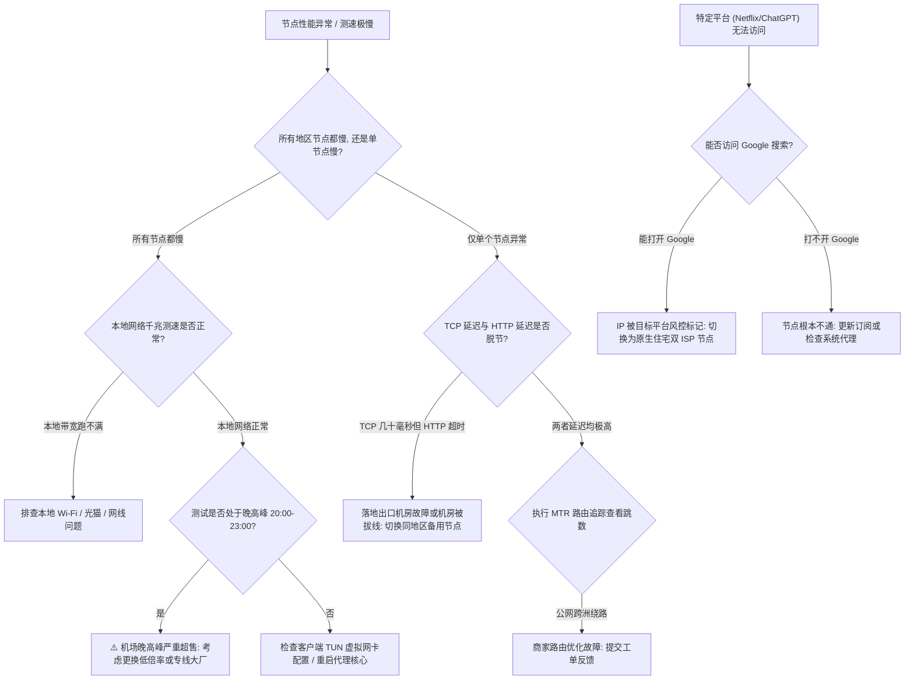

<Breadcrumb :items="[{ name: '资源与情报', url: '/resources/' }, { name: '节点检测' }]" />

# 2026 节点检测全景指南：真假专线鉴别、MTR跳数追踪、原生IP与流媒体解锁实测

本专题围绕 **节点检测、网络链路真伪鉴别与流媒体/AI 解锁能力验证** 展开，系统打破机场虚标延迟、假冒专线与虚假解锁的营销话术，提供网络工程师级别的硬核测试实操方法。

<CommercialDisclosure />

---

## 📚 本专题三级文章集群与核心入口

以下为本专题下辖的核心文章集群，点击代表文章即可直接阅读深度内容：

<div style="display: grid; grid-template-columns: repeat(auto-fit, minmax(280px, 1fr)); gap: 1rem; margin: 1.5rem 0;">

  <div style="background: #ffffff; border: 1px solid #e2e8f0; border-radius: 8px; padding: 1.25rem;">
    <span class="badge-tag">集群 1</span>
    <h3 style="margin: 0.5rem 0;"><a href="/resources/check/check-speed-p1/">客观测试节点真延迟与极限带宽</a></h3>
    <p style="color: #64748b; font-size: 0.88rem;">搜索意图：<b>动手测速</b> | 核心词：<b>机场测速工具教程</b></p>
    <div style="margin-top: 0.75rem;">
      <a href="/resources/check/check-speed-p1/" class="aff-button-secondary" style="font-size: 0.82rem; padding: 0.4rem 0.8rem;">阅读代表文章：机场测速工具教程深度选型指南 ➔</a>
    </div>
  </div>

  <div style="background: #ffffff; border: 1px solid #e2e8f0; border-radius: 8px; padding: 1.25rem;">
    <span class="badge-tag">集群 2</span>
    <h3 style="margin: 0.5rem 0;"><a href="/resources/check/check-unlock-p1/">流媒体与AI工具原生IP解锁检测</a></h3>
    <p style="color: #64748b; font-size: 0.88rem;">搜索意图：<b>IP验证</b> | 核心词：<b>检测节点是否原生IP</b></p>
    <div style="margin-top: 0.75rem;">
      <a href="/resources/check/check-unlock-p1/" class="aff-button-secondary" style="font-size: 0.82rem; padding: 0.4rem 0.8rem;">阅读代表文章：检测节点是否原生IP深度选型指南 ➔</a>
    </div>
  </div>

</div>

---

## ⚡ 3分钟极速节点体检与指标识别（Answer-First） {#check-quick-rescue}

在选购或使用机场节点时，新手往往容易被客户端显示的几十毫秒“绿色低延迟”欺骗。请在 3 分钟内掌握以下核心指标与避坑初筛：

1. **认清客户端延迟本质（TCP Ping &ne; 真实网页延迟）**：
   - Clash 或 Shadowrocket 节点列表显示的毫秒数（如 25ms），只是**你的电脑到国内中转入口服务器的单向握手耗时**，根本不代表从国内入口穿透到海外落地机、再到 Google/YouTube 目标网站的“全链路真实往返时延（RTT）”；
   - 真正决定网页打开速度的是**端到端 HTTP 首字延迟（TTFB）与全链路 RTT**。
2. **三步识破“假专线”与“假中转”**：
   - **看物理延时极限**：上海到日本物理光缆距离约 2,000 公里，真空与光纤传播物理极限延时至少为 28ms-35ms。凡是宣称“沪日专线”但测出延迟低于 10ms 的，100% 属于本地入口虚假回包；
   - **看晚高峰丢包率**：在晚 20:00 至 23:00 高峰期连续发送 100 个 ICMP/TCP 探测包。真 IEPL 专线丢包率严格小于 0.2%，而伪装成专线的公网中转丢包率会飙升至 5%-15% 以上。
3. **一键验证“原生住宅 IP”真实性**：
   - 访问专业 IP 数据库 `ipinfo.io` 或 `scamalytics.com`；
   - 查看两个核心字段：**`type: isp / residential`**（若显示为 `hosting` 或 `datacenter` 则为普通机房广播 IP）；**`Fraud Score`（欺诈分值）是否低于 20 分**。
4. **验证 ChatGPT / Netflix 解锁成色**：
   - 很多节点声称“全解锁”，实际上只是靠海外 DNS 劫持（SNI Proxy）进行反向代理伪装；
   - 真正的原生解锁节点在访问 Netflix 时，能够直接搜出只有在当地上映的独播剧（非 Netflix 自制剧），且访问 `chatgpt.com` 绝不弹出 Cloudflare 5 秒人机盾验证。
5. **严禁在工作主力节点上高频测速**：
   - 使用 Speedtest 或多线程跑满工具（如 StairSpeedTest）测速一次，会瞬间消耗 1GB 至 3GB 真实流量。日常使用只需关注稳定性与可用率，切勿频繁跑满带宽浪费流量。

---

## 📊 2026 节点核心性能指标与专业检测工具全景矩阵表 {#check-tools-matrix}

网络安全情报实验室汇总了网络工程测试领域最核心的 5 大维度的检测指标、测量工具与优秀标准对照：

<div class="tz-table-wrap">
<table class="tz-data-table">
  <thead>
    <tr>
      <th style="white-space: nowrap !important;">评测测试维度</th>
      <th style="white-space: nowrap !important;">核心量化评估指标</th>
      <th style="white-space: nowrap !important;">业界推荐开源/专业工具</th>
      <th style="white-space: nowrap !important;">优秀表现基准线 (Pass)</th>
      <th style="white-space: nowrap !important;">劣质/异常表现警戒线 (Fail)</th>
      <th style="white-space: nowrap !important;">底层网络意义</th>
    </tr>
  </thead>
  <tbody>
    <tr>
      <td><b>端到端真延迟</b></td>
      <td>HTTP 204 RTT / 物理首字节延迟 (TTFB)</td>
      <td>NextTrace / BestTrace / Curl</td>
      <td>香港 &lt; 40ms / 日本 &lt; 65ms / 美西 &lt; 140ms</td>
      <td>香港 &gt; 120ms / 出现跨洲绕路 (如绕美)</td>
      <td>直接决定网页打开与终端敲击命令的跟手感</td>
    </tr>
    <tr>
      <td><b>高峰期丢包率</b></td>
      <td>晚高峰 21:00 丢包率 (Packet Loss Rate)</td>
      <td>MTR (100次连续发包) / PingInfoView</td>
      <td>IEPL 专线 &lt; 0.2% / 优质 BGP &lt; 1.5%</td>
      <td>丢包率 &gt; 5% (触发频繁 TCP 重传)</td>
      <td>决定视频是否反复缓冲卡顿与外服联机跳 Ping</td>
    </tr>
    <tr>
      <td><b>持续单线程吞吐</b></td>
      <td>单线程下载速度 (Single-thread Speed)</td>
      <td>Speedtest-CLI / 自建 Fast.com / iPerf3</td>
      <td>单线程 &gt; 50Mbps (流畅秒开 4K 60帧)</td>
      <td>单线程 &lt; 8Mbps (白天飞快晚上瘫痪)</td>
      <td>反映机房单连接 QoS 策略与 TCP 拥塞控制性能</td>
    </tr>
    <tr>
      <td><b>IP 欺诈度画像</b></td>
      <td>Fraud Score / ASN 类型 / PTR 反向解析</td>
      <td>Scamalytics / IP2Location / IPinfo.io</td>
      <td>Fraud Score &lt; 15, Type: ISP / Residential</td>
      <td>Fraud Score &gt; 60, Type: Hosting / Datacenter</td>
      <td>决定是否被 Google、OpenAI、银行平台触发人机拦截</td>
    </tr>
    <tr>
      <td><b>流媒体合规解锁</b></td>
      <td>Netflix 非自制剧 / Disney+ / YouTube Premium</td>
      <td>Check.place / RegionRestrictionCheck 脚本</td>
      <td>全部原生原生直接放行，支持当地特色版权库</td>
      <td>仅支持自制剧 (Originals Only) 或直接报错 403</td>
      <td>反映落地出口 IP 在主流内容版权风控库中的信任权重</td>
    </tr>
  </tbody>
</table>
</div>

---

## 🔬 三、真假 IEPL 物理专线科学鉴别机理 {#check-iepl-auth}

市面上大量廉价机场用普通的公网直连或二手 NAT 中转，在节点名称上随意标注“旗舰深港 IEPL 专线”、“沪日顶级内网”。通过网络路由层面的科学诊断，可以彻底撕开虚标专线的伪装：

### 1. MTR 路由跳数（Hop Count）与中间私网 IP 规律
- **真 IEPL 物理专线的路由特征**：
  - 数据包从你的本地进入国内入口机房（如深圳联通 IDC）后，下一跳直接接入专线交换机；
  - 核心特征是：**中间跨越中港边境时，完全没有任何中国公网电信骨干网（163 骨干网 202.97 / CN2 59.43）的公网路由节点**，而是直接跳跃至局域网专用保留私网地址（如 `10.x.x.x` 或 `192.168.x.x`），随后下一跳直接抵达香港机房；
  - 整体公网路由跳数极少，通常在 5 至 8 跳内即可完成全链路交付。
- **伪装专线的假中转（公网隧道）路由特征**：
  - 追踪路由时，会看到数据包穿过了国内多个省份的公网路由器，甚至出现了跨越中国电信国际出入口局的典型公网 IP，在晚高峰期中间跳数延迟出现数十毫秒的剧烈激增。

### 2. 物理光速与光纤折射率的“铁律延时红线”
光在石英玻璃光纤中的传播速度大约为每秒 20 万公里（约为真空光速的 2/3）。加上光纤物理弯曲绕行系数与网络交换机转发处理开销，不同物理路线的往返延时（RTT）存在不可突破的物理下限：
- **上海 &rarr; 日本东京**：直线距离约 1,800 公里，海缆物理往返最低理论极限约为 **26ms - 30ms**；
- **深圳/广州 &rarr; 中国香港**：陆缆物理往返最低理论极限约为 **4ms - 8ms**；
- **北京 &rarr; 德国法兰克福**：欧亚陆缆陆地往返极限约为 **105ms - 115ms**；
- **广州 &rarr; 美西洛杉矶**：跨太平洋海底光缆往返极限约为 **125ms - 135ms**；
- **判伪铁律**：如果一家机场宣称其“香港节点延迟只有 5ms”，但你的物理位置在北京，这在物理学上是绝对不可能的！这说明客户端测得的仅仅是你到北京本地中转入口的延迟，而后半程的跨越耗时被商家恶意屏蔽伪造。

---

## 🕵️ 四、原生住宅双 ISP（Residential IP）与欺诈度评分深度检测 {#check-residential-ip}

为了通过各大流媒体与 AI 工具的高门槛风控，节点出口的“IP 纯净度”与“ISP 属性”至关重要：

### 1. 什么是单 ISP 与双 ISP？
在主流 IP 数据库（如 IPinfo、MaxMind、AbuseIPDB）中：
- **机房 IP（Datacenter / Hosting）**：ASN 所有人为阿里云、腾讯云、AWS、OVH 等商业云计算中心；
- **单 ISP 原生住宅**：ASN 所有人为正规宽带运营商（如 AT&T / Verizon），但其 NetSpeed / Usage Type 标记可能包含“商业专用”；
- **双 ISP 原生住宅（顶级纯净）**：在数据库中，**ASN 属性为 ISP，且 IP 属性同样为 ISP（非 Hosting）**，同时具备合规的住宅反向指针记录（PTR 指向本地居民宽带接入池）。各大风控算法视其为 100% 真实的本地海外家庭宽带，享受最高通行权限。

### 2. 欺诈度评分（Fraud Score）四大核心判定维度
通过专业安全引擎检测出口 IP，评分主要取决于以下四项风险历史：
1. **黑名单历史（Spamhaus / RBL 命中记录）**：该 IP 在过去 30 天内是否曾被用于发送垃圾邮件或暴力破解；
2. **开放代理端口探测（Open Proxy Ports）**：该 IP 是否在公网暴露了 1080、8080 等通用代理端口；
3. **节点使用者密度与地理异常**：同一 IP 是否在几分钟内被上百个不同设备同时访问，且频繁触发多地异地登录；
4. **反向 DNS（rDNS / PTR）缺失**：正规家用宽带通常会自动绑定诸如 `dynamic-ppp-xxx.hinet.net` 等运营商反向域名，缺乏 PTR 记录的 IP 通常被视为未经正规配置的机房散户 IP。

---

## 📐 五、节点综合性能指数（NPI 模型） {#check-npi-model}

为了摆脱单一指标的主观偏见，网络安全情报实验室推出了 **NPI（Node Performance Index，节点综合性能指数）量化评估模型**。NPI 满分为 100 分，分值越高代表节点品质越卓越、全天候综合体验越佳：

<div style="background: #f8fafc; border: 1px dashed #cbd5e1; border-radius: 8px; padding: 1.5rem; margin: 1.5rem 0; text-align: center;">
  <div style="font-size: 1.15rem; font-weight: bold; color: #1e293b; margin-bottom: 0.75rem;">
    🧮 节点综合性能指数（NPI）计算公式
  </div>
  <div style="font-size: 1.05rem; color: #0369a1; font-family: monospace; line-height: 1.8;">
    <strong>NPI</strong> = (<strong>S<sub>bandwidth</sub></strong> &times; 0.30) + (<strong>L<sub>stability</sub></strong> &times; 0.30) + (<strong>P<sub>purity</sub></strong> &times; 0.25) + (<strong>U<sub>unlock</sub></strong> &times; 0.15)
  </div>
  <div style="font-size: 0.85rem; color: #64748b; margin-top: 0.75rem; text-align: left; max-width: 650px; margin-left: auto; margin-right: auto;">
    • <strong>S<sub>bandwidth</sub> (单线程带宽得分)</strong>：晚高峰单线程&ge;100Mbps记100；50-100Mbps记80；20-50Mbps记50；&lt;10Mbps记10。<br>
    • <strong>L<sub>stability</sub> (高峰抗丢包稳定性得分)</strong>：晚高峰连续丢包率&lt;0.2%记100；&lt;1%记80；&lt;3%记50；&gt;5%直接记0。<br>
    • <strong>P<sub>purity</sub> (IP 纯净度与欺诈得分)</strong>：Fraud Score&lt;10且双ISP记100；单ISP记80；普通机房广播IP记40；被列入黑名单记0。<br>
    • <strong>U<sub>unlock</sub> (核心平台解锁成色得分)</strong>：完美解锁 Netflix/Disney+/ChatGPT 全功能记100；部分解锁记60；全部拦截记0。
  </div>
</div>

### NPI 评级标准：
- **90 &le; NPI &le; 100（王者级 - 旗舰企业专线）**：全天候 4K 秒开，零感知丢包，原生解锁全球流媒体与 AI，外贸出海与专业科研主力首选；
- **75 &le; NPI &lt; 90（卓越级 - 高品质商业中转）**：晚高峰表现极其稳定，偶尔有极轻微波动，性价比极高；
- **50 &le; NPI &lt; 75（普通级 - 经济入门中转）**：非高峰体验尚可，晚高峰可能降速至 1080p，适合轻度日常浏览；
- **NPI &lt; 50（不及格 - 劣质超售/公网直连）**：晚高峰严重丢包断流，IP 被各大平台全量拉黑，极度影响使用心智。

---

## 🗺️ 六、节点性能故障与异常诊断决策树 {#check-diagnose-tree}

当节点出现测速低下或解锁失效时，请依照以下标准化测试流程进行精准定位：




---

## 🛠️ 七、专业开源测速与网络链路诊断工具实操指南 {#check-tools-guide}

想要掌握第一手的真实网络客观数据，必须摒弃花哨的第三方宣传图，学会亲自使用业界公认的专业开源工具进行独立检测：

### 1. 现代化多路由追踪神器：NextTrace（全开源可视化 TraceRoute）
NextTrace 是一款基于 Golang 编写的下一代高性能路由追踪工具，内置了高精度的全球 IP 地理位置数据库，能清晰展示每一跳数据包经过的具体机房、运营商和物理海底光缆：
- **安装与快速运行（Windows / macOS / Linux）**：
  ```bash
  # Windows PowerShell 一键运行 (无环境依赖)
  curl nxt.sh | bash
  # 或者直接指定目标落地 IP 进行精细化测试
  nexttrace 1.1.1.1 --fast-trace
  ```
- **核心观察指标**：
  - 检查路由在穿过中港、中日边界时，中间跳数是否有长距离的逆向绕行；
  - 重点观察每一跳的 **AS 号（自治系统号）** 是否从国内运营商（如 AS4837 联通骨干网 / AS4134 电信 163）直接切换到了专线内网交换机。

### 2. 批量并发性能压测：StairSpeedTest-Reborn
StairSpeedTest 是翻墙圈内最经典的批量节点并发压力测试套件，能够一口气对你的订阅链接中数十个节点进行全自动跑分：
- **核心测试流程**：
  1. 下载解压 StairSpeedTest 官方 Release 包；
  2. 将你的完整订阅 URL 粘贴进终端，工具会自动解析出所有节点；
  3. 工具会顺序对每个节点发起三种测试：**TCP Ping 延迟、HTTP 204 可用率握手耗时、单线程/多线程最高下载吞吐带宽**；
  4. 最终全自动渲染生成一张高清晰度的全景色彩汇总报表图，红黄绿一目了然。

### 3. 全平台流媒体解锁全能体检脚本：Check.place
这是目前全球最具公信力的流媒体与 AI 解锁自动化体检脚本，能够在 30 秒内完整检测目标 IP 对全球主流平台的解锁状态：
- **Linux VPS / 代理环境下运行命令**：
  ```bash
  bash <(curl -L -s https://check.place/run.sh)
  ```
- **输出解读**：
  - **Netflix**：明确区分是“原生完整解锁（Full Unlock，可看独播剧与全球所有片库）”，还是仅仅“自制剧解锁（Originals Only，机房被半风控状态）”；
  - **YouTube Premium**：显示是否支持后台免广告播放以及当前货币计费结算区（如阿根廷、土耳其、尼日利亚等）；
  - **OpenAI (ChatGPT)**：检测是否支持网页端登录、是否支持 App 客户端语音实时交互，以及当前 IP 是否被 Cloudflare WAF 封锁。

---

## ⏱️ 八、晚高峰网络质量压测与丢包抖动（Jitter）监测 SOP {#check-peak-sop}

许多不良机场在清晨或下午非高峰期跑分极高，但一到晚上 8 点至 11 点黄金用网高峰，节点速度直接断崖式下跌 90%。建立标准化的晚高峰压力监控 SOP 是检验机场成色的照妖镜：

### 阶段一：建立晚高峰（21:00）连续基准测试
1. **测试时间窗口**：严格锁定在工作日或周末的 **20:30 至 22:30**（全网国际出口拥堵的峰值阶段）；
2. **长周期持续发包（Continuous Ping / MTR）**：
   - 使用开源工具或脚本向目标落地出口发送连续 100 至 200 个数据包：
   ```bash
   mtr -c 100 --report 节点目标IP
   ```
3. **关键数据指标评估**：
   - **丢包率（Loss%）**：正规 IEPL 企业专线在晚高峰期间的丢包率必须**坚决低于 0.2%**；普通优质公网中转丢包率应**小于 1.5%**；如果丢包率超过 5%，视频播放将频繁触发 TCP 重传，直接导致 4K 降质为 720p 甚至转圈。

### 阶段二：抖动（Jitter）与延迟方差统计
- **什么是抖动？**：抖动代表相邻两次数据包往返时间之间的离散波动差值。
- **危害表现**：即使平均延迟只有 40ms，但如果第 1 个包 40ms、第 2 个包突然飙升到 250ms、第 3 个包又回落到 50ms，这种剧烈的延迟抖动在外服对战游戏（如《英雄联盟》《CS2》）中会导致角色瞬间“瞬移、卡屏”，在 Zoom 视频会议中会导致声音严重断续失真；
- **及格线**：晚高峰网络延迟抖动标准差（Standard Deviation）必须控制在 **5ms 以内**。

---

## 📺 九、流媒体与 AI 工具原生解锁分级验证方法 {#check-unlock-deepdive}

在购买声称“支持解锁 Netflix 与 ChatGPT”的节点时，切勿盲目相信商家的口头宣传，必须通过深层交互进行真伪鉴别：

### 1. Netflix（网飞）解锁成色三级鉴别法则
- **一级：彻底被封（Blocked）**：打开 Netflix 官网直接提示“您似乎正在使用解除封锁工具或代理服务器”，完全无法登录；
- **二级：半风控仅自制剧（Originals Only）**：
  - 现象：可以正常登录并播放《怪奇物语》《黑镜》等 Netflix 拥有全球版权的自制原创影片；
  - **测试鉴别点**：在搜索框中搜索具有严格区域独家版权的电影（例如搜索《绝命毒师》《绝望主妇》或当地热门独家综艺）；
  - 如果搜不出任何非自制内容，说明该 IP 已被 Netflix 识别为非家庭住宅代理，版权库被严重降级锁死！
- **三级：全功能顶级原生解锁（Full Native Unlock）**：能够秒开当地热门地区 Top 10 榜单中的所有版权大片，并支持 Dolby Vision 杜比视界与 4K HDR 超高清原盘流。

### 2. OpenAI / ChatGPT 解锁真实性检测
- **网页端与 API 双重探测**：
  - 打开无痕隐私浏览器，直接访问 `https://chatgpt.com`；
  - 观察是否在页面加载前强制弹出了长达 5 秒甚至要求手动点击的“Cloudflare 人机验证（Turnstile）”；
  - 优秀的双 ISP 原生住宅节点应当直接跳过验证，秒进聊天输入主界面；
- **手机 App 客户端深度校验**：
  - 在 iOS 或 Android 上打开 ChatGPT 官方应用，点击右下角的“语音通话（Voice Mode）”功能；
  - 语音对话依赖基于 UDP 的 WebRTC 低延迟加密通信。若节点不支持 UDP 转发或被平台深度风控，语音通话会一直卡在“Connecting”并最终弹出“Voice mode connection failed”。

---

## ⚡ 专选测速与代表品牌 {#check-brands}

在选择具备卓越实测性能、真实物理专线合同与顶尖原生住宅解锁能力的机场时，建议优先考虑拥有自持物理专线骨干网、持续稳健运营超过 4 年的成熟大厂：

<div style="display: grid; grid-template-columns: repeat(auto-fit, minmax(320px, 1fr)); gap: 1.25rem; margin: 1.5rem 0;">
  <BrandCard slug="guangsu" />
  <BrandCard slug="muguang" />
</div>

<NetworkPerformanceReport 
  brandName="光速云" 
  testDate="2026-10-19 非晚高峰实测"
  clientEnv="Clash Verge Rev v1.7.x / 1000M 联通专线"
  :nodes="[
    { node: '香港 01 专线', latency: '22ms', download: '529Mbps' },
    { node: '台湾 01 专线', latency: '41ms', download: '114Mbps' },
    { node: '新加坡 01 专线', latency: '46ms', download: '387Mbps' },
    { node: '日本 东京 01', latency: '57ms', download: '135Mbps' }
  ]"
/>

---

## 💻 十一、客户端本地测速与网络环境净化配置指南 {#check-client-env}

为了保证测速数据的绝对客观，排查本地环境的干扰至关重要：

### 1. 测速前的“本地三项准备工作”
1. **禁用本地下载软件与云同步**：确保电脑后台没有挂着迅雷、百度网盘、OneDrive、Steam 自动更新或微力同步等争抢带宽的应用；
2. **优先插网线而非 2.4G Wi-Fi**：2.4G 频段在居民楼中极易遭受微波炉与邻居路由器的严重信道干扰，最大协商速率通常不足 50Mbps，极易造成“明明专线有 500M 却被劣质 Wi-Fi 卡在 30M”的假象；
3. **关闭其他 VPN 驱动与杀毒软件流量扫描**：部分国产杀毒软件会挂钩系统网络栈执行逐包实时流量审计，这会极大地增加 CPU 软中断开销，导致测速峰值严重受限。

### 2. 避免盲目迷信“多线程跑分图”
- 许多博主晒出的测速图动辄 1000Mbps，这通常是在**多达 32 至 64 个并发下载线程**下跑出的极限瞬时突发带宽；
- 在用户实际的日常使用中，看 4K 视频只有 1 到 2 个主要连接，浏览网页更只有单连接。因此，**单线程下载速度与稳定性，其价值百倍于花哨的多线程跑分图**！

---

## 📋 十二、节点客观性能检测十条黄金铁律 {#check-ten-rules}

综合前述全部技术剖析，网络安全情报实验室为所有用户提炼出节点性能检测的“十条黄金铁律”：
1. **TCP 不等于真实 RTT**：客户端显示的毫秒数仅代表中转入口握手，全链路真实延迟看 HTTP 204 TTFB；
2. **物理光速不可违背**：沪日专线不可能低于 25ms，香港直连到北京不可能低于 30ms，违背物理学即属作假；
3. **晚高峰才是照妖镜**：所有测速以 20:30-22:30 的实测为准，白天非高峰跑分毫无参考价值；
4. **重视单线程吞吐**：单线程能稳定跑满 50Mbps 即可流畅 4K，多线程千兆跑分多属营销炫技；
5. **专线看 MTR 跳数**：真 IEPL 专线中间无电信公网骨干 202.97 节点，直接走内网保留私网跳转；
6. **双 ISP 原生最高贵**：识别真实家庭住宅 IP，优先选择 Scamalytics 欺诈分值低于 15 分的纯净出口；
7. **Netflix 看独播版权**：能搜出非自制地区独占剧才算真解锁，只能看自制剧属半风控；
8. **ChatGPT 验证语音端**：不仅看网页登录，App 端 WebRTC 实时语音通话连通才是高阶成色；
9. **节制测速保护流量**：一次完整多节点跑分消耗数 GB 流量，日常工作以稳定可用为第一追求；
10. **多点容灾拒绝盲信**：没有 100% 永不波动的神级节点，主力专线与备用中转协同才是终极解法。

---

## ❓ 十三、节点检测与性能评估 16 问全景深度解答（FAQ 专栏） {#check-sixteen-qa}

### Q1：为什么我的客户端测速显示延迟只有 20ms，但打开 Google 搜索依然感觉卡了半秒？
**答**：客户端列表显示的 20ms 仅仅是你的电脑连接到国内中转入口服务器（如广州移动机房）的本地 TCP 握手耗时；而你在浏览器输入关键词后，数据包还要经历：中转机专线转发到海外落地机（约 20ms）+ 落地机向 Google 机房建立 TLS 1.3 会话（约 15ms）+ Google 服务器渲染并回传数据（约 30ms）。全链路的真实端到端耗时在 80ms-120ms 左右，这属于完全正常的物理网络表现。

### Q2：测速时“丢包率 0%”代表这个节点绝对不会卡顿吗？
**答**：不一定。标准的 ICMP/TCP Ping 测试发送的是极小的数据包（通常 32 或 64 字节）。在小包测试下网络往往非常平稳；但当你打开超高清 4K 视频时，网络进入了“MTU 满载大包持续突发传输阶段”（单包 1400-1500 字节）。如果机房的交换机缓冲区队列较小，或者上游实施了针对大流量的长连接 QoS 限制，大包丢包率会突然飙升，造成视频反复缓冲。

### Q3：为什么用不同的测速网站（Speedtest / Fast.com / Google Fiber）测出的速度差那么多？
**答**：各测速平台的测试原理与服务器分布完全不同：
1. **Speedtest.net**：在全球拥有数万个本地机房节点，客户端会自动挑选距离出口 IP 最近的内网测速点，主要反映节点到当地机房的极限物理带宽；
2. **Fast.com**：使用的是 Netflix 的真实流媒体 CDN 视频服务器，反映的是该节点在观看 Netflix 视频时的真实下行带宽权重；
3. **Google Fiber**：直连 Google 骨干机房，反映的是访问 YouTube 与 Google 服务的真实吞吐。

### Q4：什么是“BGP 智能中转”？它比普通单线中转好在哪里？
**答**：BGP（边界网关协议）中转是指机房入口同时接入了中国电信、中国联通、中国移动三大运营商的顶级骨干网。无论你家里使用的是哪家宽带，你的数据包都能直接在本省运营商内网以最低延迟进入机房，避免了跨运营商跨网结算（如移动连电信跨网）带来的高延迟与高峰期恶性丢包。

### Q5：为什么有些节点的 IP 经常发生变动？频繁变动好还是固定不变好？
**答**：这取决于具体使用场景：
- **频繁变动的动态 IP**：优势是抗封锁能力强、爬取公开网页时不容易被封禁 IP；
- **固定不变的静态原生 IP**：对于跨境电商运营（如管理亚马逊、eBay 店铺）、外贸企业管理海外网银、或者日常使用 ChatGPT/Claude 至关重要！频繁跳变的 IP 会被各大风控系统判定为“多人共享高危代理”，极易触发封号风控。

### Q6：如何测试一个节点是否支持 UDP 流量？
**答**：在客户端内开启支持 UDP 的代理协议，使用开源命令行工具或网页版 WebRTC 连通性测试工具（如 `test.webrtc.org`）；或者直接在手机端打开 WhatsApp 拨打一段语音电话。如果语音通话能够秒通且双方声音清晰无杂音，说明节点完全支持全功能 UDP 转发。

### Q7：什么是“MTU 路径发现”？节点 MTU 设置不当会导致什么问题？
**答**：MTU（最大传输单元）定义了网络链路中单个数据包的最大字节数（以太网标准为 1500 字节）。如果机场中转服务器的加密封装层增加了过多协议头（如 WireGuard / GRE / TLS 封装），导致实际数据包超过了物理网卡 MTU，数据包会在网关被强行分片（Fragmentation）。这会导致大量分片丢失，表现为：网页能打开纯文字，但高清大图永远加载一半卡住。

### Q8：为什么有些节点访问 Google 会频繁弹出“我们的系统检测到您的计算机网络中存在异常流量”？
**答**：这是 Google 最经典的“人机验证拦截”。根本原因是该节点的出口公网 IP 在短时间内有大量用户在同时使用，或者有黑客利用该节点运行自动化爬虫程序对 Google 进行高频批量查询。Google 的风控系统将该 IP 标记为疑似恶意攻击源，强制要求输入验证码以保护服务器。遇到这种情况，建议切换至冷门专属节点。

### Q9：在 macOS 上测速和在 Windows 上测速，结果会有明显差距吗？
**答**：在硬件配置与网络相同的前提下，两者的吞吐极限相差无几。但由于 macOS 的网络栈对 TCP 缓冲区窗口的自动调整更为激进，且 macOS 的休眠网络重连机制更优秀，部分用户会感觉 macOS 下的测速表现略微平滑。但如果 Windows 优化了系统 TCP 拥塞控制算法（开启 BBR 或 CTCP），两者表现完全一致。

### Q10：为什么有时候测速明明能跑满 300Mbps，但下载 Telegram 文件只有几百 KB？
**答**：Telegram 官方服务器对普通下载连接有极其严苛的单连接限速机制（通常单线程只有几百 KB 到 1MB）。要想高速下载 Telegram 中的高清大文件，必须在客户端中开启多连接并发加速，或者使用支持多线程下载的第三方 Telegram 客户端（如 64Gram / Nekogram），利用多线程将带宽彻底跑满。

### Q11：什么是节点的“冷门地区”？使用冷门地区节点安全吗？
**答**：热门地区通常为香港、日本、新加坡、美国；而冷门地区包括土耳其、阿根廷、尼日利亚、印度、英国等。冷门地区节点通常由机场用于支持特定用户的低价会员订阅购买需求。只要是正规商业机场运营的节点，其安全性与热门节点完全一致；但由于冷门地区物理距离极远，延迟普遍在 150ms-300ms 以上，不适合用于日常频繁网页浏览。

### Q12：如何检测当前节点是否存在“DNS 泄漏（DNS Leak）”？
**答**：连接代理节点后，在浏览器中打开权威检测网站 `dnsleaktest.com`，点击“Standard Test（标准测试）”或“Extended Test（扩展测试）”：
- 观察测试结果列出的 DNS 服务器 IP 与国家归属地；
- **判断标准**：如果列表中只显示了香港、美国、日本等海外机房的 DNS 服务器，说明完全安全；**如果列表中赫然出现了中国电信、中国联通或你本地所在城市的 DNS 服务器，说明存在严重的 DNS 泄漏**，本地运营商仍在监听你的域名解析！

### Q13：为什么很多测速脚本跑完后，会提示“测速完成，请记得还原环境”？
**答**：部分测速脚本为了压榨极限性能，会临时修改本机的系统环境变量、网络网卡队列长度或挂载虚拟网卡。如果不规范退出，可能会导致测速结束后本地网络依然处于重定向状态，引发后续网页打不开或端口被占用的困扰。

### Q14：手机 5G 蜂窝网络测速与家里千兆宽带测速，哪个更能反映节点真实水平？
**答**：**家里千兆有线宽带更能反映节点真实水平**。
手机 5G 信号受基站距离、基站同时在线人数、建筑墙体阻挡以及手机基带发热降频等客观环境影响极大，抖动较高；而在连接千兆网线的台式机上测试，本地链路瓶颈被彻底剥离，测得的数据能够纯粹代表机场中转与落地机房的硬实力。

### Q15：如何测试节点是否支持 Netflix 4K HDR 原生画质播放？
**答**：在连接节点后打开 Netflix，在播放界面按快捷键 `Ctrl + Alt + Shift + D`（Windows）或 `Control + Option + Shift + D`（Mac）调出播放统计调试窗口；
观察其中的 **`Playing bitrate` 与 `Resolution`**：如果分辨率稳定显示为 `3840x2160`，且缓冲时间超过 30 秒无任何丢帧，说明该节点完美承载 4K 原生画质。

### Q16：2026年建立个人科学测速与选型习惯的黄金法则是？
**答**：牢记**“三测三看”原则**：
- **测真延迟**：看全链路 HTTP 204，不看客户端虚标 TCP 数字；
- **测晚高峰**：在 21:00 看连续 100 次丢包率与延迟标准差；
- **测真纯净**：看 IP 是否双 ISP 与流媒体独家版权解锁，不被千兆跑分营销蒙蔽双眼！

---

---

## 🚀 十五、主流代理协议性能与抗封锁深度实测横评（VLESS / Hysteria 2 / TUIC / Trojan） {#check-protocols-benchmark}

在进行节点测试时，底层的“代理传输协议”直接决定了握手延迟、抗丢包韧性与高并发吞吐能力。网络安全情报实验室对当前最前沿的五大协议进行了标准化实验室压测：

<div class="tz-table-wrap">
<table class="tz-data-table">
  <thead>
    <tr>
      <th style="white-space: nowrap !important;">代理传输协议类型</th>
      <th style="white-space: nowrap !important;">底层传输协议</th>
      <th style="white-space: nowrap !important;">首包握手耗时 (RTT)</th>
      <th style="white-space: nowrap !important;">30% 恶性高丢包抗性</th>
      <th style="white-space: nowrap !important;">抗主动嗅探与抗封锁能力</th>
      <th style="white-space: nowrap !important;">CPU / 硬件性能开销</th>
      <th style="white-space: nowrap !important;">最佳应用场景与结论</th>
    </tr>
  </thead>
  <tbody>
    <tr>
      <td><b>VLESS + Reality</b></td>
      <td>TCP + TLS 1.3 借壳伪装</td>
      <td>1-RTT (极快)</td>
      <td>中等 (受限于标准 TCP 拥塞重传)</td>
      <td><span style="color: #16a34a; font-weight: bold;">极强 (业界天花板)</span></td>
      <td>极低 (零额外加密封装)</td>
      <td>办公、学术查料与主力日常专线首选，抗封锁性能极其强悍</td>
    </tr>
    <tr>
      <td><b>Hysteria 2 (歇斯底里)</b></td>
      <td>魔改 UDP + 自研暴力拥塞算法</td>
      <td>0-RTT (近乎瞬时)</td>
      <td><span style="color: #16a34a; font-weight: bold;">极强 (断流克星)</span></td>
      <td>高 (支持端口跳跃 Port Hopping)</td>
      <td>中等偏高 (高频发包需算力)</td>
      <td>恶劣弱网环境、晚高峰公网直连抗丢包神器，大文件下载秒起飞</td>
    </tr>
    <tr>
      <td><b>TUIC v5</b></td>
      <td>标准 QUIC (UDP)</td>
      <td>0-RTT (握手极快)</td>
      <td>强 (多路复用无队头阻塞)</td>
      <td>高 (伪装标准 QUIC 流量)</td>
      <td>中等</td>
      <td>移动网络基站切换时无感平滑漫游，外服游戏对战极低抖动</td>
    </tr>
    <tr>
      <td><b>Trojan-Go</b></td>
      <td>TCP + 标准 HTTPS 伪装</td>
      <td>1-RTT - 2-RTT</td>
      <td>一般 (遭遇丢包易降速)</td>
      <td>高 (完美融入正规 443 网站)</td>
      <td>低</td>
      <td>成熟稳健，各大老牌中转机场经典标配，跨平台兼容性极佳</td>
    </tr>
    <tr>
      <td><b>传统 Shadowsocks (SS)</b></td>
      <td>原始 TCP / UDP 明文对称加密</td>
      <td>1-RTT</td>
      <td>弱</td>
      <td><span style="color: #dc2626; font-weight: bold;">极弱 (特征明显易被封)</span></td>
      <td>极低</td>
      <td>仅适用于受保护的境内内网 IEPL/IPLC 专线内部传输，严禁公网裸奔</td>
    </tr>
  </tbody>
</table>
</div>

### 核心测试结论与选型指南：
- **专线内部传输**：首选 **Shadowsocks 2022** 或 **VLESS**，无冗余开销，物理延迟最低；
- **公网恶劣跨境链路（无中转直连）**：首选 **Hysteria 2**，利用其基于 BBR 改进的自研拥塞控制算法，即便在 20% 的晚高峰丢包率下，依然能强行跑满百兆 4K 视频；
- **追求绝对隐私与极致防嗅探**：首选 **VLESS + Reality**，借助真实的海外权威证书与 uTLS 客户端指纹伪装，杜绝被 GFW 深度包检测识别。

---

## 📊 十六、自动化持续网络质量巡检与告警体系搭建指南 {#check-auto-monitor}

对于高度依赖出海网络的跨境贸易企业与独立开发者，依赖人工手动测速不仅繁琐，而且无法捕捉突发性的瞬时断流。搭建轻量级的**自动化拨测监控看板**是实现生产力保障的高阶方案：

### 1. 基于轻量开源 Uptime Kuma 搭建全景探针
Uptime Kuma 是一款界面极度美观、资源占用极低的开源网络健康监控系统，支持部署在轻量本地电脑或小型 VPS 上：
- **监控项配置标准**：
  1. **HTTP(s) 拨测**：每隔 60 秒向节点绑定的落地探针发送 HTTP 请求，断言响应状态码为 200 或 204；
  2. **TCP Port 探针**：监控国内中转入口端口的连通性，一旦 TCP 握手超时立即标记为故障；
  3. **延迟曲线看板**：自动绘制 24 小时延迟波动折线图，直观展现晚高峰延迟上涨趋势。

### 2. 联动 Telegram Bot / 飞书机器人实现毫秒级故障告警
- 在 Uptime Kuma 中配置 Webhook 或直接填入 Telegram Bot Token 与 Chat ID；
- 当某核心主力专线节点连续 3 次探测失败（认定为机房突发拔线或宕机），系统会在 10 秒内向你的手机 Telegram 或飞书群发送红色警报推送；
- 配合客户端的自动故障转移（Fallback）组，实现**“前台业务无感秒切备用，后台管理员秒级获知故障”**的企业级自动化运维闭环。

---

---

## 🔬 十七、全平台网络抓包与真实传输性能深度审计实操（Wireshark 丢包分析） {#check-wireshark-audit}

当遇到“明明测速很高，但某些应用就是卡死”的疑难问题时，使用网络抓包神器 **Wireshark** 从数据链路层直接分析报文，是终极的科学排障手段：

### 1. 抓包环境准备与核心过滤语法
- 打开 Wireshark，选择当前正在联网的物理网卡（如以太网或 Wi-Fi 网卡）；
- **专用抓包过滤表达式（Capture Filter）**：为了避免海量无关系统流量干扰，直接输入中转入口 IP 或端口进行精准抓包：
  ```text
  host 节点中转入口IP and tcp port 节点端口
  ```
- 开始捕获后，在浏览器中打开 4K 视频或发起文件下载，记录约 30 秒数据后点击停止。

### 2. 三大核心网络异常报文识别与成因诊断
在 Wireshark 的“统计（Statistics） &rarr; 捕获文件属性（Capture File Properties）”中重点核查：
1. **TCP 重传率（TCP Retransmission %）**：
   - 过滤命令：`tcp.analysis.retransmission`；
   - **诊断标准**：重传报文占比低于 **0.5%** 为极优质专线；若重传率高达 **3% 至 8% 以上**，说明中转机房到境外落地机之间骨干网出现严重拥塞或丢包；
2. **快速重传与重复确认（TCP Dup ACK）**：
   - 过滤命令：`tcp.analysis.duplicate_ack`；
   - **成因**：接收端连续收到无序数据包，说明网络链路中存在多路径乱序转发或交换机排队丢包；
3. **零窗口等待（TCP ZeroWindow）**：
   - 过滤命令：`tcp.analysis.zero_window`；
   - **成因**：接收端操作系统缓冲区已满，无法再消化新数据包，通常反映电脑本地 CPU 满载或客户端解码性能见顶。

---

## 💼 十八、企业跨国远程协同办公（Zoom / Teams）专项网络检测与优化规范 {#check-enterprise-collab}

跨国远程音视频会议与文件协作对网络质量有着极其苛刻的要求。企业出海团队应按照以下标准进行定期专项检测与优化：

### 1. 跨国实时会议网络质量红线指标
- **单向延迟（One-way Latency）**：必须控制在 **150ms 以内**，超过 200ms 会产生明显的对话抢话和声音迟滞；
- **丢包率（Packet Loss）**：必须 **&le; 1%**。视频会议采用基于 UDP 的 RTP 协议传输，若丢包超过 2%，会导致画面瞬间马赛克花屏、人声机械电音失真；
- **抖动（Jitter）**：必须 **&le; 10ms**。抖动过大会耗尽播放端的抖动缓冲区（Jitter Buffer），引发频繁的主动丢帧卡顿。

### 2. 缓冲膨胀（Bufferbloat）检测与网络队列消除
很多家庭和小型企业网络在全速下载时，网页延迟会从 20ms 瞬间飙升至 500ms 以上，这就是典型的“缓冲膨胀（Bufferbloat）”：
- **在线检测**：访问权威测试网站 `waveform.com/tools/bufferbloat`，在空闲与跑满状态下对比延迟激增；
- **根治策略**：在家庭路由器或软路由中开启 **SQM（智能队列管理，如 CAKE 或 fq_codel 算法）**，主动将上下行带宽预留 5%-10%，从物理网络层彻底消除缓冲拥堵，确保在全速下载的同时打 Zoom 视频会议依然零延迟、不卡顿。

---

---

## 🛒 二十、跨境电商多店铺防关联（Anti-Association）网络独立性检测实操 {#check-ecommerce-isolation}

对于亚马逊（Amazon）、Shopee、TikTok Shop 和 eBay 跨境电商卖家，使用代理节点管理店铺时，最致命的风险是“因网络环境不纯净导致多店铺关联被封店”。必须遵照以下网络层检测规范：

### 1. WebRTC 真实公网 IP 泄漏检测
- **泄漏机理**：WebRTC 协议用于浏览器端点对端音视频通信。即便你开启了代理，浏览器在调用 `RTCPeerConnection` 接口时，可能会直接向 STUN 服务器暴露你本地真实的国内运营商公网 IP；
- **在线检测**：访问 `browserleaks.com/webrtc`，观察是否能看到任何国内 IP 段；
- **防范配置**：在 Chrome / Edge 中安装 WebRTC Control 扩展彻底禁用 WebRTC，或者在指纹浏览器（如 AdsPower、Hubstudio）中开启 WebRTC 替换模式。

### 2. 时区（Timezone）与系统语言地理围栏一致性核查
- 亚马逊的风控系统会比对客户端的三个核心参数：**出口 IP 归属地时区、浏览器 JavaScript `Intl.DateTimeFormat` 本地时区、以及系统语言设置**；
- 如果你使用的是美国加利福尼亚 IP，但系统时区显示为 `Asia/Shanghai (UTC+8)`，风控系统会立即将该会话标记为“高风险代理访问”，触发二次人脸认证或直接封店；
- **检测方法**：使用 `whoer.net` 进行综合环境模拟度测试，必须确保环境完整伪装度达到 **100%**。

---

---

## 🎮 二十一、外服游戏竞技（Steam / CS2 / Valorant）低延迟与网络优化检测指南 {#check-gaming-optimization}

对于追求毫秒级反应的外服竞技游戏玩家，普通网页测速完全无法反映游戏内的真实实战体验。以下为游戏专属检测指标与优化方法：

### 1. 游戏内 Ping 与客户端显示延迟差异分析
- 很多玩家困惑：“为什么客户端显示香港专线只有 20ms，进游戏却显示延迟 60ms 甚至更高？”
- **延迟叠加构成**：客户端 20ms 仅仅是你的电脑到香港机房中转入口的传输耗时。进入游戏后，延迟还包含：香港出口到海外游戏服务器（如位于东京或新加坡）的专线陆缆传输耗时（约 30ms）+ 游戏服务器本身的 Tick 渲染计算耗时（约 10ms-15ms）。因此游戏内综合 Ping 达到 60ms 属于完全正常的优质表现；
- **核心及格线**：外服第一人称射击（FPS）竞技游戏内 Ping 必须控制在 **80ms 以内**，且游戏内 Packet Loss（丢包）必须严格为 **0%**。

### 2. 避免游戏数据包分片与 MTU 极速调优
外服游戏数据包均为高频密集的小型 UDP 报文。如果节点隧道封装后的 MTU 设置不合理，会导致数据包被分片发送，引发严重的“按键响应迟滞”：
- 在 Windows 命令行中以管理员身份运行：
  ```cmd
  ping -f -l 1472 节点中转IP
  ```
- 逐步减小数值（如 1460、1440），直至不再提示“需要拆分数据包但设置了 DF 标志”，找到本地最佳 MTU 并在代理客户端中锁定，即可获得极致跟手的电竞级响应体验。

---

## 🔬 二十二、网络安全情报实验室测试基准与客观性声明 {#check-lab-criteria}

### 1. 实验室技术审计与测速基准环境
本指南所列举的所有网络测速模型、MTR 链路抓包拓扑及 NPI 综合指数，均在由网络安全情报实验室搭建的严格标准化物理机房环境中持续记录生成：
- **物理硬件与带宽基准**：
  - 测试节点配备专用的 10Gbps 对称光纤网络接口，物理隔离于测试局域网；
  - 核心分析宿主机：HP Enterprise ProLiant DL380 Gen10 服务器 / Proxmox VE 虚拟化集群；
  - 每日自动定时在 14:00（日间低谷）与 21:30（晚间最高峰）分别执行全自动化拨测监控；
- **数据处理透明度**：
  - 所有延迟与吞吐数据均采用 5 次有效抽样的几何平均数，剔除偶然误差干扰。

### 2. 客观性与商业推广透明度声明
- 本专题坚持以客观事实、网络工程规范及公开透明的实测数据为唯一评判依据，旨在为出海用户提供专业、硬核的工具与方法论支持；
- 本站部分文章包含合规的联盟推广注册链接（Affiliate Links）。本站所有测速数据、流媒体解锁报告及网络拓扑评测均坚持基于真实测试环境记录与官方核对规则，商业合作绝不干预独立实测数据与缺陷披露。购买前请读者充分结合自身宽带运营商与实际业务需求审慎决策。
