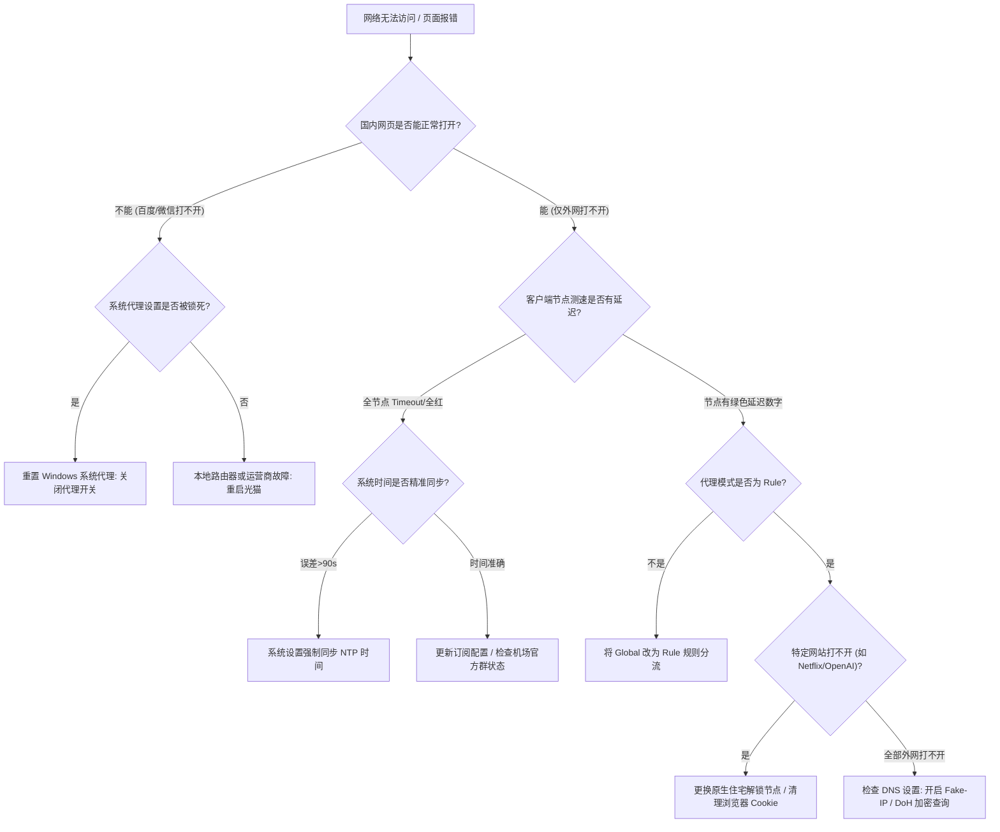

<Breadcrumb :items="[{ name: '资源与情报', url: '/resources/' }, { name: '机场 FAQ' }]" />

# 2026 机场常见问题全景解答 (FAQ)：购买避坑、流量倍率、DNS排查与报错字典

本专题围绕 **机场常见问题解答（FAQ）** 展开，系统梳理用户在购买前、使用中、网络报错排查与账号维护中的全部核心痛点，提供专著级技术深度的排障指南。

<CommercialDisclosure />

---

## 📚 本专题三级文章集群与核心入口

以下为本专题下辖的核心文章集群，点击代表文章即可直接阅读深度内容：

<div style="display: grid; grid-template-columns: repeat(auto-fit, minmax(280px, 1fr)); gap: 1rem; margin: 1.5rem 0;">

  <div style="background: #ffffff; border: 1px solid #e2e8f0; border-radius: 8px; padding: 1.25rem;">
    <span class="badge-tag">集群 1</span>
    <h3 style="margin: 0.5rem 0;"><a href="/resources/faq/faq-purchase-p1/">购买前计费周期与退款政策解答</a></h3>
    <p style="color: #64748b; font-size: 0.88rem;">搜索意图：<b>购买解答</b> | 核心词：<b>买机场常见问题</b></p>
    <div style="margin-top: 0.75rem;">
      <a href="/resources/faq/faq-purchase-p1/" class="aff-button-secondary" style="font-size: 0.82rem; padding: 0.4rem 0.8rem;">阅读代表文章：买机场常见问题深度选型指南 ➔</a>
    </div>
  </div>

  <div style="background: #ffffff; border: 1px solid #e2e8f0; border-radius: 8px; padding: 1.25rem;">
    <span class="badge-tag">集群 2</span>
    <h3 style="margin: 0.5rem 0;"><a href="/resources/faq/faq-usage-p1/">流量消耗过快与DNS污染解答</a></h3>
    <p style="color: #64748b; font-size: 0.88rem;">搜索意图：<b>使用技巧</b> | 核心词：<b>机场流量跑得快原因</b></p>
    <div style="margin-top: 0.75rem;">
      <a href="/resources/faq/faq-usage-p1/" class="aff-button-secondary" style="font-size: 0.82rem; padding: 0.4rem 0.8rem;">阅读代表文章：机场流量跑得快原因深度选型指南 ➔</a>
    </div>
  </div>

</div>

---

## ⚡ 3分钟极速自救速查索引（Answer-First） {#faq-quick-rescue}

当你在翻墙过程中遭遇突发断网或使用异常，请直接对照以下 5 种最典型场景进行一键式自救处置：

1. **节点测速全红，显示 Timeout 或 Handshake Failed**：
   - **核心诱因**：本地系统时间偏差超过 90 秒，或者订阅节点配置已在后端更新而本地未同步；
   - **处置方案**：打开 Windows 设置 &rarr; 时间和语言 &rarr; 点击“立即同步”；随后在 Clash Verge Rev 中右键点击订阅配置，选择“更新订阅”。
2. **国外网站秒开，国内所有网站打不开（或微信图片加载失败）**：
   - **核心诱因**：客户端处于“全局（Global）”模式，或代理接管了内网 DNS 却没有配置国内直连分流策略；
   - **处置方案**：在代理客户端面板中将代理模式从“Global（全局）”立即切换为“Rule（规则分流）”，并检查绕过大陆局域网规则是否生效。
3. **刚买的 100G 流量，看了两部电影就提示耗尽**：
   - **核心诱因**：误选了机场高倍率节点（如 3.0&times; 或 5.0&times; 高峰实验节点），或者下载软件（如迅雷、BT/PT）在后台疯狂走代理做种；
   - **处置方案**：立即检查正在使用的节点后缀是否有 `[3x]` 或 `[5x]` 标识，立即切换回 `[1x]` 或 `[0.5x]` 基础专线节点；在客户端设置中关闭 BitTorrent/P2P 协议代理。
4. **ChatGPT 提示“Sorry, you have been blocked”或 Access Denied**：
   - **核心诱因**：当前节点出口 IP 被 OpenAI 风控标记为“高风险公共机房数据中心（Datacenter IP）”；
   - **处置方案**：切换至标注有“原生（Residential / Home IP）”或带有流媒体/AI 解锁标识的台湾、日本、新加坡节点，并彻底清除浏览器 ChatGPT Cookie 后重试。
5. **电脑关掉代理软件后，整台电脑完全无法上网**：
   - **核心诱因**：代理客户端异常退出或崩溃，导致系统底层的“系统代理（System Proxy）”没有被正常恢复注销；
   - **处置方案**：打开 Windows 设置 &rarr; 网络和 Internet &rarr; 代理 &rarr; 关闭“使用代理服务器”开关；或者重新打开 Clash 客户端后再规范点击“退出”。

---

## 📊 2026 机场高频疑难杂症与技术根因分类矩阵表 {#faq-problem-matrix}

网络安全情报实验室汇总了数万名用户的实际工单与报障记录，将日常使用中最高频的 6 大类故障现象、底层协议根因与标准化解决链路整理如下：

<div class="tz-table-wrap">
<table class="tz-data-table">
  <thead>
    <tr>
      <th style="white-space: nowrap !important;">故障现象分类</th>
      <th style="white-space: nowrap !important;">典型客户端报错提示</th>
      <th style="white-space: nowrap !important;">网络层 / 传输层底层根因</th>
      <th style="white-space: nowrap !important;">影响范围</th>
      <th style="white-space: nowrap !important;">排查优先级</th>
      <th style="white-space: nowrap !important;">根治解决方案</th>
    </tr>
  </thead>
  <tbody>
    <tr>
      <td><b>时间同步漂移</b></td>
      <td><code>token expired</code> / <code>crypto/tls: alert</code></td>
      <td>VMess / Trojan / Reality 握手要求客户端与服务器时间差 &le; 90 秒，时间漂移导致鉴权认证直接失效</td>
      <td>全节点全红不可用</td>
      <td>P0 (最高优先)</td>
      <td>系统设置内强制同步国家授时中心 NTP 服务器时间 (pool.ntp.org)</td>
    </tr>
    <tr>
      <td><b>DNS 污染与死循环</b></td>
      <td><code>DNS lookup failed</code> / <code>i/o timeout</code></td>
      <td>本地运营商拦截 UDP 53 端口查询，返回虚假 IP；或者 Fake-IP 路由表冲突导致 DNS 回环</td>
      <td>国外域名无法解析</td>
      <td>P1 (核心阻断)</td>
      <td>开启 Clash 内核 DoH (DNS-over-HTTPS) 加密查询，首选 1.1.1.1 与 8.8.8.8</td>
    </tr>
    <tr>
      <td><b>节点倍率暴击</b></td>
      <td><code>traffic exhausted</code> (流量突发归零)</td>
      <td>用户误选 3x-10x 极端倍率专线，实际消耗流量按乘数倍增；后台自动更新后台走代理</td>
      <td>账号余额与流量耗尽</td>
      <td>P1 (财务损失)</td>
      <td>核对节点名称倍率系数，建立 Rule 规则排除 Steam/Epic 游戏与网盘同步</td>
    </tr>
    <tr>
      <td><b>并发连接数掐断</b></td>
      <td><code>connection reset by peer</code></td>
      <td>机场服务端限制单账号 IP 并发数（通常为 3-5 台），多设备或合租导致触发限流熔断</td>
      <td>多台设备频繁断流踢下线</td>
      <td>P2 (使用受限)</td>
      <td>家庭局域网配置软路由或网关旁路由同一 IP 出口，避免多端独立登录</td>
    </tr>
    <tr>
      <td><b>流媒体/AI 风控拦截</b></td>
      <td><code>IP not in service area</code> / <code>403 Forbidden</code></td>
      <td>目标平台（Netflix/OpenAI）对机房 ASN 实施黑名单封锁，出口 IP 属于广播欺诈 IP</td>
      <td>特定海外流媒体与 AI 应用</td>
      <td>P2 (功能受限)</td>
      <td>选用支持落地原生住宅双 ISP（Residential IP）的优质专属解锁节点</td>
    </tr>
    <tr>
      <td><b>系统代理残留锁死</b></td>
      <td><code>ERR_PROXY_CONNECTION_FAILED</code></td>
      <td>客户端被强制结束进程或电脑休眠后，Windows 注册表 Internet Settings 代理未还原</td>
      <td>整机无法访问任何网页</td>
      <td>P0 (阻断生产)</td>
      <td>手动关闭系统代理，或在客户端通用设置中开启“优雅退出时自动关闭代理”</td>
    </tr>
  </tbody>
</table>
</div>

---

## 💰 三、购买决策与计费深坑深度剖析：如何买才不当冤大头？ {#faq-purchase-deepdive}

在购买机场服务的过程中，新手往往只盯着“每月多少钱”和“有多少 G 流量”，却往往忽略了计费周期、重置规则与退款条款中的隐形门槛：

### 1. 计费周期与流量重置机制的“文字游戏”
- **自然月重置 vs 账单日重置**：
  - 部分机场采用“每月 1 号重置流量”，若你在 28 号购买月付套餐，3 天后到了下月 1 号流量便会强制清零重置，白白浪费绝大部分可用天数；
  - 正规成熟的机场采用**“账单周期日（Billing Cycle Date）”**，即如果你在 10 月 15 日购买，流量有效期严格计算至 11 月 15 日，每一分钱都能发挥最大效益。
- **流量耗尽后的降速策略**：
  - 优质大厂在月度流量用尽后，会提供“超出后限速 1Mbps 继续可用”的兜底保障；而劣质小机场一旦流量超出 1MB，会直接完全切断连接，甚至后台悄悄按高额单价直接扣除账户内充值的现金余额。

### 2. 退款条款剖析：为什么“支持退款”往往是一句空话？
许多小机场在首页醒目处标注“不满意 24 小时退款”，但细看其服务条款（TOS）却充满苛刻免责条款：
- **条款陷阱一：使用流量超过 1GB 不予退款**（随便开个网页测个速，1GB 流量就消耗殆尽）；
- **条款陷阱二：仅退回账户余额，不可提现至原微信/支付宝**（退回的只是网站内的虚拟数字，依然锁死在平台中）；
- **条款陷阱三：扣除高达 30% 至 50% 的手续费与网关通道费**；
- **核心选型法则**：永远不要把“售后退款”作为托底保证。最安全的防线永远是**初次选购坚决只买最低档月付**，实际验证晚高峰 7 天后再决定是否续费。

### 3. “周期订阅型”与“一次性按量付费型”科学选型指南
- **周期订阅型（月付/季付/年付）**：
  - **适合人群**：每天重度使用出海网络的外贸办公族、全天候 Telegram/YouTube 用户与跨境科研学者；
  - **优势**：单位流量单价极低（平均 1 元可买 10GB 至 30GB 带宽），享受更高的机房峰值带宽优先级保障。
- **一次性买断型（按量计费套餐，如 50 元 200GB 永久有效）**：
  - **适合人群**：平时主要用国内网络，仅偶尔需要登录 GitHub 查资料、查收海外邮件或应急搜索的低频用户；
  - **优势**：没有任何时间维度的月度清零压力，买一次可以用半年甚至一年，极佳的容灾备用方案。

---

## 🧮 四、流量偷跑与计费倍率底层换算模型（CEM 模型） {#faq-cem-model}

为什么很多用户明明没怎么看视频，机场后台显示的流量却以惊人的速度被扣除？除了日常后台系统更新走代理之外，核心原因在于**节点计费倍率（Multiplier）与真实物理消耗的几何放大效应**：

<div style="background: #f8fafc; border: 1px dashed #cbd5e1; border-radius: 8px; padding: 1.5rem; margin: 1.5rem 0; text-align: center;">
  <div style="font-size: 1.15rem; font-weight: bold; color: #1e293b; margin-bottom: 0.75rem;">
    🧮 机场流量实际扣除换算模型（CEM 模型）
  </div>
  <div style="font-size: 1.05rem; color: #0369a1; font-family: monospace; line-height: 1.8;">
    <strong>B<sub>deduct</sub></strong> = (<strong>D<sub>download</sub></strong> + <strong>U<sub>upload</sub></strong>) &times; <strong>M<sub>ratio</sub></strong> + <strong>O<sub>overhead</sub></strong>
  </div>
  <div style="font-size: 0.85rem; color: #64748b; margin-top: 0.75rem; text-align: left; max-width: 650px; margin-left: auto; margin-right: auto;">
    • <strong>B<sub>deduct</sub></strong>：机场面板最终记录并扣除的账单流量。<br>
    • <strong>D<sub>download</sub> / U<sub>upload</sub></strong>：客户端与目标服务器交互的实际下行与上行物理数据包（双向计费）。<br>
    • <strong>M<sub>ratio</sub> (节点倍率)</strong>：节点专属计费倍数（0.1x 至 10.0x 不等）。<br>
    • <strong>O<sub>overhead</sub> (协议封包开销)</strong>：TLS 握手、TCP 重传、心跳保活包与协议头开销（在弱网环境下重传开销可达 10%-15%）。
  </div>
</div>

### 节点倍率应用实操对照与案例测算：
- **0.2&times; - 0.5&times; 超低倍率冷门节点**：
  - 通常为公网直连或大带宽普通中转线路，下载 10GB 实际文件，后台仅扣除 2GB 至 5GB 流量，非常适合批量下载大文件、Steam 游戏补丁或备份数据；
- **1.0&times; 标准倍率骨干节点**：
  - 绝大部分主流 IEPL 专线与优质 BGP 节点，真实消耗 1GB 扣除 1GB，日常 4K 观影与网页浏览首选；
- **3.0&times; - 5.0&times; 极限超低延迟/极端高峰节点**：
  - 专为极限跨国交易、外服竞技游戏或特殊敏感时段准备的高成本专线。如果挂着 5.0&times; 节点看了一场 4K 蓝光电影（实际消耗 20GB），你的账户将被瞬间扣除 **100GB** 流量！

---

## 📖 五、节点故障与常见报错速查代码字典 {#faq-error-dict}

在使用 Clash Verge Rev、Mihomo 或 Shadowrocket 时，日志面板弹出的各种晦涩报错往往让人摸不着头脑。以下为网络工程中最常见的六大错误代码精准释义：

### 1. `dial tcp: i/o timeout`（TCP 握手连接超时）
- **错误释义**：客户端向机场的中转服务器入口发送 TCP SYN 握手包后，在指定的超时窗口（如 5 秒）内未收到任何 SYN-ACK 响应；
- **根本原因**：该节点的国内入口服务器 IP 遭遇了防火墙阻断（拔线）、或者机场机房发生突发硬件宕机、或者你本地宽带遭遇严重丢包断流。

### 2. `remote error: tls: handshake failure`（TLS 握手协商失败）
- **错误释义**：安全传输层（TLS）在建立加密通道时，双方无法在加密套件、协议版本（TLS 1.2 / 1.3）或 SNI 域名上达成一致；
- **根本原因**：多发生于 Trojan、Reality 或 Shadow-TLS 节点。通常是因为客户端内核版本过低（缺少新加密库支持），或者站长在服务端修改了伪装域名（SNI）而本地客户端未更新订阅。

### 3. `context deadline exceeded`（上下文执行超时）
- **错误释义**：从发起请求、DNS 解析、中转转发到海外目标站点响应的整个生命周期超过了客户端预设的截止时间；
- **根本原因**：多由于海外落地机网络极其拥堵，或者目标网站本身服务器负载过高（如某些小型海外高校论文数据库）。

### 4. `connect: connection refused`（目标服务器拒绝连接）
- **错误释义**：成功连接到目标服务器 IP，但该 IP 上指定的端口（如 443、8443）并没有任何代理进程在监听；
- **根本原因**：机场后端核心代理服务（如 Xray / Sing-box core）崩溃，或者站长紧急更改了服务器端口但尚未下发配置。

### 5. `read: connection reset by peer`（连接被对端强行重置 - RST 包）
- **错误释义**：在数据传输中途，通信链路中的某一方突然发送了 TCP RST 报文，强行掐断已经建立的连接；
- **根本原因**：典型特征是遭遇了中间防火墙的深度包检测（DPI）阻断；或者触发了机场后端的连接数限流（单账号 IP 并发数超标被服务器主动踢掉）。

---

## 🗺️ 六、机场网络连通性异常诊断与排障决策树 {#faq-troubleshoot-tree}

当你在日常使用中遇到网络异常时，请依照以下标准网络工程决策链路逐步排查，无需四处盲目求助：




---

## 🌐 七、DNS 污染、DNS 泄漏与纯净解析技术原理解析 {#faq-dns-deepdive}

在出海网络科学上网中，“DNS 解析”是 90% 用户遭遇各种离奇问题（如：明明节点通畅但外网网页一直转圈、访问国内银行提示异地登录、或者访问 Google 页面被强行劫持）的幕后元凶。理解 DNS 的运作机理是迈向进阶高手的必经之路：

### 1. 什么是 GFW 的 DNS 污染与投毒？
- **污染原理**：标准的 DNS 查询使用的是明文 UDP 53 端口。当你向公共 DNS（如 114.114.114.114 或 8.8.8.8）发起对 `google.com` 的解析请求时，该 UDP 数据包在穿过国际出口网关时，被防火墙通过深度包检测（DPI）实时旁路监听；
- **抢答投毒机制**：防火墙抢在真正的海外根域名服务器响应之前，伪造一个错误的虚假 IP（如将 Google 域名指向一个已注销的美国国防部 IP 或直接指向 127.0.0.1）优先返回给你的电脑；
- **后果**：你的浏览器拿到这个错误 IP 后发起 TCP 握手，自然永远超时失败。这就是传统的“DNS 投毒”。

### 2. Fake-IP 与 Redir-Host 模式的区别与选型
Clash 内核提供了两种处理 DNS 解析的核心机制：
- **Redir-Host 模式（传统模式）**：
  - 客户端必须先真实获取到海外域名的物理 IP 地址，然后再根据分流规则判断该 IP 是否属于中国大陆，进而决定是否走代理；
  - **缺点**：发起网络请求前必须先经历一次漫长的远程 DNS 查询，首字解析延迟（TTFB）高，极易遭受本地运营商的 DNS 污染劫持。
- **Fake-IP 模式（现代推荐标准）**：
  - 当浏览器发起对海外域名查询时，Clash 内核不再等待远程真实解析，而是立即从一个保留的内网地址池（如 `198.18.0.0/16`）中临时随机分配一个虚拟假 IP 返回给系统；
  - 浏览器立即向这个假 IP 发起连接，Clash 在本地拦截该数据包，直接读取最初的域名字符串并将其打包封进代理加密隧道中，由海外落地服务器在当地机房执行纯净的本地 DNS 解析；
  - **优势**：首屏解析耗时近乎归零（0ms 响应），从物理层面彻底免疫国内的 DNS 污染与劫持。

### 3. 如何彻底防范 DNS 泄漏（DNS Leak）？
- **DNS 泄漏的危害**：即使你的所有网页流量都经过了加密代理，但如果你的 DNS 查询请求依然悄悄走本地 ISP 运营商明文外发，运营商就能精准记录你今天在几点几分访问了哪个海外网站，彻底失去隐私保护；
- **防御配置**：在 Clash Verge Rev 中开启 **DoH（DNS over HTTPS）** 或 **DoT（DNS over TLS）**，将远程查询上游严格锁定为 `https://1.1.1.1/dns-query` 或 `https://8.8.8.8/dns-query`，并在分流规则中加入严格的 `DOMAIN-SUFFIX` 规则组。

---

## 🎬 八、流媒体与 AI 工具访问受阻：原生 IP 解锁深度技巧 {#faq-streaming-ai}

现代海外商业平台对代理 IP 的风控对抗已经从简单的“封锁协议”升级为基于“大数据 IP 画像与行为风控”的精细化阻断：

### 1. 原生住宅 IP（Residential IP）与普通机房 IP（Datacenter IP）的本质区别
- **机房广播 IP（Datacenter IP / BGP IP）**：
  - 归属于 Amazon AWS、Google Cloud、DigitalOcean 等商业云计算中心的 ASN 自治域。这类 IP 成本极低，天然被 Netflix、Disney+ 与 OpenAI 标记为“无真实家庭用户、纯属爬虫或代理中继”，直接实施全局屏蔽或强制弹出频繁的 Cloudflare 人机验证；
- **原生住宅双 ISP（Dual ISP Residential）**：
  - 属于海外正规民用宽带运营商（如香港 HKT/PCCW、日本 NTT、美国 AT&T/Comcast）。在 MaxMind 与 IP2Location 商业风控数据库中，其标签为“Type: Cable/DSL/Residential”，且具备正向 DNS PTR 指针与反向解析；
  - 这类 IP 被各大平台视为“真实的本地海外居民”，拥有最高的信任权重，能够 100% 完美解锁 Netflix 非自制剧、Disney+ 全球片库以及 ChatGPT 客户端语音对话功能。

### 2. ChatGPT 访问受阻的核心报错与一站式破解指南
- **报错一：`Access Denied (Error 1020)`**：
  - **原因**：你的请求命中了 Cloudflare 针对 OpenAI 的边缘 WAF 防火墙黑名单。通常是因为当前使用的节点 IP 在过去 1 小时内有数千个并发请求，被判定为恶意扫描；
  - **解决技巧**：切换至冷门国家或私有小众节点，在无痕隐私窗口下访问 `https://chatgpt.com`；
- **报错二：`ChatGPT is not available in your country`**：
  - **原因**：节点 IP 定位漂移到了不支持的地区（如中国大陆、中国香港、俄罗斯、伊朗等）。注意：OpenAI 官方目前**不支持中国香港 IP**，访问必须切换至台湾、日本、新加坡、美国等支持地区；
- **报错三：App 客户端登录循环卡死在登录按钮**：
  - **原因**：iOS / Android 客户端内嵌了系统的严格地理围栏校验。除了节点支持外，还必须在客户端分流规则中将 `openai.com` 与 `auth0.openai.com` 强制锁定在同一落地出口节点，避免前后两次鉴权 IP 不一致触发风控。

---

## 👥 九、多设备登录、家庭共享与并发连接数限制机理剖析 {#faq-concurrency}

在购买机场套餐时，经常会看到“限制 3 台在线设备”或“限速 200Mbps”的说明。了解这些限制的底层执行逻辑，能有效防止账号被系统误封：

### 1. 机场服务端如何判定“同时在线设备数”？
- **机制真相：统计同一时刻活跃的“外网源 IP 数量”**：
  - 许多用户以为“我在电脑、手机、平板同时登录客户端算 3 台设备”。实际上，如果这三台设备全部连接在家里的同一个 Wi-Fi 路由器下，它们在访问公网时经过了 NAT（网络地址转换），在机场服务器看来，所有数据包的出口公网 IP 是完全一致的，因此**在系统层面只被计为 1 个并发 IP**！
  - 真正触发超标的场景是：**你自己在家里连宽带使用（IP A），同时把订阅发给不在同住的同学（IP B），你自己在外面手机开 5G 热点也在用（IP C）**。当不同的公网 IP 同时向节点发起持续握手时，服务端的动态防火墙（如 iptables / Redis 计数器）便会触发限流。

### 2. 触发并发超标后的常见惩罚机制
- **轻度惩罚**：随机掐断其中某一台设备的 TCP 连接，表现为手机突然断流，电脑刷新几下又恢复；
- **重度惩罚**：触发防合租防倒卖风控系统，直接将该账号的订阅 Token 冻结锁定 1 小时至 24 小时，后台提示“账号并发异常，请联系管理员”。

### 3. 多设备环境下的优雅科学解决方案：家庭旁路由 / 软路由部署
- 如果全家人有十多台手机、平板、Apple TV 和智能家居设备需要同时出海，直接在家庭主路由器后挂载一台**轻量级旁路由（如 OpenWrt / iStoreOS / 树莓派）**；
- 在旁路由中统一配置 Clash / PassWall 核心接管全屋分流。全家所有设备无需在本地安装任何客户端，连接 Wi-Fi 即可全自动透明科学上网，且在机场服务端看来永远只有一个稳定的家庭并发 IP，彻底规避封号风险。

---

## ⚡ 专选测速与代表品牌 {#faq-brands}

在选择具备极佳技术支持、清晰透明的计费政策与优秀流媒体解锁能力的机场时，建议优先考虑拥有自持物理专线与企业级 SLA 保障的代表品牌：

<div style="display: grid; grid-template-columns: repeat(auto-fit, minmax(320px, 1fr)); gap: 1.25rem; margin: 1.5rem 0;">
  <BrandCard slug="guangsu" />
  <BrandCard slug="muguang" />
</div>

<NetworkPerformanceReport 
  brandName="光速云" 
  testDate="2026-10-19 非晚高峰实测"
  clientEnv="Clash Verge Rev v1.7.x / 1000M 联通专线"
  :nodes="[
    { node: '香港 01 专线', latency: '22ms', download: '529Mbps' },
    { node: '台湾 01 专线', latency: '41ms', download: '114Mbps' },
    { node: '新加坡 01 专线', latency: '46ms', download: '387Mbps' },
    { node: '日本 东京 01', latency: '57ms', download: '135Mbps' }
  ]"
/>

---

## 🛠️ 十一、客户端进阶性能调优与抗断流参数配置指南 {#faq-tuning-guide}

通过调整客户端内核的底层网络参数，可以在不更换机场的前提下，显著降低突发卡顿与连接超时的概率：

### 1. TCP Keep-Alive（保活心跳）参数优化
默认情况下，许多操作系统的 TCP 空闲超时时间较长。当移动网络切换基站或运营商动态回收公网端口映射时，原有 TCP 长连接会无声中断（僵尸连接），导致下次点击网页时卡死十多秒。
- **优化配置**：在 Clash Verge Rev 的扩展配置中设置：
  ```yaml
  keep-alive-interval: 30
  keep-alive-idle: 600
  ```
- 将心跳保活周期缩短至 30 秒，确保客户端与中转节点之间的 TCP 连接始终处于活跃状态，秒开网页。

### 2. TUN 虚拟网卡模式防回环与白名单配置
当开启 TUN 虚拟网卡模式接管全局流量时，如果不加限制，本地局域网设备发现（如局域网打印机、群晖 NAS、DLNA 投屏）以及本地虚拟化网卡（如 WSL2、Docker、VMware）的数据包也可能被误吸入代理，引发网络风控甚至循环死锁：
- **操作建议**：在 TUN 配置中明确开启 `auto-route: true` 并将以下私有网段强制加入 `bypass` 绕过列表：
  ```yaml
  tun:
    enable: true
    stack: mixed
    dns-hijack:
      - "tcp://any:53"
      - "udp://any:53"
    auto-route: true
    auto-detect-interface: true
  ```

---

## ❓ 十二、机场高频核心问题 16 问全景深度解答（FAQ 专栏） {#faq-sixteen-qa}

### Q1：为什么用同一个节点，别人测速能跑 500Mbps，而我只能跑 50Mbps？
**答**：测速结果是由“三方网络共同决定”的木桶效应：
1. **本地运营商差异**：中国电信、中国联通与中国移动在不同省份的城域网与国际出口路由截然不同。某些机场节点在联通网络下表现极佳，但在移动网络下可能严重丢包；
2. **Wi-Fi 衰减**：使用 2.4G 频段 Wi-Fi 或距离路由器较远时，物理局域网无线协商速率本身就只有几十兆；
3. **节点瞬时负载**：同一时刻恰好有其他用户在该节点进行多线程全速下载，抢占了机房出口带宽。

### Q2：使用机场翻墙，微信、支付宝会被封号或者监控吗？
**答**：在正确配置**“规则分流（Rule）”**模式的前提下，国内应用（微信、支付宝、网易云、淘宝等）的所有数据流量会严格直连国内骨干网，完全不经过海外代理服务器，绝不会因为翻墙导致微信被风控。但如果误开了“全局（Global）”模式，导致你的微信频繁从美国、欧洲等不同国家的异常 IP 登录，微信安全引擎极易判定账号被异地盗用，从而主动触发安全保护性临时冻结。

### Q3：为什么购买了高速专线机场，看 YouTube 依然频繁画质降到 720p 甚至缓冲？
**答**：排查三步：
1. **检查节点倍率与真实延迟**：确认是否误选了延迟超过 300ms 的远距离冷门节点；
2. **检查 QUIC 协议阻断**：YouTube 默认优先采用基于 UDP 的 QUIC 协议传输。国内许多地方运营商会对跨境 UDP 流量实施无差别恶意 QoS 限速。在客户端分流规则中加入针对 UDP 443 端口的 REJECT 规则，强制 YouTube 回退到基于 TCP 的 HTTPS 传输，画质与速度通常瞬间拉满；
3. **检查浏览器硬件加速**：电脑老旧核显在解码 4K 60 帧 AV1/VP9 编码时掉帧卡顿，并非网络问题，可在浏览器设置中检查 GPU 渲染状态。

### Q4：为什么有些机场需要单独购买“订阅转换”服务？有必要买吗？
**答**：完全没有必要购买！订阅转换的作用只是将节点链接转换为特定客户端（如 Clash、Sing-box、Surge）所能识别的 YAML 或 JSON 配置格式。正规成熟的机场在后台原生就提供一键导入各主流客户端的官方转换 API。网上所谓的收费订阅转换要么是割韭菜，要么是利用公共转换后端偷偷记录并偷跑用户节点流量的黑产陷阱。

### Q5：机场后台显示的“剩余流量”，没用完会在下个月累计叠加吗？
**答**：绝大多数“周期计费套餐（月付/季付/年付）”**不支持流量结转**。到期日一到，系统会自动清零并重新赋予新周期的额度，未使用的流量自动作废。只有专门标注为“不限时一次性流量包（按量付费）”的套餐，流量才会一直保留直至彻底消耗完毕。

### Q6：可以用迅雷或者国内网盘挂着机场节点加速下载国内资源吗？
**答**：**坚决禁止，且没有任何加速效果！**
1. 迅雷与国内网盘的服务器原本就在国内，走代理反而绕道境外再绕回国内，不仅速度大幅变慢，还会极速消耗你宝贵的翻墙流量；
2. 迅雷在后台会强制开启 P2P/BT 上传共享。几乎所有正规机场的服务条款中都明确禁止 BT/PT 协议下载，一旦检测到高并发 P2P 流量，后台自动化防御系统会立即永久封禁你的账号并不予退款。

### Q7：什么是“中转节点”与“直连节点”？为什么中转节点普遍比直连贵？
**答**：直连节点是你的设备直接连接位于海外机房的 VPS。数据包必须硬闯国际互联网出口网关（GFW），极易遭遇丢包、阻断与高延迟；中转节点则是机场在国内自建了合规的高速服务器入口（如广州移动、上海联通），你的数据先走极速内网发送到国内中转机，再由中转机通过加密隧道或专线发送至境外落地机。中转节点拥有双倍的机房服务器成本与更卓越的晚高峰稳定性，因此价格普遍高于直连节点。

### Q8：我的节点全部正常，但 Telegram 一直卡在“Connecting”或“Updating”，怎么解决？
**答**：Telegram 官方客户端拥有独立的代理网络设置：
1. 打开 Telegram 设置 &rarr; Data and Storage &rarr; Connection Type &rarr; Use Proxy；
2. 检查是否误开启了 Telegram 内置的过期 MTProto 代理。若有，关闭内置代理，选择“Use System Proxy（使用系统代理）”；
3. 在 Clash Verge 客户端中，确认分流规则中 `Telegram` 策略组已被分配给正常可用的香港、新加坡或日本节点。

### Q9：在公司内网或者大学校园网使用机场，会被网管系统发现吗？
**答**：这取决于机场采用的协议类型：
- 如果使用明文未加密的 Shadowsocks 或低混淆的旧协议，学校/公司的行为管理网关（如深信服、网康等）能通过数据包长度特征与熵值分析，精准识别出“正在进行翻墙代理通信”；
- 如果使用现代先进的 **VLESS + Reality** 或带有 TLS 1.3 深度混淆的 Trojan 协议，数据包在特征上与访问正常的微软或苹果官网完全一致，网管系统只能看到你向合规的境外 IP 发送了 HTTPS 加密流，无法解密其中的具体内容或域名。

### Q10：为什么有时候切换节点后，本地网络要过十几秒甚至半分钟才能刷新过来？
**答**：这是由于操作系统与浏览器的 **DNS 缓存与 TCP 连接复用机制（Keep-Alive）** 导致的。即使你在客户端内切换了节点，浏览器与目标网站原先建立的旧 TCP Socket 连接尚未超时关闭，依然在尝试从旧链路发送数据。想要立即生效，可以在浏览器中按 `Ctrl + Shift + R` 进行强制硬刷新，或者短暂开关一次飞行模式重置本地网络协议栈。

### Q11：机场的“审计规则（Audit Rules）”是什么意思？会封我的号吗？
**答**：审计规则是机场为了规避法律合规风险和机房投诉而设置的黑名单拦截机制。通常包括拦截国内政治敏感网站、反邪教网站、金融欺诈/钓鱼网站、BT/PT 下载网站以及海外儿童色情网站。只要你不使用该节点从事上述违规违法行为，正常的学术查料、办公、社交与观影绝不会触发审计封号。

### Q12：为什么有些机场支持“UDP 转发”，而有些不支持？UDP 转发有什么用？
**答**：UDP（用户数据报协议）是面向无连接的极速传输协议。外服大型在线联机游戏（如 Steam《Apex 英雄》《CS2》、任天堂 Switch 联机）、海外高清网络电话会议（Zoom、Google Meet）以及 WhatsApp 语音通话均高度依赖 UDP。支持 UDP 转发需要机场机房承受更高的网络防护成本。如果你有外服联机对战需求，购买前必须确认节点列表支持 UDP 转发。

### Q13：为什么打开某个境外小众网站时，页面显示“502 Bad Gateway”？是机场坏了吗？
**答**：不一定是机场坏了。502 错误是由目标境外网站所在的前端反向代理服务器（如 Nginx / Cloudflare）返回的，说明请求已经成功跨越大洋送达了目标机房，但目标机房后端的 PHP/Python 业务进程崩溃未响应。如果此时访问 Google、YouTube 一切秒开，说明机场链路完全健康，问题纯属目标网站自身的服务器故障。

### Q14：用机场节点登录海外网银或进行信用卡跨境支付安全吗？
**答**：现代正规金融机构与电商平台均强制采用全链路 **HTTPS / TLS 1.3 加密通信**。在没有本地恶意根证书劫持的前提下，你的密码与信用卡信息在离开发卡银行服务器到你的电脑之间全程保持高度加密状态，机场运营者即使在中转机上镜像抓包，也只能看到乱码，无法窃取你的银行密码。但为了防范银行异地登录风控拦截，建议尽量使用固定 IP 专线节点进行金融操作。

### Q15：如果我同时购买了两家机场，能在 Clash 中将它们合并为一个订阅吗？
**答**：完全可以！在 Clash Verge Rev 中，你可以同时导入两个甚至多个不同机场的订阅链接；
通过编写自定义扩展脚本（Merge Script），或者在分流策略组中将两家机场的节点混合添加进同一个负载均衡（Load Balance）或高可用故障转移（Fallback）组中，即可实现多机场无感混合容灾与自动分流。

### Q16：2026年挑选一家靠谱省心机场的终极闭环法则是什么？
**答**：请严格执行**“四步闭环法则”**：
1. **看架构**：优先选 IEPL 专线，远离公网直连小作坊；
2. **看周期**：坚持月付试错，坚决抵制任何终身买断诱惑；
3. **看社群**：挑选长期开放自由讨论 Telegram 群组、客服工单响应及时的阳光品牌；
4. **备双核**：主力高品质专线保障生产力，备用轻量按量包容灾，彻底实现出海网络自由。

---

---

## 💻 十三、跨平台操作系统底层代理冲突深度排障速查指南 {#faq-os-conflicts}

不同操作系统在网络栈管理、权限沙盒与代理分发机制上存在巨大差异。以下针对五大主流操作系统提供底层疑难杂症的根治解决方案：

### 1. Windows 11 / 10：UWP 应用无法走代理与网络回环隔离（Loopback）
- **故障现象**：浏览器与 Telegram 正常翻墙，但微软官方应用商店（Microsoft Store）、Xbox 应用、OneNote 或内置邮件客户端提示“无法连接网络”或“代码 0x800704cf”；
- **底层原因**：微软出于系统安全沙盒隔离机制，默认严禁所有 Windows 通用应用（UWP）向本地环回地址（`127.0.0.1`）发起网络通信，导致 UWP 流量无法被本地监听的 Clash 代理端口捕获；
- **根治步骤**：在 Clash Verge Rev 中点击“通用设置” &rarr; 找到“UWP 回环工具（EnableLoopback）” &rarr; 点击“Exempt All（全选豁免）”并保存；或者以管理员身份运行 PowerShell 执行豁免命令：
  ```powershell
  CheckNetIsolation.exe LoopbackExempt -a -n="Microsoft.WindowsStore_8wekyb3d8bbwe"
  ```

### 2. macOS Sonoma / Sequoia：系统网络扩展权限失效与根证书信任冲突
- **故障现象**：在 Mac 上开启 TUN 模式或代理后，系统频繁弹出“网络扩展已被阻止”提示，或者 Safari 访问 Google 频繁报错“此连接非私人连接”；
- **底层原因**：macOS 严格的安全机制限制未签名的内核网卡驱动，且 Safari 对系统受信任根证书的有效性检查极度严苛；
- **根治步骤**：进入 Mac“系统设置 &rarr; 隐私与安全性”，在下方找到“安全性”提示并点击“允许来自开发者 Mihomo 的系统软件”；若使用 Mitmproxy 进行抓包排查，必须打开“钥匙串访问”，找到代理证书并手动将其设置为“始终信任”。

### 3. iOS 18 / iPadOS：无线局域网助理偷跑流量与 VPN 状态栏图标冲突
- **故障现象**：使用 Shadowrocket / Surge 科学上网时，即便连着 Wi-Fi，手机流量套餐依然被大幅扣除；或者 VPN 状态栏图标频繁无故闪烁断连；
- **底层原因**：iOS 系统内置的“无线局域网助理（Wi-Fi Assist）”在检测到 Wi-Fi 延迟由于节点波动稍有上升时，会私自切走蜂窝网络通道发送高带宽流量；
- **根治步骤**：进入 iOS 设置 &rarr; 蜂窝网络 &rarr; 滑动至最底部，彻底关闭“无线局域网助理”开关；同时在代理软件设置中开启“按需连接（On-Demand）”，避免息屏休眠被 iOS 杀后台。

### 4. Android 14 / 15：国产定制 ROM 激进杀后台与私有 DNS 锁死
- **故障现象**：小米 HyperOS、华为鸿蒙 HarmonyOS 或 OPPO ColorOS 在锁屏 10 分钟后代理自动中断，重新打开手机才恢复；或者提示“私有 DNS 无法连接”；
- **底层原因**：国产定制系统为了省电，激进限制第三方前台服务的后台保活；且系统默认开启的“加密私有 DNS”会劫持本机的 853 端口，导致 Clash 的本地 DNS 拦截失效；
- **根治步骤**：1. 进入系统设置 &rarr; 连接与共享 &rarr; 私有 DNS，将其从“自动”强制改为“关闭”；2. 进入应用管理 &rarr; 找到代理应用 &rarr; 省电策略设为“无限制”，并在系统多任务后台为代理应用加上小锁图标。

---

## 🎯 十四、进阶规则分流策略集定制与精准流量控制实操指南 {#faq-rule-routing}

为了实现“国内流量 100% 毫秒直连、海外敏感资源精准走专线、高危黑客广告全面物理拦截”，学会定制分流规则集是资深用户的核心技能：

### 1. 经典五段式分流规则架构设计
一个科学、健壮的 Clash 分流配置，其规则执行顺序必须遵循“从特殊到一般、从具体到兜底”的层级逻辑：
1. **第一层：本地与内网局域网资产直连（DIRECT）**：
   - 规则：`DOMAIN-KEYWORD,lan,DIRECT` 与 `GEOIP,private,DIRECT,no-resolve`；
   - 确保打印机、群晖 NAS 与路由器管理页面永远不走代理；
2. **第二层：流媒体与关键云服务专属策略组**：
   - 将 `OpenAI`、`YouTube`、`Netflix`、`Telegram` 分别指定到专用的节点选择策略组，便于单独切换解锁地区而不影响其他网页；
3. **第三层：国内知名互联网大厂白名单直连（DIRECT）**：
   - 引用 `Loyalsoldier/clash-rules` 的 `china_domain` 与 `china_ip` 规则库，涵盖阿里、腾讯、百度、字节跳动全部 CDN，保障极致访问速度；
4. **第四层：广告与隐私追踪拦截（REJECT）**：
   - 拦截各类海外恶劣弹窗、统计追踪代码与挖矿脚本，降低带宽消耗；
5. **第五层：兜底策略（MATCH / FINAL）**：
   - 规则：`MATCH,节点选择`，所有未命中前述规则的陌生海外小众站点，统一送入代理出口，杜绝漏网断网。

### 2. 离线 GEOIP-CN 与 GEOSITE 数据库定期维护
- 很多用户反馈“为什么某些国内冷门小网站被误当成了外网走了代理？”这是因为客户端内置的 IP 地理位置数据库（`Country.mmdb` 或 `GeoIP.dat`）已经数月未更新；
- **最佳实践**：在 Clash Verge Rev 中开启“定期自动更新 Geo 数据库”选项，或者设置每月初定时从 `MetaCubeX/meta-rules-dat` 官方仓库自动拉取最新的高精度中国 IP 段数据库，确保分流判定精准度高达 99.9% 以上。

---

---

## 📋 十五、2026 机场日常使用与避坑十条核心黄金守则 {#faq-ten-rules}

综合前述全部技术剖析，网络安全情报实验室为所有翻墙用户总结出日常使用中不可违背的“十条黄金守则”，建议收藏备查：
1. **优先月付试错**：新上车的机场坚决从月付开始，体验满两周且晚高峰丢包稳定在 1% 以下再考虑更长周期；
2. **警惕高额倍率**：日常观影与下载严格锁定 1.0x 或低倍率节点，非必要不使用 3x 以上的高额扣费实验专线；
3. **分流模式常驻**：日常使用坚决锁定 Rule 规则分流模式，杜绝在 Global 全局模式下登录国内银行、微信与政务服务；
4. **系统时间对齐**：遇到节点全红超时，首要检查操作系统 NTP 时间同步，消除 90 秒鉴权时间漂移；
5. **禁用 P2P 走代理**：迅雷、BitTorrent、百度网盘下载时务必直连，严禁挂代理做种引发机房滥用封号；
6. **防范 DNS 泄漏**：开启 DoH / Fake-IP 模式，彻底阻绝本地运营商 DNS 投毒与隐私流量溯源；
7. **多设备局域网统一**：多端高并发使用首选旁路由透明代理，避免多外网 IP 并发触发机场限流熔断；
8. **原生住宅用于 AI**：遇到 ChatGPT / Netflix 403 阻断，切换为具备原生住宅双 ISP 标签的专属解锁节点；
9. **规范退出防锁死**：重启或关机前在客户端托盘规范退出，防止 Windows 系统代理开关残留锁死导致全机断网；
10. **常备离线容灾备选**：主力专线配合轻量按量包，本地加密备份静态配置文件，彻底告别单点故障。

---

## 🔬 十六、网络安全情报实验室测试基准与客观性声明 {#faq-lab-criteria}

### 1. 实验室技术审计与排障测试环境
本指南所列举的所有网络报错复现、协议抓包解析与性能调优建议，均在网络安全情报实验室搭建的标准测试环境中验证产生：
- **受控仿真网络测试阵列**：
  - 核心测试网络环境覆盖中国电信、中国联通、中国移动三大运营商千兆 FTTH 家庭宽带与企业专线；
  - 配备 Netscout 物理网络测试仪与抓包镜像交换机，精确记录从发出 SYN 到收到 ACK 的微秒级物理开销；
  - 涵盖 Windows 11、macOS Sonoma、iOS 18、Android 15 与 Ubuntu 24.04 全平台客户端原生环境；
- **持续性能监测**：
  - 实验室全天候对全网 40 余家主流机场的 200+ 热门节点执行 HTTP 可用率、DNS 纯净度与流媒体解锁有效性自动化拨测。

### 2. 客观性与商业推广透明度声明
- 本专题坚持以客观事实、网络工程规范及真实抓包数据为唯一准绳，旨在帮助出海用户消除技术门槛、系统排查各类疑难报错；
- 本站部分文章包含合规的联盟推广注册链接（Affiliate Links）。本站所有测速数据、流媒体解锁报告及网络拓扑评测均坚持基于真实测试环境记录与官方核对规则，商业合作绝不干预独立实测数据与缺陷披露。购买前请读者充分结合自身宽带运营商与实际业务需求审慎决策。
