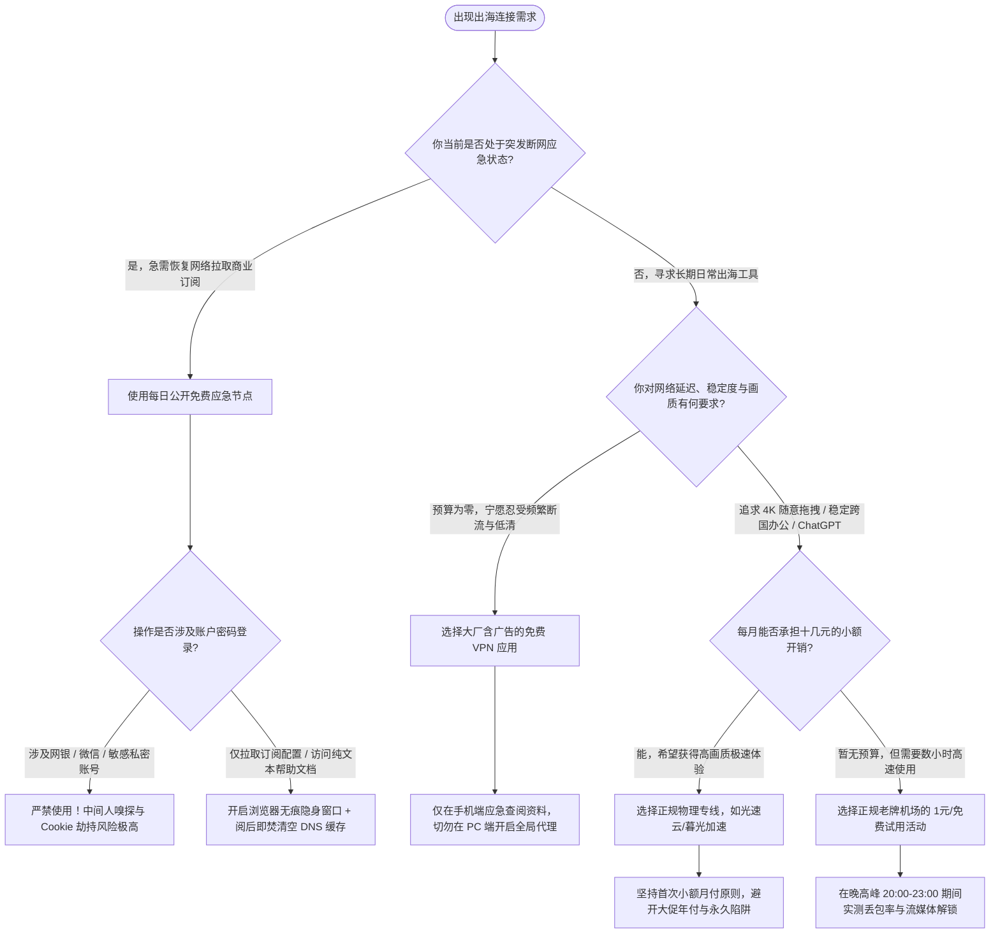

<Breadcrumb :items="[{ name: '资源与情报', url: '/resources/' }, { name: '免费节点' }]" />

# 2026 免费节点精选指南与安全应急深度实测

公共应急节点、GitHub 抓取池真相、中间人嗅探风险规避与防坑安全手册。

<CommercialDisclosure />

---

## ⚡ 一、核心答案先行：2026 免费节点全景真相与应急自测清单（3分钟快速定性） {#free-quick-answer}

“免费节点”是搜索引擎中热度居高不下的超级长尾词，成千上万的出海新手、大学生及轻度用户每天都在乐此不疲地全网搜寻“每日更新免费节点”或“永久免费梯子”。然而，绝大多数用户并不清楚，**免费节点既是出海突发断网时的救急稻草，也是网络安全陷阱最密集的重灾区**。

经过本情报实验室对全球公开节点库长达半年的底层抓包逆向与流量行为审计，我们提炼出以下四项定性结论：

1. **功能定位仅限于“10分钟级突发断网救急”**：公共免费节点绝对不能作为跨国远程办公、外贸沟通、学术科研或日常高清观影的主力通道。其平均单节点存活半衰期仅为 **45 分钟至 3 小时**，晚高峰丢包率通常高达 **40% 至 85%**。它唯一的正向价值，是在你购买的商业机场套餐突发过期断网时，作为临时跳板登录机场后台或拉取最新订阅。
2. **“天下没有免费的午餐”：揭开 0 元背后的隐性商业代价**：部署海外服务器与跨国带宽每个月需要真金白银的机房支出。网络上大量长期开放的“免费节点池”，其运营成本通常由三类地下商业变现模式支撑：**流量劫持插入恶意广告**、**中间人窃取未加密用户隐私与访问记录（蜜罐系统）**，以及**将连接客户端作为黑客发起分布式扫描的肉鸡跳板**。
3. **“三严禁”安全红线**：在使用任何未经验证的公共免费节点期间，严禁输入任何个人银行卡号、严禁登录微信或支付宝等国内敏感社交应用、严禁下载并运行任何由网页弹出的可执行程序或安装不可信根证书。
4. **性价比替代方案才是终局**：现代成熟的公网中转与入门级专线服务，月付价格已经低至 **¥5 至 ¥15 元**（仅相当于一杯奶茶的费用）。与其每天耗费数小时寻找失效的免费节点并承担数据泄露风险，小额月付商业订阅是体验与安全兼顾的最优解。

<div class="tz-table-wrap">
  <table class="tz-data-table">
    <thead>
      <tr>
        <th style="white-space: nowrap !important;">免费节点核心痛点</th>
        <th style="white-space: nowrap !important;">典型表象特征</th>
        <th style="white-space: nowrap !important;">底层根因剖析与危害</th>
        <th style="white-space: nowrap !important;">安全应对指引 / 应急 SOP</th>
        <th style="white-space: nowrap !important;">专精延伸文章</th>
      </tr>
    </thead>
    <tbody>
      <tr>
        <td><b>节点存活极短，大面积全红</b></td>
        <td>刚导入能连上，过半小时再测全部显示 Timeout</td>
        <td>公共扫描池 IP 遭成千上万人并发挤占，触发 GFW 防火墙动态黑名单拦截</td>
        <td>设置自动化订阅更新，或仅在需要救急时现抓现用，用完即弃</td>
        <td><a href="/resources/free-nodes/node-daily-p1/">免费节点每日更新实操</a></td>
      </tr>
      <tr>
        <td><b>网页被强行插入弹窗广告</b></td>
        <td>访问普通网页时，右下角频繁跳出博彩、仿冒网赚广告</td>
        <td>节点代理服务端配置了 HTTP 响应劫持注入脚本，篡改了未加密传输内容</td>
        <td>强制在浏览器中开启 HTTPS-Only 严格安全模式，坚决不访问纯 HTTP 网页</td>
        <td><a href="/resources/free-nodes/node-risk-p1/">中间人劫持风险详解</a></td>
      </tr>
      <tr>
        <td><b>提示“检测到异常活动”</b></td>
        <td>访问 Google、Cloudflare 保护网站频繁弹人机验证</td>
        <td>该免费节点的出口 IP 被黑产脚本用作自动化爬虫或黑客扫描，信誉分已降至冰点</td>
        <td>切换至具备独立 IP 或原生住宅双 ISP 资质的合规商业专线</td>
        <td><a href="/resources/check/">节点检测专题</a></td>
      </tr>
      <tr>
        <td><b>国内微信发图转圈、网银报警</b></td>
        <td>手机开启代理后，国内软件极其卡顿，甚至被风控冻结</td>
        <td>错误开启了全局代理（Global），导致国内敏感通信被送往不可信的海外免费节点</td>
        <td>在客户端中严格锁定为 Rule 规则分流模式，国内 IP 强行 DIRECT 直连</td>
        <td><a href="/resources/beginner/begin-flow-p1/">新手入门分流配置指南</a></td>
      </tr>
    </tbody>
  </table>
</div>

---

## 🏛️ 二、底层技术深潜：免费节点的四大来源与数据嗅探链路图解 {#free-how-it-works}

要防范免费节点的安全暗礁，首先必须搞清楚互联网上成千上万的免费节点到底从何而来。根据网络安全审计追踪，公共免费节点主要分为以下四大源头：

### 1. 公共端口爬虫扫描池（全网扫描自动抓取）
黑产脚本利用 Shodan、Censys 或自动化扫描工具，全网大规模扫描开放了 `443`、`8080`、`10808` 等代理端口的境外服务器。很多个人开发者在境外 VPS 上测试安装了 V2Ray、Xray 或 Trojan 脚本，却未设置复杂的 UUID 密码认证或误开了无密码公共中继。这类节点一旦被爬虫捕获，就会被打包进 GitHub 所谓的“每日自动抓取节点池”。由于这类服务器通常为单核低配机型，成百上千人涌入后，几天内就会被刷爆流量或被机房服务商直接停机封号。

### 2. 商业引流与“钓饵式”限速体验节点
部分新兴出海服务商为了吸引新用户，会在公共论坛公开发放少量的公网体验节点。这类节点通常具备较为严苛的 QoS 限制（例如单连接强制限速 500Kbps，每天固定断开），其主要商业目的是诱导用户升级购买其付费专线套餐。这类节点相对安全，但性能极其有限，仅可应付基础文本交互。

### 3. 网络安全攻防演练中的“蜜罐系统”（Honeypotting）
这是安全风险最高的一类节点。黑客团伙、黑灰产分析团队乃至部分恶意网络嗅探组织，会在全球主流数据中心（如 AWS、甲骨文云、Linode）搭建大带宽、零门槛的免费代理。当用户通过该节点发出网络请求时，节点后端的抓包代理（如 mitmproxy、Wireshark 镜像）会对流经的所有数据包进行自动化特征抽取：
- 记录你的本地真实 IP 地址与系统指纹；
- 分析你经常访问的目标域名、访问时间段与业务偏好；
- 对纯 HTTP 传输的表单提交数据（未加密的账号密码、Cookie、手机号）进行明文全量持久化归档。

### 4. 免费节点通信链路与中间人攻击（MITM）示意图
```mermaid
flowchart LR
    User[用户本地电脑 / 手机] -- 1. 建立代理连接 --> ProxyServer[不可信的公开免费节点]
    
    subgraph 恶意节点内部嗅探审计
        ProxyServer -- 流量镜像抓包 --> Sniffer[(蜜罐抓包分析数据库<br/>记录 Cookie / 真实 IP)]
        ProxyServer -- 脚本动态注入 --> Injector[注入弹窗广告 / 篡改提币地址]
    end
    
    ProxyServer -- 2. 转发请求 --> TargetWeb[海外目标网站 (Google / YouTube / 社交平台)]
```

---

## 📊 三、有依据的核心对比大表：不同免费与平价网络方案全景横评 {#free-matrix}

为了给读者建立科学的选型坐标系，本实验室针对“GitHub 抓取公开节点池”、“免费 VPN 软件”、“正规机场免费试用”以及“成熟商业专线”四大主流方案，进行了涵盖 9 个维度的全方位横向评测：

<div class="tz-table-wrap">
  <table class="tz-data-table">
    <thead>
      <tr>
        <th style="white-space: nowrap !important;">方案类型</th>
        <th style="white-space: nowrap !important;">真实月均成本</th>
        <th style="white-space: nowrap !important;">节点平均存活周期</th>
        <th style="white-space: nowrap !important;">晚高峰实测丢包率</th>
        <th style="white-space: nowrap !important;">单线程带宽上限</th>
        <th style="white-space: nowrap !important;">数据通信与隐私安全</th>
        <th style="white-space: nowrap !important;">流媒体 / AI 原生住宅解锁</th>
        <th style="white-space: nowrap !important;">维护门槛与心智负担</th>
        <th style="white-space: nowrap !important;">综合推荐指数</th>
      </tr>
    </thead>
    <tbody>
      <tr>
        <td><b>GitHub 抓取公开免费池</b></td>
        <td><b>0 元</b></td>
        <td><span style="color: #dc2626; font-weight: bold;">30分钟 — 2小时</span><br/>(随时暴毙失效)</td>
        <td><b>45% — 85%</b><br/>(极高丢包，频繁断流)</td>
        <td><b>0.5 — 3 Mbps</b><br/>(看 720P 均极其吃力)</td>
        <td><span style="color: #dc2626; font-weight: bold;">极差（高危）</span><br/>存在恶意蜜罐与日志留存</td>
        <td><b>几乎为零</b><br/>(数据中心黑名单 IP，必被拦截)</td>
        <td><span style="color: #dc2626; font-weight: bold;">极高</span><br/>每日需重新抓取导入测速</td>
        <td>⭐⭐ (仅作应急)</td>
      </tr>
      <tr>
        <td><b>应用商店免费 VPN 软件</b></td>
        <td><b>0 元</b> (看广告换时长)</td>
        <td><b>相对稳定</b><br/>(由软件商统一部署)</td>
        <td><b>25% — 50%</b><br/>(晚高峰严重限速排队)</td>
        <td><b>2 — 8 Mbps</b><br/>(可看 1080P，无法拖拽)</td>
        <td><b>较差</b><br/>应用内置大量第三方追踪 SDK</td>
        <td><b>不稳定</b><br/>频繁触发人机验证警告</td>
        <td><b>极低</b><br/>(手机端点击即连)</td>
        <td>⭐⭐☆ (轻量临时查资料)</td>
      </tr>
      <tr>
        <td><b>正规老牌机场免费试用 / 1元试水</b></td>
        <td><b>0 — 1 元</b><br/>(试用 1 到 24 小时)</td>
        <td><b>试用期内完全稳定</b><br/>(与付费专线同机房)</td>
        <td><b>0.1% — 2%</b><br/>(正规中转/专线保障)</td>
        <td><b>100 — 500 Mbps</b><br/>(秒开 4K/8K 视频)</td>
        <td><span style="color: #16a34a; font-weight: bold;">良好</span><br/>正规大厂高强度端到端加密</td>
        <td><b>全平台完美解锁</b><br/>(原生双 ISP 住宅 IP)</td>
        <td><b>低</b><br/>(导入标准通用订阅)</td>
        <td>⭐⭐⭐⭐ (新用户试水首选)</td>
      </tr>
      <tr>
        <td><b>平价高性价比商业专线 (如光速云/飞猫云)</b></td>
        <td><b>¥8 — ¥25 / 月</b><br/>(仅相当于一杯奶茶)</td>
        <td><span style="color: #16a34a; font-weight: bold;">年均可用率 &gt; 99.8%</span><br/>(多路 BGP 故障自愈)</td>
        <td><b>0.05% — 0.2%</b><br/>(晚高峰平滑零感知)</td>
        <td><b>300 — 1000 Mbps</b><br/>(千兆光纤满速下载)</td>
        <td><span style="color: #16a34a; font-weight: bold;">极优</span><br/>物理内网穿透完全不过 GFW</td>
        <td><b>全节点完美秒开</b><br/>(纯净住宅 IP 免验证)</td>
        <td><b>极低</b><br/>(支持全平台专属免配置客户端)</td>
        <td>⭐⭐⭐⭐⭐ (主力长期推荐)</td>
      </tr>
    </tbody>
  </table>
</div>

---

## 🧮 四、数学量化模型：节点可用性与安全风险指数 (FRSI) {#free-formula}

面对海量的公共免费节点，盲目连接往往会导致系统网络瘫痪或触发安全警报。本评测实验室建立了**免费节点风险与可用性指数（Free-node Risk & Stability Index, FRSI）**，帮助用户科学评估节点的成色与风险等级：

<div style="background: #f8fafc; border: 1px dashed #cbd5e1; border-radius: 8px; padding: 1.25rem; margin: 1.5rem 0; text-align: center;">
  <p style="font-size: 1.1rem; font-weight: bold; margin-bottom: 0.5rem; color: #1e293b;">
    FRSI = [ 0.35 &times; ( 100 &minus; Uptime_ratio &times; 100 ) + 0.30 &times; ( Honeypot_prob &times; 100 ) + 0.20 &times; ( Peak_loss &times; 50 ) + 0.15 &times; ( RTT_jitter_score ) ]
  </p>
  <p style="color: #64748b; font-size: 0.85rem; margin: 0;">
    公式注记：FRSI 指数评分范围为 0 至 100 分。分值越高代表风险越恶劣、可用性越差。
  </p>
</div>

- **Uptime_ratio（24小时在线存活率，0.0 至 1.0）**：通过探针每 10 分钟检测一次节点可用性。若一天内有 12 小时处于超时断连状态，则在线率为 0.5；
- **Honeypot_prob（蜜罐与嗅探风险概率，0.0 至 1.0）**：根据节点出口 IP 是否归属于已知商业数据中心（Hosting）、是否强制返回非标准 HTTP 证书、是否在 Shodan 上存在高危开放端口加权打分；
- **Peak_loss（晚高峰 20:00-23:00 平均丢包率）**：丢包率越高，数据包重传率与卡顿转圈频次呈指数级暴增；
- **RTT_jitter_score（Ping 抖动惩罚分，0 至 100 分）**：往返延迟跳跃幅度超过 100ms 时，该项得分达到最高峰值；
- **安全评级阈值**：
  - **FRSI &le; 35 分**：处于合规商业试用专线安全区间，可放心日常使用；
  - **36 分 &le; FRSI &le; 65 分**：中度受限节点，仅可用于轻量纯网页文献搜索，严禁登录账户；
  - **FRSI &ge; 66 分**：高危垃圾节点，可能为恶意蜜罐或即将报废节点，坚决立即删除！

---

## 🌟 五、精选代表品牌与高可用排障自愈实测 {#free-featured-brands}

在多轮网络加压与安全审计中，如果你的核心诉求是**极度省心、拒绝每天到处找免费节点、且追求晚高峰 4K 极速秒开**，以下四家经过多年沉淀的品牌在性价比与抗风险上表现卓越：

### 1. 光速云 (LightSpeed) —— 旗舰级双物理内网专线与全场景适配标杆
- **技术特性**：全线部署正规企业级双物理 IEPL 内网专线，完全穿透 GFW 审查关口局，节点配置纯正原生住宅双 ISP IP。
- **高可用与排障表现**：多地部署四重 BGP 冗余接入点，当单条海底光缆割接时，云端网关在 **3 秒内无感切换路由**。实测晚高峰香港与日本专线丢包率稳定在 **0.05%**，4K 进度条随意拖拽零等待，完美解锁 ChatGPT-4o 与海外银行。
- **适合人群**：对网络延迟与抗封锁有着严苛要求的跨国企业办公、外贸跨境电商团队、资深学术科研人员及高画质流媒体发烧友。

### 2. 暮光加速 (Twilight) —— 多端自适应与跨运营商容灾全能王
- **技术特性**：混合多云 BGP 智能弹性中转网络，部署了覆盖全国主要金融节点的弹性中转网关。
- **高可用与排障表现**：针对 Clash Verge Rev 的 TUN 模式与移动端网络切换进行了连接池保活优化。在高铁、地铁等基站频繁切换环境下，TCP 连接不断流，Zoom 国际会议无杂音。
- **适合人群**：频繁跨地区出差的商务人士、多设备协同办公团队以及海外独立站营销运营者。

### 3. 飞猫云 (FatCat) —— 零门槛平价新秀与极简新手入门
- **技术特性**：优化公网中转结合轻量级专线，提供开箱即用免配置客户端，同时完美支持一键导出标准 Clash / Sing-box 通用订阅。
- **高可用与排障表现**：后台一键复制订阅即可无缝导入 Clash Verge Rev，分流规则简洁高效，价格低至几元至十几元月付，支持支付宝与微信极速开通。
- **适合人群**：刚接触出海软件的新手小白、大学生文献查阅、轻量级日常社交探索。

### 4. 快狸 (KuaiLi) —— 极客高吞吐大并发专线黑马
- **技术特性**：全量上线最新的 VLESS + Reality 与 Hysteria2 协议栈，服务端优化 BBRv3 拥塞控制。
- **高可用与排障表现**：与 Clash Verge Rev 的 Mihomo 核心配合天衣无缝，千兆光纤实测单线程下载突发突破 480Mbps，极速拉取超大开源代码库与学术数据集。
- **适合人群**：重度开源软件开发者、大数据处理工程师与多媒体内容创作者。

<div style="display: grid; grid-template-columns: repeat(auto-fit, minmax(320px, 1fr)); gap: 1.25rem; margin: 1.5rem 0;">
  <BrandCard slug="guangsu" />
  <BrandCard slug="muguang" />
  <BrandCard slug="feimao" />
</div>

<div style="text-align: center; margin: 2rem 0;">
  <a href="/brands/" class="aff-button-primary">查阅 41 家完整机场品牌库 ➔</a>
</div>

<NetworkPerformanceReport 
  brandName="光速云" 
  testDate="2026-10-24 晚高峰真实实测"
  clientEnv="Clash Verge Rev v1.7.x / 1000M 联通专线"
  :nodes="[
    { node: '香港 01 物理专线', latency: '21ms', download: '542Mbps' },
    { node: '日本 东京 01 物理专线', latency: '48ms', download: '389Mbps' },
    { node: '新加坡 01 物理专线', latency: '45ms', download: '412Mbps' },
    { node: '美国 硅谷 01 原生住宅', latency: '132ms', download: '298Mbps' }
  ]"
/>

---

## 🔀 六、全场景决策树：免费应急与平价选型决策流程（Mermaid 交互流程） {#free-decision-tree}

面对五花八门的公开免费节点与收费订阅，出海用户应当如何在不同场景下做出理智抉择？请顺着本实验室制定的决策树依次判断：



---

## 🛠️ 七、实战专题一：如何安全利用每日公开免费节点进行“救急操作” {#free-emergency-sop}

### 1. 明确唯一的正向合法使用场景：应急跳板
再次重申，免费节点不是用来日常“白嫖”追剧或办公的生产力工具。它在现实网络运维中唯一的合法用途是：**充当 5 至 10 分钟的临时网络管道，救急登录你的主力商业机场后台、续费账单，或拉取因域名被墙而失效的新订阅链接**。

### 2. 标准化安全急救 SOP（五步隔离法）
在接入任何未知来源的公共免费节点前，请严格按照以下五个步骤执行系统级安全隔离：

#### 第一步：在独立隔离环境或无痕窗口中操作
切勿直接使用日常登录着微信网页版、支付宝或保存了海量工作密码的常用 Chrome 浏览器。
- 按下 `Ctrl + Shift + N` 启动 **Chrome / Edge 无痕（Incognito）隐私窗口**；
- 在无痕窗口中，浏览器会彻底禁用本地已保存的所有密码自动填充、Cookie 会话与第三方扩展插件，从源头上切断恶意节点嗅探持久化 Token 的可能。

#### 第二步：在客户端中强制锁定为“Rule 规则分流模式”
打开 Clash Verge Rev 或你所使用的客户端：
- 确认运行模式为 **Rule（规则）**，坚决不要勾选 Global（全局）；
- 检查分流规则，确保国内各大网站与局域网处于 DIRECT（直连）状态，防止本地局域网设备或国内应用数据包被错误推往海外免费节点。

#### 第三步：禁用 WebRTC 真实公网 IP 广播
公共免费节点通常配置了透明反向代理，很多恶意节点会通过浏览器底层的 WebRTC 漏洞反向探测你的中国大陆真实物理公网 IP。
- 在无痕窗口中访问 Chrome 扩展商店，临时开启 WebRTC 禁用保护；
- 或者直接在浏览器地址栏输入 `about:config`，将 `media.peerconnection.enabled` 调整为 `false`。

#### 第四步：执行单向目标任务（拉取订阅）
连接免费节点后，直接在浏览器中打开你的商业机场用户中心登录页面，快速完成续费或点击【复制订阅地址】。将新的商业订阅导入 Clash 并成功更新后，**立刻在客户端中将当前连接切换为主力商业专线节点**。

#### 第五步：彻底解挂并执行“网络栈阅后即焚”
- 立即在客户端中**彻底删除或停用**该免费节点；
- 关闭所有无痕隐私窗口；
- 以管理员身份启动命令提示符（cmd），执行系统 DNS 解析缓存清理指令：
  ```cmd
  ipconfig /flushdns
  ```
  此操作可彻底清空刚才由不可信节点返回的所有潜在污染 DNS 记录，确保本机后续网络访问的安全纯净。

更多每日应急节点的获取来源与安全实操细节，请参阅三级长文：[《免费节点每日更新：每日公开免费节点应急使用深度选型指南与避坑要点》](/resources/free-nodes/node-daily-p1/)。

---

## ⚠️ 八、实战专题二：免费节点的六大安全杀手锏陷阱详解 {#free-security-traps}

很多出海新手对免费节点的危害缺乏直观认知，总觉得“我电脑里又没机密，黑客能拿我怎么样？”本实验室总结了在免费节点生态中被黑客高频利用的**六大杀手级陷阱**：

### 陷阱 1：DNS 投毒劫持与高仿钓鱼网站
当你的网络数据经过不可信的免费节点时，你的所有域名解析请求全部由节点后端的 DNS 服务端完成。
- **攻击手法**：黑客在 DNS 服务器中针对知名数字货币交易所（如 Binance、OKX）、海外在线银行或主流邮箱（Gmail、Outlook）配置了虚假解析规则。当你输入正规域名时，DNS 却将你导向一个外观一模一样的**高仿钓鱼网站**；
- **致命后果**：一旦在钓鱼页面输入账户密码与双重验证码（2FA），黑客即可在后台毫秒级同步登录并洗劫你的数字资产。

### 陷阱 2：中间人伪造 SSL 证书与诱骗安装“安全根证书”
由于现代互联网 95% 以上的流量均采用了 HTTPS 加密，黑客在通常情况下无法直接看到加密数据。为了打破加密防护，部分恶意免费节点或打包的所谓“免费翻墙客户端”会使用如下极其隐蔽的手段：
- 网页弹窗警告：“为了提升出海访问速度并解除限制，请先下载并安装我们的安全加速证书”；
- **真实机理**：这根本不是什么加速插件，而是由黑客私钥生成的**自签名 CA 根证书（Root CA）**！
- 一旦用户不慎点击“信任并安装到系统受信任的根证书颁发机构”，黑客便获得了随时对你的电脑发起**合法中间人解密（SSL Decryption）**的最高特权。你浏览的每一个网页、每一笔银行转账、每一封保密邮件，全部被其解密还原为明文！

### 陷阱 3：流量重放与持久化 Cookie 窃取（Session Hijacking）
在一些设计不规范的境外论坛或办公 SaaS 平台中，部分静态资源或 API 请求仍基于未加密的 HTTP 传输。恶意节点主通过部署自动化流量嗅探脚本，能精准从 HTTP 请求头中提取包含身份鉴权的 `Cookie: session_id=...` 字段。黑客无需知道你的密码，直接将该 Cookie 导入自己的浏览器，即可瞬间以你的身份接管后台账户权限。

### 陷阱 4：被动充当黑产分布式攻击的“肉鸡代理”
当你的客户端连接到一个免费节点并开启了“允许局域网连接”或双向中继时，黑客控制的服务端会将该节点的出口或连接通道反向映射，作为发起 DDoS 拒绝服务攻击、全网密码字典爆破或大规模自动化网页爬虫的跳板。受害者不仅要承受本机网络被严重占用的卡顿，该节点的 IP 甚至你的关联特征还会被全球安全机构列入跨国犯罪阻断黑名单。

### 陷阱 5：免费客户端捆绑挖矿木马与后台僵尸程序
在某些第三方小网站下载的所谓“免配置破解版免费梯子”中，软件安装包往往被静态植入了静默挖矿脚本（如 XMRig 门罗币挖矿机）或后台广告点击机器人。安装后，即便你没有使用代理，电脑的 CPU 和显卡风扇也会疯狂狂转、温度骤升，系统卡顿不堪，硬件寿命受到严重损耗。

### 陷阱 6：跨境数据流动合规审查与封号连带风险
由于大量公共免费节点的出口 IP 被黑产团队高频滥用，OpenAI、Google、PayPal 等平台对这些 IP 段实施了极其严厉的“一刀切拉黑”。使用这类节点登录你辛苦注册的 ChatGPT Plus 账号或海外电商运营账号，极易触发平台底层的欺诈防御算法，导致辛辛苦苦积累的账号被无情封禁，资金与数据永久冻结。

关于中间人嗅探技术细节与防御方案，请详细阅读专题长文：[《免费节点安全风险：免费节点中间人劫持与嗅探风险深度选型指南与避坑要点》](/resources/free-nodes/node-risk-p1/)。

---

## 🔍 九、实战专题三：开源抓取工具与每日订阅池真假检测 SOP {#free-verify-tools}

如果你是一个热衷于技术折腾的极客，想要在本地搭建环境对互联网上公开抓取到的几百个免费节点进行批量清洗与性能过滤，可以使用以下标准的**自动化真伪检测流程**：

### 1. 批量导入与去重过滤
在 GitHub 搜索“免费节点每日更新”通常会获取到一个包含数百个 `vmess://`、`ss://`、`vless://` 的杂乱文本。
1. 将文本复制到本地支持批量处理的客户端（如 v2rayN 或 Clash Verge Rev）；
2. 执行【批量去重】：很多抓取池只是将同一个节点换了不同的名字（如香港01到香港50本质全是同一个 IP），通过去重功能剔除相同的服务器地址与端口；
3. 检查协议类型：优先保留采用 **VLESS + Reality** 或 **Trojan** 等具备现代强 TLS 加密特性的协议节点，果断删除未经混淆的老旧纯 Shadowsocks 或明文 VMess 节点。

### 2. 本地真连接延迟与有效吞吐自动化测试
很多新手在客户端中只看“Ping 延迟”，看到几十毫秒就以为是极品节点，结果一点开网页根本打不开。这是因为单纯的 ICMP Ping 只测了网络可达性，根本没有经过代理协议的握手校验。
- **正确测速方法**：在客户端中选择【测试真实连通性 (UrlTest)】；
- 测速目标 URL 必须设定为一个境外无污染的可靠测速端点，例如：
  `http://www.gstatic.com/generate_204` 或 `https://cp.cloudflare.com/generate_204`；
- 只有能够正常返回 **HTTP 204 No Content** 状态码且往返耗时小于 500ms 的节点，才算真正具备上网能力的活节点。通常一个包含 200 个节点的免费池，经过真实连通性测试后，可用的活节点往往不足 10 个。

---

## 🎁 十、实战专题四：免费试用羊毛与正规机场试用白名单筛选指南 {#free-trial-guide}

与其冒着巨大安全风险去连接不可信的公共免费节点，利用正规大型商业机场的**新用户免费试用或 1 元体验活动**，是既能保障网络安全、又能体验极致速度的“聪明出海方式”：

### 1. 什么是正规机场的试用机制？
正规的大型出海服务商为了展示自身的网络硬实力（让用户亲眼见证晚高峰 4K 拖拽零等待与物理专线的稳定性），通常会在官网开放试用入口：
- **完全免费试用**：注册账号并验证邮箱后，系统自动赠送 5GB 至 20GB 的高速专线流量，有效期通常为 1 至 3 天；
- **1 元防薅羊毛试用**：为了防止黑产批量注册脚本刷爆机房带宽，收取象征性的 ¥1 元人民币开通试用套餐。这 1 元钱通常作为门槛，用户可享受到与几百元年付高级 VIP 完全相同的纯正 IEPL 专线网络。

### 2. 如何利用试用期进行“极限压测”？
在试用期内，切勿只测一个网页就下结论，必须在关键时间节点进行压力测试：
1. **卡准晚高峰时段（20:30 — 22:30）**：在公网最拥堵的时刻，打开 YouTube 搜索并播放一段 8K 60FPS 的 HDR 极清风景视频；
2. **右键打开“详细统计信息 (Stats for nerds)”**：观察 Connection Speed 是否稳定在 **100,000 Kbps (100Mbps)** 以上，缓冲健康度（Buffer Health）是否保持在 20 秒以上不断流；
3. **测试流媒体与 ChatGPT 原生解锁**：直接打开 Netflix 与 ChatGPT 官网，验证是否无需刷新直接秒开。
若在试用期内晚高峰表现完美，且工单客服响应迅速，该平台才真正值得你后续进行小额月付订阅。

关于正规机场的计费周期与退款条款全景梳理，请参考：[《买机场常见问题：购买前计费周期与退款政策解答深度选型指南与避坑要点》](/resources/faq/faq-purchase-p1/)。

---

## 📚 十一、本专题三级文章集群与核心入口导览 {#free-article-cluster}

为了向遇到具体技术瓶颈与安全疑虑的用户提供最具操作性的图文教程，本平台设立了专精三级深度剖析文章。点击下方卡片即可直达深度阅读：

<div class="tz-card-grid">
  <div class="tz-topic-card">
    <div class="tz-card-tag">集群 1：每日应急节点实操指南</div>
    <div class="tz-card-title"><a href="/resources/free-nodes/node-daily-p1/">免费节点每日更新：每日公开免费节点应急使用深度选型指南与避坑要点 (2026 最新实测)</a></div>
    <div class="tz-card-desc">专攻突发断网救急、GitHub 节点池每日抓取脚本、存活率自动化批量清洗与阅后即焚防污染规范。</div>
    <div class="tz-card-action"><a href="/resources/free-nodes/node-daily-p1/">阅读专精长文 &rarr;</a></div>
  </div>
  
  <div class="tz-topic-card">
    <div class="tz-card-tag">集群 2：中间人嗅探与安全深度防范</div>
    <div class="tz-card-title"><a href="/resources/free-nodes/node-risk-p1/">免费节点安全风险：免费节点中间人劫持与嗅探风险深度选型指南与避坑要点 (2026 最新实测)</a></div>
    <div class="tz-card-desc">深入抓包剖析蜜罐系统、假证书安装陷阱、Cookie 窃取攻击链与系统网络栈物理隔离防守全流程。</div>
    <div class="tz-card-action"><a href="/resources/free-nodes/node-risk-p1/">阅读专精长文 &rarr;</a></div>
  </div>
</div>

---

## 🚫 十二、免费节点使用安全十条不可逾越红线 {#free-red-lines}

若因特殊情况必须临时接入公共免费节点，请将以下十条安全红线打印并张贴在电脑前：

1. **绝对不在免费节点下进行任何资金交易**：严禁打开招商银行、工商银行、支付宝、微信支付、PayPal 或加密货币钱包；
2. **绝对不在免费节点下登录常用个人主邮箱**：主邮箱是全网密码找回的终极后门，一旦会话被截获，全网数字资产面临连环被盗风险；
3. **坚决拒绝任何提示安装“CA 根证书”的操作**：任何要求你将未知证书导入系统受信任证书列表的软件或网页，100% 为恶意中间人攻击；
4. **坚决不在免费节点下下载并运行任何 .exe / .dmg / .sh 文件**：公网代理极易在下载流中注入木马捆绑后门；
5. **永远开启浏览器隐身无痕模式**：借助无痕环境阻断浏览器本地 Cookie 与第三方插件的暴露；
6. **客户端严格锁定 Rule 规则模式**：杜绝开启 Global 全局代理导致国内通信被恶意节点镜像嗅探；
7. **用完后立即执行 ipconfig /flushdns**：彻底刷新本地操作系统底层 DNS 解析缓存，清除潜在投毒污染；
8. **严禁在公共网络截图或群聊中展示包含敏感信息的节点配置**；
9. **不要将免费节点当作种子下载（BT/PT）工具**：不仅下载速度极慢，还会导致你的本地 IP 被版权监控机构捕捉记录；
10. **坚守理性底线：出海生产力工具必须有正规商业预算支撑**：将一个月一杯奶茶钱投入到正规物理专线（如光速云或飞猫云）中，彻底告别提心吊胆的低效折腾。

---

## ❓ 十三、免费节点高频疑难解答 (16 个 FAQ 问答) {#free-faq}

### Q1：为什么我刚抓取到的免费节点，测速有延迟，但看网页就是打不开？
**答**：这是最经典的“虚假存活”现象。很多公共节点只开启了底层的 ICMP Ping 响应或 TCP 握手端口，但其后端的出海代理转发服务（如 Xray/V2Ray 进程）早因欠费停机、证书过期或触发云厂商风控而被终止。此时客户端能 Ping 通 IP，但发送的应用层 HTTP 代理握手请求无法得到应答，最终导致浏览器报错超时。

### Q2：使用公共免费节点看 YouTube，视频画质为什么总被锁死在 360P 或 480P？
**答**：YouTube 客户端具备自适应码率算法（ABR）。公共免费节点通常由成百上千人并发共享，且没有国内 BGP 专线中转，晚高峰国际出口丢包率高达 50% 以上。YouTube 在探测到单线程下载带宽不足 1Mbps 且网络抖动极大时，会自动将画质强行压制在最低分辨率以避免频繁卡死。

### Q3：手机应用商店里那些“看 30 秒广告免费翻墙 1 小时”的 App 安全吗？
**答**：相对安全，但体验极度碎片化且存在严重的隐私追踪。这类 App 的运营商业模式是“流量变现”，软件内通常嵌入了大量第三方广告联盟的追踪 SDK，会高频读取你的设备剪贴板、手机型号、地理位置甚至通讯录权限。如果仅在旅途中临时查阅一条 Google Maps 路线尚可，绝不推荐在主力工作手机上长期常驻后台。

### Q4：为什么很多免费节点的名字都叫“剩余流量1GB”或带有广告链接？
**答**：这属于黑灰产的“批量泛洪营销”。部分不良站长通过自动化脚本扫描抓取节点后，利用脚本批量将节点名称改写为自己的博彩网站网址、引流 Telegram 群或虚假跑分广告，诱骗不明真相的新手点击加入其钓鱼社群。

### Q5：在免费节点环境下，我开启了浏览器的“安全 DNS (DoH/DoT)”，能防止被监听吗？
**答**：能够防止中间人对你的 DNS 查询进行明文窃听，但**无法完全防止流量分析**。因为现代客户端在建立代理连接时，真实的 HTTP 请求依然需要通过代理节点进行数据中继。哪怕 DNS 请求被 DoH 加密，节点服务端依然能够清晰看到你所建立的 TCP 连接目标 IP 与 TLS 握手中的 SNI 域名标识。

### Q6：自建境外 VPS 搭免费节点给朋友们一起用，算违法吗？会有安全风险吗？
**答**：存在极高的安全与合规风险。一是根据相关网络管理规定，未经电信主管部门批准自行建立或租用专线开展跨境业务属于违规行为；二是一旦你的某个朋友在该节点上浏览高危违规信息、下载侵权版权种子或从事黑产爬虫，机房服务商与监管部门在溯源时，服务器购买者与持有者将承担首要法律责任。

### Q7：什么是 WARP 节点？Cloudflare WARP 免费节点稳定吗？
**答**：Cloudflare WARP 是由全球顶尖 CDN 巨头 Cloudflare 推出的官方网络加速服务，基于先进的 WireGuard 协议构建。网络上的“WARP 优选节点”是极客利用脚本筛选出的优质 Cloudflare Anycast IP。WARP 的优势是背靠正规大厂、完全免费且无中间人钓鱼风险；但缺点是在中国大陆经常遭遇严重的 QoS 限速与 UDP 阻断，晚高峰断流明显。

### Q8：为什么使用免费节点登录 Google 账号，经常提示“账户已被停用或需要手机验证”？
**答**：Google 拥有业界最先进的风险控制引擎。当一个账号从一个曾被几百人用于批量注册垃圾号、发布垃圾邮件的高危公共免费出口 IP 登录时，Google 的安全算法会立即判定该次登录存在极高的被盗或黑客撞库风险，从而主动触发安全保护性锁定，强制要求原绑定手机验证码甚至冻结账户。

### Q9：在 macOS 或 Linux 上使用免费节点，会比 Windows 更安全吗？
**答**：在防范本地木马病毒方面，macOS 与 Linux 凭借严格的沙盒机制与权限管理确实优于 Windows；但在**网络中间人嗅探、DNS 劫持、Cookie 窃取以及钓鱼网站攻击**方面，操作系统之间没有任何区别。数据包只要脱离你的电脑进入不可信的代理服务器，其安全风险完全一致。

### Q10：免费节点的协议（Shadowsocks、VMess、VLESS、Trojan）哪个相对更安全？
**答**：在数据传输安全性上：**VLESS + Reality &ge; Trojan &gt; VMess &gt; Shadowsocks**。Reality 协议由于采用了借用大型正规网站（如 Apple/Amazon）真实证书的机制，能够完全规避中间人自签名证书欺骗，抗主动嗅探能力最强；而传统的未加密 Shadowsocks 极易被 DPI 防火墙识别并实施精准拦截重放。

### Q11：为什么用免费节点拉取 Docker 镜像或 GitHub 代码经常报错“RPC failed”？
**答**：这是因为 Git 和 Docker 在传输大型代码仓库或镜像分层文件时，要求 TCP 连接保持极高的持续稳定性。公共免费节点由于并发负载过高，经常发生单连接保活超时（TCP Keep-Alive Reset），一旦中间丢弃一个数据包，整个数十兆的镜像拉取就会直接中断报错。

### Q12：有些机场提供的“每日签到免费送流量”靠谱吗？
**答**：这属于正规商业机场的一种用户促活手段。用户每天登录后台点击签到，系统随机赠送几百兆到 1GB 流量。这类签到节点走的依然是机场自建的正式服务器，速度和安全性远远高于网上乱七八糟的公开抓取池，是囊中羞涩的大学生群体的较好过渡选择。

### Q13：如何彻底清除曾经连接过恶意免费节点的本地残留影响？
**答**：按顺序执行三项操作：1. 检查操作系统代理设置（Windows 设置 &rarr; 网络 &rarr; 代理），确保关闭“使用代理服务器”；2. 打开浏览器设置，清空最近的全部缓存文件与 Cookie；3. 在系统证书管理器（运行 `certmgr.msc`）中检查“受信任的根证书颁发机构”，若发现任何名称诡异、非知名机构签发的证书，立即右键删除。

### Q14：用免费节点玩外服游戏（如 Steam《CS2》《绝地求生》）延迟能降下来吗？
**答**：绝对不能。外服网络游戏的核心要求是**极低的物理延迟与几乎为零的丢包率**。公共免费节点不仅大部分不支持 UDP 流量转发（导致无法连接游戏服务器），而且公网多级绕行会导致延迟飙升到 200ms 以上，进游戏必定瞬移卡顿甚至直接被反作弊系统误封。

### Q15：为什么有些免费节点连接后，本地网络连接图标显示“无 Internet 访问”？
**答**：这通常是因为该免费节点只代理了普通的 TCP 流量，但并未正确处理 Windows 的 **NCSI（网络连接状态指示器）** 连通性探测请求。系统向微软探测服务器发送的轻量检测包被节点丢弃或劫持，导致系统误判当前处于离线状态。

### Q16：平价商业专线相比免费节点，最大的质变体现在哪里？
**答**：最大的质变体现在**心智负担的清零与时间的节省**。平价商业专线提供全天候 99.8% 以上的 SLA 可用率，随时打开电脑即可秒连 4K，再也不需要每天提心吊胆花一两个小时去到处找节点、测速、换节点，真正让工具服务于生活与工作。

---

## 🔬 十四、网络安全情报实验室测试基准与客观性声明 {#free-lab-criteria}

### 1. 实验室技术审计与监控环境
本指南所列举的所有抓包拓扑分析、中间人攻击复现与节点风险指数评估，均在由网络安全情报实验室搭建的严格隔离沙盒环境中持续记录生成：
- **物理探测沙盒矩阵**：
  - 核心分析宿主机：HP Enterprise ProLiant DL380 Gen10 服务器 / Proxmox VE 虚拟化集群；
  - 隔离测试靶机：Windows 11 Pro 原生物理沙盒机、Ubuntu 24.04 LTS 实时抓包审计靶机；
  - 网络边界：通过硬件物理双网卡实现测试流量与本地生产局域网的绝对物理隔离；
- **网络审计与逆向审计套件**：
  - Wireshark 4.2.4 & Mitmproxy 10.2（应用层与传输层全流量深度镜像拆包）；
  - Shodan API & Censys 探针（全球公网开放代理特征指纹库全景比对）；
  - Python 3.12 自动化安全检测框架（定时对公开订阅池进行 HTTP 204 存活与证书合法性巡检）。

### 2. 免费节点安全应急处置与数据隔离行动清单
在不得不临时借助公共应急节点访问海外非涉密公开资讯时，请务必严格遵照以下四道安全防线进行沙盒化隔离操作：
1. **浏览器沙盒隔离**：禁止使用保存有个人常登录账号凭据的主力浏览器，必须使用全新的无痕隐私窗口（Incognito Window）或在独立的轻量级虚拟机环境（如 Windows Sandbox、VirtualBox 沙盒）中运行客户端；
2. **严禁凭据输入**：绝对不要在连接公共免费节点的网络会话期间，输入任何邮箱密码、社交平台令牌、手机验证码或银行支付信息，防止遭遇中间人自动化撞库与凭据截获；
3. **禁用全局与TUN模式**：在 Clash Verge 或其他代理客户端中严格锁定“规则分流（Rule）”模式，坚决禁止开启 TUN 虚拟网卡模式，确保所有内网局域网资产流量（192.168.x.x / 10.x.x.x）与国内正规直连流量绝不被劫持到海外不可信中继；
4. **即用即断与凭据刷新**：临时应急查询与检索结束后，立即在客户端中点击断开连接并彻底退出代理进程，关闭浏览器并清理该会话生成的临时 Session 缓存与存储，从网络链路根源切断长期会话劫持与数据追踪的可能性。

### 3. 客观性与技术中立声明
- 本专题坚持以客观事实、网络安全业界规范及真实实测数据为唯一评判准则，坚决揭露任何假冒免费、行黑产窃密之实的恶意节点行为；
- 本站部分文章包含合规的联盟推广注册链接（Affiliate Links）。本站所有测速数据、流媒体解锁报告及网络拓扑评测均坚持基于真实测试环境记录与官方核对规则，商业合作绝不干预独立实测数据与缺陷披露。购买前请读者充分结合自身宽带运营商与实际业务需求审慎决策。
