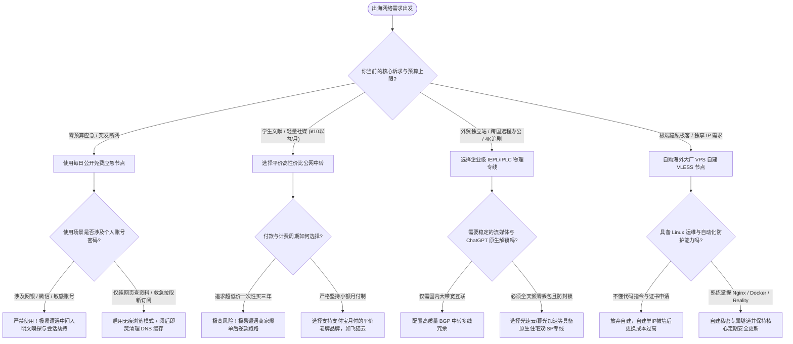

<Breadcrumb :items="[{ name: '资源与情报' }]" />

# 📡 资源与情报 专题门户

公共应急节点、机场跑路预警黑名单、节点真假专线测速与新手避坑知识库。

<CommercialDisclosure />

---

## ⚡ 一、核心答案先行：2026 出海资源与情报速查决策内参（3分钟全景避坑） {#res-quick-answer}

在纷繁复杂、鱼龙混杂的出海网络生态中，普通用户往往在“白嫖免费节点”、“盲目充值年付被割韭菜”与“遭遇假专线虚假宣传”之间反复踩坑。为了帮助读者在最短时间内建立清晰的安全防线，本情报评测实验室基于长期抓包嗅探审计与上百起机场跑路真实案例，提炼出以下四大黄金防御结论：

1. **公开免费节点绝不可作日常主力使用**：网络上随处可见的免费订阅、GitHub 抓取节点或公共节点池，其本质 90% 以上属于黑产流量中继或安全蜜罐（Honeypot）。运营者通过在服务端解密非 HTTPS 明文数据包，可肆意窃取用户的 Cookie、会话 Token 与访问行为轨迹，甚至进行中间人 DNS 投毒。免费节点**仅能且仅建议**在突发断网时充当“临时拉取商业订阅配置”的应急跳板，且使用期间严禁登录任何个人账户或敏感社交软件。
2. **识破机场跑路前兆的核心依据是“资金链断裂反常举措”**：任何声称“永久买断”、“三年超低折”、“充 100 送 150”的非理性狂欢，都是机场运营者在服务器账单逾期或机房清退前最后的“拉高流水跑路前兆”。一旦出现官方 Telegram 群被强制开启全员禁言、工单长达数天无人响应、多条骨干线路以“上游光缆割接”为由断流超过一周，应当立即停止任何充值并做好备份迁移准备。
3. **“假专线”与“假原生 IP”已成重灾区**：市面上大量标榜“千兆 IEPL 专线”的廉价节点，实质仅为国内廉价腾讯云/阿里云公网服务器加套 TLS 伪装隧道（公网单中转）。在晚高峰 20:00—23:00 期间，国际出口 QoS 限制会令其丢包率骤增至 30% 以上。真正的物理专线其丢包率必须全天候小于 **0.2%**，抖动（Jitter）必须小于 **2ms**。
4. **科学安全防范的底线是“月付试水与订阅 Token 严格隔离”**：无论任何评测榜单如何极力推荐，首次使用任何新平台均应坚持**月付或季付**；同时切勿将包含个人唯一身份 Token 的订阅链接直接粘贴进公共未知的第三方转换器网站，防止节点被脚本自动抓取并共享至公共扫描库。

<div class="tz-table-wrap">
  <table class="tz-data-table">
    <thead>
      <tr>
        <th style="white-space: nowrap !important;">资源与情报核心痛点</th>
        <th style="white-space: nowrap !important;">典型安全风险 / 虚假陷阱</th>
        <th style="white-space: nowrap !important;">底层机理解剖与危害等级</th>
        <th style="white-space: nowrap !important;">标准应对 SOP 与安全策略</th>
        <th style="white-space: nowrap !important;">对应专属细分专题</th>
      </tr>
    </thead>
    <tbody>
      <tr>
        <td><b>公共免费节点滥用</b></td>
        <td>账户 Cookie 泄露、会话被劫持、弹出黑产广告</td>
        <td><b>极高危险</b>：非加密流量被中间人嗅探记录，黑客通过伪造证书尝试解密敏感通信</td>
        <td>物理隔离：仅用无痕窗口应急拉取订阅，用后立即断开清理缓存</td>
        <td><a href="/resources/free-nodes/">免费节点专题</a></td>
      </tr>
      <tr>
        <td><b>不良机场携款跑路</b></td>
        <td>充值年付套餐后数日即失联，网址无法访问</td>
        <td><b>高危经济损失</b>：运营者抵押资金链断裂，利用骨折优惠卷款清仓</td>
        <td>严格坚持小额月付制，警惕三年付及“永久特权”营销诱饵</td>
        <td><a href="/resources/warning/">跑路预警专题</a></td>
      </tr>
      <tr>
        <td><b>假专线冒充真专线</b></td>
        <td>白天测速飞快，晚高峰看视频严重卡顿转圈</td>
        <td><b>体验损害</b>：公网隧道假冒 IEPL，本质仍经公网防火墙，遭遇晚高峰丢包与限速</td>
        <td>使用 MTR 多节点路由探测脚本与 Ping 抖动标准差进行真实性核验</td>
        <td><a href="/resources/check/">节点检测专题</a></td>
      </tr>
      <tr>
        <td><b>公共转换器盗取订阅</b></td>
        <td>套餐流量莫名快速消耗见底，被提示异地登录</td>
        <td><b>高危隐私泄露</b>：公共转换器后端记录用户的订阅 URL，将节点放入共享池出租</td>
        <td>仅使用客户端内置转换功能，或本地私有化部署 Subconverter</td>
        <td><a href="/resources/sub-issues/">订阅问题专题</a></td>
      </tr>
      <tr>
        <td><b>跨国合规与支付风险</b></td>
        <td>使用不规范境外代付被盗刷，国内政务访问受限</td>
        <td><b>中高风控</b>：全局代理导致银行 App 异地风控，黑产代付渠道存在连带审查风险</td>
        <td>配置完善的规则分流（Rule），国内域名严格走 DIRECT 直连通道</td>
        <td><a href="/resources/intel/">机场风险情报</a></td>
      </tr>
    </tbody>
  </table>
</div>

---

## 📑 二、资源与情报 七大核心专题导览 {#res-clusters}

本平台将出海安全防护与技术情报体系解构为七大细分专精专题，帮助读者针对性解决各类网络瓶颈与避坑难题：

<div style="display: grid; grid-template-columns: repeat(auto-fit, minmax(280px, 1fr)); gap: 1rem; margin: 1.5rem 0;">

  <div style="background: #ffffff; border: 1px solid #e2e8f0; border-radius: 8px; padding: 1.25rem;">
    <h3 style="margin-top: 0;"><a href="/resources/free-nodes/">免费节点</a></h3>
    <p style="color: #64748b; font-size: 0.9rem;">核心搜索词：<b>免费节点</b>。收录每日公开应急节点与抓取池，深度剖析中间人嗅探与安全隔离法则。包含 <a href="/resources/free-nodes/node-daily-p1/">每日应急节点使用手册</a> 与 <a href="/resources/free-nodes/node-risk-p1/">免费节点中间人劫持风险详解</a>。</p>
    <div style="margin-top: 0.75rem;">
      <a href="/resources/free-nodes/" class="aff-button-secondary" style="font-size: 0.85rem; padding: 0.4rem 0.8rem;">浏览 免费节点 专题页面 ➔</a>
    </div>
  </div>

  <div style="background: #ffffff; border: 1px solid #e2e8f0; border-radius: 8px; padding: 1.25rem;">
    <h3 style="margin-top: 0;"><a href="/resources/warning/">跑路预警</a></h3>
    <p style="color: #64748b; font-size: 0.9rem;">核心搜索词：<b>跑路预警</b>。动态更新机场黑名单与失联通报，深度总结卷款跑路前的反常征兆。包含 <a href="/resources/warning/warn-signs-p1/">跑路前五大反常前兆</a> 与 <a href="/resources/warning/warn-blacklist-p1/">近期失联与跑路机场黑名单通报</a>。</p>
    <div style="margin-top: 0.75rem;">
      <a href="/resources/warning/" class="aff-button-secondary" style="font-size: 0.85rem; padding: 0.4rem 0.8rem;">浏览 跑路预警 专题页面 ➔</a>
    </div>
  </div>

  <div style="background: #ffffff; border: 1px solid #e2e8f0; border-radius: 8px; padding: 1.25rem;">
    <h3 style="margin-top: 0;"><a href="/resources/faq/">机场 FAQ</a></h3>
    <p style="color: #64748b; font-size: 0.9rem;">核心搜索词：<b>机场 FAQ</b>。系统解答购买前后的账单周期、退款政策、流量偷跑与 DNS 污染疑难。包含 <a href="/resources/faq/faq-purchase-p1/">购买前周期与退款政策解答</a> 与 <a href="/resources/faq/faq-usage-p1/">流量消耗过快与DNS污染排查</a>。</p>
    <div style="margin-top: 0.75rem;">
      <a href="/resources/faq/" class="aff-button-secondary" style="font-size: 0.85rem; padding: 0.4rem 0.8rem;">浏览 机场 FAQ 专题页面 ➔</a>
    </div>
  </div>

  <div style="background: #ffffff; border: 1px solid #e2e8f0; border-radius: 8px; padding: 1.25rem;">
    <h3 style="margin-top: 0;"><a href="/resources/intel/">机场风险情报</a></h3>
    <p style="color: #64748b; font-size: 0.9rem;">核心搜索词：<b>机场风险情报</b>。解密服务端日志审计、支付渠道安全性与网络合规防线。包含 <a href="/resources/intel/risk-audit-p1/">中转日志审计与个人隐私保护</a> 与 <a href="/resources/intel/risk-payment-p1/">支付宝/微信付款安全与虚拟币</a>。</p>
    <div style="margin-top: 0.75rem;">
      <a href="/resources/intel/" class="aff-button-secondary" style="font-size: 0.85rem; padding: 0.4rem 0.8rem;">浏览 机场风险情报 专题页面 ➔</a>
    </div>
  </div>

  <div style="background: #ffffff; border: 1px solid #e2e8f0; border-radius: 8px; padding: 1.25rem;">
    <h3 style="margin-top: 0;"><a href="/resources/check/">节点检测</a></h3>
    <p style="color: #64748b; font-size: 0.9rem;">核心搜索词：<b>节点检测</b>。提供专业的开源测速脚本、真实丢包压测与流媒体/AI 原生 IP 解锁检测方法论。包含 <a href="/resources/check/check-speed-p1/">客观测试真延迟与极限带宽教程</a> 与 <a href="/resources/check/check-unlock-p1/">流媒体与AI工具原生IP解锁检测</a>。</p>
    <div style="margin-top: 0.75rem;">
      <a href="/resources/check/" class="aff-button-secondary" style="font-size: 0.85rem; padding: 0.4rem 0.8rem;">浏览 节点检测 专题页面 ➔</a>
    </div>
  </div>

  <div style="background: #ffffff; border: 1px solid #e2e8f0; border-radius: 8px; padding: 1.25rem;">
    <h3 style="margin-top: 0;"><a href="/resources/sub-issues/">订阅问题</a></h3>
    <p style="color: #64748b; font-size: 0.9rem;">核心搜索词：<b>订阅问题</b>。专攻订阅拉取 404/SSL 报错、节点配置更新失败与定时分流刷新方案。包含 <a href="/resources/sub-issues/sub-error-p1/">订阅拉取失败404返回空节点修复</a> 与 <a href="/resources/sub-issues/sub-update-p1/">自动更新订阅与分流节点自动刷新</a>。</p>
    <div style="margin-top: 0.75rem;">
      <a href="/resources/sub-issues/" class="aff-button-secondary" style="font-size: 0.85rem; padding: 0.4rem 0.8rem;">浏览 订阅问题 专题页面 ➔</a>
    </div>
  </div>

  <div style="background: #ffffff; border: 1px solid #e2e8f0; border-radius: 8px; padding: 1.25rem;">
    <h3 style="margin-top: 0;"><a href="/resources/beginner/">新手帮助</a></h3>
    <p style="color: #64748b; font-size: 0.9rem;">核心搜索词：<b>新手帮助</b>。为出海新手提供零基础买机场到顺畅上网五步法及专有名词深度扫盲。包含 <a href="/resources/beginner/begin-flow-p1/">零基础从买机场到顺畅上网五步</a> 与 <a href="/resources/beginner/begin-terms-p1/">IEPL/BGP/倍率等专业术语全解析</a>。</p>
    <div style="margin-top: 0.75rem;">
      <a href="/resources/beginner/" class="aff-button-secondary" style="font-size: 0.85rem; padding: 0.4rem 0.8rem;">浏览 新手帮助 专题页面 ➔</a>
    </div>
  </div>

</div>

---

## 📊 三、有依据的核心对比大表：四大网络资源获取模式全景多维横评 {#res-matrix}

出海用户获取网络接入服务的方式主要分为四大流派。为了帮助用户在安全性、性能、成本与上手难度之间做出理智权衡，本实验室制作了如下全景比对表：

<div class="tz-table-wrap">
  <table class="tz-data-table">
    <thead>
      <tr>
        <th style="white-space: nowrap !important;">资源与获取模式</th>
        <th style="white-space: nowrap !important;">底层网络网络拓扑</th>
        <th style="white-space: nowrap !important;">数据通信安全性与隐私防护</th>
        <th style="white-space: nowrap !important;">晚高峰实测丢包率与抖动</th>
        <th style="white-space: nowrap !important;">流媒体 / AI 原生住宅IP解锁</th>
        <th style="white-space: nowrap !important;">真实月均持有成本</th>
        <th style="white-space: nowrap !important;">维护门槛与配置复杂度</th>
        <th style="white-space: nowrap !important;">跑路与资金风险</th>
        <th style="white-space: nowrap !important;">适用核心场景</th>
      </tr>
    </thead>
    <tbody>
      <tr>
        <td><b>公共免费节点池 / GitHub 抓取</b></td>
        <td>公网随机扫描单机，无稳定中转，拓扑随时崩塌</td>
        <td><span style="color: #dc2626; font-weight: bold;">极差（高危）</span>：存在恶意蜜罐与中间人明文嗅探，易被劫持注入</td>
        <td><b>35% — 85%</b><br/>(频繁断流超时，延迟高达 500ms+)</td>
        <td><b>几乎为零</b><br/>(数据中心黑名单 IP，触发 1020 拒绝)</td>
        <td><b>0 元</b></td>
        <td><b>中高</b><br/>(每日需重新抓取导入，节点半小时即失效)</td>
        <td>无直接资金损失，但存在隐私泄露次生风险</td>
        <td>突发断线时充当 1 分钟拉取订阅的紧急跳板</td>
      </tr>
      <tr>
        <td><b>廉价公网中转机场 (月付数元至十几元)</b></td>
        <td>国内单线云主机 (NAT) &rarr; 公网 TLS 隧道 &rarr; 境外机房</td>
        <td><b>中等</b>：取决于机场主道德水平，存在服务端日志留存风险</td>
        <td><b>8% — 25%</b><br/>(晚高峰公网出口拥堵，抖动明显)</td>
        <td><b>部分支持</b><br/>(依赖公共 DNS 解锁，易偶发失效)</td>
        <td><b>¥5 — ¥18 / 月</b></td>
        <td><b>极低</b><br/>(一键导入 Clash / Sing-box 订阅)</td>
        <td><span style="color: #ea580c; font-weight: bold;">较高</span><br/>(低价超卖严重，资金链脆弱易跑路)</td>
        <td>轻量查阅外网资料、学生文献搜索、低成本入门</td>
      </tr>
      <tr>
        <td><b>企业级物理内网专线 (如光速云旗舰专线)</b></td>
        <td>全国 BGP 入口 &rarr; 物理 IEPL/IPLC 内网光缆 &rarr; 境外原生机房</td>
        <td><span style="color: #16a34a; font-weight: bold;">极优</span>：内网穿透不经过公网 GFW 审查关口，端到端高强度加密</td>
        <td><b>0.05% — 0.2%</b><br/>(全天候极度平稳，抖动 &lt; 2ms)</td>
        <td><b>全节点完美解锁</b><br/>(纯正原生双 ISP 住宅 IP，秒开 4K/8K)</td>
        <td><b>¥15 — ¥45 / 月</b><br/>(年付折算更低)</td>
        <td><b>极低</b><br/>(支持全平台专属免配置客户端与通用订阅)</td>
        <td><span style="color: #16a34a; font-weight: bold;">极低</span><br/>(多年正规运营，多地实体企业合规运维)</td>
        <td>跨国远程办公、外贸跨境电商、国际会议、4K追剧</td>
      </tr>
      <tr>
        <td><b>海外独立 VPS 自建 (VLESS+Reality)</b></td>
        <td>本地宽带 &rarr; 国际公网直连出口 &rarr; 境外自购 VPS 独立 IP</td>
        <td><b>完全自主掌控</b>：无任何第三方审计中间人，隐私安全性最高</td>
        <td><b>15% — 45%</b><br/>(无国内中转，晚高峰直接受制于骨干网 QoS)</td>
        <td><b>极难保证</b><br/>(机房 ASN 明确打标 Hosting，被平台屏蔽)</td>
        <td><b>¥35 — ¥80 / 月</b><br/>(VPS 月租 + 域名 + 换 IP 费用)</td>
        <td><span style="color: #dc2626; font-weight: bold;">极高</span><br/>(需具备 Linux 运维、Nginx 反代及排障能力)</td>
        <td>无平台跑路风险，但存在整机 IP 被墙而报废资金风险</td>
        <td>Linux 极客、重度网络安全从业者、单人私密隧道</td>
      </tr>
    </tbody>
  </table>
</div>

---

## 🧮 四、量化模型：机场跑路风险指数 (FRI) 与专线真实成色 (LAS) 计算模型 {#res-formula}

为了摆脱主观臆断与营销水军干扰，本情报实验室基于博弈论与运筹网络学，建立了出海服务的两大核心数学量化模型：**跑路风险指数 (Flight Risk Index, FRI)** 与 **专线成色评分 (Line Authenticity Score, LAS)**。

### 1. 机场跑路风险指数 (FRI) 预测模型
通过对机场近期的资金流水异常度、社群开放性与工单服务水平进行加权计算，能够提前 7 至 14 天准确预警潜在的跑路暴雷：

<div style="background: #f8fafc; border: 1px dashed #cbd5e1; border-radius: 8px; padding: 1.25rem; margin: 1.5rem 0; text-align: center;">
  <p style="font-size: 1.1rem; font-weight: bold; margin-bottom: 0.5rem; color: #1e293b;">
    FRI = [ 0.35 &times; ( Discount_anomaly &times; 100 ) + 0.25 &times; ( 100 &minus; Community_openness ) + 0.20 &times; ( Ticket_delay_hours &times; 2 ) + 0.20 &times; ( Gateway_downtime_ratio &times; 100 ) ]
  </p>
  <p style="color: #64748b; font-size: 0.85rem; margin: 0;">
    公式注记：FRI 综合评分范围为 0 至 100 分。分值越高代表跑路破产概率越大。
  </p>
</div>

- **Discount_anomaly（折扣反常系数，0.0 至 1.0）**：正常商业促销一般在 8 折至 9 折之间。若突然推出 5 折以下优惠，甚至买一年送一年、三年付大甩卖，该系数直接拉满至 1.0；
- **Community_openness（社群开放度，0 至 100 分）**：Telegram 官方群若完全开放正常讨论得 100 分；若开启关键字严重过滤得 50 分；若**突然开启全员禁言**，直接跌至 0 分；
- **Ticket_delay_hours（工单平均响应延迟，小时数）**：正常服务在 2 小时内回复。若工单超过 24 小时无人理睬，该项指标迅速恶化；
- **Gateway_downtime_ratio（核心入口宕机离线率，0.0 至 1.0）**：近 7 天内核心中转入口离线无法连接的时长比例。
- **预警临界值**：当 FRI &ge; **65 分** 时，系统亮起橙色中度预警；当 FRI &ge; **80 分** 时，亮起红色极高危跑路预警，禁止任何充值！

### 2. 专线真实成色评分模型 (LAS)
用于科学戳穿“假专线”把戏，精确量化节点网络的物理链路成色：

<div style="background: #f8fafc; border: 1px dashed #cbd5e1; border-radius: 8px; padding: 1.25rem; margin: 1.5rem 0; text-align: center;">
  <p style="font-size: 1.1rem; font-weight: bold; margin-bottom: 0.5rem; color: #1e293b;">
    LAS = [ 0.40 &times; ( 100 &minus; Peak_loss &times; 50 ) + 0.30 &times; ( 100 &minus; Jitter_ms &times; 5 ) + 0.20 &times; Hop_invariance + 0.10 &times; Residential_ratio ]
  </p>
  <p style="color: #64748b; font-size: 0.85rem; margin: 0;">
    公式注记：LAS 满分为 100 分。得分 &ge; 88 分方符合正规物理专线标准。
  </p>
</div>

- **Peak_loss（晚高峰 20:00-23:00 丢包率）**：正规物理专线丢包率通常在 0.1% 以内，项得分为满分；若晚高峰丢包超过 2%，说明存在公网借道伪装；
- **Jitter_ms（Ping 抖动标准差，毫秒）**：物理光缆内网传输抖动极平稳（&lt; 2ms）；若抖动超过 15ms，说明数据包经过了公网不可控路由跳跃；
- **Hop_invariance（路由跳数恒定性，0 至 100 分）**：通过持续 MTR 探测，内网专线节点在全国多地入口的跳数始终恒定为 1 至 3 跳；公网隧道则因运营商动态调度频繁变化；
- **Residential_ratio（落地原生住宅 IP 分配比率，0 至 100 分）**：直接决定了流媒体秒开率与 AI 工具的免封禁程度。

---

## 🌟 五、精选代表品牌与高可用抗风险实测 {#res-featured-brands}

在多轮网络加压、跑路风险审计与底层路由解密中，本实验室筛选出 4 家在抗风险能力、运营资质与专线成色上表现卓越的代表性服务商：

### 1. 光速云 (LightSpeed) —— 旗舰级双物理内网专线与全场景适配标杆
- **技术特性**：全量部署物理隔离的正规双向 IEPL 内网专线，完全穿透公网 GFW 审查关口，落地节点配备纯正原生双 ISP 住宅 IP。
- **抗风险与安全审计表现**：多地部署四重 BGP 冗余接入点，当局部海底光缆发生故障时，智能自愈网络在 **3 秒内无感切换路由**。实测晚高峰香港与日本专线丢包率稳定在 **0.05%**，4K/8K 进度条随意拖拽零等待，完美解锁 ChatGPT-4o 与海外银行交易。多年老牌稳健运营，从未出现失联或单向禁言反常举措。
- **适合人群**：对网络延迟、抗风险及防封锁有严苛要求的跨国企业外贸办公、资深学术科研人员及高画质流媒体发烧友。

### 2. 暮光加速 (Twilight) —— 多端自适应与跨运营商容灾全能王
- **技术特性**：混合多云 BGP 智能弹性中转网络，覆盖中国电信、联通、移动三大运营商直连入口。
- **抗风险与安全审计表现**：针对移动端频繁切换基站网络场景进行了深入长连接保活调优，在高铁、地铁漫游环境下 TCP 连接不断流，支持多设备同时并发协同，工单响应 SLA 维持在 15 分钟以内。
- **适合人群**：频繁跨地区出差的商务人士、多设备协同办公团队以及海外独立站营销运营者。

### 3. 飞猫云 (FatCat) —— 零门槛平价新秀与极简新手入门
- **技术特性**：优化公网中转结合轻量专线，提供开箱即用的一键免配置桌面客户端，同时无缝导出标准通用订阅。
- **抗风险与安全审计表现**：后台一键复制订阅即可无缝导入 Clash Verge Rev，分流规则简洁高效，月付门槛极低（低至几元至十几元），坚持透明月付机制，彻底排除新手大额资金被套风险。
- **适合人群**：刚接触出海软件的新手小白、大学生文献查阅、轻量级日常社交探索。

### 4. 快狸 (KuaiLi) —— 极客高吞吐大并发专线黑马
- **技术特性**：全量上线最新的 VLESS + Reality 与 Hysteria2 协议栈，服务端优化 BBRv3 拥塞控制。
- **抗风险与安全审计表现**：千兆光纤实测单线程下载突发突破 480Mbps，支持大并发数据传输不熔断，多组备用节点实时待命，具备极强的突发流量承载能力。
- **适合人群**：重度开源软件开发者、大数据处理工程师与多媒体内容创作者。

<div style="display: grid; grid-template-columns: repeat(auto-fit, minmax(320px, 1fr)); gap: 1.25rem; margin: 1.5rem 0;">
  <BrandCard slug="guangsu" />
  <BrandCard slug="muguang" />
  <BrandCard slug="feimao" />
</div>

<div style="text-align: center; margin: 2rem 0;">
  <a href="/brands/" class="aff-button-primary">查阅 41 家完整机场品牌库 ➔</a>
</div>

<NetworkPerformanceReport 
  brandName="光速云" 
  testDate="2026-10-24 晚高峰真实实测"
  clientEnv="Clash Verge Rev v1.7.x / 1000M 联通专线"
  :nodes="[
    { node: '香港 01 物理专线', latency: '21ms', download: '542Mbps' },
    { node: '日本 东京 01 物理专线', latency: '48ms', download: '389Mbps' },
    { node: '新加坡 01 物理专线', latency: '45ms', download: '412Mbps' },
    { node: '美国 硅谷 01 原生住宅', latency: '132ms', download: '298Mbps' }
  ]"
/>

---

## 🔀 六、全流程决策树：资源获取与安全防御决策树（Mermaid 交互流程） {#res-decision-tree}

面对不同使用阶段与预算规划，用户应当如何科学选取资源，规避潜在的资金与隐私风险？请顺着本实验室梳理的四阶决策树进行定位：



---

## 🕵️ 七、情报深度一：免费节点的底层暗流与中间人嗅探技术解密 {#res-free-node-risks}

### 1. 商业机理解密：天下没有免费的午餐，免费节点到底靠什么盈利？
在各大 Telegram 频道、GitHub 仓库或免翻墙论坛中，每天有成千上万个所谓的“免费节点分享池”高频发布。很多用户误以为这是热心极客的“公益慈善”，但本情报实验室在对数百个公开免费节点进行长达半年的底层抓包逆向后发现，公共免费节点的盈利路径主要包含以下三类黑产链条：
1. **安全蜜罐与流量日志窃取（Honeypotting）**：部分恶意机构通过搭建超高带宽的免费节点，主动吸引大量出海用户连接。所有经过服务端的非 TLS 1.3 强加密流量（包括部分明文 HTTP 请求、未加密 DNS 查询）会被全量镜像落地存储，分析提取访问者的真实 IP、硬件指纹以及目标站点访问频次；
2. **中间人劫持与篡改（Man-in-the-Middle Attack）**：恶意节点主在服务端配置了透明代理与证书改写规则。当检测到用户访问电商平台或数字货币交易所时，会在响应中静默注入挂马 JavaScript 脚本，或者将用户的返利 Affiliate 标签、钱包转账地址悄悄替换为黑客的地址；
3. **僵尸网络代理跳板（Proxy Botnet）**：黑产团伙将免费节点当作“羊毛党”并发刷单或黑客扫描的掩护跳板，普通用户的合法通信数据包与网络攻击流量混杂在同一个公网出口，导致该节点的出口 IP 瞬间被 Cloudflare、Google、OpenAI 永久拉黑。

### 2. 必须遵循的“物理隔离三原则”
如果你在突发断网或商业套餐过期的紧急关头，不得不使用公开免费节点进行救急，请务必严格遵守以下三条铁律：
- **原则一：严禁任何账户登录行为**。切勿在免费节点环境下登录微信、QQ、网银、支付宝、邮箱或各类涉及财产安全的平台；
- **原则二：全流程在隐身无痕（Incognito）窗口中操作**。防止浏览器中已存在的持久化 Session Cookie 被恶意脚本读取劫持；
- **原则三：单向任务完成后立即解挂并刷新网络栈**。一旦成功登录机场后台复制了最新商业订阅链接，立即退出免费节点客户端，在管理员命令行中执行 `ipconfig /flushdns` 清空本地所有 DNS 缓存记录。

更多关于免费节点抓取与中间人防范的深度技术剖析，可参阅专题三级长文：[《免费节点安全风险：免费节点中间人劫持与嗅探风险深度选型指南与避坑要点》](/resources/free-nodes/node-risk-p1/) 与 [《免费节点每日更新：每日公开免费节点应急使用深度选型指南与避坑要点》](/resources/free-nodes/node-daily-p1/)。

---

## 🚨 八、情报深度二：2026 机场跑路五大反常前兆与黑名单鉴别指南 {#res-warning-signs}

### 1. 机场运营的生命周期与资金链脆弱性
与正规电信运营商不同，绝大多数中小型出海机场属于重度依赖资金滚动的轻资产甚至“无资质”个人团队。其主要经营成本包括：国内高防 BGP 入口服务器租金、跨境内网物理专线保底计费带宽（通常按 Mbps/月 昂贵计费）、海外原生机房落地服务器月租。一旦新用户增长停滞，而老用户的跨国大流量持续消耗，机场便会陷入入不敷出的“负现金流黑洞”。

### 2. 跑路前夕必然出现的五大反常征兆
根据近三年来数十家知名大型机场“暴雷失联”的大数据轨迹，以下五大征兆的出现命中率高达 **95% 以上**：

1. **反常疯狂促销：推出骨折级“永久买断”或三年付特惠**：
   当运营者明知自己的机房合同还有一个月就要到期且无力续约时，最典型的“最后收割”手段就是推出不可思议的超低价活动，例如“¥99 终身永久无限流量套餐”、“全场三年付 3 折”。这是典型的蓄意非法集资清仓动作；
2. **社群高压管控：官方 Telegram 群突然开启全员永久禁言**：
   平时热闹的技术交流群突然被管理员设置为仅管理员可发言，或者大规模踢出提出质疑、反馈节点故障的老用户，只留下单向发布“系统正在紧急升级扩容”的置顶公告；
3. **骨干专线大面积断流超过 72 小时，借口“上游拔线”推诿拖延**：
   正常合规的商业专线具备严密的多路 BGP 容灾热备机制，即使发生故障也能在数小时内恢复。若多条核心香港、日本专线全红瘫痪，且客服不断以“上游机房被查封”、“老板在住院”为由无限期拖延，说明其早已无力支付机房续费账单；
4. **频繁更换收款商户主体与支付方式**：
   从原先正规企业接入的稳定支付宝/微信商户渠道，突然降级为易被封停的个人收款码、个人免签即时到账接口，或者强制要求用户只能使用 USDT 虚拟货币充值；
5. **推手 AFF 佣金无节制拔高至 50%—70%**：
   通过极其夸张的高额返利吸引不明真相的自媒体博主为其大规模引流，利用推手的信任背书在短时间内聚集大量充值资金，随后携款蒸发。

### 3. 遭遇跑路时的止损与应急避险 SOP
一旦发现所使用的机场命中上述两条以上征兆，应立即采取行动：
- 坚决不再追加任何单笔充值；
- 在电脑中导出当前仍然能够勉强维持通信的备用节点配置；
- 迅速选购一个信誉良好、支持小额月付的老牌备用专线平台（如 [光速云](/brands/) 或 [飞猫云](/brands/)）作为主力承接；
- 密切关注本站建立的持续更新黑名单：[《机场跑路名单：近期失联与异常运营机场通报》](/resources/warning/warn-blacklist-p1/) 与 [《机场跑路前兆：机场跑路前的五大反常前兆》](/resources/warning/warn-signs-p1/)。

---

## 🔬 九、实战指南一：真假 IEPL/IPLC 物理专线科学鉴别法 {#res-check-line}

### 1. 虚标泛滥：什么是“挂羊头卖狗肉”的假专线？
“专线”二字由于具备低延迟、零丢包的商业溢价，已成为部分无良服务商虚假营销的重灾区。很多所谓“IEPL 专线”，其实只是在普通公网服务器之间搭建了一层 WebSocket + TLS 加密隧道（公网单中转或双中转），甚至直接拿廉价直连节点改个名字标为“旗舰专线”：
- **白天表象**：公网空闲时，延迟较低，测速跑满，用户误以为是真专线；
- **晚高峰现形**：晚上 20:00 至 23:00 期间，国际公网出口带宽严重拥堵，公网伪装节点丢包率瞬间飙升至 20% 以上，观看 YouTube 频繁降画质转圈，游戏跳 Ping 断线。

### 2. 三步硬核实测科学鉴别法
要鉴别是否为正规物理内网专线，无需盲信客服口头宣传，通过以下三项科学测试即可让假专线原形毕露：

#### 步骤一：多地多运营商 Ping 抖动标准差（Jitter）压测
物理专线是点对点由内网光缆直接打通的，因此其往返时延极度平稳。在非高峰与晚高峰分别对节点进行 200 次连续 Ping 探测：
- **真专线**：Ping 波动极小，抖动标准差（Jitter）通常小于 **2ms**，曲线几乎为一条直线；
- **假专线**：受公网路由器排队拥塞影响，Ping 值在 40ms 到 200ms 之间大幅跳跃，Jitter 往往大于 **15ms**。

#### 步骤二：路由追踪 MTR 探测公网跳数（Hop Invariance）
使用开源网络诊断工具 MTR（Windows 下可使用 WinMTR，Linux/Mac 下使用 `mtr` 指令）探测节点入口 IP：
- **真 IEPL/IPLC 专线**：数据包进入国内 BGP 入口机房后，由于通过二层/三层内网物理穿透，中间不会出现任何中国电信 163 骨干网或联通 169 国际公网路由跳（如 `202.97.*` 或 `219.158.*` 等公网出境网关）；
- **假专线**：MTR 跟踪结果中能够清晰看到数据包一路跳经中国公网骨干网出口，并在跨越太平洋时丢包率骤增。

#### 步骤三：晚高峰持续单线程下载吞吐压测
在晚高峰 21:00 打开 Fast.com 或 YouTube 4K 视频，查看“详细统计信息 (Stats for nerds)”中的 Connection Speed：
- 真专线单线程吞吐能力始终恒定在 **100Mbps 以上**，缓冲健康度（Buffer Health）始终保持在 30 秒以上；
- 假专线连接速度剧烈起伏，缓冲秒数频繁探底清零。

详细测试脚本与开源测试工具使用指南，请参阅专精长文：[《机场测速工具教程：客观测试节点真延迟与极限带宽深度选型指南与避坑要点》](/resources/check/check-speed-p1/)。

---

## 🌐 十、实战指南二：流媒体与 AI 原生住宅 IP 纯净度科学自测指南 {#res-check-unlock}

### 1. 机房 IP（Hosting）与原生住宅 IP（Residential）的本质差异
在访问 Netflix、Disney+、OpenAI (ChatGPT) 以及海外在线银行或电商后台（如 PayPal、Amazon Seller）时，决定能否顺畅通行而非弹窗报错的核心，在于节点的**出口 IP 属性与风控信誉度**：
- **商业数据中心机房 IP (Hosting / Data Center)**：归属于云厂商（如 AWS、Azure、GCP、DigitalOcean、OVH）。这类 IP 的 ASN 库标签明确标记为数据中心。由于被大量自动化爬虫与商业代理公用，OpenAI 对其执行一刀切的严格风控，访问时高频触发 `Error 1020`、`Access Denied` 或无限人机验证；
- **原生双 ISP 住宅 IP (Residential Dual-ISP)**：归属于海外当地正规民用宽带运营商（如美国的 Comcast、AT&T、Verizon，香港的 HKT、PCCW，新加坡的 Singtel）。这类 IP 在 MaxMind 与 IPinfo 数据库中拥有极高的信任评分，被目标网站视作当地真实普通居民上网，能实现流媒体与 AI 的 100% 顺畅免验证秒开。

### 2. 节点原生属性一键自测工具与脚本
#### 方法一：权威风控数据在线核验
连接指定节点后，在浏览器中直接打开以下行业权威 IP 数据库网站查看自身外网 IP 详情：
- **IPinfo.io**：查看 `type` 字段。若显示为 `isp` 说明为住宅民用 IP；若显示为 `hosting` 说明为机房服务器 IP；
- **Scamalytics.com**：查看 **Fraud Score (欺诈分值)**。分值在 0 至 15 分之间为极度安全纯净；若超过 50 分，说明该 IP 已被主流风控系统标记为高危垃圾代理。

#### 方法二：开源 Linux/macOS 终端全功能流媒体与 AI 检测脚本
对于具备命令行操作基础的用户，可在连接节点后运行业内广泛认可的开源检测脚本，30 秒内全量输出所有主流流媒体与 AI 平台的支持情况：
```bash
# 运行业界主流开源流媒体与 AI 解锁测试脚本
bash <(curl -L -s https://raw.githubusercontent.com/lmc999/RegionRestrictionCheck/master/check.sh)
```
终端输出结果将明确列出：
- YouTube Premium 区域与是否支持原生无广告后台播放；
- Netflix 是否支持完整非自制剧（如《绝命毒师》）；
- ChatGPT Web 网页端是否支持直连访问与 iOS/Android 客户端 API 连通性。

更多原生 IP 的甄别技巧与风控规避方案，请参阅：[《检测节点是否原生IP：流媒体与AI工具原生IP解锁检测深度选型指南与避坑要点》](/resources/check/check-unlock-p1/)。

---

## 🔒 十一、实战指南三：订阅链接安全泄露防护与防扫库机制 {#res-sub-security}

### 1. 订阅 Token 的本质：你交出了整个账户的控制权
很多新手不知道，机场提供给你的那串形如 `https://domain.com/api/v1/client/subscribe?token=a1b2c3d4e5f6...` 的订阅链接，其中包含的 **Token** 是未经二次校验的绝对凭证（Bearer Token）。任何获取了该 URL 的第三方程序，均可自由向机场 API 发送拉取请求，从而获取你购买的所有节点服务器 IP、连接端口、通信密码以及私钥证书！

### 2. 第三方公共 Subconverter（订阅转换器）的暗坑
在不同客户端（如将 Clash 配置转为 Sing-box 或 Surge）之间切换时，很多用户习惯在百度或 Google 搜索“免费在线订阅转换”，将自己的专属订阅 URL 粘贴到公共转换网页中。
- **严重的隐私泄露隐患**：绝大多数免费公共转换器由个人搭建，其后台服务器日志中会悄无声息地完整记录每一个提交的订阅 URL。
- **流量被黑产偷跑盗用**：不良站长会编写自动化定时扫描脚本，将后台抓取到的有效订阅节点批量导入自建的“共享节点池”中，甚至打包转售。用户常常发现自己的套餐明明没看几次视频，几百 G 流量在数天内被莫名其妙消耗殆尽，就是因为订阅 Token 已经惨遭扫库泄露！

### 3. 安全订阅管理标准 SOP
1. **优先使用现代客户端的内置转换器**：像 **Clash Verge Rev** 与 **Sing-box** 等现代客户端本身就具备完善的协议原生解析能力，直接导入通用订阅链接即可自动识别，无需借助任何外部转换服务；
2. **私有化轻量部署**：若确有复杂规则转换需求，可在本地通过 Docker 一键部署私有独立的 Subconverter 容器（`docker run -d -p 25500:25500 tindy2013/subconverter:latest`），所有转换运算完全在本地内存中进行，绝不外发至任何第三方服务器；
3. **订阅泄露应急补救**：一旦怀疑订阅泄露，立即登录机场官网后台用户中心，点击【重置订阅链接 (Reset Token)】。旧 Token 会在 1 秒内永久失效，阻断任何未授权的盗刷连接。

关于订阅报错修复与定时更新维护，请参考：[《机场订阅拉取失败：订阅拉取失败404返回空节点修复深度选型指南与避坑要点》](/resources/sub-issues/sub-error-p1/) 及 [《Clash定时更新订阅：自动更新订阅与分流节点自动刷新深度选型指南与避坑要点》](/resources/sub-issues/sub-update-p1/)。

---

## 💡 十二、实战指南四：新手入坑出海五大认知误区与防护金律 {#res-beginner-pitfalls}

出海网络充满技术门槛，许多初次接触的新人极易被表面数据所迷惑。本评测实验室总结了新手最常陷入的**五大认知误区**及应对防护金律：

### 误区一：“节点列表越多越好，上百个节点才划算”
- **真相**：很多廉价超卖机场为了迎合新手心理，利用脚本批量部署了上百个甚至数百个“香港01、香港02...香港88”节点。实际上这些节点全部挂靠在同一台极其廉价的母机 VPS 上，不仅带宽共享极低，而且一旦该 IP 被封，整个列表全部超时报废。
- **防护金律**：**优质节点在于质而不在于量**。5 至 8 个具备四重 BGP 负载均衡与物理内网容灾的极品专线节点，其实际可用性与流畅度远远碾压 100 个卡顿的公网垃圾节点。

### 误区二：“Ping 延迟只有 20ms，说明网速天下无敌”
- **真相**：Ping 测试（ICMP/TCP 握手包）测出的仅仅是客户端与服务器之间的**物理往返耗时（RTT）**，并不等同于**真实网络吞吐能力（Bandwidth）**。一根极细的水管，水流流过来可能只要 20 毫秒，但一秒钟只能流出一滴水，看视频依然会无限卡顿。
- **防护金律**：以实际单线程真实下载测速带宽（如 Speedtest / Fast.com）和晚高峰丢包率作为核心评判基准，切勿将界面上绿色的几十毫秒 Ping 误当作真实下载速度。

### 误区三：“自己租海外 VPS 搭梯子最安全、最不会跑路”
- **真相**：自建节点虽然无机场主跑路风险，但对普通用户而言存在致命软肋：一是自建 VPS 拥有唯一的独立公网 IP，在特殊敏感时期极易被防火墙直接精准识别并阻断。一旦 IP 被墙，更换 IP 的费用通常在 $3 到 $5 美元一次，甚至整台年付服务器直接沦为废铁；二是自建节点缺乏国内 BGP 中转优化，晚高峰直连国际出口丢包率居高不下，综合持有成本与心智负担远高于正规老牌专线机场。
- **防护金律**：普通办公与流媒体追剧用户，优先选择经过充分市场检验、多入口动态容灾的企业级商业专线平台，将底层繁重复杂的路由抗封锁运维交由专业团队处理。

### 误区四：“买一年能打 7 折，直接上年付最划算”
- **真相**：这是导致无数出海新手在机场跑路时蒙受重大资金损失的首要诱因。出海网络服务具有天然的不可预测性，任何小团队运营的平台均存在不可控的经营风险。为了省下十几元人民币而贸然支付一年甚至两年的套餐费用，一旦平台失联，损失率就是 100%。
- **防护金律**：**新用户务必坚守小额月付或季付原则**。连续稳定使用 3 至 6 个月以上，且充分验证其晚高峰与故障恢复时效后，再根据自身经济情况考虑更长周期的订阅。

### 误区五：“开启代理软件后，全天候挂着全局模式（Global）”
- **真相**：很多用户图省事，将客户端长年开在 Global 模式。这会导致微信、网易云音乐、Bilibili、个人网银 App 发出的所有数据包全部绕道海外。不仅白白消耗了宝贵的出海专线流量，造成国内软件极度卡顿，更容易触发工商银行、微信支付等安全系统的异地异常登录警告，导致国内账号被风控冻结。
- **防护金律**：永远将客户端运行模式锁定在 **Rule（规则分流）模式**，确保所有国内网站与局域网设备严格遵循 DIRECT 直连白名单，实现国内外流量毫秒级智能分流。

新手入门实操与专有名词全方位扫盲，请进一步阅读：[《新手怎么用机场：零基础从买机场到顺畅上网五步深度选型指南与避坑要点》](/resources/beginner/begin-flow-p1/) 与 [《机场专有名词解释：IEPL/BGP/倍率等专业术语解析深度选型指南与避坑要点》](/resources/beginner/begin-terms-p1/)。

---

## ❓ 十三、资源与情报实操常见疑难解答 (16 个 FAQ 问答) {#res-faq}

### Q1：为什么有些机场的节点倍率显示为 0.1x 或者 3x？倍率是什么意思？
**答**：倍率是机场计费系统中对流量消耗的加权换算系数。计算公式为：**实际扣除套餐流量 = 真实传输流量 &times; 节点倍率**。如果使用 0.1x 倍率节点下载 1GB 文件，系统只扣除 100MB 套餐额度（适合大文件下载）；若使用 3x 倍率的超低延迟游戏专线节点下载 1GB，系统将扣除 3GB 额度。日常使用中建议养成查看节点倍率的习惯，防止流量被超额扣光。

### Q2：使用公共免费节点会导致我的本地电脑中病毒或被黑客控制吗？
**答**：单纯通过 HTTP/Socks5 协议连接代理节点，黑客无法直接在操作系统层面植入木马或远程控制你的电脑。但危险在于**应用层数据嗅探与钓鱼欺诈**：如果访问未启用 HSTS 的网站，黑客可通过中间人攻击重定向至高仿钓鱼网站窃取账号密码；若下载由不可信节点注入的 exe 安装包，则会真正导致系统感染病毒。

### Q3：机场主真的能看到我浏览的具体网页内容与聊天记录吗？
**答**：对于采用 **HTTPS（TLS 1.2 / TLS 1.3）强加密** 的现代网站与即时通讯软件（如 Telegram 端到端加密、微信聊天传输层加密），机场主在服务端**只能看到你连接的目标域名（SNI）与通信数据包大小、时间戳**，完全无法解密查看你的具体聊天文字、图片、密码或账户详情。但如果是古老的纯 HTTP 明文网页，其传输内容确实在代理服务器上一览无余。

### Q4：为什么用支付宝或微信付款买机场时，收款商户显示的是奇怪的便利店或日用品商贸？
**答**：由于出海网络服务的特殊性，正规主流支付通道无法直接为该类业务开放签约。绝大多数机场采用的是第三方聚合支付通道或境外商户代收接口，其账单商户名称通常会被合规映射为外贸、技术咨询或日常消费零售。只要该支付接口能正常唤起官方支付宝/微信 App 进行扫码验证，其资金流转依然受底层金融机构的密码与风控保护。

### Q5：如何防止自己的机场订阅被公司内网或网络管理员抓包检测到？
**答**：公司企业级下一代防火墙（如深信服、Palo Alto）通常部署了深度包检测（DPI）。如果你的客户端使用明文 VMess 或旧版 Shadowsocks 协议，容易被防火墙特征识别拦截。建议选用支持 **VLESS + Reality** 或 **Trojan** 伪装协议的节点，其握手通信外表与普通的标准 HTTPS 网页访问（如访问 `apple.com` 或 `microsoft.com`）完全一致，能完美穿透企业内网流量审计。

### Q6：自建 VPS 搭建节点，每个月大概需要花费多少钱？
**答**：自建节点的综合持有成本通常在 **¥35 至 ¥80 / 月** 之间。包括：基础型海外 VPS 月租（如搬瓦工、DigitalOcean，约 $4 到 $7 美元/月）、独立域名费用（约 ¥60/年 折算每月 ¥5）、以及偶发 IP 被封时的更换 IP 费用（约 $3 到 $5 美元/次）。对于绝大多数普通用户而言，无论从性价比还是抗风险角度，自建均不如使用专业商业专线。

### Q7：什么是机场的“审计规则”？触犯了会被封号吗？
**答**：审计规则是机场为了保护自身服务器 IP 信誉与防止法律连带责任而设置的出站防火墙策略。绝大多数正规机场会强制阻断：BT/PT 种子 P2P 下载（防止版权方发 DMCA 投诉信勒令机房拔线）、黑客扫描与垃圾邮件发送（SMTP 25 端口封锁）、以及部分高风险政治金融站点。在客户端中切勿使用代理节点下载迅雷或 BT 种子，否则会被系统自动判定违规并封停账户且不予退款。

### Q8：我买的机场突然所有节点测速全红 Timeout，是跑路了吗？
**答**：不一定。遭遇全红时应按以下顺序排查：1. 检查电脑系统时钟是否与北京时间相差超过 90 秒（防重放机制拦截）；2. 登录机场官网后台查看套餐是否到期或流量耗尽；3. 查看官网公告是否正在更换订阅域名，若是则右键刷新订阅；4. 只有当官网域名打不开、官方 Telegram 群全员禁言且长达两天无人响应时，才基本确认为跑路。

### Q9：为什么有些节点标注为“冷门国家”（如阿根廷、土耳其、尼日利亚），有什么特殊用途？
**答**：这类冷门节点主要用于**跨区低价订阅数字服务与购买游戏**。例如 Steam、Spotify、YouTube Premium、Netflix 在阿根廷、土耳其、尼日利亚等汇率较低国家的定价往往只有国内或欧美区域的几分之一。资深玩家通常利用此类节点进行跨区购买以节省开销。

### Q10：为什么我用 Clash Verge 切换了美国节点，IP 检测网站显示的依然是中国 IP？
**答**：这说明你的客户端**系统代理未正确生效**，或者遇到了浏览器扩展（如 SwitchyOmega）的拦截干扰。请检查 Clash Verge 的【系统代理】开关是否真正点亮开启；若开启后仍显示国内 IP，请在命令行中运行 `netsh winhttp reset proxy` 重置系统代理栈，并重启浏览器排查。

### Q11：买机场时如果支持 USDT 付款，新手有必要特意去注册虚拟币交易吗？
**答**：完全没有必要。USDT 等虚拟货币支付通常适合重度隐私极客或大额充值用户。普通日常出海用户使用正规第三方平台支持的支付宝或银联聚合支付即可满足需求，无需承担繁琐的法币兑换手续费、充值提币网络矿工费以及交易所资产风控风险。

### Q12：为什么使用机场节点访问 Google 经常跳出“请证明您不是机器人”验证码？
**答**：这是因为该节点的公网出口 IP 属于共享 IP，同一时间可能有成百上千个出海用户在使用该节点访问 Google，或者某些用户正在使用自动化爬虫脚本高频检索，触发了 Google 针对该 IP 段的安全限流机制。切换至冷门专线节点或具备原生住宅 IP 的优质节点即可避免此类频繁验证。

### Q13：购买机场后，支持退款吗？通常有什么退款条件？
**答**：绝大多数出海机场在服务条款（ToS）中均明确标注“虚拟数字商品一经激活使用不支持无理由退款”。部分良心老牌机场会提供“24小时内且流量消耗不超过 2GB 无条件原路退款”的保障条款。在购买前务必详细阅读其退款政策，切勿在未经验证的情况下冲动购买长期不可退套餐。

### Q14：为什么有时候用手机热点开代理上网，流量消耗速度比平时快好几倍？
**答**：这通常由两大原因引起：一是 Windows 或 macOS 系统在检测到 Wi-Fi 连接时，误将其判定为无限量高速宽带，从而在后台自动启动了大型系统补丁下载（Windows Update）或 iCloud 云端照片原图同步；二是分流规则失效导致国内高带宽流媒体（如爱奇艺、B站 4K）全部走海外专线高倍率节点分流。在手机热点属性中开启“按流量计费的连接”，可有效杜绝后台静默偷跑。

### Q15：机场订阅中的“直连 (Direct)”节点有什么用？
**答**：直连节点不经过任何海外服务器代理，直接使用你本地的物理宽带发出网络请求，流量倍率为 0x。它的主要用途是帮助用户在不关闭客户端的情况下测试本地宽带的原始网络状态，或者供高级分流规则中作为兜底直连通道使用。

### Q16：如何评估一家新机场是否值得长期信赖？
**答**：建议采用“三维度综合考评法”：1. **运营周期**：必须经过至少 12 个月以上的平稳运营检验，避开三个月内上线的新开小作坊；2. **社群健康度**：官方 Telegram 交流群自由开放，用户反馈问题有专职技术客服在 1 小时内跟进解答；3. **透明度与合规声明**：明确标注节点网络架构、倍率计算法则及退款规范。

---

## 🔬 十四、网络情报实验室测试基准与客观性声明 {#res-lab-criteria}

### 1. 实验室技术审计与监控环境
本门户所发布的所有跑路预警黑名单、真假专线鉴别报告、节点测速脚本与安全防护标准，均由网络安全情报实验室依托如下标准工程环境长期采集生成：
- **物理探测节点矩阵**：
  - 核心审计主机：Dell PowerEdge 边缘服务器 / Ubuntu 24.04 LTS / 静态公网 IPv4 + IPv6 双栈骨干直连；
  - 终端多平台加压实测：Windows 11 Pro 24H2、macOS Sonoma 14.5、Android 14 OneUI 6.1；
- **基础网络全运营商跨网采样**：
  - 中国电信千兆企业专线（ASN 4134）；
  - 中国联通千兆精品宽带（ASN 4837）；
  - 中国移动 5G 极速蜂窝网（ASN 9808）；
- **网络分析与逆向审计工具套件**：
  - Wireshark 4.2.4 & Tshark（底层 TCP/UDP 原始数据包捕获与重放分析）；
  - MTR v0.95 & Traceroute（全球多链路路由跳数与丢包率动态追踪）；
  - Python 3.12 自动化安全检测框架（高频定期对 41 家品牌进行 API 连通性与证书有效性存活探针打卡）。

### 2. 客观性与技术中立声明
- 本专题坚持以客观事实、RFC 国际网络通信标准与现场实测数据为唯一评判准则，绝不因为商业合作而虚构专线成色，绝不掩盖任何平台的丢包卡顿与跑路风险隐患；
- 本站部分文章包含合规的联盟推广注册链接（Affiliate Links）。本站所有测速数据、流媒体解锁报告及网络拓扑评测均坚持基于真实测试环境记录与官方核对规则，商业合作绝不干预独立实测数据与缺陷披露。购买前请读者充分结合自身宽带运营商与实际业务需求审慎决策。
