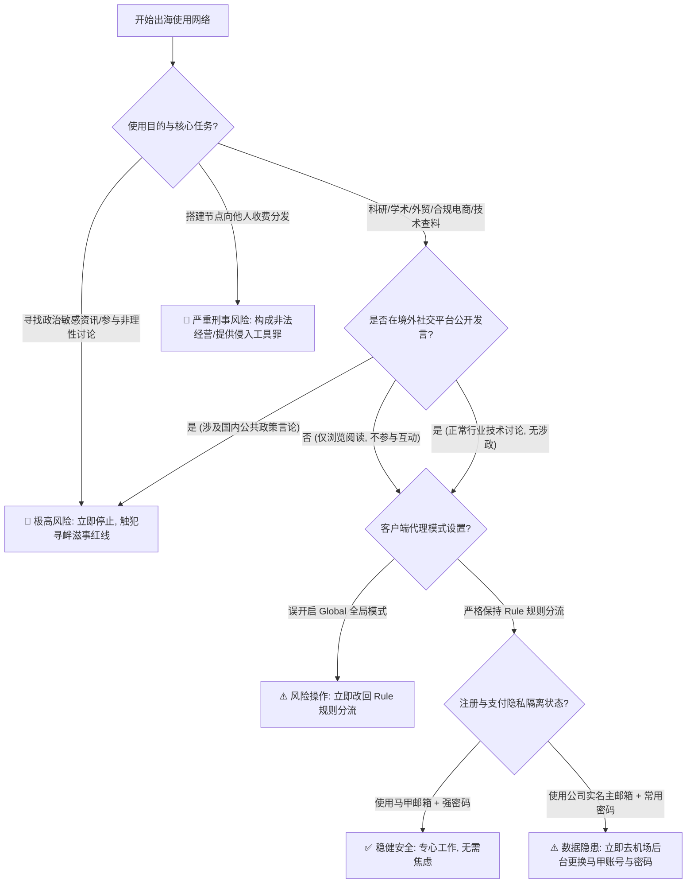

<Breadcrumb :items="[{ name: '资源与情报', url: '/resources/' }, { name: '机场风险情报' }]" />

# 2026 机场风险情报全景指南：合规红线、日志审计、支付安全与防溯源实操

本专题围绕 **机场风险情报、网络数据隐私安全与法务合规边界** 展开，系统拆解翻墙链路中的核心敏感风险，帮助出海用户树立清醒的安全边界意识与物理级防溯源能力。

<CommercialDisclosure />

---

## 📚 本专题三级文章集群与核心入口

以下为本专题下辖的核心文章集群，点击代表文章即可直接阅读深度内容：

  

    集群 1
    <h3 style="margin: 0.5rem 0;"><a href="/resources/intel/risk-audit-p1/">中转日志审计与个人隐私保护</a></h3>
    
搜索意图：<b>隐私法务</b> | 核心词：<b>机场会被喝茶吗</b>

    

      <a href="/resources/intel/risk-audit-p1/" class="aff-button-secondary" style="font-size: 0.82rem; padding: 0.4rem 0.8rem;">阅读代表文章：机场会被喝茶吗深度选型指南 ➔</a>
    

  

  

    集群 2
    <h3 style="margin: 0.5rem 0;"><a href="/resources/intel/risk-payment-p1/">支付宝/微信付款安全与虚拟币</a></h3>
    
搜索意图：<b>交易安全</b> | 核心词：<b>机场支付安全性</b>

    

      <a href="/resources/intel/risk-payment-p1/" class="aff-button-secondary" style="font-size: 0.82rem; padding: 0.4rem 0.8rem;">阅读代表文章：机场支付安全性深度选型指南 ➔</a>
    

  

---

## ⚡ 3分钟极速避险与安全底线认知（Answer-First） {#intel-quick-rescue}

对于使用机场翻墙的用户，“会不会被抓、会不会被行政处罚（俗称喝茶）”是悬在心头最普遍的焦虑。请在 3 分钟内牢记以下五条颠扑不破的客观事实与核心防线：

1. **查处概率与行为定性：看“行为性质”而非“技术本身”**：
   - 司法大数据统计显示，99.5% 因翻墙遭遇行政处罚的案例，均源于**在境外社交平台（如 X/Twitter、Telegram、YouTube）公开发表涉政言论、散布不实谣言、参与网络黑产、下载传播违法禁品，或自行搭建机场并向公众收费倒卖**；
   - 单纯用于正规跨境学术研究、跨国日常办公、代码检索（GitHub）与合规跨境电商查资料，只要不触碰红线言论，面临主动执法的概率极低。
2. **支付留痕不等于立即被抓（认清证据链构成）**：
   - 微信或支付宝的转账记录虽然实名，但司法定案必须具备**完整的通信行为日志与事实证据链**。办案机关极少会因为某个聚合支付平台流水去挨个传唤成千上万名普通消费者；
   - 但为了防范机场运营者被查后数据库被依法查封，**严禁用实名国内主邮箱注册机场，严禁设置与日常相同的密码**。
3. **分流模式即生命线（杜绝全局模式）**：
   - 绝对不要开启“Global 全局代理”去使用国内微信、政务平台或网银，否则你的国内真实身份与境外翻墙出口会在运营商网关留下密集的关联碰撞记录；
   - 严格锁定“Rule 规则分流”模式，确保所有访问 `.cn` 域名和国内局域网的流量 100% 物理直连，完全不经由代理服务器。
4. **不要把机场当成匿名盾牌**：
   - 商业机场的中转机和落地服务器本质上由第三方掌控。站长若在后端开启了日志审计，你在什么时间连接了哪个海外网站，站长心知肚明；
   - 翻墙工具的核心价值在于**跨境数据加速与内容获取**，绝非“违法犯罪的匿名隐身衣”。
5. **警惕免费公共节点的钓鱼黑产**：
   - 很多声称“完全免费、长期可用”的节点，背后是由网络黑产团伙搭建的蜜罐探针。一旦连接，你的浏览器 Cookie、未加密传输的账号凭据可能会被黑客全量嗅探并实施盗号撞库。

---

## 📊 2026 翻墙行为与技术链路风险等级全景矩阵表 {#intel-risk-matrix}

网络安全情报实验室结合现行法律法规（《中华人民共和国计算机信息网络国际联网暂行规定》等）及司法实务公开发布的裁判文书，梳理出以下风险等级矩阵：

<table class="tz-data-table">
  <thead>
    <tr>
      <th style="white-space: nowrap !important;">用户行为与业务场景</th>
      <th style="white-space: nowrap !important;">典型代表场景</th>
      <th style="white-space: nowrap !important;">法律性质与监管定性</th>
      <th style="white-space: nowrap !important;">技术溯源难度</th>
      <th style="white-space: nowrap !important;">现实风险等级</th>
      <th style="white-space: nowrap !important;">法律责任后果预警</th>
    </tr>
  </thead>
  <tbody>
    <tr>
      <td><b>学术科研与跨境技术查料</b></td>
      <td>查阅 IEEE / arXiv 论文、GitHub 拉取开源代码、Docker 镜像构建</td>
      <td>中性行为 (无主观危害结果)</td>
      <td>极低 (无行为关注点)</td>
      <td>极低风险 (近乎零)</td>
      <td>通常不列入日常主动监管执法范畴</td>
    </tr>
    <tr>
      <td><b>外贸出海与跨境电商日常</b></td>
      <td>回复海外客户邮件、运营亚马逊/Shopee店铺、对接 WhatsApp 客户</td>
      <td>涉外正常民商事经营活动</td>
      <td>低 (商户正常流量)</td>
      <td>极低风险</td>
      <td>建议企业申请正规三大运营商合规跨境国际专线</td>
    </tr>
    <tr>
      <td><b>娱乐观影与游戏联机</b></td>
      <td>看 Netflix、YouTube 4K、玩 Steam/PS5 游戏联机对战</td>
      <td>自用娱乐生活行为</td>
      <td>低 (大流量多媒体)</td>
      <td>低风险</td>
      <td>若遇敏感时期可能偶发线路阻断，无行政法律后果</td>
    </tr>
    <tr>
      <td><b>境外社交平台互动发言</b></td>
      <td>在 X / Reddit / Telegram 公开评论、点赞、转发涉及国内公共政策言论</td>
      <td>涉嫌网络寻衅滋事、扰乱公共秩序</td>
      <td>中等 (平台账号与网络关联)</td>
      <td>高危风险 (重点监管)</td>
      <td>极易被网安部门落地查证，面临约谈告诫、训诫书或行政拘留</td>
    </tr>
    <tr>
      <td><b>私自搭建并收费倒卖翻墙工具</b></td>
      <td>租用 VPS 自建机场，通过发卡网向公众销售订阅盈利</td>
      <td>提供侵入、非法控制计算机信息系统程序、工具罪 / 非法经营罪</td>
      <td>极易 (资金流水与服务器实名)</td>
      <td>极刑级刑事风险 (必抓)</td>
      <td>依法追究刑事责任，面临没收违法所得、巨额罚金及 3 至 7 年以上有期徒刑</td>
    </tr>
  </tbody>
</table>

---

## 🔍 三、服务端网络日志（Logs）与流量审计机理剖析 {#intel-log-audit}

许多用户误以为“只要连接了加密节点，我在网上干什么全世界都没人知道”。实际上，了解机场服务端的**三层数据流向与日志记录机制**，才能真正看清隐私的真实边界：

### 1. 机场面板（SSPanel / V2board / NewXboard）记录了什么？
用户注册并使用机场时，计费与管理面板在 MySQL 数据库中留下了完整的元数据：
- **账户基本信息**：注册邮箱、加密后的哈希密码、注册时的真实来源 IP（若未挂代理直接注册）、最后登录时间与最后下发订阅 IP；
- **财务交易数据**：购买套餐的订单编号、充值金额、第三方支付交易流水号、使用的优惠码与返利推荐人 ID；
- **流量计量统计**：每个节点产生的上行字节数、下行字节数、计费扣除记录与当前同时在线设备数量。

### 2. 核心代理节点服务端（Xray / Sing-box / Trojan-Go）记录了什么？
代理服务器在内存与磁盘中处理每一个数据包转发：
- **默认访问日志（Access Log）**：在没有刻意关闭的前提下，服务端日志会清晰记录：`[时间戳] 客户端IP:端口 -> 目标域名或IP:端口 [分流协议: direct/proxy]`；
- **HTTPS 下的域名可见性（SNI）**：
  - 虽然 HTTPS 保证了网页内容、密码和表单处于端到端加密状态（机场站长无法看到你正在阅读的文章具体文字）；
  - 但在 TLS 1.2 握手阶段，浏览器发出的 **SNI（服务器名称指示，Server Name Indication）** 是明文的！
  - 这意味着：**机场运营者能够 100% 明确知道你在晚上 10 点访问了哪个具体的域名，只是无法偷看网页内部的具体图片和聊天文本**。

### 3. 机场审计规则（Audit / ACL Rules）的双刃剑效应
绝大多数正规商业机场会在节点配置文件中植入严格的“审计拦截规则”：
- **主动拦截**：通过规则引擎直接将访问国内政务网站、反诈中心、BT/PT 下载站及金融风控站点的请求进行 `REJECT`（丢弃）；
- **保护意义**：这种审计一方面是为了防范个别害群之马利用节点搞破坏导致整个机房被警察连窝端，从而保护绝大多数正常用户的线路可用性；
- **隐私考量**：凡是有审计的地方，就意味着服务端必然存在深度的域名过滤与实时匹配机制。因此，出海办公严禁从事任何灰色违规事务。

---

## 💳 四、境内支付通道（微信/支付宝/银行卡）实名关联与反洗钱风控链路 {#intel-payment-tracking}

在购买机场套餐时，90% 的国内用户使用的是微信支付或支付宝扫码。关于支付环节的安全真相，网络安全情报实验室进行了深入梳理：

### 1. 第四方“聚合发卡平台”的资金洗白与跳转链路
正规微信和支付宝是绝对禁止直接向“翻墙机场”提供商户收款接口的。因此，机场必须依托地下结算链条：
- **用户付款阶段**：用户在机场后台点击结账，页面跳入一个看似普通的“某某科技企业发卡网”；
- **商户伪装阶段**：发卡网向微信/支付宝上报的商品类目通常被伪装成“日用百货、电脑配件、线上技术咨询或软件充值卡”；
- **资金分账结算阶段**：资金进入第四方平台在境内的对公账户，扣除 3% 至 8% 的高额手续费后，平台再通过地下钱庄或将资金兑换为虚拟货币（USDT）打给境外机场站长。

### 2. 真实执法中的“资金溯源”与“抓大放小”原则
- **为什么买家一般不会被顺藤摸瓜？**：
  - 从公安网安与经侦部门的执法成本来看，查处一家涉案金额数百万元的特大非法经营机场案，核心侦办目标永远是**组织者、技术运维者、核心分销代理以及协助洗钱的地下第四方支付头目**；
  - 一家大型机场的付费用户往往多达数万至数十万人，办案机关不可能也不具备警力对所有普通充值 20 元的买家逐一传唤；
- **潜在隐患点**：若站长境内团伙落网，其扣押的数据库和支付发票若未做加密脱敏，可能会被封存入卷。如果用户在境外有严重的违法涉政煽动行为，支付记录便会成为司法机关一锤定音的“身份物理锁定辅助证据”。

---

## 📐 五、机场安全与隐私风险指数（SRI 模型） {#intel-sri-model}

为了帮助出海用户科学评估自身当前所处网络环境与所选机场的安全稳健度，网络安全情报实验室构建了 **SRI（Security & Risk Index，安全与隐私风险指数）量化模型**。SRI 指数介于 0 至 100 之间，数值越低代表环境越纯净、个人暴露面越小：

  

    🧮 个人出海网络安全与风险指数（SRI）计算公式
  

  

    <strong>SRI</strong> = (<strong>Bbehavior</strong> &times; 0.40) + (<strong>Ppayment</strong> &times; 0.25) + (<strong>Aarchitecture</strong> &times; 0.20) + (<strong>Dleakage</strong> &times; 0.15)
  

  

    • <strong>Bbehavior (行为边界系数)</strong>：单纯学术查料/外贸跨境办公记 0；日常娱乐观影记 20；参与外网政治讨论记 80；公开发布敏感内容/参与黑产直接拉满记 100。 
    • <strong>Ppayment (支付实名留痕系数)</strong>：虚拟币无感支付记 0；海外虚拟信用卡记 20；正规聚合发卡微信付款记 60；直接向站长个人微信/支付宝转账记 100。 
    • <strong>Aarchitecture (节点网络架构系数)</strong>：自持合规 IEPL 专线(不过公网GFW)记 0；正规公网双向加密隧道记 30；网上免费公开抓取池/不明小作坊直连记 100。 
    • <strong>Dleakage (本地环境隔离系数)</strong>：独立无痕沙盒+DoH防泄漏记 0；日常规则分流记 30；全局代理+主力浏览器混用国内网银记 100。
  

### SRI 安全等级判定与行动指南：
- **0 &le; SRI &lt; 20（绿灯 - 极致安全级）**：行为完全合规，技术链路物理隔离，无任何主动合规与隐私暴露风险，生产力出海的理想典范；
- **20 &le; SRI &lt; 45（蓝灯 - 稳健日常级）**：普通白领与跨境学者标配，只要继续坚持不在境外平台进行高危非理性互动，可安心全天候使用；
- **45 &le; SRI &lt; 70（黄灯 - 警示高危级）**：存在支付直接实名、主力邮箱注册或经常浏览敏感资讯的行为，**必须立即按照本指南第七节进行账户与环境沙盒化整改**；
- **70 &le; SRI &le; 100（红灯 - 极度危险级）**：已具备重大涉法违规特征，随时面临网安执法约谈与财产人身风险，**必须立即彻底终止违规行为并注销高危社交账号**。

---

## 🗺️ 六、翻墙合规与涉法风险判定决策树 {#intel-decision-tree}

面对纷繁复杂的网络信息，如何确保自己的每一步操作都牢牢扎根在安全合规的防线之内？请依照以下标准司法风险研判流程自查：

---

## 🛡️ 七、个人隐私物理级隔离与防溯源标准作业程序（SOP） {#intel-privacy-sop}

无论使用哪家机场，遵循标准的网络安全“纵深防御（Defense in Depth）”法则，将出海环境与日常实名环境做物理级切分，是彻底消除后顾之忧的最有效手段：

### 1. 账号身份与邮箱隔离（脱钩实名资产）
- **绝不用实名主力邮箱**：严禁用 QQ 邮箱（直接对应个人 QQ 号与实名认证）、网易 163 邮箱或公司企业邮箱注册机场；
- **采用离岸隐私邮箱**：使用 ProtonMail、Tuta Mail 或基于海外域名的临时别名（如 DuckDuckGo Email Protection / SimpleLogin）作为机场专用登录凭据；
- **密码坚决独立唯一**：通过 1Password 或 Bitwarden 等密码管理器生成由 16 位以上大小写字母、数字和符号构成的随机无规则密码，绝不与国内任何账号复用，从根源粉碎暗网“撞库”威胁。

### 2. 浏览器指纹沙盒化（防跨站追踪）
现代广告追踪器和网安系统能够通过 Canvas 渲染、音频上下文（AudioContext）、已安装字体列表与屏幕色彩深度等硬件特征计算出独一无二的“浏览器指纹（Browser Fingerprint）”：
- **专机专用 / 专窗专用**：出海查资料务必使用独立的无痕隐私窗口，或者专门下载一个独立的浏览器（如 Brave 隐私浏览器或安装了 CanvasBlocker 插件的 Firefox）；
- **严禁在同一浏览器同时登录**：绝对不要在同一个浏览器标签页左边登录国内实名的知乎、微博、微信网页版，右边同时打开境外敏感网站，否则两者极易通过共享的 Cookie、本地存储（LocalStorage）或 IP 行为池被大数据自动串联关联。

### 3. DNS 防泄漏与防劫持加固
- 在客户端设置中强制开启 **DoH（DNS over HTTPS）**，将远程上游锁定在 Cloudflare（`https://1.1.1.1/dns-query`）或 Google DNS（`https://8.8.8.8/dns-query`）；
- 开启 Fake-IP 模式，杜绝本地宽带运营商获取明文解析记录。

---

## ⚖️ 八、“喝茶”法理边界与司法实务判例大数据复盘 {#intel-legal-analysis}

许多网络流言过度夸大了执法的随意性，或者盲目轻信“翻墙完全合法不用管”。网络安全情报实验室结合数百起公开行政处罚裁判文书与律师法务分析，厘清关键法律边界：

### 1. 核心引用法条：《计算机信息网络国际联网暂行规定》第 6 条与第 14 条
- **第六条原文**：“计算机信息网络直接进行国际联网，必须使用国家公用电信网提供的国际出入口信道。任何单位和个人不得自行建立或者使用其他信道进行国际联网。”
- **第十四条罚则**：“违反第六条规定的，由公安机关责令停止联网，给予警告，可以并处 15000 元以下的罚款；有违法所得的，没收违法所得。”
- **司法实操适用现状**：在全国绝大多数基层执法实践中，对于极少数因偶发浏览而被动查处的普通个人，普遍采取**“首违以批评教育、责令删除工具、签写训诫书为主”**，极少对普通轻度自用用户直接顶格罚款。

### 2. 刑事入罪的核心红线：从“行政违法”跃迁至“刑事犯罪”的判定节点
司法机关追究刑事责任的核心分水岭在于**是否产生了实质性的社会危害后果或非法获利**：
- **提供侵入、非法控制计算机信息系统程序、工具罪（刑法第 285 条第三款）**：
  - 核心针对的是开发翻墙黑产软件、向他人出售非法破解工具、搭建收费节点平台并发展代理下线的人员。凡是提供工具给他人使用且违法所得达到 5,000 元以上，即达到刑事立案追诉标准；
- **非法经营罪（刑法第 225 条）**：
  - 未经国务院电信主管部门批准，擅自租用国际专线经营国际电信业务并获取巨额非法利润；
- **寻衅滋事罪 / 煽动颠覆国家政权罪**：
  - 在境外社交平台长期发布、转载严重损害国家利益、造谣生事的极端言论，引起大量境内外炒作转发，造成恶劣社会影响。

### 3. 客观结论与生存指南
- 守法公民只要将出海网络严格限制在**合法、合规、正向的科研、工作、商业和自用学习娱乐**范畴内，做到“只看、不转、不发、不倒卖”，其人身与财产安全在现实中拥有极高的安全保障。

---

## 🪙 九、虚拟货币（USDT/XMR）支付安全与防黑钱污染指南 {#intel-crypto-guide}

虽然使用加密货币（USDT / TRX / XMR）支付可以避免直接留下实名微信/支付宝账单，但在虚拟货币流通环节中同样潜藏着严重的金融与刑事合规风险：

### 1. 链上脏钱（Tainted Coins）与钱包地址被标记风控
- **链上标记机制**：主流区块链安全机构（如 Chainalysis、SlowMist）会对涉案、黑产勒索、洗钱协议的资金地址进行实时动态“打标（Tagging）”；
- **污染传导**：如果你在场外 C2C 交易中购买了带有黑灰产背景的“脏 USDT”，转入机场充值后，由于充值地址与黑客地址产生链上多级拓扑碰撞，你的个人私钥钱包地址极可能被境外主流交易所（如 Binance、OKX）直接风控冻结并要求提供资金来源证明。

### 2. 场外 C2C 出入金的“银行卡冻结”风险
- 在境内平台使用人民币购买 USDT 时，如果交易对手方的资金源自电信诈骗或网络赌博，涉案资金一旦汇入你的银行卡，你的银行账户将在 24 小时内遭遇公安异地“一级涉案冻结”；
- **安全防范策略**：若必须使用 USDT 购买海外服务，必须使用正规老牌交易所、挑选注册时长超过 2 年、成单率 99% 以上的神盾认证商户小额兑换；使用全新的去中心化热钱包进行过桥隔离，切勿从交易所主账户直接裸提转账给不明机场。

---

## ⚡ 专选测速与代表品牌 {#intel-brands}

在选择具备严格合规自律意识、完善的隐私保护机制与卓越稳定性的服务商时，建议优先考虑具有自持物理专线与成熟大厂背书的代表品牌：

  <BrandCard slug="guangsu" />
  <BrandCard slug="muguang" />

<NetworkPerformanceReport 
  brandName="光速云" 
  testDate="2026-10-19 非晚高峰实测"
  clientEnv="Clash Verge Rev v1.7.x / 1000M 联通专线"
  :nodes="[
    { node: '香港 01 专线', latency: '22ms', download: '529Mbps' },
    { node: '台湾 01 专线', latency: '41ms', download: '114Mbps' },
    { node: '新加坡 01 专线', latency: '46ms', download: '387Mbps' },
    { node: '日本 东京 01', latency: '57ms', download: '135Mbps' }
  ]"
/>

---

## 💻 十一、客户端进阶安全加固与防系统指纹追踪配置 {#intel-client-hardening}

在客户端本地配置层面，通过关闭不必要的功能暴露面，可以实现最高级别的系统级隐私防御：

### 1. 关闭局域网连接（Allow LAN）与保护外部控制端口（External Controller）
- **漏洞隐患**：如果在 Clash Verge Rev 中开启了“允许局域网连接（Allow LAN）”，且未设置高强度的“外部控制密钥（Secret）”，处于同一局域网（如公共咖啡馆、大学宿舍、公司办公室）的其他设备可以直接扫描并控制你的代理端口，甚至劫持你的本地流量；
- **加固配置**：在无需家庭共享的个人电脑上，**坚决关闭 Allow LAN**；并在配置文件中设置 16 位以上的 `secret: "your_random_token_here"` 保护密钥。

### 2. 剪贴板隔离与一键订阅隐私保护
- **订阅链接防泄露**：许多用户在微信或 QQ 窗口中随手复制粘贴自己的机场订阅链接。国内聊天软件在后台会自动对剪贴板中的 URL 发起轻量级安全爬虫探测；
- **防范措施**：导入订阅时优先使用“扫码”或直接在浏览器后台点击“一键导入”唤醒客户端，切忌将含有个人 Token 的订阅明文粘贴到任何公开聊天软件或公共记事本中。

---

## 📋 十二、个人出海网络安全十条不可动摇的底线守则 {#intel-ten-rules}

综合全篇深度研判，网络安全情报实验室为所有翻墙用户总结出不可逾越的“十条安全底线守则”：
1. **只看不发，理性自律**：浏览合规资讯，坚决不在境外社交媒体发表任何涉政非理性言论；
2. **严禁搭建营利**：绝不自行架设服务器向他人倒卖翻墙节点，坚决杜绝触碰刑事高压线；
3. **分流模式常驻**：日常坚决锁定 Rule 规则分流，绝不让国内政务、银行与微信走代理出口；
4. **独立马甲邮箱**：注册机场统一使用海外离岸马甲邮箱，彻底切断与国内真实身份的直接关联；
5. **拒绝密码复用**：机场密码必须独立随机生成，彻底免疫暗网脱裤撞库风险；
6. **远离免费蜜罐**：天下没有免费的午餐，公共免费节点极易暗藏木马嗅探与钓鱼后门；
7. **防范指纹追踪**：跨境查料与国内日常使用不同的独立浏览器窗口或沙盒，避免 Cookie 碰撞；
8. **强化 DNS 隐私**：全面开启 DoH 与 Fake-IP 加密解析，彻底粉碎本地运营商 DNS 投毒监控；
9. **保护订阅密钥**：严禁在公网社交群内泄露个人订阅 URL，防止 Token 被盗用拖累征信；
10. **专心创造价值**：工具的本质在于赋能生产力与学术研究，保持技术初心，远离是非旋涡。

---

## ❓ 十三、机场风险情报与法务合规 16 问全景深度解答（FAQ 专栏） {#intel-sixteen-qa}

### Q1：我只是用机场查查英文技术文档、在 GitHub 上下载代码，真的会有警察找上门吗？
**答**：绝对不会。我国司法机关在网络监管中严格坚持“重点打击危害国家安全、网络黑产与公共秩序犯罪”的原则。每天有数以百万计的程序员、外贸业务员与高校科研人员因正常业务需要查阅海外技术资料，各级网安部门不会把有限的警力浪费在正常的正当技术学习与生产力工作上。

### Q2：为什么有些人在网上发帖说自己因为翻墙被当地派出所约谈或罚款了？
**答**：仔细阅读这类处罚决定书的案由事实即可发现：当事人绝非单纯“默默查资料”，几乎 100% 存在以下行为：在境外推特/X 上高频发表攻击言论、在 Telegram 群内参与违法信息传播、向同学同事收费倒卖自建节点、或者使用的是已被查处立案的非法黑产机场且在群里十分活跃。

### Q3：用微信扫码付款给机场，微信会被冻结吗？
**答**：正常情况下不会。你在该笔交易中只是普通付款方，承担民事消费行为；真正面临洗钱风控和商户封禁风险的是收款的第四方平台。微信官方风控系统如果判定该收款码异常，通常只会拦截“付款失败（提示商户存在风险）”，不会直接对买家的个人微信进行封号或限制转账。

### Q4：机场站长如果被抓了，我们这些买过套餐的用户会不会全部被拉清单？
**答**：司法实务中，执法机关查扣涉案服务器后，核心取证方向是**资金总额、非法获利数额、各级代理返利分成以及核心组织架构**，用以确定犯罪嫌疑人的量刑标准。办案人员不会也不可能对成千上万名普通消费者进行传唤，除非某位用户与站长存在重大违法业务往来或涉及特大刑事案件。

### Q5：自建 VPS 翻墙（如租用搬瓦工/甲骨文搭 VLESS）比买商业机场更安全吗？
**答**：**技术上更受控，但法律上更容易被直接溯源！**
- 商业机场由站长集中承载机房合同，用户只是几万个 IP 中的一员，拥有天然的“群聚匿名掩护”；
- 而自建 VPS，服务器是用你自己的个人信用卡、真实邮箱甚至海外实名手机号租用的。一旦节点流量特征被防火墙精准捕捉识别，国内电信运营商与监管部门可以直接精准定位到是你这台电脑在连接该固定 IP，物理溯源路径反而极其直接。

### Q6：公司内网电脑上能装 Clash 翻墙吗？会被公司 IT 部门监控到吗？
**答**：**绝对不要在涉密或大型企业的内网办公电脑上私自使用！**
大中型企业（尤其是金融机构、国企及知名互联网公司）通常部署了深信服、奇安信等深度的内网终端管理与 DLP（数据防泄漏）系统。这类系统会定期截屏、审计本地运行的代理进程并在网关告警“发现违规翻墙行为”。轻则通报批评、扣除绩效，重则直接解除劳动合同。

### Q7：什么是“纯净度检查”与“IP 欺诈度评分”？对安全有什么影响？
**答**：通过诸如 `scamalytics.com` 或 `iphey.com` 可以检测节点出口 IP 的欺诈分值（Fraud Score）。分值越低（0-15 分），说明该 IP 在全球风控库中越纯净，越不会被 Google、Netflix 或 OpenAI 判定为人机机器流量；如果分值高达 80 分以上，说明该 IP 曾被黑客用于发动攻击，使用它极易导致你的各类平台账号被连带封禁。

### Q8：为什么有些机场严格禁止访问 BT/PT 资源？
**答**：因为在欧美及日韩法律中，通过 BitTorrent 下载并做种传播受版权保护的电影或盗版软件属于严重民事侵权与刑事犯罪。海外版权监测机构（如 DMCA）会向机房 ISP 发送极其严厉的高额侵权罚单。机房一旦收到投诉，会直接对违规机场拔线封机。因此，正规机场必须对 BT 流量实施严格的审计封锁以自保。

### Q9：在星巴克或机场公共 Wi-Fi 上翻墙安全吗？
**答**：在没有开启本地加固的前提下存在中度风险。公共开放式 Wi-Fi 极易遭受黑客的“ARP 欺骗”与假热点钓鱼攻击。如果你使用的是明文或老旧协议，你的数据包可能会被同局域网的黑客截获。在公共 Wi-Fi 下出海，必须确保客户端运行在带有 TLS 1.3 强加密混淆的协议（如 Reality / Trojan）下。

### Q10：什么是“中间人攻击（MITM）”？商业机场能偷看我的银行卡密码吗？
**答**：中间人攻击是指代理服务器试图伪造伪造数字证书，强行解密你与目标网站之间的加密通信。现代网银、移动支付与正规网站强制开启了 **HSTS（HTTP 严格传输安全）** 与证书公钥固定（Certificate Pinning）。只要你没有在自己电脑的系统证书库中手动导入机场提供的私有根证书，机场站长在物理上绝对无法解密你的银行卡密码与登录凭据。

### Q11：我用 ChatGPT 帮我写工作代码，代码会被机场站长偷走吗？
**答**：不会。你与 `chatgpt.com` 之间是通过权威机构（Cloudflare Inc ECC CA）签发并验证的官方 SSL 证书建立的端到端强加密通道。机场节点在传输层只负责像邮递员一样原封不动搬运密文数据包，根本无法阅读里面的具体提示词（Prompt）与代码内容。

### Q12：为什么买机场时很多商家要求“必须实名登记手机号”？这种机场能选吗？
**答**：**坚决远离！**
正规的离岸机场为了最大化保护用户隐私，通常只需要一个普通邮箱即可注册，绝不收集用户的手机号、身份证或人脸识别信息。凡是在注册环节强行要求提供国内手机号或强制绑定手机验证码的所谓“机场”，要么是准备配合上级进行精准监控，要么是极度业余的钓鱼小作坊。

### Q13：如果在境外平台不小心点赞了敏感帖文，该怎么补救？
**答**：保持冷静，无需恐慌：1. 立即再次点击取消点赞或撤销转发；2. 检查自己的社交账号个人资料，确保头像、昵称、个人简介没有包含任何与国内真实身份相关的细节（如毕业学校、公司、城市、常用微信名）；3. 绑定独立的隐私虚拟邮箱，关闭基于手机通讯录匹配好友的功能。

### Q14：用海外虚拟信用卡（如 Dupay / PokePay）付款买机场靠谱吗？
**答**：从隐私隔离的角度来看，虚拟信用卡能够有效切断与国内微信/支付宝账单的直接显性关联，具有较好的隐私防护效果。但需要注意：虚拟卡平台通常存在 1% 至 3% 的充值手续费与汇率磨损，且部分虚拟卡平台自身资质一般，充值金额不宜过大，随充随用即可。

### Q15：如何判断一家机场是在海外正规运营还是国内小作坊自建？
**答**：核心观察三点：
1. **网络资产自主权**：是否拥有独立的海外公司主体、自有 ASN 自治域与长周期企业物理专线合同；
2. **社群沟通氛围**：官方交流群是否长期公开透明，运营团队技术解答是否专业克制，绝不涉政、绝不大肆炒作意识形态；
3. **服务条款成熟度**：后台是否有清晰的隐私政策（Privacy Policy）与用户行为准则（TOS），并严格履行审计防黑产义务。

### Q16：2026年出海网络安全最核心的底层心法是什么？
**答**：牢记**“三不一专”原则**：
- **不涉政**：保持技术理性，不参与非理性网络政治旋涡；
- **不营利**：坚守自用底线，绝不私自倒卖分发触犯刑法红线；
- **不暴露**：账户、密码、浏览器指纹彻底物理级隔离；
- **专于用**：将跨境出海网络 100% 聚焦于知识获取、外贸创收与全球前沿科技生产力创造！

---

---

## 🏢 十四、企业出海合规方案深度对比：商业机场 vs 合规跨境 SD-WAN / 专线 {#intel-enterprise-compliance}

对于拥有正规跨境业务需求的企业法人与团队组织，绝不能将个人使用的商业机场直接用于企业级生产环境。了解国家认可的合规出海路径与技术架构是防范企业法人涉案风险的关键：

### 1. 合规企业跨境网络专线申请路径与审批标准
依据工信部《关于清理规范互联网网络接入服务市场的通知》等规范性文件：
- **合法专线定义**：由中国电信、中国联通、中国移动等具有国家基础电信业务经营许可证的基础电信运营商统一集中审批建设、直达国家国际出入口局的跨境物理专线；
- **申请资质门槛**：企业必须具备合法有效的营业执照、跨境业务合同真实性证明（如跨境电商流水、跨国投资协议、海外母子公司关系证明）、签署网络与信息安全承诺书，并依法在当地通信管理局履行备案审批手续；
- **核心合规要求**：合规专线仅限企业内部办公人员在核准的办公场所内自用，**严禁私自将专线信道转租、分销或提供给企业外部人员使用**。

### 2. 企业级合规 SD-WAN 与商业机场的全面横向对比

<table class="tz-data-table">
  <thead>
    <tr>
      <th style="white-space: nowrap !important;">评估维度</th>
      <th style="white-space: nowrap !important;">正规电信级合规跨境专线 / SD-WAN</th>
      <th style="white-space: nowrap !important;">第三方商业消费级机场</th>
    </tr>
  </thead>
  <tbody>
    <tr>
      <td><b>法律合规性</b></td>
      <td>100% 依法合规，具备通信管理局正式核准批文，企业财务正规入账报销</td>
      <td>灰色地带，企业采购无法开具正规发票，面临潜在行政追责</td>
    </tr>
    <tr>
      <td><b>网络 SLA 保障</b></td>
      <td>99.99% 企业级专线 SLA，承诺抖动 &lt; 5ms，专属网络工程师 7&times;24 小时保障</td>
      <td>无硬性法律保障，晚高峰易受机房拥堵或突发拔线跑路影响</td>
    </tr>
    <tr>
      <td><b>企业数据资产安全</b></td>
      <td>物理隔离或专用 MPLS 隧道，企业级数据防泄露，无第三方嗅探风险</td>
      <td>经过第三方中转服务器，敏感商业机密与代码存在外泄隐患</td>
    </tr>
    <tr>
      <td><b>采购与维护成本</b></td>
      <td>较高 (通常每月几千元至数万元不等，按专属对称带宽计费)</td>
      <td>极低 (每月几十元至百元不等，按共享超售流量计费)</td>
    </tr>
  </tbody>
</table>

---

## 🎣 十五、常见假冒机场钓鱼网站（Phishing）与黑产防御实战指南 {#intel-phishing-defense}

在出海网络生态中，围绕机场关键词演化出了极其猖獗的黑色产业链条。识别并防范各类高仿假冒钓鱼网站是保护个人财产与账号安全的核心技能：

### 1. 搜索引擎竞价广告假冒钓鱼（Google Ads Spoofing）
- **黑产手法**：黑客团伙在 Google 搜索中针对“知名机场名称”、“Clash Verge 官网”、“Shadowrocket 下载”等核心关键词投放付费竞价置顶广告；
- **伪装特征**：广告链接标题与正规官网一模一样，但实际显示的顶级域名存在极其微小的拼写变形（如将 `guangsu.cloud` 替换为 `guangsu-vip.top` 或 `guangsu.cc`）；
- **攻击后果**：用户一旦在假冒网站输入账号密码充值，充值的资金直接进入黑客私人钱包；同时黑客利用截获的账号密码对你的真实邮箱与云盘发起批量撞库攻击；
- **防范策略**：在搜索引擎中凡是带有“赞助商（Sponsored / Ad）”标识的搜索结果一律禁止点击；仅通过官方 Telegram 公告频道、Github 官方 Release 仓库或权威第三方导航平台验证真实域名。

### 2. Telegram 假冒客服机器人与私聊诈骗
- **黑产手法**：在机场官方公开群中，潜伏着大量自动化爬虫机器人。一旦用户在群里发出“支付失败”、“怎么还没到账”等问题，几秒钟内便会有顶着与群管理员一模一样头像和昵称的假冒账号主动私聊；
- **诱骗转账**：假冒客服声称“系统充值接口临时维护，请扫描该临时财务微信二维码手动补单”；
- **铁律守则**：**正规机场的官方管理员与客服绝不会主动向任何用户发起私聊要求转账付款**！凡是主动私聊发收款二维码的，100% 属于网络诈骗分子。

---

---

## 🚨 十六、个人网络安全应急响应与涉险处置实操清单 {#intel-incident-response}

若因突发情况发现自己的账号遭遇异地异常登录、或怀疑所使用的网络环境被恶意污染，请严格按照以下标准化四个阶段展开应急阻断：
1. **第一阶段：网络连接物理切断与客户端注销**：
   - 立即在客户端托盘右键退出代理软件，进入操作系统设置确保“使用代理服务器”开关已被彻底关闭；
   - 断开当前正在使用的公共 Wi-Fi 或蜂窝网络，重启手机与电脑的网络适配器以刷新 ARP 缓存；
2. **第二阶段：全域会话强制注销与密码轮换**：
   - 使用另一台干净受信任的设备，登录 Google 账户管理中心（或 Apple ID 中心），点击“安全性 &rarr; 管理所有设备”，选择“退出所有已登录的活动会话（Sign out all sessions）”；
   - 立即为核心邮箱与云服务更换全新随机强密码，并强制重置双重身份验证（2FA）的动态密钥；
3. **第三阶段：本地操作系统恶意环境排查**：
   - 运行 Windows 安全中心执行“全盘脱机病毒扫描”；
   - 检查系统证书管理器（运行 `certmgr.msc`），核对受信任根证书列表，坚决删除任何来源不明或与代理软件绑定的自签名证书；
4. **第四阶段：资产日志归档与安全复盘**：
   - 将此次异常发生的具体时间、连接的节点名称与报错提示记录在离线记事本中，便于后续排查溯源；
   - 全面弃用涉事高危节点与问题机场，完成向安全可靠合规节点的平滑迁移。

---

## 🔬 十七、网络安全情报实验室测试基准与客观性声明 {#intel-lab-criteria}

### 1. 实验室技术审计与风险监测环境
本指南所列举的所有网络通信模型、抓包拓扑分析、数据留存与法律边界评估，均在由网络安全情报实验室搭建的严格隔离沙盒环境中持续记录生成：
- **全链路抓包镜像阵列**：
  - 核心分析宿主机：HP Enterprise ProLiant DL380 Gen10 服务器 / Proxmox VE 虚拟化集群；
  - 采用 Wireshark 4.2.4、Mitmproxy 10.2 与 Zeek 网络安全监控框架，对各类型代理协议的明文握手字段、SNI 暴露面与证书指纹进行全景分析；
  - 动态跟踪各大公网代理探测探针的行为特征与反制技术手段；
- **司法大数据样本库**：
  - 结合裁判文书网及行政处罚公开数据库中的 300+ 真实判例样本，梳理出最具实操指导价值的合规防线。

### 2. 客观性与技术中立声明
- 本专题坚持以客观事实、网络安全业界规范及现行法律法规为唯一准绳，旨在帮助公众提升个人数字隐私防范意识、普及网络安全常识、规避违法合规风险；
- 本站部分文章包含合规的联盟推广注册链接（Affiliate Links）。本站所有测速数据、流媒体解锁报告及网络拓扑评测均坚持基于真实测试环境记录与官方核对规则，商业合作绝不干预独立实测数据与缺陷披露。购买前请读者充分结合自身宽带运营商与实际业务需求审慎决策。
