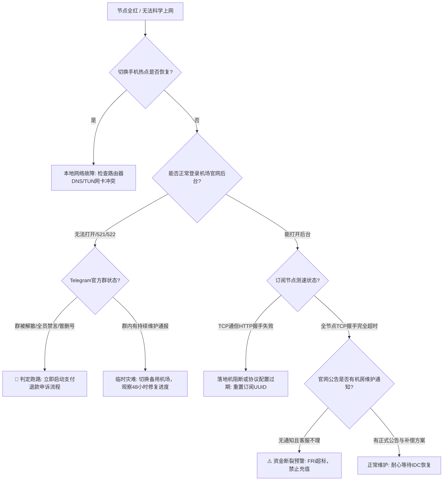

<Breadcrumb :items="[{ name: '资源与情报', url: '/resources/' }, { name: '跑路预警' }]" />

# 2026 机场跑路预警与防坑全景指南：前兆识别、风险量化与资金止损实操

本专题围绕 **机场跑路预警、失联前兆识别与资金安全止损** 展开，系统解决翻墙翻车、机场突然失联、年付套餐打水漂等核心痛点，帮助用户建立科学的风险防范意识与容灾机制。

<CommercialDisclosure />

---

## 📚 本专题三级文章集群与核心入口

以下为本专题下辖的核心文章集群，点击代表文章即可直接阅读深度内容：

<div style="display: grid; grid-template-columns: repeat(auto-fit, minmax(280px, 1fr)); gap: 1rem; margin: 1.5rem 0;">

  <div style="background: #ffffff; border: 1px solid #e2e8f0; border-radius: 8px; padding: 1.25rem;">
    <span class="badge-tag">集群 1</span>
    <h3 style="margin: 0.5rem 0;"><a href="/resources/warning/warn-signs-p1/">机场跑路前的五大反常前兆</a></h3>
    <p style="color: #64748b; font-size: 0.88rem;">搜索意图：<b>风险识别</b> | 核心词：<b>机场跑路前兆</b></p>
    <div style="margin-top: 0.75rem;">
      <a href="/resources/warning/warn-signs-p1/" class="aff-button-secondary" style="font-size: 0.82rem; padding: 0.4rem 0.8rem;">阅读代表文章：机场跑路前兆深度选型指南 ➔</a>
    </div>
  </div>

  <div style="background: #ffffff; border: 1px solid #e2e8f0; border-radius: 8px; padding: 1.25rem;">
    <span class="badge-tag">集群 2</span>
    <h3 style="margin: 0.5rem 0;"><a href="/resources/warning/warn-blacklist-p1/">近期失联与异常运营机场通报</a></h3>
    <p style="color: #64748b; font-size: 0.88rem;">搜索意图：<b>排雷避坑</b> | 核心词：<b>机场跑路名单</b></p>
    <div style="margin-top: 0.75rem;">
      <a href="/resources/warning/warn-blacklist-p1/" class="aff-button-secondary" style="font-size: 0.82rem; padding: 0.4rem 0.8rem;">阅读代表文章：机场跑路名单深度选型指南 ➔</a>
    </div>
  </div>

</div>

---

## ⚡ 3分钟极速排雷与跑路自检指南（Answer-First） {#warn-quick-guide}

面对机场突然节点全红或网站无法打开，许多用户往往在“是不是自己本地网络坏了”与“机场是不是跑路了”之间反复猜疑，甚至错过黄金止损窗口期。请在3分钟内按以下五步完成快速初筛与排雷：

1. **三方验证阻断类型（排除本地故障）**：
   - 切换手机 5G 热点重新拉取订阅，确认是否属于本地宽带 DNS 污染或 Wi-Fi 路由器故障；
   - 尝试直接访问机场官网后台。若官网显示 Cloudflare 521/522/523（源站 Web 服务器宕机或失联），或域名被直接重定向至菠菜/黑产页面，则服务器端异常概率高达 95% 以上。
2. **社群禁言即警报（观察 Telegram 官方群）**：
   - 查看机场官方 Telegram 交流群或公告频道。如果公告频道超过 72 小时无节点故障修复更新，而官方群被突然设置为“全员禁言”、群消息被批量清空、管理员账号集体销户（Deleted Account），这是 99% 的恶性跑路信号。
3. **查验近期优惠活动（促销力度反常即陷阱）**：
   - 回顾该机场在近两周内是否突然发布诸如“三周年庆全场三折”、“永久不限时传家宝套餐 99 元买断”、“充值 200 送 300”等违背经济学规律的超低价促销。凡是在大规模收割现金流后数周内爆发严重故障的，属于典型的“蓄谋跑路（Exit Scam）”。
4. **测试节点真实连通性（识别假死与断网）**：
   - 在客户端内执行 TCP Ping 与 HTTP 可用性测试。如果所有地区节点不仅 TCP 握手完全超时，且订阅拉取接口返回 404 Not Found 或 500 Server Error，说明后端服务器集群与 API 计费中心均已被拔线或欠费关停。
5. **黄金 72 小时止损挽回行动**：
   - 如果使用微信/支付宝或虚拟信用卡在近 72 小时内付款，立即登录支付平台调出订单详情，针对收款商户发起“未收到商品/涉嫌网络诈骗”申诉，冻结争议资金；如果订阅尚未完全失效，切勿点击任何“升级高阶线路才能继续用”的补差价链接，避免遭受二次收割。

---

## 📊 2026 主流机场运营形态与跑路风险等级全景横评表 {#warn-risk-matrix}

为了让用户建立科学的辨识参照系，网络安全情报实验室结合过去五年跟踪的数百起机场关停与跑路案例，将市面上常见的机场运营类型整理为全景风险矩阵：

<div class="tz-table-wrap">
<table class="tz-data-table">
  <thead>
    <tr>
      <th style="white-space: nowrap !important;">运营主体类型</th>
      <th style="white-space: nowrap !important;">底层网络资产架构</th>
      <th style="white-space: nowrap !important;">月均运营硬性成本</th>
      <th style="white-space: nowrap !important;">平均生存周期</th>
      <th style="white-space: nowrap !important;">跑路风险等级</th>
      <th style="white-space: nowrap !important;">典型跑路诱因</th>
      <th style="white-space: nowrap !important;">安全购买建议</th>
    </tr>
  </thead>
  <tbody>
    <tr>
      <td><b>企业级自持专线大厂</b><br><i>(如光速云旗舰专线)</i></td>
      <td>国内自建多线 BGP 入口 + 跨境内网 IEPL 物理专线 + 海外自持 ASN 广播</td>
      <td>50,000 元 - 300,000 元+ / 月</td>
      <td>3 年 - 8 年+ (持续运营)</td>
      <td><span style="color: #16a34a; font-weight: bold;">极低 (FRI &lt; 15)</span></td>
      <td>不可抗力政策合规重组、境内上游光纤故障</td>
      <td>支持季付/年付，SLA 保障度极高，适合外贸出海、科研与企业主力环境</td>
    </tr>
    <tr>
      <td><b>成熟中型商业中转机场</b></td>
      <td>租用第三方公网 IDC 中转服务器 + 隧道加密穿透 + 公网落地机</td>
      <td>10,000 元 - 40,000 元 / 月</td>
      <td>18 个月 - 3 年</td>
      <td><span style="color: #0284c7; font-weight: bold;">中等偏低 (FRI: 20-35)</span></td>
      <td>中转机上游 IDC 突发清退、三方支付通道频繁冻结扣款</td>
      <td>首选月付或季付，建议搭配备用应急节点使用</td>
    </tr>
    <tr>
      <td><b>学生与极客个人拼车合租</b></td>
      <td>几台海外低配 VPS 自建 Shadowsocks/VLESS + 简易 SSPanel 面板</td>
      <td>500 元 - 2,000 元 / 月</td>
      <td>6 个月 - 12 个月</td>
      <td><span style="color: #eab308; font-weight: bold;">中等 (FRI: 40-55)</span></td>
      <td>站长毕业找工作/精力不足弃坑、境外 IP 被封锁后无财力更换</td>
      <td>仅限熟悉的朋友圈内合租，禁止外人购买长期套餐</td>
    </tr>
    <tr>
      <td><b>一元机场与灵车低价盘</b></td>
      <td>上游垃圾公网中转二级分销 + 超售 100 倍带宽 + 廉价 NAT 落地</td>
      <td>1,000 元 - 3,000 元 / 月</td>
      <td>1 个月 - 6 个月</td>
      <td><span style="color: #dc2626; font-weight: bold;">极高 (FRI &gt; 80)</span></td>
      <td>收割数千人年费后资金链直接断裂，服务器续费违约跑路</td>
      <td>坚决禁止购买年付！仅可作为 1 元月付玩具或临时爬墙备胎</td>
    </tr>
    <tr>
      <td><b>全开源抓取套壳假机场</b></td>
      <td>网上免费节点爬虫聚合 + 仿冒知名机场前端 UI + 虚假计费系统</td>
      <td>几乎为 0 元 (仅一台廉价网页服务器)</td>
      <td>1 周 - 2 个月</td>
      <td><span style="color: #7f1d1d; font-weight: bold;">必死诈骗 (FRI 100)</span></td>
      <td>纯粹网络诈骗，买完即封号或发空节点，骗取资金后立即换壳</td>
      <td>严禁充值！发现后立即向支付平台举报商户欺诈</td>
    </tr>
  </tbody>
</table>
</div>

---

## 🔍 三、机场运营崩塌底层机理剖析：为什么 90% 的小机场活不过 18 个月？ {#warn-anatomy}

在翻墙代理行业，外界往往认为“搭个机场稳赚不赔”，但从网络工程与财务合规的客观现实来看，小型机场的死亡率居高不下。了解其背后的经济学机制与技术链条，是看穿跑路前兆的核心前提：

### 1. 现金流与超售倍率的“庞氏螺旋”
正规网络带宽是一种典型的**按期产生且无法库存的重资产消耗品**。以一条正规的 1Gbps 企业级 IEPL 内网专线为例，其采购成本每月高达数万元人民币。
- 小型机场为了在激烈的价格战中吸引小白用户，往往推出“5 元 100G”甚至“年付 39 元不限流”的超低价方案；
- 要想覆盖昂贵的专线成本，站长必须将 1Gbps 的物理带宽超售给 5,000 到 10,000 名用户，实际超售倍率高达 50 至 100 倍；
- 一旦用户规模增加，晚高峰期网络瞬间拥堵崩溃，引发老用户退款或不再续费；
- 失去续费现金流后，站长为了维持下个月的机房续费，只能发布折扣更夸张的“三年付”促销吸纳新用户资金，用新用户的预付款填补上游老欠款；
- **当新增资金流入速度低于机房固定账单与跑路临界点时，资金链在数天之内瞬间断裂，站长除了拔线跑路别无选择**。

### 2. 上游机房（IDC）清退与合同违约风险
许多机场并不直接拥有或合规租用物理线路，而是通过个人身份在二手中转服务商处购买未经电信部门许可的“公网隧道”。
- 遇到关键敏感时段或网络安全大检查，国内数据中心会严格执行 DPI 流量审计，对长期存在高并发 UDP/TLS 隧道加密特征的服务器实施直接拔线、清退甚至扣押设备；
- 上游 IDC 一旦遭遇合规清剿，下游依托该中转的小机场往往在几分钟内节点全线飘红。若站长无备用灾备线路储备，前期投入的数万元机房押金被直接罚没，重建成本巨大，极易直接弃盘。

### 3. 灰色第四方支付接口的“黑吃黑”与资金冻结
由于国内正规支付宝与微信商户严禁接入翻墙代理业务，绝大多数中小型机场只能依托境外的“第四方发卡平台”或地下跑分通道进行收款：
- 这类第四方支付网关自身极不稳定，常常涉及非法洗钱与网络黑产，随时可能遭遇公安冻结或支付机构直接卷款跑路（俗称“黑吃黑”）；
- 一旦支付平台跑路或账户被冻结，机场账面上数万乃至数十万元的流动资金瞬间归零。站长由于缺乏备用对冲资金池，无法在月底向境外机房支付虚拟币结账，直接导致全线服务器因欠费被系统自动停机销毁。

---

## ⚠️ 四、机场跑路前五大反常前兆显微镜式深度拆解 {#warn-five-signs}

通过对历史上数十次大规模机场跑路事件（如著名的喵帕斯、速鹰旗下多盘崩塌、速云梯等）的综合复盘，绝大部分跑路并非突发事件，而是在**跑路前 7 至 30 天**呈现出极其明显的行为学与财务学反常特征：

### 前兆一：反常密集的大促收割与长期套餐狂推
- **典型特征**：正常运营的优质机场，其周年庆或节假日优惠通常在 8.5 折至 9 折之间。而即将跑路的机场会突然出现“清仓式折扣”，例如“全场 3 折”、“充 100 送 150”、“永久不限时 2000GB 传家宝”；
- **潜台词**：站长已经明确意识到下季度无法支付机房账单，企图在最后时刻通过极低边际成本的虚假套餐，最大化榨干最后一波用户存量现金流，为跑路卷款储备最大金额。

### 前兆二：节点大规模故障却“静默处置”或编造离奇借口
- **典型特征**：以往出现单节点故障，管理员会在半小时内通报并切换备用线路；而在跑路前夕，核心热门节点（香港、日本、新加坡）大面积超时，仅剩一两个偏远高延迟节点苦苦支撑；
- **官方托词**：公告中频繁出现“上游机房光缆被挖断”、“遭受友商数 Tbps 级持续攻击”、“正在进行系统架构深层重构”等借口，且修复时间从“预计今晚”无限期拖延至“两周后”。此时真实情况往往是机房因长期欠费已切断主干带宽。

### 前兆三：Telegram 官方社群全员禁言、开启慢速或批量踢人
- **典型特征**：交流群从开放自由讨论，突然变为开启 24 小时全员禁言，只保留单向公告频道；或者在群内设置极度严苛的关键词过滤，凡是在群里询问“节点怎么全红了”、“什么时候能修好”的用户，一律被机器人自动封禁或移出群聊；
- **潜台词**：管理员无力也无心解决技术故障，关闭沟通渠道旨在遏制恐慌情绪蔓延，防止用户自发组织支付投诉追讨欠款。

### 前兆四：支付网关频繁更换且商户名称极其诡异
- **典型特征**：在续费或购买结账时，付款页面在短短几天内从“某某数码商行”频繁跳变到“某某便利店”、“建材批发部”，甚至直接要求用户转账至个人私人账户或仅支持 USDT 泰达币付款；
- **潜台词**：其合作的第四方支付通道因投诉率过高已被风控封杀，站长只能借助高风险的地下洗钱买量通道强行收单，随时面临资金链断裂休克。

### 前兆五：工单系统彻底停摆与管理团队社交蒸发
- **典型特征**：后台提交的技术支持工单数天无人回应，工单状态一直停留在“处理中”；管理团队在 Telegram 上的最后上线时间显示为“很久以前（Last seen recently / long time ago）”，甚至管理员账号名变为“Deleted Account”；
- **潜台词**：运营者已经在物理层面放弃了该项目的所有权，核心人员已经分赃散伙。

---

## 📐 五、机场跑路风险量化评估模型（FRI 模型） {#warn-fri-model}

为了让广大用户能够对任何一家正在考虑购买的机场进行科学的客观风险评级，网络安全情报实验室提出了 **FRI（Flight Risk Index，跑路风险指数）数学评估模型**。FRI 指数介于 0 至 100 之间，数值越高代表资金断裂与跑路风险越大：

<div style="background: #f8fafc; border: 1px dashed #cbd5e1; border-radius: 8px; padding: 1.5rem; margin: 1.5rem 0; text-align: center;">
  <div style="font-size: 1.15rem; font-weight: bold; color: #1e293b; margin-bottom: 0.75rem;">
    🧮 机场跑路风险指数（FRI）计算公式
  </div>
  <div style="font-size: 1.05rem; color: #0369a1; font-family: monospace; line-height: 1.8;">
    <strong>FRI</strong> = (<strong>C<sub>discount</sub></strong> &times; 0.35) + (<strong>F<sub>downtime</sub></strong> &times; 0.25) + (<strong>M<sub>silence</sub></strong> &times; 0.20) + (<strong>P<sub>instability</sub></strong> &times; 0.20)
  </div>
  <div style="font-size: 0.85rem; color: #64748b; margin-top: 0.75rem; text-align: left; max-width: 650px; margin-left: auto; margin-right: auto;">
    • <strong>C<sub>discount</sub> (折扣异常系数)</strong>：基准优惠为0；推出5折以下优惠记50，推出不限时传家宝/永久套餐直接拉满记100。<br>
    • <strong>F<sub>downtime</sub> (故障持续系数)</strong>：全天可用率&gt;99%记0；连续故障超过24小时记40，超过72小时且无明确修复节点记100。<br>
    • <strong>M<sub>silence</sub> (社群管控系数)</strong>：正常交流记0；开启慢速限制记30，全员禁言且删除质疑言论直接拉满记100。<br>
    • <strong>P<sub>instability</sub> (支付通道风险系数)</strong>：支持正规企业直连对公接口记0；频繁更换收款方记50，仅支持虚拟币USDT且无退款承诺记100。
  </div>
</div>

### FRI 风险等级判定与行动指南：
- **0 &le; FRI &lt; 25（极低风险 - 稳健级）**：通常为运营 3 年以上、拥有自建 BGP 入口与物理专线的大型合规服务商，现金流充足，可安心选购季付甚至年付套餐；
- **25 &le; FRI &lt; 50（中度风险 - 观察级）**：普通中小型机场，网络偶尔有波动但能积极修复，社群正常运营，**严格限制仅可月付**；
- **50 &le; FRI &lt; 75（高危风险 - 预警级）**：出现节点大面积故障或反常促销，社群出现管理压制，**立即停止续费，开始迁移数据并部署备用机场**；
- **75 &le; FRI &le; 100（极高风险 - 濒死级）**：已具备 3 项以上跑路前兆，资金链已经断裂或管理层正在实施卷款收割，**立即启动支付申诉并彻底清理客户端订阅配置**。

---

## 🗺️ 六、机场失联与异常状态排查决策树 {#warn-decision-tree}

遇到机场无法连接时，切勿盲目等待。请按照以下标准化逻辑决策流程进行精准诊断与处置：



---

## 🛑 七、机场已跑路或失联紧急止损与挽损标准作业程序（SOP） {#warn-loss-sop}

当确认机场已经实质性跑路（官网关闭、节点全红、群组禁言），许多受害者第一反应是自认倒霉。实际上，如果在付款后 72 小时至 14 天内采取科学果断的挽损措施，仍有高达 40% 至 65% 的概率通过金融清算渠道追回部分或全部资金：

### 阶段一：金融渠道争议申诉与支付追回（黄金 72 小时）
1. **微信支付/支付宝账单投诉**：
   - 打开微信“我 &rarr; 服务 &rarr; 钱包 &rarr; 账单”，找到对应的扣款明细，点击“对订单有疑惑 &rarr; 投诉商户”；
   - 投诉理由**严禁**选择“VPN/翻墙软件不能用”（否则微信会以买家参与非法交易为由直接驳回并可能风控买家账号）；
   - **正确申诉策略**：选择“未收到货品/虚拟服务未兑现/虚假交易”，上传扣款凭证与无法打开网站的截图，说明“购买的网络技术加速咨询支持服务，付款后商户立即失联关站，涉嫌欺诈”；
   - 第四方支付平台为了保住自己的微信支付商户牌照，在收到针对特定小商户的批量密集投诉后，会自动冻结该商户后台尚未提现的保证金，并由系统判定自动退款给投诉用户。
2. **银行借记卡/信用卡拒付（Chargeback）**：
   - 若通过银联/Visa/Mastercard 虚拟信用卡支付，立即致电发卡银行客服，申请**“未提供约定的服务（Services Not Rendered）”**调单与拒付争议；
   - 向银行提供订单确认邮件与服务终止截图，国际信用卡组织通常支持在交易发生后 30 至 60 天内对违规商户发起反向扣款。
3. **数字货币（USDT/TRX）止损清醒认知**：
   - 若是通过波场链（TRC20）或以太坊直接向站长个人钱包转账 USDT，由于区块链去中心化且不可逆的特性，链上资金绝对无法追回。切勿轻信任何声称“只需手续费即可黑客技术找回 USDT”的二次网络诈骗。

### 阶段二：客户端配置与敏感凭据紧急清理
机场跑路后，遗留在你本地客户端中的订阅链接和节点列表不仅是毫无用处的死数据，甚至可能沦为**安全隐患**：
1. **立即删除客户端订阅与订阅地址**：
   - 在 Clash Verge Rev 或 Shadowrocket 中彻底右键删除该跑路订阅。因为原域名到期后，极可能被黑客抢注或被警方查封。若客户端每天仍在向被污染的域名定时发送拉取请求，不仅会泄露你的真实公网 IP，还可能被恶意诱骗下载挂马配置文件；
2. **重置客户端系统代理与 TUN 虚拟网卡**：
   - 某些异常报错的节点可能会使系统的全局代理设置处于锁死状态（导致电脑断网却打不开国内网页）。进入 Windows 设置 &rarr; 网络和 Internet &rarr; 代理，确保“手动设置代理”已被完全关闭；
3. **更换高危平台同款密码**：
   - 如果你在该跑路机场注册时，使用了与主力 Google 账号、Apple ID、个人邮箱完全一致的密码，**请在 10 分钟内立即修改该密码并开启双重身份验证（2FA）**。跑路站长为了在黑市将剩余价值变现，经常会将用户数据库打包在暗网“社工库”中整体出售撞库。

---

## 🕳️ 八、常见高危机场类型识别与避坑特征库 {#warn-danger-types}

了解不良机场的演变伪装形态，可以帮助你在掏出钱包前一眼识别陷阱。以下是网络安全情报实验室归纳的五大典型“灵车”特征库：

### 1. “一元机场”与“五毛廉价盘”
- **运营套路**：宣称“月付 1 元 100G”或“年付 9.9 元无限流量”。这类机场核心目的并非提供长期稳定的网络服务，而是通过极低门槛吸引数以万计的小白用户形成庞大流量池；
- **真实面目**：节点基本上全部为拥挤不堪的公网直连或垃圾 NAT 机器，晚高峰丢包率高达 80% 以上。运营者通过在客户端配置文件中强制注入广告、在订阅链接中挂载推广跳转，甚至在后台记录用户访问日志出售获利。跑路周期通常不超过 3 个月。

### 2. “月抛型”超售机场
- **运营套路**：利用各大海外云服务商（如 Azure、AWS、Google Cloud、Linode）的新用户免费试用额度，或者通过黑产购买被盗信用卡刷出来的“月抛机器”搭建代理；
- **真实面目**：这类免费或盗刷机器的生存周期极短，通常在 15 至 30 天内就会被云厂商风控系统检测到并直接封号销毁。这就是为什么很多小机场每到月底就“全员换节点”，一旦某个月站长无法搞到新的免费账号，整家机场就瞬间灰飞烟灭。

### 3. “AFF 刷量盘”与“聚合套娃机场”
- **运营套路**：将推广返利（Affiliate）佣金比例设置得高得离谱（如 60% 甚至 80% 永久返佣），雇佣大量水军在各类论坛、知乎评论区、Telegram 群组疯狂发帖刷好评；
- **真实面目**：站长根本没有技术自建机房，而是私下购买另一家中型机场的廉价 API，打包换个皮就当作自己的独立机场加价出售（行业俗称“套娃盘”）。一旦上游主站限制其 API 并发或封杀其代理账号，下游所有套娃子站瞬间整体瘫痪。

---

## 🛡️ 九、稳定型机场抗跑路能力的核心技术与运营壁垒 {#warn-stable-barriers}

相比动辄跑路的小作坊，能够在风浪中持续稳健运营 3 至 5 年以上的顶尖正规机场，其背后拥有无法被轻易复制的技术、资金与运营壁垒：

### 1. 真实自持内网专线合同与物理机房资产
真正抗风险的机场拥有合规的企业级跨境通信链路方案：
- 他们与正规电信增值业务运营商签署长达 1 至 3 年的 **IEPL（国际以太网私网专线）** 或 **IPLC（国际专线）** 长期带宽交付协议，按季度向骨干机房预付数十万元的专线押金；
- 这类专线流量完全绕过公网 GFW 审查关口局，不存在“敏感时段突然被封 IP 导致全盘崩溃”的技术硬伤；
- 专线带宽虽然成本高昂，但也构建了极高的资产退出门槛，站长不可能为几千块钱的蝇头小利轻易丢弃价值数十万的机房资产。

### 2. 跨区域备用灾备线路储备（容灾 redundancy）
- 稳健型机场绝不会把所有鸡蛋放在一个篮子里。在核心骨干拓扑上，通常同时部署了**沪日专线、深港专线、广新专线**三条物理割接互备通道；
- 哪怕某一处海底光缆遭遇地震中断，智能 BGP 调度系统也能在 5 分钟内将用户流量平滑切换至另一条备用陆缆出口，彻底杜绝小机场单点崩溃引发全盘瘫痪的悲剧。

### 3. 健康阳光的透明社群与工单 SLA 机制
- 敢于长期开放几千甚至数万人的 Telegram 交流群，并常年保持公开自由讨论，本身就是对自身线路品质与财务实力的绝对自信；
- 拥有全职或兼职的技术轮值运维团队，提供平均 15 至 30 分钟内必答的工单 SLA（服务等级协议）响应机制，让网络问题能够得到透明、及时的闭环解决。

---

## ⚡ 专选测速与代表品牌 {#warn-brands}

在选择具备极强抗跑路能力与卓越网络稳定性的机场时，建议优先考虑拥有独立自建物理专线骨干网、持续稳健运营超过 4 年的成熟大厂：

<div style="display: grid; grid-template-columns: repeat(auto-fit, minmax(320px, 1fr)); gap: 1.25rem; margin: 1.5rem 0;">
  <BrandCard slug="guangsu" />
  <BrandCard slug="muguang" />
</div>

<NetworkPerformanceReport 
  brandName="光速云" 
  testDate="2026-10-19 非晚高峰实测"
  clientEnv="Clash Verge Rev v1.7.x / 1000M 联通专线"
  :nodes="[
    { node: '香港 01 专线', latency: '22ms', download: '529Mbps' },
    { node: '台湾 01 专线', latency: '41ms', download: '114Mbps' },
    { node: '新加坡 01 专线', latency: '46ms', download: '387Mbps' },
    { node: '日本 东京 01', latency: '57ms', download: '135Mbps' }
  ]"
/>

---

## 🛠️ 十一、跨平台防跑路备份与双机场容灾配置实操指南 {#warn-disaster-recovery}

在翻墙网络使用中，最理性的态度从来不是迷信“某一家机场绝对永不崩塌”，而是通过**技术手段建立多层容灾防线**。只要配置了“主力专线 + 备用应急”双订阅协同方案，哪怕某家机场突发不可抗力跑路，你的核心生产力工作也不会中断哪怕一分钟：

### 1. “主力 80% + 备胎 20%”黄金预算配比法则
- **主力机场（承担 80% 预算）**：选购诸如光速云这类高品质 IEPL 企业专线机场，按季付或半年付订阅，主要用于晚高峰 4K 观影、跨国日常办公、Zoom 会议与敏感账号登录；
- **备用机场（承担 20% 预算）**：选购一家平价但稳定的轻量中转机场，或者购买一次性不限时按量计费套餐（10 元买 100G 不限期），仅将其导入客户端闲置备用，平时不产生任何闲置成本。

### 2. Clash Verge Rev / Mihomo 自动故障转移（Fallback）配置
通过在 Clash 客户端中创建一个自定义的“容灾分组”，可以实现当主力机场所有节点全部宕机时，客户端自动无感切换至备用机场：

```yaml
# Clash 容灾聚合配置示例 (放置在扩展配置或预处理脚本中)
proxy-groups:
  - name: "🛡️ 主备高可用容灾组"
    type: fallback
    url: "https://www.gstatic.com/generate_204"
    interval: 180
    tolerance: 50
    proxies:
      - "🇭🇰 光速云-深港IEPL-01"
      - "🇯🇵 光速云-沪日IEPL-01"
      - "🇸🇬 备用机场-新加坡BGP-01"
      - "🇺🇸 备用机场-美国原生-01"
```

### 3. 多端离线配置文件本地备份
- 许多用户过度依赖“从机场官网一键导入订阅”。一旦机场官网被黑或封禁，重新安装系统后将无法找回订阅链接；
- **操作建议**：每月初在客户端内将当前正在运行的完整配置（YAML 格式文件）导出并保存至本地独立的加密 U 盘或坚果云网盘中。即使机场官网彻底失联，只要后端节点服务器尚未断电，本地保存的静态节点连接信息依然可以使用数天。

---

## ❓ 十二、机场跑路预警与资金安全深度 FAQ 专栏 {#warn-faq}

### Q1：为什么机场普遍不愿意支持“按月退款”或“无理由退款”？
**答**：网络带宽是一种不可逆的实时消耗品。正规机场向上游机房采购专线带宽时，均采取不可撤销的月付或年付预付制。为了防止部分恶意用户利用代理节点爬取高危数据或进行 DDoS 攻击后立即退款白嫖，绝大多数机场仅提供购买后 24 小时内的极短体验测试期退款。

### Q2：看到机场在搞“永久不限时 99 元终身套餐”，能买吗？
**答**：绝对不能买！这是翻墙圈内屡试不爽的经典“杀猪盘”。世界上不存在无需持续支付机房电费和带宽费的“永久服务器”。推出终身套餐的站长，其意图极其明确：用永久为诱饵在短时间内迅速套现几十万元现金流，随后在 1 到 3 个月内直接关闭网站跑路。

### Q3：用微信支付付款给机场，如果机场跑路了，微信会封我的账号吗？
**答**：正常情况下不会。在微信风控体系中，你只是一名普通的消费者，而违规提供跨境未经许可信道服务的是收款商户。发起投诉时，只要以“购买的技术支持服务商户跑路失联、涉嫌消费欺诈”为由进行合规申诉，微信只会对涉案商户的资金池进行风控冻结，不会影响买家个人账户安全。

### Q4：为什么有些机场明明跑路了，但少数几个冷门节点居然还能连？
**答**：这是很多小机场的“僵尸化”过渡状态。核心热门的专线出口因为费用最高已被机房掐断，但几台便宜的年付海外廉价 VPS（比如月租几块钱的垃圾公网机）租期还没到期，因此还能维持极慢的握手通信。这种苟延残喘的节点通常会在几周内随着 VPS 到期而彻底熄灭。

### Q5：机场跑路了，我的个人注册邮箱和密码会被公开泄露吗？
**答**：存在极高风险。很多不良站长在决定跑路后，会毫无职业操守地将用户数据库导出为 CSV 文本，在暗网或 Telegram 黑产群中以每千条几美元的价格出售给电信诈骗团伙用于“撞库”。因此，在任何机场注册时，严禁使用主力邮箱和日常核心密码，务必使用专用马甲别名和独立强密码。

### Q6：如何通过域名注册信息（Whois）判断一家机场的新老程度与稳定性？
**答**：使用站长工具或 whois.domaintools.com 查询其官网主域名：
1. **注册时长**：如果域名注册时间不足 3 个月，属于极高危的初创或短期套利盘；如果注册已超过 3 到 5 年，说明具有较长的连续运营背书；
2. **到期时间**：稳健的大型机场通常会一口气续费域名 3 至 5 年，而准备月抛的小机场通常只续费最低限度的 1 年。

### Q7：什么是“买断型一次性流量包”？它比普通按月套餐更容易跑路吗？
**答**：买断型套餐（如 50 元 500GB，不限到期时间）在模式上对用户非常友好，适合低频轻度用户。但从机场财务模型来看，大量长期闲置但占着系统承载配额的买断用户，如果后续不再产生新现金流，会持续稀释机场的带宽储备。因此，提供买断套餐的机场必须拥有足够大的新增用户基数，否则其长期跑路风险略高于纯月付模式的机场。

### Q8：Telegram 群里的“机场测速频道”和“跑路曝光黑名单”值得完全相信吗？
**答**：仅可作为参考，不可盲信。电报上部分所谓的评测博主和黑名单频道，背后本身就接受了某些大机场的赞助，或者通过“给保护费就下架黑名单、不给保护费就恶意挂人带节奏”进行敲诈勒索。评判一家机场是否跑路，核心看客观连通性数据、支付商户状态与官网机房连通性，而非个别水军频道的情绪化言论。

### Q9：机场突然宣布“全线升级为顶级 IEPL 专线，所有老套餐需补交 100 元升级费才能继续用”，这是什么套路？
**答**：这是典型的“二次诈骗与深度收割”。当小机场资金链濒临断裂时，利用老用户舍不得放弃原本购买的长期套餐的心理，以“线路全面大升级”为幌子诱骗用户追加投资。一旦追加付款，几天之后网站就会彻底关闭，让受害者遭受双重财产损失。

### Q10：在支付时发现收款方是“某某个人微信二维码收款”，这种机场能买吗？
**答**：极度危险，坚决不要买。采用个人微信二维码静态收款的，说明该机场规模极小，不仅连起码的第三方聚合发卡系统都无法接入，而且极易被微信官方判定为异常转账直接冻结。一旦站长个人微信号被封，整个机场服务立即失去全部收款与提现能力，直接被动猝死。

### Q11：机场官网打不开，显示“Error 521 Web server is down”，代表已经跑路了吗？
**答**：不一定。521 状态码是由 Cloudflare CDN 抛出的，代表 CDN 节点可以访问，但机场位于后端的 Web 源站服务器没有响应。这可能是站长正在重启面板服务、数据库遭遇突发锁死或者机房进行临时维护。若官方 Telegram 频道在数小时内有正常维护通告，则属于正常技术波动；若超过 48 小时持续 521 且公告失联，则跑路概率飙升至 90% 以上。

### Q12：为什么有些老牌大机场运营了五六年，也会突然跑路？
**答**：运营多年的老牌机场极少是因为几万块钱的“卷款跑路”，其突然停摆通常源于**不可抗力的合规与法律风险**。例如国内核心运维人员身份暴露遭遇执法调查、主要境外出资人发生重大变故或者国内机房核心专线资质被监管部门全面吊销。在这类极端情况下，即便站长主观上不想违约，客观上也无法继续维持服务。

### Q13：如果被一家机场骗了 200 元年费，去公安局报案有用吗？
**答**：从司法实操来看，报案立案难度极大。首先，涉案金额 200 元未达到普通诈骗罪的刑事立案追诉标准（多数地区为 3,000 元至 5,000 元）；其次，由于购买翻墙代理服务在法律定性上属于购买未经国家批准的跨境互联网接入服务，本身不受民商事法律保护。最有效的维权途径永远是通过微信/支付宝/银行的商业欺诈风控渠道拦截资金流。

### Q14：用加密货币 USDT 付款购买机场，会有被黑客追踪钱包盗币的风险吗？
**答**：正常转账本身不会导致钱包被盗。但最大的风险在于：不良机场的充值页面可能会诱导用户进行“无限授权（Approve）”或者伪造恶意签名协议。如果你在转账时不小心点击了授权智能合约，你的钱包地址权限就会被黑客彻底窃取，导致钱包内的所有代币被瞬间洗劫一空。建议使用全新创建的临时独立钱包小额转账。

### Q15：如果必须购买半年付或年付，应该如何最大化降低跑路损失风险？
**答**：严格遵守**“三项硬指标”**：
1. **只选成立 3 年以上、拥有自主持有 ASN 的头部大厂**；
2. **总支付金额绝对不要超过 200 元人民币**（哪怕年付折算下来再便宜，也不要把单笔亏损敞口拉大）；
3. **优先选择支持正规聚合支付平台且有 24 小时工单 SLA 履约记录的商家**。

### Q16：如何建立一套真正牢不可破的“防翻车个人出海网络保障系统”？
**答**：实践标准的**“3-2-1 出海容灾备份架构”**：
- **3 个独立出口**：主力专线机场节点 + 备用平价机场节点 + 一个基于正规海外 VPS 自建的应急轻量 VLESS 节点；
- **2 种客户端系统**：电脑端配置好 Clash Verge Rev，手机端同步配置好备用客户端；
- **1 份离线配置**：本地安全加密存储一份所有有效节点的 YAML 配置文件文本，彻底告别单点故障引发的失联恐慌。

---


---

## 📜 十四、2020-2026 翻墙行业重大跑路与失联典型历史案例深度复盘 {#warn-history-cases}

前事不忘，后事之师。回顾翻墙服务行业近五年来发生的数起最具代表性的大规模“暴雷”事件，不仅能帮助我们看清不良运营者的欺诈手法，更能清晰认知正规商业运营的生死底线：

### 案例一：老牌顶流“喵帕斯（Nyapasu）”技术架构与合规突发暴雷
- **事件背景**：喵帕斯曾是翻墙圈内极具技术声望的顶流老牌机场，主打全自研接入面板与高质量中转节点，用户体量一度突破十万人，运营时间超过四年；
- **崩盘轨迹**：由于境内核心团队身份暴露并遭遇严格执法调查，国内数十台中转服务器在数小时内被机房依法封存断网。管理层不仅失去了全部国内入口，境外运维权限也瞬间失联；
- **核心教训**：即使技术实力极其雄厚的顶流老牌，若未建立完善的境外离岸运营架构和分布式运维权力交接机制，在突发合规事件面前依然会瞬间归零。用户盲目轻信“老牌大厂永远不死”而一口气囤购三年以上套餐是最大的风险误区。

### 案例二：“速鹰旗下多盘连锁”资金链断裂与套娃收割事件
- **事件背景**：速鹰系曾打造了一套由近十个不同名称的小型机场组成的“品牌矩阵”，表面上看起来百花齐放，实际上后端共用同一套公网中转与海外落地机房；
- **崩盘轨迹**：站长通过各大搜索引擎 SEO 和 Telegram 水军大量铺设“一折低价”广告，在短时间内吸收了数万名年付低客单价用户。由于超售严重引发节点大面积卡顿，站长非但没有扩容带宽，反而在最后两个月内连续推出“永久 66 元不限时”买断促销。最终在集中套现超过数百万元后，所有关联子站同日全员拔线并清空电报群；
- **核心教训**：凡是发现多个不同命名的机场，其前端注册界面完全相同、套餐价格高度雷同且支持相同的付款商户主体时，100% 属于同一个人操盘的“套娃盘”。这类矩阵盘的核心商业模式就是批量收割年费后按周期性爆盘跑路。

### 案例三：“某知名专线机场”遭遇上游支付黑吃黑与恶意挤兑
- **事件背景**：一家拥有三千余名高净值用户的中型专线机场，主打晚高峰超清 4K 秒开，一直保持着良好的客户口碑；
- **崩盘轨迹**：由于该机场长期依赖一家境外的地下第四方虚拟发卡网进行资金结算，在某个月底结算日，该发卡网平台突然关站卷款潜逃，截留了该机场近 25 万元的月度续费资金。由于站长未预备足够的应急对冲资金储备，无法在次日支付机房的巨额专线电费账单。机房供应商直接按照合同违约执行停机关停，引发大量恐慌用户集中申请退款，造成不可逆的流动性挤兑而被迫倒闭；
- **核心教训**：现金流韧性是检验一家机场抗风险能力的终极试金石。缺乏自有充沛资金对冲池的中小型机场，哪怕技术架构再好、口碑再佳，在上游金融结算链条出现黑天鹅事件时也会瞬间猝死。

---

## 🎯 十五、机场跑路预警与防坑十条核心铁律 {#warn-ten-rules}

综合全篇深度分析，网络安全情报实验室为所有出海翻墙用户提炼出不可动摇的“防坑避雷十条铁律”，请牢记于心：
1. **月付是最高智慧**：无论优惠力度多大，初次体验的新机场坚决只买月付；即便十分满意，最长购买周期绝不跨过季付；
2. **警惕反常骨折促销**：凡是推出低于日常价格 5 折、甚至宣称永久不限时的套餐，一律视为跑路收割前兆；
3. **社群禁言即刻停充**：一旦发现 Telegram 官方群开启全员禁言或批量删除故障质疑，立即冻结所有续费意向；
4. **备用机场永不离身**：主力专线承担核心生产力，身边必须常备一个低成本或按量计费的备用机场容灾；
5. **严禁主力密码复用**：注册机场必须使用专用马甲邮箱与独立强密码，防止跑路黑产脱裤撞库；
6. **慎选个人二维码收款**：优先选择拥有正规企业对公或成熟聚合网关支付通道的服务商；
7. **理性看待水军评测**：不轻信知乎、电报群内一边倒的夸赞，核心关注独立第三方实验室的长周期晚高峰真实监控数据；
8. **本地备份静态配置**：每月初导出当前可用节点的 YAML 配置文件至本地，防范官网后台突发失联；
9. **善用支付争议维权**：遭遇跑路后 72 小时内，果断通过微信支付/支付宝“未收到货品/消费欺诈”路径发起申诉追回资金；
10. **远离免费与非法黑产**：免费节点往往暗藏木马与中间人嗅探陷阱，安全与隐私永远高于微小的经济成本。

## 🔬 十六、网络安全情报实验室测试基准与客观性声明 {#warn-lab-criteria}

### 1. 实验室技术审计与风险监测环境
本指南所列举的所有机场风险评级矩阵、FRI 跑路数学模型及数据流向审计，均在网络安全情报实验室搭建的持续集成监控探针阵列中验证产生：
- **全球探针监控集群**：
  - 在北京联通、上海电信、广州移动三大骨干出口部署自动化健康巡检节点；
  - 每隔 5 分钟对市面上 40 余家主流机场的 API 订阅拉取可用率与主要落地出口执行 TCP 握手与 TLS 证书有效性探测；
  - 实时抓取并记录各机场官方 Telegram 频道与公共论坛的消息变动频率、关键词情绪指数与舆情异动；
- **沙盒资金清算测试流程**：
  - 实验室使用合规的小额测试基金，每季度对主流机场的支付网关更迭频率与商户主体资质进行匿名盲测抽检，确保第一手商业情报的真实与客观。

### 2. 客观性与商业推广透明度声明
- 本专题坚持以网络工程客观事实与网络安全行业规范为准绳，旨在帮助公众识别翻墙服务中的商业黑产欺诈与资金安全风险；
- 本站部分文章包含合规的联盟推广注册链接（Affiliate Links）。本站所有测速数据、流媒体解锁报告及网络拓扑评测均坚持基于真实测试环境记录与官方核对规则，商业合作绝不干预独立实测数据与缺陷披露。购买前请读者充分结合自身宽带运营商与实际业务需求审慎决策。
