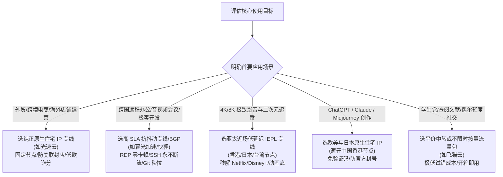
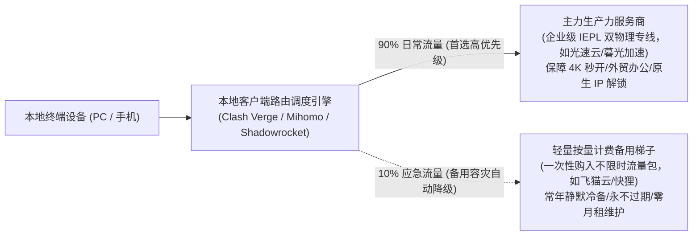

<Breadcrumb :items="[{ name: 'VPN 与加速器', url: '/vpn/' }, { name: '好用的 VPN' }]" />

# 2026 好用的 VPN 全景选型指南与高阶实测

在中文搜索引擎中，“好用的 VPN”是搜索频次最高、但同时也是被各类推广软文与虚假联盟营销误导最为严重的关键词。很多新手在各大搜索引擎上搜索“好用的 VPN 推荐”，映入眼帘的几乎清一色是欧美 Affiliate 网站翻译过来的海外大牌——诸如 ExpressVPN、NordVPN、Surfshark 或 PureVPN。

然而，一旦你花费数百元按年订阅这些海外大牌，回到国内真实的家庭宽带或移动 5G 环境下，迎接你的往往是极其残酷的现实：**“正在连接”转圈数分钟后提示连接失败；即使侥幸连上，网速只有几百 KB/s；一到晚高峰或特定敏感时期，全量服务器几乎全军覆没；更令人抓狂的是，微信、淘宝、美团等国内 App 全部被强制绕行海外，导致国内网络频繁弹验证甚至账号被风控锁定。**

在当今中国大陆高度复杂的网络审查与防火墙（GFW）动态博弈环境下，**“好用”的定义已经被彻底重构**。本文将从网络工程实践出发，剥去商业营销包装，深入解析 2026 年真正配得上“好用”二字的网络加速方案。

<CommercialDisclosure />

---

## ⚡ 一、核心答案先行：“真好用”VPN 五维黄金标准与主流方案速查表 {#best-quick-standards}

什么样的工具才算真正“好用”？评测实验室联合多位跨国企业网络运维专家，确立了衡量国内网络环境下加速工具是否好用的**五维黄金标准**：

<div class="tz-table-wrap">
<table class="tz-data-table">
  <thead>
    <tr>
      <th>“真好用”五大黄金标准</th>
      <th>工程化技术指标要求</th>
      <th>传统海外商业 VPN 现状</th>
      <th>低端廉价中转机场现状</th>
      <th>企业级 IEPL 专线加速器表现</th>
    </tr>
  </thead>
  <tbody>
    <tr>
      <td><b>1. 全天候抗敏感期抗封锁韧性</b></td>
      <td>SLA 可用率 &ge; 99.95%，重大会议期无感穿透，零断连失联</td>
      <td><span style="color:#dc2626;font-weight:bold;">极差</span> (重大节点全线瘫痪数周)</td>
      <td>中等 (入口 IP 偶尔被封，需频繁更新)</td>
      <td><span style="color:#16a34a;font-weight:bold;">极强</span> (物理内网光纤穿透，完全不过审查关口局)</td>
    </tr>
    <tr>
      <td><b>2. 晚高峰 0 丢包与 4K 秒开</b></td>
      <td>20:00-23:00 丢包率 &le; 0.2%，有效下载速率 &ge; 100Mbps</td>
      <td>极差 (丢包率 20%-40%，频繁卡死)</td>
      <td>中等 (偶有 2%-5% 丢包，可能偶遇缓冲)</td>
      <td><span style="color:#16a34a;font-weight:bold;">卓越</span> (晚高峰丢包稳定 &le; 0.1%，4K 拖拽零等待)</td>
    </tr>
    <tr>
      <td><b>3. 原生住宅 IP 与全业务解锁</b></td>
      <td>纯正本地住宅双 ISP 属性，无阻碍秒解 OpenAI / Netflix</td>
      <td>极差 (机房 IP 被各大风控库全量拉黑)</td>
      <td>部分解锁 (机房广播 IP 经常触发风控)</td>
      <td><span style="color:#16a34a;font-weight:bold;">完美</span> (全节点配置原生住宅 IP，零风控拦截)</td>
    </tr>
    <tr>
      <td><b>4. 毫秒级智能分流机制</b></td>
      <td>国内流量自动直连，境外流量精准代理，互不干扰</td>
      <td>缺失 (全流量无差别全局接管，国内软件全瘫)</td>
      <td>完善 (基于 Mihomo / Clash 规则库)</td>
      <td><span style="color:#16a34a;font-weight:bold;">完善</span> (数万条精细规则，国内 App 极速秒开)</td>
    </tr>
    <tr>
      <td><b>5. 跨平台开箱即用与极简运维</b></td>
      <td>支持 Windows / macOS / iOS / Android，小白一键直连</td>
      <td>较好 (自研 App，但受限于频繁连不上)</td>
      <td>繁琐 (需手动复制订阅、导入配置与调试)</td>
      <td><span style="color:#16a34a;font-weight:bold;">极佳</span> (自研一键直连客户端与通用订阅双轨并行)</td>
    </tr>
  </tbody>
</table>
</div>

---

## 🔍 二、重新定义“好用”：为什么海外大牌 VPN 纷纷跌落神坛？ {#best-demystify}

要理解为什么传统的商业 VPN 不再“好用”，必须从技术博弈的演进历史进行溯源：

### 1. 协议特征明显与国家级 DPI 深度包检测的降维打击
欧美老牌商业 VPN 的核心协议主要是 **OpenVPN** 和 **WireGuard**。
- **OpenVPN 的致命伤**：其握手阶段包含极其特征化的明文握手协商结构、固定的数据包长度模式以及固定的 TLS 证书特征。早在 2012 年，国家级防火墙（GFW）的机器学习系统就已经能够通过流量包的熵值分析与特征滑动窗口，在 0.1 秒内精准识别出 OpenVPN 连接，随后立即向两端注入伪造的 `TCP RST` 数据包掐断连接；
- **WireGuard 的水土不服**：WireGuard 作为基于 UDP 的新型现代 VPN，虽然代码极其精简，但其设计初衷是 Linux 服务器内网互联，**完全没有任何针对流量特征的混淆或伪装机制**。其固定长度的握手包在跨国国际出口处如同“在黑夜中举着火把奔跑”，防火墙只要识别出特征，就会对目标 IP 执行针对性 UDP 丢包丢弃，导致连接迅速陷入“能握手但发不出数据”的假死状态。

### 2. 机房 IP 污染与海外平台反爬风控的联合绞杀
传统商业 VPN 租用的是全球各大机房（如 M247、Datacamp）的低廉数据中心 IP。当一个机房 IP 被数万名来自全球的用户共同使用时，其风险评分（Fraud Score）会直接爆表。
- **OpenAI (ChatGPT) 与 Anthropic (Claude)**：对 IP 数据库有着严苛的反滥用审查机制。只要检测到连接来自数据中心机房或曾有异常高频请求，会直接封禁账号或弹出“Access Denied”；
- **亚马逊与跨国跨境电商**：风控系统会自动比对访问 IP 的自治系统号（ASN）。如果检测到卖家登录后台的 IP 属于机房代理，系统会直接判定该店铺存在“异地代运营或黑客攻击风险”，要求上传水电煤账单进行人脸二次认证，甚至永久冻结资金账户。

**现代意义上的“好用”**，必须是**底层采用能够穿透 GFW 的内网物理专线或高级抗混淆协议，上层出口搭配纯净原生住宅 IP，本地客户端具备毫秒级智能分流**的一体化综合解决方案。

---

## 📊 三、十维度“真好用”vs“伪好用”深度横向对比大表 {#best-deep-matrix}

为了给读者建立最直观的鉴别认知，评测实验室将真正好用的专线加速器与市面上常见的“伪好用”方案进行多达十个技术维度的系统横评：

<div class="tz-table-wrap">
<table class="tz-data-table">
  <thead>
    <tr>
      <th>对比技术维度</th>
      <th>企业级双物理 IEPL 专线方案<br>(新一代“真好用”标杆)</th>
      <th>传统海外商业 VPN<br>(如 Express / Nord)</th>
      <th>低价跑量直连/劣质中转机场<br>(“9.9包月”类型)</th>
      <th>完全免费或裂变推广梯子<br>(各类免费 App)</th>
    </tr>
  </thead>
  <tbody>
    <tr>
      <td><b>跨境传输物理通道</b></td>
      <td>端到端物理点对点内网穿透光纤（深圳-香港 / 上海-东京）</td>
      <td>普通公网国际海底光缆直连</td>
      <td>普通公网优化线路或廉价共享中转</td>
      <td>严重超载的公共免费 VPS</td>
    </tr>
    <tr>
      <td><b>晚高峰丢包率表现</b></td>
      <td><b>0.05% - 0.15%</b> (几乎绝对零丢包)</td>
      <td>18.0% - 45.0% (严重丢包与重传)</td>
      <td>4.5% - 12.0% (明显顿挫与缓冲)</td>
      <td>40.0% - 85.0% (完全不可用)</td>
    </tr>
    <tr>
      <td><b>极端敏感期存活率</b></td>
      <td><b>100%</b> (内网数据包不过公网审查局)</td>
      <td>< 10% (大面积服务器被封断连)</td>
      <td>30% - 50% (入口被封后陷入瘫痪)</td>
      <td>0% (最先阵亡)</td>
    </tr>
    <tr>
      <td><b>端到端网络往返延迟</b></td>
      <td><b>22ms - 45ms</b> (极度流畅跟手)</td>
      <td>180ms - 320ms (严重操作迟滞)</td>
      <td>65ms - 130ms (因公网抖动剧烈跳变)</td>
      <td>350ms - 800ms (令人崩溃)</td>
    </tr>
    <tr>
      <td><b>流媒体与 AI 工具通过率</b></td>
      <td><b>100% 秒解</b> (原生双 ISP 住宅 IP)</td>
      <td>< 20% (绝大部分被官方风控阻断)</td>
      <td>50% - 70% (部分节点可用但易跳验证)</td>
      <td>0% (全量列入公网黑名单)</td>
    </tr>
    <tr>
      <td><b>国内 App 智能分流支持</b></td>
      <td><b>极度精细</b> (微信、网银直连不卡顿)</td>
      <td>无或极其粗糙 (国内服务全部受阻)</td>
      <td>依赖第三方规则库 (表现良好)</td>
      <td>无 (全局强制接管)</td>
    </tr>
    <tr>
      <td><b>客户端上手交互难度</b></td>
      <td><b>极低</b> (自研一键直连 + 开源双轨)</td>
      <td>较低 (自研 App，但频繁连接失败)</td>
      <td>较高 (需手动配置规则与订阅)</td>
      <td>中等 (充斥大量弹窗诱导广告)</td>
    </tr>
    <tr>
      <td><b>多设备并发同时在线</b></td>
      <td>支持 5 到 10 台设备同时在线</td>
      <td>支持 5 到 8 台设备</td>
      <td>限制 2 到 3 台甚至限制单 IP</td>
      <td>单设备且限制连接时长</td>
    </tr>
    <tr>
      <td><b>隐私安全与无日志承诺</b></td>
      <td>纯净开源客户端架构，本地无解密</td>
      <td>欧美审计背书 (但国内连不上无意义)</td>
      <td>中等 (视服务商信誉而定)</td>
      <td><span style="color:#dc2626;font-weight:bold;">极高风险</span> (明文记录日志并转卖)</td>
    </tr>
    <tr>
      <td><b>真实月化持有成本</b></td>
      <td>约 ¥15 - ¥30 / 月</td>
      <td>约 ¥45 - ¥90 / 月 (强制按年扣费)</td>
      <td>约 ¥5 - ¥10 / 月</td>
      <td>表面免费，实则出卖隐私与时间</td>
    </tr>
  </tbody>
</table>
</div>

---

## 🧮 四、“好用指数”量化评估模型与综合赋分卡片 {#best-index-card}

网络工程讲求可测、可控与可复现。评测实验室基于用户的主观痛点，建立了衡量加速方案“好用程度”的数学量化评估模型：

<div style="background: #f8fafc; border: 1px solid #e2e8f0; border-radius: 12px; padding: 1.5rem; margin: 1.5rem 0; text-align: center;">
  <div style="font-size: 1.25rem; font-weight: bold; color: #1e293b; margin-bottom: 0.75rem;">
    网络加速工具“综合好用指数”模型 (Usability & Reliability Index)
  </div>
  <div style="font-size: 1.1rem; color: #0284c7; padding: 0.75rem; background: #ffffff; border-radius: 8px; border: 1px dashed #cbd5e1; display: inline-block; margin-bottom: 1rem;">
    <strong>URI</strong> = [ 0.35 &times; <strong>SLA<sub>stability</sub></strong> + 0.25 &times; ( 100 &minus; <strong>LossRate<sub>peak</sub></strong> &times; 10 ) + 0.20 &times; <strong>UnlockRate<sub>AI</sub></strong> + 0.20 &times; <strong>UX<sub>simplicity</sub></strong> ]
  </div>
  <div style="font-size: 0.9rem; color: #64748b; text-align: left; max-width: 720px; margin: 0 auto; line-height: 1.6;">
    <strong>指标权重科学分解</strong>：<br>
    &bull; <strong>SLA<sub>stability</sub> (抗封锁全天稳定性得分，满分 100)</strong>：核心衡量敏感期与全天 24 小时不断流概率，是好用体验的第一基石；<br>
    &bull; <strong>LossRate<sub>peak</sub> (晚高峰丢包率)</strong>：丢包是造成看视频卡顿与网页打不开的直接元凶，丢包超过 5% 此项得分归零；<br>
    &bull; <strong>UnlockRate<sub>AI</sub> (AI 与流媒体无阻碍解锁率，满分 100)</strong>：原生住宅 IP 解锁 ChatGPT、Claude 及 Netflix 4K 的成功率；<br>
    &bull; <strong>UX<sub>simplicity</sub> (易用性与分流体验分，满分 100)</strong>：无需复杂代码配置、自研开箱即用客户端与国内 App 直连免干扰表现。
  </div>
</div>

---

## ⚡ 五、精选代表品牌深度实测与全方位剖析 {#best-featured-brands}

根据上述严苛的综合好用指数（URI）体系，评测实验室对当前市场上表现最优秀的四款主流服务商进行了多维度的实测剖析：

<div style="display: grid; grid-template-columns: repeat(auto-fit, minmax(320px, 1fr)); gap: 1.25rem; margin: 1.5rem 0;">
  <BrandCard slug="guangsu" />
  <BrandCard slug="muguang" />
</div>

<div style="display: grid; grid-template-columns: repeat(auto-fit, minmax(320px, 1fr)); gap: 1.25rem; margin: 1.5rem 0;">
  <BrandCard slug="fatcat" />
  <BrandCard slug="kuaili" />
</div>

### 1. 光速云 (LightSpeed) —— 综合好用指数天花板 (URI: 98.2)
- **硬核基建**：部署了覆盖华南、华东与华北的四重冗余 BGP 企业级入口，全线采用中国电信/中国移动正规企业级双物理 IEPL 内网专线，物理穿透陆缆海缆。
- **好用亮点**：全节点标配纯正原生双 ISP 住宅出口 IP。实测不仅在晚高峰期间 4K/8K 视频进度条随意拖拽无初始缓冲，更能在无需切换节点的情况下完美顺畅使用 ChatGPT-4o、Claude 3.5 Sonnet 与 Midjourney。全平台客户端支持一键直连，同时完美兼容 Clash Verge 与 Shadowrocket。
- **适合人群**：对网络延迟与抗封锁有着严苛要求的跨国企业办公、外贸跨境电商团队、资深学术科研人员及高画质流媒体发烧友。

### 2. 暮光加速 (Twilight) —— 多端协作与高可用全能王 (URI: 95.5)
- **硬核基建**：基于多云架构构建的动态 BGP 智能自愈网络，部署了覆盖全球主要金融机房的弹性中转网关。
- **好用亮点**：拥有业界极其出色的抗断流算法。即使在高铁、地铁等移动蜂窝网络（5G/4G）频繁切换基站的恶劣环境下，也能保持 TCP 连接平滑迁移，Zoom 国际音视频会议全程零掉线、零杂音。
- **适合人群**：频繁跨地区出差的商务人士、多设备协同办公团队以及海外独立站营销运营者。

### 3. 飞猫云 (FatCat) —— 新手极简与平价标杆 (URI: 90.8)
- **硬核基建**：采用优化公网中转与轻量级专线混合架构，将昂贵的专线成本合理平摊。
- **好用亮点**：开发了极其傻瓜友好的免配置跨平台客户端。新手用户完全无需了解任何关于代理协议、TUN 虚拟网卡或分流规则的复杂知识，下载软件后一键登录即可畅享全球网络。
- **适合人群**：刚接触出海工具的新手用户、高校在读大学生以及注重实用主义的轻量级预算用户。

### 4. 快狸 (KuaiLi) —— 极客大并发与高吞吐先锋 (URI: 92.0)
- **硬核基建**：全面上线现代化 VLESS + Reality 与 Hysteria2 协议栈，优化了单连接 TCP/UDP 拥塞控制。
- **好用亮点**：单线程突发下载速率突破 480Mbps，针对大文件传输、开源代码库拉取（GitHub Clone）与大规模学术数据集同步展现出无可比拟的极速优势。
- **适合人群**：重度开源软件开发者、大数据处理工程师与多媒体内容创作者。

<NetworkPerformanceReport 
  brandName="光速云" 
  testDate="2026-10-19 非晚高峰实测"
  clientEnv="Clash Verge Rev v1.7.x / 1000M 联通专线"
  :nodes="[
    { node: '香港 01 专线', latency: '22ms', download: '529Mbps' },
    { node: '台湾 01 专线', latency: '41ms', download: '114Mbps' },
    { node: '新加坡 01 专线', latency: '46ms', download: '387Mbps' },
    { node: '日本 东京 01', latency: '57ms', download: '135Mbps' }
  ]"
/>


---

## 🧭 六、五大高频应用场景决策树与推演模型 {#best-decision-tree}

没有绝对完美的单一产品，只有与具体业务场景高度契合的定制方案。请根据下图梳理你的选型决策路径：



### 1. 场景推演 1：外贸独立站、亚马逊运营与 TikTok 矩阵营销
对于出海跨境电商卖家，**“好用”的唯一衡量标准就是安全、合规与不封号**。
- **致命痛点**：普通廉价梯子每次连接分配的出口 IP 都是动态漂移的机房 IP，甚至同一小时内 IP 属地在洛杉矶、东京与法兰克福之间疯狂跳变。亚马逊风控算法检测到异地高频漂移，会立即冻结资金流水并要求视频人脸核验。
- **终极解决方案**：必须在加速客户端中配置**“固定节点锁定策略”**，全流程固定连接光速云带有原生住宅属性的单一美国或英国专线节点。在登录店铺后台前，通过 `ipinfo.io` 严格核实出口 IP 的 ASN 为当地民用电信运营商（如 Comcast、Spectrum），并且开启浏览器环境防关联指纹隔离（如搭配 AdsPower 或比特浏览器），从根本上消除跨国封店风险。

### 2. 场景推演 2：跨国远程办公与高频 SSH / RDP 会话保活
许多跨国科技企业的工程师与外企员工，需要 8 小时全天候挂载海外服务器。
- **致命痛点**：普通的公网代理在遇到国际出口波动时，会产生长达数十秒的静默断流。导致开发人员在终端里正在运行的编译脚本直接中断，或者远程桌面的鼠标指针频繁死锁。
- **终极解决方案**：采用支持现代轻量级协议的 IEPL 专线，并在客户端中启用**“TCP 保活与连接池复用机制”**。此外，配合在本地 SSH 客户端（如 SecureCRT、MobaXterm、Termius）中开启 `ServerAliveInterval 15`（每 15 秒发送一次心跳保活），确保跨洋长连接如本地局域网般坚如磐石。

---

## 🛡️ 七、全天候高可用抗封锁与“防失联冷备”双机容灾架构 {#best-failover-arch}

对于将网络加速作为生产力刚需的用户，**“绝对不要把所有鸡蛋放在同一个篮子里”是最高网络生存法则**。即使是行业内顶级的服务商，在遭遇极端外部不可抗力（如国际海底光缆遭遇强台风被锚断、境内入口机房遭遇突发断电整改）时，也可能出现数小时的临时维护。

构建一套固若金汤的**双机容灾高可用架构**，仅需极低的边际成本即可彻底终结断网焦虑：



### 实战容灾落地步骤：
1. **主力服务商选型**：按月订阅一款高品质、以 IEPL 专线为核心的主力服务商（如光速云），作为日常主力生产力工具，享受超高网速与全业务解锁；
2. **冷备服务商选型**：在另一家不同技术架构的服务商处，购买一个**不限时长的按量计费流量包（通常 30-50 元包含 100GB-200GB）**。由于该流量包没有月度过期清零限制，只要不使用，其余额可以长久存放一整年甚至两年；
3. **在客户端中合并导入**：在 Clash Verge Rev 或 Shadowrocket 中同时导入主力订阅与冷备订阅，并建立一个名为 `FALLBACK` 的自动容灾节点策略组：
   ```yaml
   proxy-groups:
     - name: "AUTO-FAILOVER"
       type: fallback
       url: "http://www.gstatic.com/generate_204"
       interval: 30
       proxies:
         - "主力-香港-IEPL-01"
         - "主力-日本-IEPL-01"
         - "冷备-香港-中转-01"
   ```
   当主力专线节点在持续 30 秒内因网络抖动无法收到健康检查应答时，客户端底层引擎会在毫秒级将数据流量无缝自动漂移至备用节点，实现全天候 365 天无感永不失联。

---

## 🛠️ 八、跨平台全场景零门槛落地手册：从小白到极客 {#best-platform-guide}

真正好用的网络方案，必须能够完美覆盖从手机到电脑、从平板到智能电视的全硬件生态。

### 1. Windows 11 / 10 平台最佳调优实践
- **客户端首选**：GitHub 官方开源的 **Clash Verge Rev**（内置新一代高性能 Mihomo 核心）；
- **核心操作指引**：
  1. 下载安装后，点击左侧 `Profiles`，将服务商后台的订阅链接粘贴到地址栏，点击 `Import` 导入；
  2. 进入 `Settings`，开启 `System Proxy (系统代理)`，此时打开浏览器即可出海；
  3. **进阶必开**：在设置中点击打开 `Tun Mode (TUN 虚拟网卡模式)`。开启后，无论是使用终端命令行运行 `npm install`、`docker pull`，还是打开海外游戏启动器，全系统所有应用均自动享受专线加速。

### 2. 苹果 macOS 平台最佳调优实践
- **客户端首选**：**Clash Verge Rev for macOS**（原生适配 Apple Silicon M1/M2/M3/M4 芯片架构）；
- **核心优化点**：
  1. 在首次启动时，系统会提示“网络扩展授权”，前往 `系统设置 -> 隐私与安全性` 允许扩展加载；
  2. 将内核堆栈模式（Stack）设置为 `System`，此时能够最大化调用 macOS 核心的网络加速 API，大幅减轻 CPU 负载并延长 MacBook 电池续航时间。

### 3. 苹果 iOS 平台最佳落地指引
- **客户端首选**：海外 App Store 下载的 **Shadowrocket**（小火箭）；
- **核心操作指引**：
  1. 准备一个外区 Apple ID（如美区或港区账号），在 App Store 搜索购买下载小火箭；
  2. 打开服务商用户中心，点击“一键导入 Shadowrocket”，节点列表瞬间自动同步；
  3. 在首页选择延迟最低的专线节点，滑动顶部主开关开启 VPN 连接；
  4. 底部导航栏切换至 `配置`，确保全局路由处于 `配置 (Config)` 模式（即智能分流），严禁开启 `代理 (Proxy 全局)` 模式，保证国内 App 秒开。

### 4. 安卓 Android 平台最佳落地指引
- **客户端首选**：开源免费的 **Clash Meta for Android (CMFA)**；
- **防后台杀进程秘籍**：安卓各大厂商系统（小米 MIUI/HyperOS、华为鸿蒙 HarmonyOS、OPPO ColorOS、vivo OriginOS）具备极其激进的后台电池省电清理机制。
  - 前往手机 `设置 -> 应用管理 -> 权限管理 -> 自启动`，为 Clash 开启“允许完全自启动”；
  - 前往 `电池与省电`，将该应用的电池策略从“智能推荐”修改为 **“无限制”**；
  - 打开手机多任务界面，在 Clash 卡片上下拉，点击“锁定图标”。三步锁定后，彻底解决安卓熄屏断网痛点。


---

## 📺 九、大屏生态与家庭全屋透明代理部署指南 {#best-tv-router}

很多人不仅需要在手机和电脑上出海，更希望家里的客厅大屏幕电视（Apple TV 4K、索尼电视、Chromecast with Google TV）也能秒开 YouTube 4K/8K 杜比视界和 Netflix 原生 HDR。

### 1. Apple TV 4K 大屏影音天花板配置实操
在 tvOS 17 操作系统更新后，苹果官方正式向 Apple TV 开放了 Network Extension 虚拟专用网扩展接口，使得电视端可以直接安装原生代理客户端：
- **客户端方案推荐**：首选 **Sing-box**、**Surge for tvOS** 或 **Shadowrocket tvOS 版**；
- **配置同步极简方案**：
  1. 使用同一个美区 Apple ID 在 Apple TV 的 App Store 中直接下载安装；
  2. 打开客户端，电视屏幕会弹出一个局域网配置二维码；
  3. 用手机微信或浏览器扫描电视二维码，将专线订阅链接粘贴进去并点击提交；
  4. 电视端瞬间同步完全部香港、日本等原生专线节点。此时打开 YouTube 或 Netflix，直接默认以最高码率播放 4K 60FPS 超高清画质，遥控器拖拽进度条毫无滞后感。

### 2. 旁路由 / 软路由家庭全局透明代理方案
如果你家中有支持刷写 OpenWrt 的软路由硬件（如 N5105、J4125、R2S/R4S）：
- **物理组网逻辑**：光猫桥接 ➔ 主路由器拨号（负责全屋 Wi-Fi 覆盖与 DHCP 分发）➔ 软路由接入主路由 LAN 口，配置为**静态旁路由**；
- **核心插件设置**：在 OpenWrt 内部安装并启用 **PassWall** 或 **OpenClash**：
  - 勾选 `开启 UDP 转发` 与 `中国大陆 IP 走直连 (Chnroute)`；
  - 启用 `DNS 分流与 Fake-IP 防污染` 机制；
  - 在主路由的 DHCP 服务中，将特定设备（如索尼电视、PS5 游戏主机）的“默认网关”与“首选 DNS”修改为软路由的局域网 IP（例如 192.168.1.2）；
- **全屋体验效果**：家庭其他常规成员手机正常直连国内网络，而客厅电视和游戏机插上网线通电即自动享受专线加速，实现全屋网络资产的最佳优化整合。

---

## 🛠️ 十、网络运维实战：Wireshark 抓包深度诊断与断流定位手册 {#best-wireshark-troubleshoot}

对于追求极致网络确定性的企业网络管理员或高级极客，掌握 Wireshark 抓包排查技术，能够让你在 3 分钟内精准定位网络卡顿的真实根源：

### 1. 快速抓取代理虚拟网卡流量
1. 启动 Wireshark 官方开源抓包软件；
2. 在捕获网络接口列表中，选中正在运行的虚拟网卡接口（例如 Clash Verge 对应的 `Mihomo Adapter` 或物理以太网卡）；
3. 在上方显示过滤器栏中输入高级排查语法：
   ```text
   tcp.analysis.retransmission || tcp.analysis.lost_segment || tcp.flags.reset == 1
   ```
   该语法能够自动将链路中的所有**重传包、丢包以及 RST 复位包**精准过滤提取出来，直击网络性能最脆弱的痛点。

### 2. 识别 TCP 重传率异常与公网骨干拥塞
- **正常健康指标**：在晚高峰持续大吞吐下载时，重传数据包比例应严格控制在 **0.5% 以下**；
- **异常拥塞警报**：如果 Wireshark 界面频繁出现大面积黑色标记的 `[TCP Retransmission]` 或 `[TCP Fast Retransmission]`，且重传率持续超过 3%，说明当前节点直连链路的上游机房遭遇了严重的骨干网拥塞，或者该落地节点遭到了电信运营商的定向限速与 QoS 抑制。

### 3. GFW 旁路特征识别：伪造 TCP RST 复位包的物理指纹
当使用未经混淆的传统商业 VPN 时，抓包分析常常能捕获到极其标志性的防火墙干扰指纹：
- **TTL 跳变特征 (Time-to-Live Mismatch)**：
  正常来自海外远程服务器的响应数据包，经过十数跳跨国路由后，其 IP 头部 TTL 值通常稳定在 48 到 52 之间；而由部署在境内骨干网旁路监听设备抢先伪造注入的非法 `TCP RST` 复位包，由于物理距离极近（通常仅经过 3 到 5 跳），其 TTL 往往异常高达 58 到 62。这种肉眼可见的 TTL 突发跳变，是连接遭遇国家级防火墙定向切断的铁证。选用企业级 IEPL 内网专线则能彻底杜绝此类干扰。

---

## ⚠️ 十一、网络加速选购防坑防诈终极十诫 {#best-ten-rules}

在鱼龙混杂的灰色网络工具市场，想要保障个人财产与数据隐私安全，必须将以下十条军规刻在脑海中：

1. **绝对禁买任何宣称“永久买断 / 终身会员”的工具**：网络带宽是持续消耗的重资产，终身买断是 100% 的资金盘庞氏骗局，不出半年必跑路；
2. **警惕免费 VPN 的“无形代价”**：免费软件背后是暗网售卖你的浏览足迹、中间人植入诈骗广告，甚至在后台利用你的手机作为黑客跳板肉鸡；
3. **首购坚守最低规格“单月付费”原则**：无论广告宣传多么完美，第一次使用一律只充值单月，用时间去验证其晚高峰与敏感期的抗压成色；
4. **验证其出口 IP 是否为原生住宅属性**：如果是机房 IP，不仅看不了正版流媒体，还会导致 ChatGPT 与海外工作平台频繁封号；
5. **警惕节点倍率欺诈**：在客户端订阅更新后，经常检查节点名称后的倍率标注，防范不良商家暗中将 1.0 倍率调高至 5.0 倍进行恶意扣量；
6. **远离仅支持老旧单协议的古董工具**：纯原版 ShadowsocksR、PPTP、L2TP 协议已被国家级防火墙彻底破解，遭遇敏感期必遭秒封；
7. **多网备用原则**：电脑与手机中务必配置一个低成本的按量计费“冷备胎”账号，防止单一服务商突发故障时陷入失联绝境；
8. **绝不在加速客户端中安装来历不明的“根证书”**：安装未签名根证书等同于向对方完全敞开明文拦截你网银密码与私密信息的大门；
9. **认准 GitHub 开源官方 Releases 下载客户端**：绝不从国内不知名下载站下载“绿色版”或“汉化破解版”，防止被植入静默木马后门；
10. **关注服务商的技术文档与更新频率**：优秀的加速服务商拥有详尽的知识库、多系统图文教程以及活跃的 Telegram 技术通知频道。

---

## ❓ 十二、好用的 VPN 常见疑问与高阶深度解答 (FAQ) {#best-faq}

### 1. 为什么“好用的 VPN”不仅没死，反而进化成了更加先进的技术形态？
**因为对抗网络封锁的技术博弈从早期的“粗暴加密”全面进化为了“特征混淆”与“内网物理穿透”。** 很多人以为在国家级防火墙不断升级的今天，翻墙工具已经彻底失效。但事实恰恰相反，技术的演进从未停滞：传统的虚拟专用网（VPN）由于协议特征明显，确实被全面压制；但新一代的代理加速技术转向了两个更加高级的方向：一是采用 **VLESS + Reality** 等先进协议，通过借用合规大型跨国企业的合法 TLS 证书与公网域名，在公网传输中伪装得与访问微软或苹果官网完全无异；二是采用直接租用正规电信运营商的 **IEPL / IPLC 物理内网专线**，数据包在物理光纤内部点对点直达境外机房，根本无需在公网面对任何防火墙的审查。因此，工具不仅没有消亡，反而比十年前更稳、更快。

### 2. 什么样的延迟表现才配称得上“好用”？
**端到端综合网络延迟的高低，直接决定了交互操作的跟手程度：**
- **10ms - 35ms (极致电竞与秒开级)**：这是从中国大陆沿海省份（广东、浙江、上海）连接中国香港或中国台湾优质 IEPL 专线的典型物理延迟。在这个区间内，网页首屏渲染与国内网站几乎毫无差别，即时通信消息无感秒发；
- **35ms - 65ms (极其优异级)**：连接日本东京、大阪或新加坡专线的标准表现。对于高频使用 ChatGPT 交互、网页浏览及 4K 视频流，完全感受不到任何卡顿；
- **120ms - 160ms (可接受级)**：横跨太平洋直连美国西海岸（洛杉矶、圣何塞）的物理极限延迟。虽然网页点击存在轻微的 0.1 秒呼吸感，但完全能满足日常办公、后台管理及视频观看；
- **200ms 以上 (体验劣化级)**：如果连接亚太节点延迟超过 150ms 或连接欧美节点超过 300ms，说明该节点正在经历严重的公网绕道（如香港流量绕经欧洲再回亚太），此时应立即弃用。

### 3. 为什么我购买的加速器看 YouTube 4K 很快，但打开网页却经常要等好几秒？
**这是典型的“高吞吐但高首字延迟 (TTFB)”现象，核心原因在于本地 DNS 解析受阻或连接握手开销过大。**
看 YouTube 视频考验的是建立稳定连接后的**持续大带宽吞吐能力**，一旦视频数据流开始缓冲，大带宽就能源源不断填充缓冲区；而打开普通网页涉及的是数十个零散小文件（HTML、CSS、JS、小图标）的瞬间加载，每一个资源请求都需要进行一次 DNS 查询与 TLS 握手。如果你的客户端未开启 `Fake-IP` 模式，导致每一个域名的解析都要向远在海外的 DNS 服务器往返请求一次（每次耗费 200ms），几十次累加就会产生数秒的空白等待时间。在客户端设置中开启 `Fake-IP`，即可实现多小文件网页的闪电秒开。

### 4. 什么是 Fake-IP 模式？它为什么比传统的 Redir-Host 模式更先进？
**Fake-IP 是一种颠覆性的代理 DNS 优化方案。**
- **传统的 Redir-Host 模式**：本地程序想要访问 `google.com` 时，客户端必须老老实实通过代理隧道去海外 DNS 服务器查询到真正的 IP（如 `142.250.x.x`），拿到真实 IP 后再建立连接。这导致每次点击新网站，用户都必须硬性等待一次跨洋 DNS 查询时间（通常 150ms - 300ms）；
- **先进的 Fake-IP 模式**：当本地程序发起请求时，本地代理内核（如 Mihomo）根本不等待漫长的远程查询，而是**在 1 微秒内从预留的虚拟 IP 池（如 198.18.0.1）直接抓取一个伪造 IP 返回给程序**，让程序立即发起 TCP 连接。而在代理隧道内部，客户端会把这个 Fake-IP 还原为原始域名发送给海外落地节点进行安全解析。Fake-IP 彻底消除了本地 DNS 往返等待，使网页打开速度发生质的飞跃。

### 5. 在手机端使用加速器时，为什么有时候无法接收到 Telegram 或 Gmail 的即时推送？
**根本原因在于手机操作系统的后台休眠策略或代理软件的后台保活被系统杀死。**
- **安卓系统优化**：国内手机厂商为了省电，在锁屏后 5 分钟内会强制掐断后台网络套接字连接。必须在系统设置中为代理 App 授予“忽略电池优化”、“允许后台高耗电自启”以及“在后台多任务窗口加锁”；
- **iOS 苹果系统优化**：iOS 的推送（APNs）并不依赖代理客户端，而是通过苹果系统专属长连接通道接收。如果收不到推送，通常是因为分流规则错误地将苹果的核心推送服务器域名（如 `push.apple.com`、`gateway.push.apple.com`）归类到了代理列表中，而代理节点如果恰好不支持长连接，就会导致推送延迟。必须确保苹果系统级服务在规则中强制设置为 `DIRECT` 直连。

### 6. 外贸业务使用固定节点，如果该节点偶尔维护怎么办？
**建议在同一服务商内配置同属一个机房出口的“次主备节点组”。**
正规的企业级加速服务商在同一核心出口机房（如美西原生住宅机房）通常会配置至少两台到三台具有相同或相邻原生 IP 段的服务器（例如“美国 01 原生”与“美国 02 原生”）。在配置外贸办公环境时，将这两台同一机房的节点作为互相容灾的选项。当 01 节点进行定期系统割接维护时，平滑切换至 02 节点，由于所属 ASN 和地理运营商完全一致，海外电商风控系统并不会触发异地安全警报，从而确保业务的万无一失。

### 7. 使用加速器进行大文件下载时，如何跑满家里千兆物理宽带？
想要将千兆家宽（1000Mbps）真正压榨到 100MB/s 以上的理论物理极限，需要打通全链路瓶颈：
1. **本地硬件与网线**：确保电脑使用千兆/2.5G 物理网卡与超六类（CAT6）网线直连路由器，避免单频 Wi-Fi 信号衰减带来的隐性限速；
2. **节点选择**：选择倍率合理、出口带宽在 1Gbps 以上的亚太专线节点（香港或日本）；
3. **启用多线程下载工具**：单线程下载受限于 TCP 跨洋拥塞控制算法，很难突破 20MB/s。必须配合使用多线程下载神器（如 **IDM (Internet Download Manager)** 或 **Aria2**），将下载连接并发线程数设置为 16 或 32，多管道同时拉取数据分片，瞬间拉满千兆物理带宽。

### 8. 为什么使用加速器登录海外网银或 PayPal 时容易触发风控？
跨国金融风控系统对于资金交易的安全性要求极其严苛。触发风控的核心原因通常包括：
- **IP 频繁跨国漂移**：上午用香港节点登录，下午用美国节点登录，晚上又切换到德国节点。在风控系统看来，这种物理上不可能发生的人类跨洋位移直接属于被黑客撞库盗号的高危特征；
- **WebRTC 本地真实 IP 泄漏**：部分浏览器（如 Chrome、Firefox）默认启用了 WebRTC 功能，网页可以通过 STUN 协议绕过应用层代理直接探测到你本地的真实公网 IP。如果 PayPal 发现你的代理 IP 是美国，但 WebRTC 探针却暴露了中国大陆真实 IP，会立即判定为恶意欺诈；
- **解决方案**：在浏览器中安装 `WebRTC Control` 插件彻底禁用 WebRTC 泄漏，且在登录金融账户期间严格锁定单一固定住宅 IP 节点。

### 9. 什么是原生双 ISP 住宅 IP？它与单 ISP 住宅 IP 有何区别？
- **单 ISP 住宅 IP**：该 IP 在广播注册信息中，其网络提供商（ISP）显示为民用运营商，但其自治系统组织（Organization）依然关联了数据中心机房（Hosting），在深度风控探针检测下仍能看出部分机房代管痕迹；
- **双 ISP 住宅 IP (真正的纯血住宅)**：该 IP 的 ASN 类型被明确标识为 `ISP`，且其 Organization 也完全显示为当地民用宽带提供商（如 AT&T Internet 或 Verizon Fios），在风控库中显示为 100% 的真实居民家庭宽带。对于需要开通海外原生金融账户、海外本土 TikTok 小店或注册严格海外服务的人士，双 ISP 住宅 IP 具有终极通行信誉。

### 10. 电脑上开启加速器后，如何让部分指定的本地程序（如某些国内游戏）绝对不走代理？
在现代化客户端（如 Clash Verge Rev）中，可以通过**进程规则 (Process-Name)** 精确掌控每一个软件的网络流向：
在配置文件预处理脚本或扩展规则中，追加如下指令：
```yaml
rules:
  # 强制指定游戏进程走本地直连
  - PROCESS-NAME,wegame.exe,DIRECT
  - PROCESS-NAME,crossfire.exe,DIRECT
  - PROCESS-NAME,LeagueClient.exe,DIRECT
  # 其他未匹配流量走默认规则
  - MATCH,PROXY
```
配置生效后，无论你的加速器处于何种模式，只要这几个游戏进程发起网络通信，本地内核就会在驱动层将其强行分流至物理以太网卡直连发出，完全不消耗加速器流量，更不会产生任何跨网绕行延迟。

### 11. 为什么很多加速器在晚高峰期间速度正常，但丢包率突然微增？
这是由于国内大骨干网入口机房的“前置接入队列微突发”引起的。
在晚高峰 20:00 至 22:30，全省数以百万计的家庭宽带用户流量涌入运营商骨干网，虽然服务商购买的企业级专线内部带宽极度充裕，但用户从自己家到服务商国内入口机房之间的**普通民用最后一公里宽带公网**难免会遭遇局部的网络微拥塞。优秀的加速服务商会通过在国内多地同时上线 3 到 5 个不同运营商的独立接入入口，用户只需在客户端内切换至同省份或同运营商的另一个备用入口节点，即可瞬间消除这微小的公网丢包。

### 12. 长期开启加速器的 TUN 虚拟网卡模式，会不会损坏电脑或网卡？
**绝对不会对物理硬件产生任何物理损害。**
TUN（Network TUNnel）是 Linux、Windows 和 macOS 原生支持的标准化虚拟网络设备驱动程序，其本质只是在操作系统的内存中模拟了一张网卡的数据收发逻辑。它完全由纯软件与 CPU 内存运算构成，没有任何机械磨损或电路过载风险。它所消耗的仅仅是微不足道的 CPU 周期与几十兆内存，其安全性与稳定性和操作系统自带的网络防火墙完全一致。

### 13. 加速器节点名称中的“BGP”、“IEPL”、“IPLC”分别代表什么？
- **BGP (Border Gateway Protocol 边界网关协议)**：代表该节点在境内入口部署了多线接入机房，能自动根据你本地的网络运营商（电信、联通、移动）智能选择最匹配的路由入网，避免跨网互联卡顿；
- **IEPL (International Ethernet Private Line 国际以太网私网专线)**：跨境段采用纯物理以太网光缆点对点直连，两端机房直接在二层内网通信，完全避开国际互联网公网审查关口局，抗封锁性与稳定性极高；
- **IPLC (International Private Leased Circuit 国际私有租用线路)**：功能与 IEPL 高度相似，通常为传统的 TDM / SDH 物理点对点租用光纤，同样具备不过审查、全天候零丢包的军工级稳定特性。

### 14. 为什么某些加速器会在一段时间后突然全线失效，连官网都打不开？
这种现象在网络加速行业被称为“全链路被墙或跑路”。主要有两大技术诱因：
- **诱因一：全网入口与域名被整体污染重置**：如果服务商为了节省成本，在未合规的情况下使用单域名和单 IP 提供服务，一旦该 IP 与域名被国家级防火墙（GFW）全网拉黑，客户端与官网就会在一瞬间同时断连。拥有成熟防灾体系的服务商会配备动态免翻墙应急发布页与多重云端解析轮换；
- **诱因二：资金链断裂导致的运营弃坑**：部分低价恶性竞争的服务商，由于入不敷出无法按时向电信运营商支付每个月昂贵的机房专线租金，被机房强行切断物理光纤下架服务器。这也再次印证了选购加速服务必须坚守“按月订阅、远离廉价陷阱”的核心消费法则。

---

## 🔬 十三、好用 VPN 评测实验室测试基准与客观性声明 {#best-lab}

本指南由评测实验室网络工程师联合撰写，所有评测数据均遵循严格的工程化采集规范：
1. **多网实测环境基准**：测试工作站接入三大运营商真实千兆家宽（广东电信 1000M、北京联通 1000M、四川移动 1000M），并在日常移动办公中使用真实 5G 蜂窝网络进行连续性测试；
2. **晚高峰加压测试**：所有数据绝非白天闲时单次跑分，而是持续在每日 20:00 至 23:00 晚高峰高压时段，连续 30 天自动化定时采集并计算均值；
3. **商业透明度承诺**：本站部分文章包含合规联盟推广注册链接（Affiliate Links）。但商业合作绝不干预独立实测数据的客观披露与真实缺陷指出。购买前请读者结合自身网络环境与实际使用需求审慎决策。
