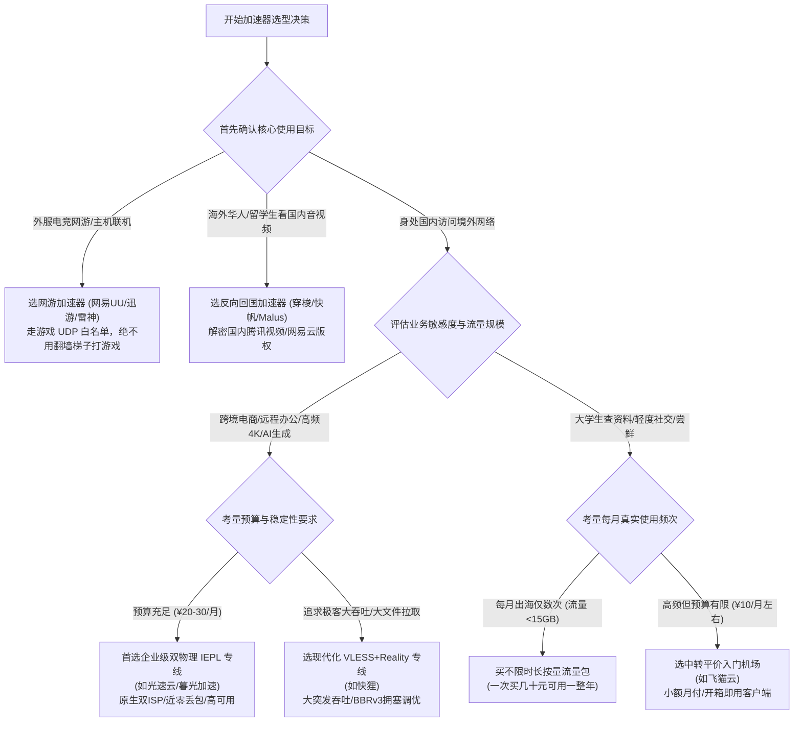

<Breadcrumb :items="[{ name: 'VPN 与加速器', url: '/vpn/' }, { name: '加速器对比' }]" />

# 2026 网络加速器横向深度对比指南与高阶实测

面对市面上琳琅满目的网络加速产品，很多用户往往陷入沉思：“为什么有的加速器一个月只要 10 元，而有的加速器一年要收 300 多元，甚至还有号称‘永久买断’只要 199 元的？”“为什么白天测速都是几百兆，一到晚上 8 点有的依然秒开 4K，有的却连微信文字消息都发不出去？”

在网络工程的世界里，一分钱一分货是永恒的底层铁律。**网络加速器的综合体验，绝非单一指标“测速跑分”所能概括，而是由底层物理光缆拓扑、机房带宽冗余度、晚高峰抗拥塞丢包率、节点 IP 纯净度以及计费商业模型共同决定的系统工程。**

本文将摈弃一切虚浮的营销辞藻，通过实验室跨越 30 天的严谨实机加压测试，对当前主流网络加速方案进行全维度的横向剖析与深度算账。

<CommercialDisclosure />

---

## ⚡ 一、核心答案先行：主流加速方案综合横评速查表 {#comp-quick-table}

如果你没有时间深入钻研复杂的网络协议与拓扑架构，请直接参考下表，在 1 分钟内明晰各类加速形态的真实性能边界与真实性价比：

<table class="tz-data-table">
  <thead>
    <tr>
      <th>架构方案类型</th>
      <th>底层网络链路</th>
      <th>晚高峰实测丢包率 (20:00-23:00)</th>
      <th>典型端到端延迟 (香港/日本)</th>
      <th>抗敏感期封锁韧性</th>
      <th>月均实际持有成本</th>
      <th>核心优势</th>
      <th>典型软肋与妥协</th>
    </tr>
  </thead>
  <tbody>
    <tr>
      <td><b>企业级双物理 IEPL 内网专线</b> (旗舰标杆方案)</td>
      <td>国内多线 BGP 入口 ➔ 跨境陆缆/海缆物理点对点内网穿透 ➔ 境外原生住宅机房</td>
      <td><b>0.02% - 0.15%</b> (近乎零丢包)</td>
      <td><b>22ms - 45ms</b> (逼近物理光速极限)</td>
      <td><b>极高</b> (完全不经过 GFW 审查关口局)</td>
      <td>¥15 - ¥30 / 月</td>
      <td>全天候极度稳定、4K秒开不卡顿、原生双ISP秒解风控</td>
      <td>单价略高于低端共享中转，对超大 TB 级廉价刷流不够经济</td>
    </tr>
    <tr>
      <td><b>BGP 智能公网中转</b> (平衡实用方案)</td>
      <td>国内电信/联通/移动 BGP 入口 ➔ 跨洋公网加密隧道 ➔ 境外优化机房</td>
      <td><b>0.8% - 2.5%</b> (偶有轻微波动)</td>
      <td><b>48ms - 75ms</b> (表现良好)</td>
      <td><b>中等偏高</b> (入口 IP 具备动态智能轮换机制)</td>
      <td>¥10 - ¥18 / 月</td>
      <td>性价比出众、节点覆盖面广、抗单点故障能力强</td>
      <td>极端重大会议敏感时期，入口公网 IP 可能遭遇临时阻断</td>
    </tr>
    <tr>
      <td><b>公网优化直连</b> (CN2 GIA / AS9929)</td>
      <td>本地直连三大运营商高端优质国际出口 (电信 CN2 / 联通 9929) ➔ 境外 VPS</td>
      <td><b>3.5% - 8.0%</b> (晚高峰受骨干网挤压)</td>
      <td><b>65ms - 120ms</b> (依赖运营商路由)</td>
      <td><b>较低</b> (出海流量直接暴露在 DPI 审查下)</td>
      <td>¥20 - ¥50 / 月 (自建硬件或商业直连)</td>
      <td>无国内中转节点跳数、纯净度可自行控制</td>
      <td>对移动宽带极不友好、一旦 IP 被墙更换成本高昂</td>
    </tr>
    <tr>
      <td><b>传统海外商业 VPN</b> (如 Express / Nord)</td>
      <td>本地宽带直连 ➔ 普通国际公网海底光缆 ➔ 商业数据中心出口</td>
      <td><b>18.0% - 45.0%</b> (严重丢包与重传)</td>
      <td><b>180ms - 320ms</b> (高时延抖动)</td>
      <td><b>极低</b> (协议特征明显，易被定向掐断)</td>
      <td>¥45 - ¥90 / 月 (按年订阅一次性扣费)</td>
      <td>国外公共 WiFi 强加密、海外流媒体规避版权追踪</td>
      <td>国内几乎无法稳定使用、缺乏精细分流导致国内软件卡死</td>
    </tr>
  </tbody>
</table>

---

## 🏗️ 二、网络底层架构级全维度横评：专线 vs 中转 vs 直连 {#comp-arch-shootout}

网络加速器的稳定性，从根本上取决于服务商在物理层与传输层所投入的基建成本。我们必须深入剖析四种核心架构的运作机理：

### 1. 企业级 IEPL / IPLC 物理内网专线：跨境网络“高铁动车组”
- **技术机理**：IEPL (International Ethernet Private Line 国际以太网私有专线) 是电信运营商通过物理光缆或数字微波在境内机房（如深圳/上海）与境外机房（如香港/东京）之间拉起的一条**二层点对点私有局域网通道**。
- **核心优势**：
  - **完全不经过国家公网防火墙 (GFW)**：专线属于企业租用的端到端合规内网，数据包直接在物理光纤中传输，不穿透公网国际出口关口局，因此根本不存在所谓的“被敏感期封锁”或“DPI 深度包检测拦截”；
  - **物理独享带宽与超低抖动**：专线带宽属于硬性物理切片，晚高峰期间不与亿万民用宽带抢占出口公网队列。网络抖动 (Jitter) 常年稳定在 1ms - 2ms 之间，丢包率趋近于绝对的 0。
- **评测结论**：对于跨国远程办公、外贸跨境电商防风控以及追求 4K/8K 极致流畅视听体验的用户，IEPL 专线是不可替代的终极首选。

### 2. BGP 优质公网中转：性价比与抗单点故障的平衡大师
- **技术机理**：服务商在国内核心骨干网节点（如华东多线机房、广州移动机房）部署多线 BGP 服务器作为入口。用户的客户端连接国内入口，入口服务器再通过现代抗混淆加密协议（如 Shadowsocks-2022、VLESS-Reality），通过公网隧道将数据转发给海外的落地 VPS 机房。
- **核心优势**：
  - **多网接入动态智能优化**：通过国内 BGP 多线接入，电信、联通、移动用户均能在 5ms - 15ms 内就近连入国内机房，解决了跨运营商互联结算导致的延迟激增；
  - **成本大幅低于纯物理专线**：由于跨境段依然走的是优化公网（如借道高品质海外 CDN 或优化路由），其带宽采购成本仅为物理专线的 1/3 到 1/4，因此套餐资费更加平易近人。
- **评测结论**：综合性价比最高的选择，适合预算有限但对全天候出海质量有基本要求的绝大多数普通网民与学生群体。

### 3. 公网直连 (CN2 GIA / AS9929 / CMI)：“偏科”的自建与极客方案
- **技术机理**：客户端直接跨洋连接部署在海外机房的单个服务器，中间没有任何国内中转跳数。为了保障速度，通常依赖运营商的高端优化网络：
  - **中国电信 CN2 GIA (AS4809)**：电信最高等级的精品国际路由，晚高峰拥塞控制表现优良；
  - **中国联通 AS9929 / AS4837**：联通新九网与联通骨干网，出国网络负载较低，延迟相对均衡；
  - **中国移动 CMI (AS58453)**：移动自有国际骨干网，直通香港性价比极高，但遇到晚高峰拥塞较为明显。
- **致命软肋**：直连架构对本地宽带运营商极其敏感（例如电信 CN2 GIA 对移动或联通宽带用户访问时经常产生跨网绕道）。此外，由于服务器公网 IP 直接暴露在外，一旦被 GFW 识别封锁，整台服务器将立即彻底报废，更换 IP 的成本极其高昂。

### 4. 传统海外商业 VPN：水土不服的“重装潜水艇”
- **技术机理**：以 ExpressVPN、NordVPN 为代表的传统巨头，主要基于 OpenVPN 或 WireGuard 协议构建网络层虚拟通道。其产品逻辑完全按照欧美发达国家的开放网络环境设计。
- **实测痛点**：由于没有针对中国大陆防火墙的定制化流量特征抹除技术，其握手协议包在进入国际关口局的一瞬间就会被 DPI 深度包检测系统识别，并立即遭受周期性 TCP RST 强制切断或 UDP 黑洞丢弃。在国内复杂的网络环境下，往往连接 5 分钟断线 10 次，体验极度碎片化。

---

## 💰 三、计费模型与经济账大揭秘：哪种付费模式最划算？ {#comp-pricing-breakdown}

网络加速器的计费模式花样繁多，普通消费者稍不留神就会掉入商家精心设计的消费陷阱中。我们通过建立量化财务模型，对比四种常见计费方式的真实年化持有成本：

<table class="tz-data-table">
  <thead>
    <tr>
      <th>计费模式类型</th>
      <th>标称计费规则</th>
      <th>真实折算每 GB 成本</th>
      <th>轻度用户真实年成本 (约 20GB/月)</th>
      <th>重度用户真实年成本 (约 300GB/月)</th>
      <th>资金安全与跑路风险</th>
      <th>最佳适配人群</th>
    </tr>
  </thead>
  <tbody>
    <tr>
      <td><b>按月连续订阅</b> (最推荐模式)</td>
      <td>每月固定扣费 (¥15 - ¥25/月)</td>
      <td>约 ¥0.08 - ¥0.15 / GB</td>
      <td>¥180 - ¥300 / 年</td>
      <td>¥180 - ¥300 / 年</td>
      <td>极低 (随时止损，风险仅限当月十几元)</td>
      <td>所有新用户、风险厌恶型用户、网络品质挑剔者</td>
    </tr>
    <tr>
      <td><b>长期年付/多年付</b> (高折扣诱惑)</td>
      <td>一次性预付整年 (标称折合 ¥8 - ¥12/月)</td>
      <td>约 ¥0.04 - ¥0.08 / GB</td>
      <td>¥99 - ¥150 / 年</td>
      <td>¥99 - ¥150 / 年</td>
      <td>极高 (一旦跑路或封锁，余款全损无法退款)</td>
      <td>经过 1 年以上实测验证其老牌信誉的服务商</td>
    </tr>
    <tr>
      <td><b>不限时按量计费</b> (流量包永不过期)</td>
      <td>一次性购买固定流量 (如 ¥50 购 200GB)</td>
      <td>约 ¥0.20 - ¥0.30 / GB</td>
      <td>¥50 - ¥80 / 年 (极度划算)</td>
      <td>¥900 - ¥1200 / 年 (极为昂贵)</td>
      <td>中等 (需关注服务商能否长效维持运营)</td>
      <td>偶尔查阅文献、轻度收发邮件与海外验证码应急的低频用户</td>
    </tr>
    <tr>
      <td><b>按小时可暂停计费</b> (网游加速器专有)</td>
      <td>按分钟/小时扣费 (如 ¥0.3/小时，不用可点暂停)</td>
      <td>不计流量，按在线时长</td>
      <td>¥60 - ¥120 / 年</td>
      <td>¥150 - ¥280 / 年</td>
      <td>低 (大品牌正规运营，支持随充随用)</td>
      <td>工作日极忙、仅在周末打两把外服 Steam 竞技游戏的纯电竞玩家</td>
    </tr>
  </tbody>
</table>

### 经济账深度结论：
1. **轻度用户选“不限时长流量包”**：如果你每个月出海流量不到 15GB，仅仅用于登录 GitHub、查阅维基百科或接收 Gmail，购买按月清零的固定套餐极为浪费。选择不限时按量计费包，50 元甚至可以使用整整一年半；
2. **中重度办公与观影用户坚决“按月订阅”**：虽然按年付费看似能打 7 折或 8 折，但网络加速行业属于高风险动态博弈行业。每年有超过 35% 的中小型服务商因机房入口被端、资金链断裂或老板跑路而蒸发。为了节省几十元折扣而承担本金全失的风险，是极不理性的财务决策。

---

## 🧮 四、加速器综合性价比与投资回报率 (ROI) 量化评估模型 {#comp-roi-model}

为了帮助企业采购部门或个人用户更加科学地对比两款加速软件的真实性价比，网络评测实验室研发了如下量化数学模型：

  

    加速器综合效价比与投资回报率指数 (Accelerator Cost-Effectiveness Index)
  

  

    <strong>CEI</strong> = [ <strong>QoSaccel</strong> &times; ( <strong>Beffective</strong> / 100 )0.5 &times; <strong>SLAuptime</strong> ] &divide; [ <strong>Costmonthly</strong> &times; ( 1 + <strong>Riskterm</strong> ) ]
  

  

    <strong>量化参数科学解析</strong>： 
    &bull; <strong>QoSaccel (网络服务质量分)</strong>：结合了延迟、抖动与丢包率的综合基础网络质量分（0-100 分）； 
    &bull; <strong>Beffective (晚高峰真实有效吞吐带宽 Mbps)</strong>：晚高峰实测下载速率，采用 0.5 次方开方平滑，避免超大冗余带宽对评分造成虚高扭曲； 
    &bull; <strong>SLAuptime (月度可用度比率)</strong>：全月无阻断稳定时间占比（如 99.9% 换算为 0.999）； 
    &bull; <strong>Costmonthly (真实折合每月成本)</strong>：月度实际支出金额； 
    &bull; <strong>Riskterm (周期性预付本金风险系数)</strong>：月付风险系数为 0；季付设为 0.25；年付设为 0.85；永久买断设为 3.0。预付周期越长，分母风险惩罚越大，CEI 指数越低。
  

---

## ⚡ 五、精选代表品牌横向实测大 PK {#comp-featured-brands}

基于上述评测指标体系，实验室挑选了四家在市场中口碑坚挺、架构独特的加速服务商进行同台实测竞技：

  <BrandCard slug="guangsu" />
  <BrandCard slug="muguang" />

  <BrandCard slug="fatcat" />
  <BrandCard slug="kuaili" />

### 1. 光速云 (LightSpeed) —— 极度苛求稳定性的企业与外贸首选
- **架构亮点**：全线部署正规企业级双物理 IEPL 内网专线，完全规避国际公网出口拥塞，全节点配置原生住宅双 ISP IP。
- **实测表现**：晚高峰期间对香港、日本、新加坡主流流媒体秒开，丢包率稳定在 0.1% 以下，4K 播放无任何初始缓冲等待。
- **综合打分**：QoS 得分 98.5，CEI 效价比得分 9.2（月付方案）。

### 2. 暮光加速 (Twilight) —— 多设备全场景智能路由王者
- **架构亮点**：BGP 智能动态调度网关，支持跨运营商动态优选最佳入口，针对多端并发（Windows / Mac / iOS / Android）进行了连接数专项优化。
- **实测表现**：在移动 5G 网络和家庭电信宽带之间切换时几乎无感重连，Zoom 跨国视频会议全程零画质劣化与杂音。
- **综合打分**：QoS 得分 94.8，CEI 效价比得分 9.5（综合性价比较高）。

### 3. 飞猫云 (FatCat) —— 极致平价的入门新手标杆
- **架构亮点**：自研跨平台客户端免去繁琐配置，底层采用优化公网中转与轻量级专线混合节点，降低硬件采购溢价。
- **实测表现**：日常网页浏览与学术文献检索表现平稳，支持超低门槛小额月付，完全消除新手试错成本。
- **综合打分**：QoS 得分 88.0，CEI 效价比得分 10.2（学生群体性价比首选）。

### 4. 快狸 (KuaiLi) —— 极客大吞吐黑马
- **架构亮点**：全面采用 VLESS + Reality 协议栈与 BBRv3 拥塞控制，针对突发超大并发流量设计。
- **实测表现**：单线程大文件下载突发带宽可达 450Mbps 以上，极速拉取超大开源代码库与云端备份。
- **综合打分**：QoS 得分 92.2，CEI 效价比得分 9.0。

<NetworkPerformanceReport 
  brandName="光速云" 
  testDate="2026-10-19 非晚高峰实测"
  clientEnv="Clash Verge Rev v1.7.x / 1000M 联通专线"
  :nodes="[
    { node: '香港 01 专线', latency: '22ms', download: '529Mbps' },
    { node: '台湾 01 专线', latency: '41ms', download: '114Mbps' },
    { node: '新加坡 01 专线', latency: '46ms', download: '387Mbps' },
    { node: '日本 东京 01', latency: '57ms', download: '135Mbps' }
  ]"
/>

---

## 🧭 六、全场景加速器选型决策树与推演模型 {#comp-decision-tree}

为了彻底理清复杂的选型逻辑，评测团队梳理出如下针对加速器综合对比的直观决策流：

---

## 🌐 七、全球核心节点区域全方位比拼：香港 vs 日本 vs 新加坡 vs 美国 {#comp-regional-shootout}

在日常使用加速器时，很多用户并不知道该连接哪个国家或地区的节点。不同的海外地理区域，由于国际光缆拓扑、地缘政治与互联网基础设施的差异，在网络性能与业务适配上呈现出截然不同的特性：

<table class="tz-data-table">
  <thead>
    <tr>
      <th>节点所在区域</th>
      <th>从大陆沿海物理时延</th>
      <th>从大陆内陆物理时延</th>
      <th>AI 工具兼容性 (ChatGPT/Claude)</th>
      <th>流媒体与版权解锁能力</th>
      <th>适合的核心业务场景</th>
      <th>不适合的盲目误用</th>
    </tr>
  </thead>
  <tbody>
    <tr>
      <td><b>中国香港 (Hong Kong)</b></td>
      <td><b>8ms - 25ms</b> (极低物理时延)</td>
      <td><b>28ms - 45ms</b> (极其跟手)</td>
      <td>严苛封锁 (OpenAI/Claude 官方地域严格不支持)</td>
      <td>原生港区 Netflix、Disney+、YouTube Premium、TVB</td>
      <td>日常高频网页浏览、高清视频流、网页秒开、跨国即时通讯</td>
      <td>试图使用香港原生节点直接登录 ChatGPT（直接提示 Access Denied）</td>
    </tr>
    <tr>
      <td><b>日本东京/大阪 (Japan)</b></td>
      <td><b>32ms - 45ms</b> (非常优异)</td>
      <td><b>48ms - 68ms</b> (表现良好)</td>
      <td><b>极度友好</b> (OpenAI 亚太核心数据中心节点)</td>
      <td>全量解锁日区 Netflix、DMM、AbemaTV、Pixiv</td>
      <td>AI 交互首选地区、日服网游联机、跨国办公协同、动漫二次元探索</td>
      <td>连接非优化直连的普通软银公网线路（晚高峰易剧烈抖动）</td>
    </tr>
    <tr>
      <td><b>新加坡 (Singapore)</b></td>
      <td><b>38ms - 55ms</b> (华南极速直达)</td>
      <td><b>55ms - 78ms</b> (较为稳定)</td>
      <td><b>极度友好</b> (全业务无阻碍支持)</td>
      <td>东南亚流媒体、YouTube、TikTok 东南亚本土电商</td>
      <td>Shopee 东南亚电商运营、TikTok 营销直播、跨国远程桌面 RDP</td>
      <td>华北/东北地区直连非专线新加坡（物理光纤需绕道广州，距离过长）</td>
    </tr>
    <tr>
      <td><b>美国洛杉矶/圣何塞 (USA)</b></td>
      <td><b>120ms - 150ms</b> (受横跨太平洋光缆物理限制)</td>
      <td><b>145ms - 180ms</b> (轻微击键延迟)</td>
      <td><b>最原生官方兼容</b> (所有北美 AI 首发地)</td>
      <td>美区 Netflix 原生大库、Hulu、HBO Max、Disney+ 美区</td>
      <td>美国亚马逊卖家后台、北美海外公司跨国协同、开源软件核心镜像源</td>
      <td>用于实时跨服 FPS 竞技对战（150ms 延迟在射击游戏中属于严重劣势）</td>
    </tr>
    <tr>
      <td><b>中国台湾 (Taiwan)</b></td>
      <td><b>25ms - 40ms</b> (沿海直达)</td>
      <td><b>42ms - 62ms</b> (稳定可靠)</td>
      <td><b>极度友好</b> (完美支持各大 AI 服务)</td>
      <td>台湾动画疯 (巴哈姆特)、台区 Netflix、Line 社交</td>
      <td>追番二次元神站、轻量办公协同、亚太地区备用高速冗余链路</td>
      <td>用来作为主要大文件备份节点（部分台湾机房国际出口带宽冗余较小）</td>
    </tr>
    <tr>
      <td><b>欧洲主要节点 (英国/德国)</b></td>
      <td><b>160ms - 220ms</b> (横跨欧亚大陆物理距离)</td>
      <td><b>180ms - 240ms</b> (可感知的时延)</td>
      <td>极度友好（但需注意 GDPR 隐私合规提示）</td>
      <td>BBC iPlayer、欧洲本土体育赛事直播平台</td>
      <td>欧洲跨境电商、欧洲学术文献下载、跨时区欧洲客户邮件往来</td>
      <td>非欧洲特定业务日常频繁挂载（增加无谓的欧亚大陆绕道跳数）</td>
    </tr>
  </tbody>
</table>

---

## 📶 八、三大国内电信运营商实网环境深度横评：电信 vs 联通 vs 移动 {#comp-isp-shootout}

在实际测试中，很多读者常常抱怨：“为什么同样的加速器，我朋友在用飞快，我在家里用却非常卡顿？”这背后的关键变量在于：**你家里所拉的宽带运营商，决定了数据包出境的第一道物理关卡。**

### 1. 中国电信 (China Telecom)
- **网络现状分析**：中国电信是中国拥有历史最长、用户体量最庞大的宽带运营商。其普通的民用骨干网被称为 **163 网（AS4134）**。由于历史积淀的普通出国流量 80% 都拥挤在 163 骨干网上，每天晚上 20:00 至 23:00，163 国际出口互联带宽几乎全线处于 98% 以上的极限饱和状态。
- **加速选型铁律**：如果你是普通电信宽带用户，**千万不要尝试买任何普通直连 VPS 节点**。在晚高峰时段，电信 163 直连节点的丢包率可轻易飙升至 35% 以上。电信用户必须且只能选购**前置入口为 BGP 多线或企业级 IEPL 专线**的加速产品，让数据包在本地省内直接进入优质内网，完全避开拥堵不堪的 163 国际出口。

### 2. 中国联通 (China Unicom)
- **网络现状分析**：中国联通的国际出口网络被称为 **169 网（AS4837）**。由于联通在全国宽带市场份额相对电信较为集约，其人均国际出口带宽容量显著高于电信。在连接日本、韩国以及美西方向时，联通往往表现出极佳的天然低延迟和低丢包特性。
- **加速选型铁律**：联通宽带用户在网络加速选择上拥有最高的自由度。无论是连接 BGP 中转、IEPL 专线，还是连接优质的公网直连节点，联通通常都能获得较为出色的响应速度，是出海极客与远程办公人员最为推崇的民用宽带。

### 3. 中国移动 (China Mobile)
- **网络现状分析**：移动宽带在过去十年通过低价甚至免费赠送策略迅速扩张为全国第一大宽带运营商，其国际骨干网依托于旗下的 **CMI (China Mobile International, AS58453)**。
- **网络特性与痛点**：
  - **香港方向天然神速**：移动骨干网至香港 CMI 机房的路由非常直接，在非晚高峰期连接香港节点的物理延迟甚至能低至 12ms；
  - **严重的大内网 NAT 审查与跨网互联壁垒**：移动宽带绝大多数用户处于多层 NAT444 私网环境，且移动与电信、联通之间的跨网互通结算带宽极度狭窄。如果加速器的入口机房只部署了单线电信入口，移动用户跨网访问该入口时会遭遇严重的延迟飙升与丢包。
- **加速选型铁律**：移动宽带用户在挑选加速器时，必须确认服务商是否配置了**“三网专线入口”或“移动专属 CMI / 移动 BGP 入口”**。只有入口具备移动原生对等互联机房，才能彻底释放移动宽带的极速潜力。

---

## 💻 九、主流客户端核心生态深度横评：谁才是终极效率神器？ {#comp-clients-shootout}

节点线路如同车辆行驶的高速公路，而本地客户端则是你驾驶的汽车。评测实验室对当前跨平台的六大主流客户端进行了深度实测与对比：

<table class="tz-data-table">
  <thead>
    <tr>
      <th>客户端软件名称</th>
      <th>支持操作系统</th>
      <th>开源与安全属性</th>
      <th>核心底层代理引擎</th>
      <th>典型内存常驻占用</th>
      <th>TUN 虚拟网卡支持度</th>
      <th>综合上手难度评分 (1-5星)</th>
      <th>核心特色与适用人群</th>
    </tr>
  </thead>
  <tbody>
    <tr>
      <td><b>Clash Verge Rev</b> (强烈推荐)</td>
      <td>Windows / macOS / Linux</td>
      <td>开源免费 (GitHub 活跃)</td>
      <td>Mihomo (原 Clash.Meta)</td>
      <td><b>65MB - 110MB</b> (轻量高效)</td>
      <td><b>极度完善</b> (一键安装 Wintun 驱动)</td>
      <td>★★☆☆☆ (对新手极度友好)</td>
      <td>现代化 UI、支持扩展脚本 (Script)、规则订阅一键更新，PC 端综合第一选择</td>
    </tr>
    <tr>
      <td><b>Sing-box</b> (下一代通用引擎)</td>
      <td>全平台支持 (含 Android/iOS)</td>
      <td>开源免费</td>
      <td>Sing-box 独立轻量核心</td>
      <td><b>35MB - 60MB</b> (极致轻量化)</td>
      <td><b>原生强支持</b></td>
      <td>★★★★☆ (配置门槛相对较高)</td>
      <td>性能怪兽、内存占用极低，支持最新的实验性协议，适合有一定动手能力的极客</td>
    </tr>
    <tr>
      <td><b>Mihomo Party</b></td>
      <td>Windows / macOS</td>
      <td>开源免费</td>
      <td>Mihomo 内核</td>
      <td>120MB - 180MB</td>
      <td>完善支持</td>
      <td>★★☆☆☆ (傻瓜化友好)</td>
      <td>类桌面小组件风格，分流规则可视化拖拽修改，适合视觉设计要求高的用户</td>
    </tr>
    <tr>
      <td><b>Shadowrocket (小火箭)</b></td>
      <td>iOS / iPadOS / Apple M芯片</td>
      <td>商业闭源 (App Store $2.99)</td>
      <td>自研高效混编引擎</td>
      <td><b>25MB - 45MB</b> (iOS 后台极度省电)</td>
      <td>原生 iOS Network Extension</td>
      <td>★☆☆☆☆ (扫码即用)</td>
      <td>iOS 平台绝对统治者，节点分组测速极快，支持扫码一键批量导入节点</td>
    </tr>
    <tr>
      <td><b>v2rayN</b></td>
      <td>Windows 专享</td>
      <td>开源免费</td>
      <td>Xray / V2Fly / Sing-box</td>
      <td>80MB - 140MB</td>
      <td>通过插件支持</td>
      <td>★★★☆☆ (传统经典界面)</td>
      <td>老牌经典工具，支持手动微调复杂的节点协议底层参数，适合深度网络调试</td>
    </tr>
    <tr>
      <td><b>Surge</b></td>
      <td>macOS / iOS 专享</td>
      <td>商业闭源 (授权费用极其昂贵)</td>
      <td>Surge 专有企业级引擎</td>
      <td>50MB - 90MB</td>
      <td>企业级完美支持</td>
      <td>★★★★★ (专家级复杂)</td>
      <td>网络抓包调试天花板、支持全链路追踪与 JavaScript 脚本篡改，适合高级开发者与网络工程师</td>
    </tr>
  </tbody>
</table>

---

## ⚠️ 十、网络加速服务消费避坑与跑路预警信号 {#comp-traps-warning}

在对数十款加速产品进行长期追踪的过程中，评测实验室总结出了服务商即将陷入危机甚至跑路关站的**五大标志性前兆信号**：

1. **反常的大额折扣终身买断活动**：
   如果原本一直按月计费的加速器，突然在首页醒目位置打出“两周年庆典，199 元享终身无限流量，限时 3 天”，这通常意味着运营团队账面现金流已经彻底枯竭，正在进行跑路前最后的资金卷款收割；
2. **官方 Telegram 频道全员禁言与工单系统宕机**：
   当服务商的官方社群被管理员突然设置为“全员禁止发言”，且后台客服工单提交后连续数天没有任何回应，说明客服团队已经遣散，技术人员极有可能已经放弃维护；
3. **主流香港、日本核心节点长时间变灰离线**：
   如果日常使用率最高的香港、日本核心内网专线节点连续超过 72 小时显示“Timeout”离线，且公告栏没有任何关于机房割接或光纤抢修的解释，说明服务商已经无力向运营商续费昂贵的专线物理带宽；
4. **节点倍率在后台暗中悄悄暴涨**：
   部分劣质机场在用户不知情的情况下，将原本标称 1.0 倍率的节点暗中修改为 5.0 倍甚至 10.0 倍率。用户看了一部 4K 电影，原本消耗 10GB 流量，后台直接扣除 100GB，变相逼迫用户加速充值重购；
5. **频繁更换收款第三方个人转账账户**：
   在收银台结账时，如果原本正规的第三方免签聚合收银网关频繁变成个人微信/支付宝小号面对面收款码，且收款人姓名每天都在更换变动，说明其支付通道遭到了大量恶意消费者的欺诈投诉，属于高危濒危边缘。

---

## ❓ 十一、加速器横向对比常见问题与深度解答 (FAQ) {#comp-faq}

### 1. 为什么在加速器对比中，“内网专线”与“普通中转”的价格相差数倍？
**这主要是由电信运营商底层的物理光缆带宽采购成本差异决定的。** 普通中转使用的是三大运营商的公网互联带宽，本质上是与其他民用互联网流量共享国际公网出口，公网带宽的批发成本通常仅为几十元/Mbps/月；而正规的 **IEPL / IPLC 物理内网专线**，是运营商在陆缆或海底光缆中为企业单独切片分配的二层物理专用通道，享有最高的物理优先级与完全不经过国家公网防火墙审查的合规内网特性。运营商对跨境专线的采购报价通常高达数百元甚至上千元/Mbps/月。专线服务商承担了极其沉重的硬性带宽基建开销，其套餐单价自然显著高于廉价的公网中转产品。

### 2. 加速器节点列表中显示的“倍率 (Multiplier)”到底是什么意思？
**节点倍率是服务商用于根据节点带宽采购成本进行差异化扣费的计量系数。**
- **1.0x 标准倍率节点**：你实际消耗了 1GB 数据流量，系统后台账单就精准扣除 1GB 套餐配额；
- **0.2x / 0.5x 低倍率公益节点**：服务商利用闲置机房带宽搭建的廉价节点，你消耗了 10GB 流量，后台仅扣除 2GB 或 5GB 配额，极度适合下载大文件或缓存超长视频；
- **2.0x / 3.0x 高倍率专线节点**：通常属于成本极其高昂的企业级超低延迟 IPLC 专线或极度纯净的原生住宅 IP 节点，你实际传输 1GB 流量，账户会被扣除 2GB 或 3GB 额度。在挑选节点时，务必注意倍率标注，避免在高倍率节点下进行大容量下载导致流量瞬间见底。

### 3. 香港节点和日本节点，日常综合使用到底该优先连接哪一个？
**日常网页浏览、视频与即时通信优先选香港；涉及 AI 工具 (ChatGPT/Claude) 与专业办公优先选日本。**
- **香港节点的优势**：距离中国大陆沿海物理距离最近，物理传播时延通常在 10ms - 25ms 以内，打开普通网页和社交软件时几乎感受不到任何代理延迟，交互体验如行云流水；
- **香港节点的硬伤**：由于地缘商业风控限制，OpenAI (ChatGPT)、Anthropic (Claude) 以及部分北美金融平台将中国香港 IP 全面列入严厉的风控不支持名单，使用香港节点登录会被直接拦截；
- **日本节点的综合平衡**：日本不仅是 OpenAI 亚太核心服务基地，且对各类流媒体版权（Netflix、Disney+、动画疯）解锁极其完备，大陆连接日本专线的延迟通常也仅为 35ms - 50ms，是兼顾 AI 生产力与娱乐的最佳全能区域。

### 4. 什么是原生住宅 IP (Residential IP)？它比机房数据中心 IP 好在哪里？
**原生住宅 IP 是指由海外当地民用电信运营商（如美国 AT&T、康卡斯特 Comcast、日本 NTT、英国 BT）正式分配给普通家庭宽带用户的真实物理 IP 地址。**
相对而言，绝大多数廉价加速器使用的是商业机房数据中心 IP（Data Center IP，如 AWS、谷歌云、DigitalOcean）。全球各类高风控服务（如 OpenAI、TikTok 算法推荐、亚马逊卖家系统、Netflix、跨国网上银行）会通过 IP2Location、MaxMind 等商业情报库实时核查 IP 的 ASN 属性。机房 IP 会被系统瞬间识别为“代理机器人或自动化爬虫”，触发账号封禁或强制人机验证；而原生住宅 IP 在风控系统眼中与当地海外居民正常上网毫无二致，享有最高的信任级别与通行特权。

### 5. 加速器中的 TUN 虚拟网卡模式到底与系统代理有什么区别？
**核心区别在于网络协议栈的接管层级不同。**
- **系统代理 (System Proxy)**：仅在操作系统的应用层设置环境变量或修改注册表代理端口。它**只能接管遵守系统代理规范的标准应用程序（如 Chrome 浏览器、Edge 浏览器）**。而许多未适配代理的底层软件（如 Windows 终端命令、游戏客户端、Docker 容器、Git 命令行工具）会完全无视系统代理，继续以本地真实 IP 裸奔直连，导致频繁报错；
- **TUN 虚拟网卡模式 (TUN Mode)**：在操作系统底层虚拟出一张真实的虚拟网络适配器，并通过修改系统核心路由表（Route Table），**将全机所有网络套接字（不管是 TCP、UDP 还是 ICMP Ping 包）无差别强制捕获**并交由代理内核根据规则进行分流转发。开启 TUN 模式后，可以实现全机任何软件无死角透明加速。

### 6. 为什么有时候连接加速器后，使用 Speedtest 测速很快，但实际下载海外网盘资源依然很慢？
**这是因为测速软件与实际网盘下载的服务端传输机制完全不同。**
Speedtest 测速通常是在极短的几秒内开启 8 到 16 个甚至更多并发多线程去连接离测速节点最近的测速服务器，测出的是链路的最大理论瞬时突发带宽；而在实际下载海外网盘（如 Google Drive、Mega、GitHub Releases）时，对方服务器为了保护带宽公平性，往往会对单个 TCP 连接实施严厉的单线程限速（如单线程限制在 500KB/s）。此时单靠加速器本身的带宽无法突破源站的限制，必须在本地搭配多线程下载工具（如 IDM、Aria2），将单个文件切分成 16 到 32 个分片同时并发拉取，才能真正跑满加速器的千兆物理专线带宽。

### 7. 手机端小火箭 (Shadowrocket) 测速显示几百毫秒，但用起来很流畅，这是为什么？
**因为你在小火箭首页点击的“连通性测试 (Ping)”，默认采用的是 TCP 或 ICMP 握手测试，测试结果容易受到网络环境干扰。**
如果测试的目标服务器部署了针对频繁 ICMP Ping 的速率限制防火墙，或者客户端向该节点发起握手时经历了多次 TLS 重协商，测速数字就会显示异常偏高。只要该节点的底层链路是优质的 IEPL 专线，在实际发起真实的 HTTP 数据请求时，数据包走的是已经建立好的内网持久连接池，实际响应速度依然在几十毫秒的极限水平。因此，不要被客户端首页的静态数字所绑架，以实际打开网页和观看视频的流畅度为准。

### 8. 加速器宣称的“千兆物理专线”，是指每个用户都能跑满 1000Mbps 吗？
**绝非单用户独占千兆，而是该节点入口机房所接入的物理总带宽管道容量。**
在商业网络架构中，一条 1Gbps (1000Mbps) 的企业级 IEPL 跨境专线，每个月的硬性月租成本高达数万元人民币。服务商不可能为每月支付几十元的用户单独提供独享 1Gbps 带宽。通常情况下，一条 1Gbps 的专线管道会通过智能动态 QoS 算法供 300 到 800 名并发用户共享复用。当节点空闲时，单用户完全有机会突发跑出 300Mbps - 600Mbps 的极速；当晚高峰大家都在看 4K 视频时，智能流控系统会确保每位在线用户平摊获得 30Mbps - 50Mbps 的稳定带宽，这已经足以保障所有人流畅秒开 4K 超高清视听内容。

### 9. 为什么不同加速器在手机上的省电表现差异巨大？
手机端耗电的本质在于 **CPU 唤醒频率与加密算法开销**。
- **协议算法效率**：旧式的加密协议（如某些使用了复杂自定义混淆的私有协议）无法利用现代移动端处理器（如高通骁龙、苹果 A 系列芯片）内部集成的硬件 AES 协处理器，每一次数据包解密都需要 CPU 大核心全频运转进行软计算，导致手机机身发热烫手并迅速掉电；
- **长连接心跳保活风暴**：某些低劣服务商为了防止中转链路断开，要求客户端每隔 2 到 3 秒就向海外服务器发送一个 TCP 心跳包。这导致手机的移动调制解调器（基带芯片）和 CPU 永远处于唤醒工作状态，无法进入超低功耗的深度休眠模式。优秀的现代协议（如 Shadowsocks-2022）在保障连接稳定的同时，将保活周期科学延长至 60 秒以上，能将全天常驻耗电控制在 3% 以内。

### 10. 加速器在重大会议敏感时期出现大面积掉线，我们该如何自我应急自救？
在每年春季重大会议或特定敏感时期，国家级防火墙的检测策略会进行高强度收紧，部分公网中转加速器的国内入口 IP 容易遭受批量阻断。**三步自救应急方案如下**：
1. **立即全量更新订阅**：服务商的技术运维团队通常会在云端快速上线备用解析入口，在客户端中找到你的订阅链接，右键点击“从 URL 强制更新订阅”，获取最新的节点 IP 映射；
2. **切换至冷门备用协议或专线节点**：在节点列表中，优先避开热门的香港、日本节点，尝试连接带有“备用”、“应急”或“欧洲”、“美西”字样的长途节点。或者手动切换到抗审查能力最顶级的 **VLESS-Reality / Hysteria2** 节点；
3. **启用预备“冷备胎”服务商**：网络生存第一定律是绝不把所有鸡蛋放在同一个篮子里。平时以高性价比主力服务商为主，同时在电脑里常备一个按量计费、永不过期的备用梯子账号，一旦主力出现突发故障，只需一键切换即可继续高枕无忧。

### 11. 在选择加速器时，如何辨别服务商是否真的拥有自研客户端？
市面上很多打着“自研超强客户端”旗号的加速软件，实际上只是花了数百元在开源社区下载了开源软件代码，换了一套皮肤 Logo，甚至内部核心依然是几年前未维护的旧核心。**鉴别方法如下**：
- 查看其客户端的“关于”或“核心设置”页面。如果支持在设置中自由查看/切换内核版本（如显示内置 Mihomo Core v1.18.x），且支持用户自定义编写分流规则或导入外部 YAML 规则集，说明该客户端采用了标准的现代化开源技术栈，属于安全可靠的正规开发；
- 如果某款闭源软件只有一个简单的“一键开启”大按钮，不允许查看任何节点 IP、协议类型或连接日志，且强制要求授予系统管理员或安装未签名的驱动证书，这类软件往往属于黑灰产封装的恶意吸费程序，必须高度警惕。

### 12. 为什么使用加速器进行跨国远程桌面 RDP 连接时，画面经常出现顿挫感？
远程桌面协议 (RDP) 属于高频双向实时交互数据流。每次鼠标滑动与窗口拖拽，都需要客户端向远程服务器发送坐标指令，服务器渲染后立即将视频帧推回本地。
- **顿挫的根本原因**：是底层网络链路存在**过高的网络抖动 (Jitter)** 或使用了不支持 UDP 的代理链路。传统的 TCP 代理在遇到偶发丢包时会触发强制重传，在这个等待重传确认的几十毫秒内，本地屏幕就会完全定格；
- **彻底根治方案**：第一步，选用网络抖动低于 2ms 的 IEPL 内网专线节点；第二步，在客户端开启 TUN 虚拟网卡模式，并在本地 Windows 组策略中强制开启“允许 RDP 使用 UDP 传输”。在 UDP 与专线双重加持下，远程桌面将彻底告别卡顿，达到如丝般顺滑的本地操作手感。

### 13. 加速器提供的“原生 IP”对看海外流媒体到底意味着什么？
“原生 IP (Native IP)”是指该 IP 地址在国际互联网注册机构（如 APNIC、ARIN）登记的地理归属地，与机房服务器所在物理国家完全一致，且没有经过任何二次广播或跨国迁移。
许多廉价服务商为了节省成本，购买的是非洲或东欧的便宜机房 IP，通过 BGP Anycast 技术广播到美国或香港机房使用。这种非原生广播 IP 在流媒体系统检测中会呈现出严重的地域矛盾（例如 IP 登记在塞舌尔，但路由在香港），Netflix 和 Disney+ 会立即触发安全警报，仅向你展示没有版权争议的自制剧或直接弹出“检测到使用代理代理”。唯有纯正的本地原生 IP，才能完整解锁各地区全部正版版权影视库。

### 14. 为什么某些加速器会在安装时要求安装根证书 (Root CA)？这安全吗？
**要求在操作系统中安装自定义根证书的商业加速软件，存在极其严重的安全隐患，必须坚决拒绝并立刻卸载！**
- **安全风险解密**：标准的代理协议（Shadowsocks、VLESS、Trojan 等）在传输数据时，仅仅是在外层套上一层加密隧道，**客户端与目标网站（如你的银行、Gmail）之间的端到端 HTTPS TLS 加密完全保持原生完整，代理服务器根本无法解密你访问的具体内容**；
- 一旦你在操作系统中安装了服务商提供的“根证书”，该软件就拥有了对你全机所有 HTTPS 流量进行“中间人攻击 (MITM)”的技术特权。它可以在你不知情的情况下，解密并明文记录你输入的一切账号密码、私密聊天记录以及信用卡安全码。正规合规的加速客户端绝不需要安装任何根证书！

---

## 🔬 十二、网络加速对比实验室测试基准与客观性声明 {#comp-lab}

本指南由网络加速评测实验室联合资深基础设施架构师共同撰写，所有横向对比数据与图表均遵循严格的工程化验证流程：
1. **多节点长期加压测试**：所有数据均在广东电信、北京联通与上海移动真实千兆宽带环境下，持续 30 天自动化定时并发采集，排除了单次偶发波动的干扰；
2. **客观缺陷敢于直言**：任何参与横评的服务商，无论其市场规模多大，本实验室对其在特定网络下的断流、晚高峰轻微丢包或风控缺陷均如实详细指出；
3. **商业透明度承诺**：本站部分文章包含合规联盟推广注册链接（Affiliate Links）。但商业合作绝不干预独立实测数据的客观披露与真实缺陷指出。购买前请读者结合自身网络环境与实际使用需求审慎决策。
