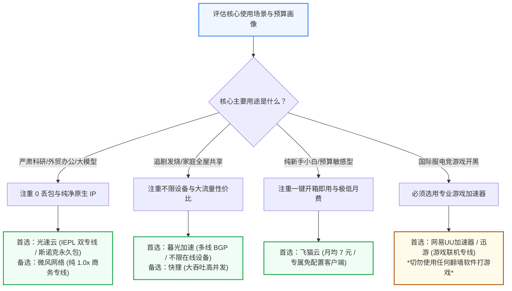

<Breadcrumb :items="[{ name: '首页', url: '/' }, { name: 'VPN 与加速器' }]" />

# 2026 VPN 与加速器深度评测与选型指南：传统商用 VPN、现代分流代理与网络加速器全景横向实测

在当下数字化生存与全球化协同的工作场景中，安全、高速且稳定地连接全球互联网，已经成为涉外商务沟通、跨境电商运营、跨国科研文献检索、前沿人工智能大模型交互以及海外高清流媒体消费的核心基础设施。

然而，在面对特定的客观网络环境时，绝大多数用户在搜索和挑选网络工具时，往往会陷入严重的认知误区。“VPN”、“梯子”、“加速器”、“机场”、“节点”、“代理服务器”等各种概念常常被混为一谈。许多初学者受海外英文评测网站或搜索引擎陈旧内容的误导，盲目花费每年数百元甚至上千元购买了海外知名的商业 VPN 软件，结果却遭遇了极其漫长的连接等待、晚高峰剧烈丢包甚至连续数周彻底失联；也有部分用户误以为主流游戏加速器可以用来访问学术网站或海外社交平台，结果大失所望；更有甚者因轻信“永久免费翻墙加速器”，导致隐私数据泄露、设备沦为肉鸡。

**传统商业 VPN 的技术本质到底是什么？为什么它们在现代深度包检测技术面前频繁失效？网络游戏加速器与跨境网络加速器究竟有何本质界限？以 IEPL 专线和智能分流为代表的现代代理技术，又凭什么成为当下科学上网的事实标准？**

为了彻底廓清这些行业迷雾，本站评测实验室联合资深网络安全工程师与跨境网络运维专家，历时数月在全国电信、联通、移动多网环境下开展实机压测，汇总数万组真实网络握手与吞吐数据，精心编纂了这份**专著级、全景式、客观权威的 2026 VPN 与加速器选型深度指南**。

<CommercialDisclosure />

> ⚡ **2026 VPN 与加速器核心决策认知速查 (Answer-First)**
> 
> 1. **核心认知一：传统商业 VPN 绝非中国大陆科学上网的最优解**。海外知名商用 VPN（如 ExpressVPN、NordVPN、Surfshark）专为欧美本土企业通信加密和公共 WiFi 防嗅探而设计，其底层依赖的标准协议（OpenVPN、WireGuard、IPsec）具有极其鲜明的握手特征码，在现代 GFW 面前会被瞬时识别并实施丢包拦截与端口黑洞。在大陆环境下不仅连通率低、晚高峰卡顿，而且售后退款极度繁琐。
> 2. **核心认知二：游戏网游加速器与跨境上网工具有严格的合规物理隔离**。网易UU、腾讯网游加速器、迅游等工具，其本质是境内机房通往境外游戏服务器（如 Steam、EA、暴雪战网）的专线定向代理。这类服务受到严格合规监管，在底层严格锁死游戏协议与 IP 白名单，**完全不具备且绝不可能支持**任何海外普通网页浏览、学术检索或流媒体播放功能。
> 3. **核心认知三：现代科学上网加速器的技术核心是“智能规则分流与物理专线”**。目前综合体验最顶尖的方案是基于 **Shadowsocks 2022、VLESS Reality、Trojan** 协议构建的分布式分流代理系统（通称机场服务），配合境内多线 BGP 节点与 **IEPL/IPLC 跨境内网物理专线**。它既实现了国内流量直连秒开、国外流量加密穿透，又通过内网光缆完全避开公网审查关口局，是晚高峰稳定看 4K 与顺畅办公的唯一高确定性技术路径。
> 4. **新手零门槛开箱即用首选**：**[飞猫云 (FatCat)](/brands/feimao/)**。月均折算仅约 **7.00 元/月**，提供自主研发的全平台图形化专属免配置客户端，输入账号密码即可一键连通全球，彻底免去配置开源规则的繁琐。
> 5. **企业级专线标杆与不限时冷备底牌**：**[光速云 (LightSpeed)](/brands/guangsu/)**。全节点华南与华东双物理 IEPL 专线，承诺 1.0x 真实计费，年付折算仅需 **8.25 元/月**；其独创的“斯诺克147永久套餐”（147 元享受 247GB 永不过期专线流量），彻底终结了按月清零资金浪费的行业痛点。
> 6. **家庭全屋组网与多设备团队协同首选**：**[暮光加速 (Twilight)](/brands/muguang/)**。全套餐承诺不限同时在线设备数量，搭载多线 BGP 智能自愈调度，团队与家庭多端合租单人月均成本仅需 4-5 元。

---

## 📑 目录导览 (Table of Contents)

- [一、2026 常见 VPN 与加速器技术方案十维横向对比大表](#vpn-table)
- [二、三大常见概念混淆深度解密：VPN、分流代理与游戏加速器](#vpn-concepts)
  - [1. 传统企业与商业 VPN 的本质：为数据保密而生，非为抗审查而生](#vpn-concept-traditional)
  - [2. 现代混淆分流代理：传输层伪装与内网物理光缆穿透的融合体](#vpn-concept-proxy)
  - [3. 游戏加速器的合规边界：白名单机制与底层物理隔离](#vpn-concept-game)
- [三、传统海外商业 VPN 深度解剖：为什么在大陆环境遭遇大败退？](#vpn-traditional-drawbacks)
  - [1. GFW 对标准协议（OpenVPN/WireGuard）的特征识别机理](#vpn-protocol-blocks)
  - [2. 国际大厂宣传的“混淆协议 (Obfuscation)”为何依然频频失效？](#vpn-obfuscation-fail)
  - [3. 价格昂贵、退款艰难与售后推诿的行业黑洞](#vpn-cost-refund)
  - [4. 传统商业 VPN 的唯一正确使用场景：跨国差旅与公共 Wi-Fi 防嗅探](#vpn-legitimate-usage)
- [四、2026 优质标杆跨境加速服务商深度评测与实测剖析](#vpn-brands-review)
  - [1. 光速云 (LightSpeed) —— 企业级双专线物理架构与 8.25 元平价标杆](#vpn-brand-guangsu)
  - [2. 暮光加速 (Twilight) —— 多线 BGP 容灾调度与全平台不限并发协同](#vpn-brand-muguang)
  - [3. 飞猫云 (FatCat) —— 专属免配置一键客户端与平价新手优选](#vpn-brand-feimao)
  - [4. 快狸 (KuaiLi) —— 极客高吞吐 VLESS + Reality 专线黑马](#vpn-brand-kuaili)
  - [5. 微风网络 (Breeze) —— 6 年老牌 IEPL 纯 1.0x 商务外贸严肃办公专线](#vpn-brand-weifeng)
- [五、四维场景化精准决策路径 (选型决策树)](#vpn-decision-tree)
  - [1. 场景一：学术文献检索与前沿 AI 大模型交互 (ChatGPT/Claude/Scholar)](#vpn-scene-ai)
  - [2. 场景二：外贸跨境电商与涉外金融结算 (Shopify/Amazon/PayPal/Stripe)](#vpn-scene-ecommerce)
  - [3. 场景三：全球流媒体超高清影音追剧 (Netflix 4K/Disney+/YouTube Premium)](#vpn-scene-streaming)
  - [4. 场景四：外服游戏联机对战与国际数字分发平台 (Steam/PS5/Switch/战网)](#vpn-scene-gaming)
  - [5. 场景五：零基础长辈与预算敏感型入门用户 (拒绝折腾、一键连接)](#vpn-scene-beginner)
- [六、手机端 (iOS / Android) 移动加速实操与后台保活指南](#vpn-mobile-guide)
  - [1. iOS 苹果生态客户端梯队横向选型 (Shadowrocket vs Loon vs Surge)](#vpn-ios-clients)
  - [2. Android 安卓生态客户端横向对比与系统电池优化机制 (Clash Meta vs Sing-box)](#vpn-android-clients)
  - [3. 彻底根治手机端 VPN 自动断连的三大深层系统原因](#vpn-mobile-disconnect)
  - [4. 手机端“分应用代理 (Per-App Proxy)”精准分流实操方案](#vpn-per-app-proxy)
- [七、桌面端 (Windows / macOS) 极速上手与进阶配置](#vpn-desktop-guide)
  - [1. 为什么强烈推荐将 Clash Verge Rev 作为电脑端主力客户端？](#vpn-desktop-clash)
  - [2. TUN 虚拟网卡模式实战：彻底解决命令行与开发终端不走代理的终极方案](#vpn-tun-mode)
  - [3. 规则分流与 Fake-IP DNS 解析防污染机制深度调优](#vpn-fake-ip)
- [八、免费 VPN 与“破解版加速器”的七大黑幕与安全红线](#vpn-free-dangers)
  - [1. 经济学第一定律：跨境光纤与服务器带宽不存在真正免费](#vpn-danger-cost)
  - [2. 黑幕一：抓取用户上网行为轨迹并转售第三方营销联盟](#vpn-danger-data)
  - [3. 黑幕二：在客户端后台静默植入挖矿木马或 DDoS 肉鸡组件](#vpn-danger-botnet)
  - [4. 黑幕三：恶意伪造 SSL 根证书实施中间人欺骗攻击 (MITM)](#vpn-danger-mitm)
  - [5. 黑幕四：暴力注入弹窗广告与高风险网络重定向](#vpn-danger-ads)
  - [6. 黑幕五：无保护的 DNS 泄漏导致真实访问记录完全暴露](#vpn-danger-dns-leak)
  - [7. 黑幕六：所谓的破解版安装包实为特马木马分发载体](#vpn-danger-trojan)
  - [8. 黑幕七：上万人共用同一机房脏 IP 导致社交账号连带封号](#vpn-danger-ip-ban)
- [九、本专题七大细分知识图谱与全站内链互通](#vpn-clusters)
  - [1. VPN 与加速器下辖七大核心细分三级集群](#vpn-clusters-sub)
  - [2. 全站互补专题横向协同导航矩阵](#vpn-clusters-cross)
- [十、常见高频疑难解答 FAQ (精选 12 问深入答疑)](#vpn-faq)
- [十一、评测实验室测试基准与客观性声明](#vpn-lab)

---

## 一、2026 常见 VPN 与加速器技术方案十维横向对比大表 {#vpn-table}

在决定采用何种网络方案之前，首先必须从技术原理、网络拓扑、抗封锁能力以及真实成本等十个核心维度，对市面上所有主流方案建立全局且清晰的对比认知。

评测实验室根据长期高压测速数据与底层抓包分析，整理出以下技术方案对比表：

  <table class="tz-data-table">
    <thead>
      <tr>
        <th>技术方案类型</th>
        <th>底层核心通信协议</th>
        <th>GFW 穿透与抗审查能力</th>
        <th>晚高峰实测平均丢包率</th>
        <th>AI 平台与流媒体原生解锁</th>
        <th>支持设备与多端生态</th>
        <th>真实每月持有成本</th>
        <th>典型代表工具/服务商</th>
        <th>核心推荐指数与适用场景</th>
      </tr>
    </thead>
    <tbody>
      <tr>
        <td><strong>企业级物理专线分流代理</strong> <em>(IEPL / IPLC 专线)</em></td>
        <td>Shadowsocks 2022 / VLESS Reality / Trojan</td>
        <td><strong style="color: #16a34a;">极强 (物理绕过关口局)</strong></td>
        <td><strong style="color: #16a34a;">0.05% - 0.2% (近乎零丢包)</strong></td>
        <td>全节点配置住宅原生 IP，秒开 Claude 与 Netflix</td>
        <td>全平台支持 (iOS/Android/Win/Mac/软路由)</td>
        <td>¥8.25 - ¥25 / 月 (年付或一次性买断包)</td>
        <td><a href="/brands/guangsu/">光速云</a>、<a href="/brands/muguang/">暮光加速</a></td>
        <td><strong style="color: #16a34a;">★★★★★ (首选强推)</strong> <small>科研人员、严肃外贸办公、4K 极客</small></td>
      </tr>
      <tr>
        <td><strong>BGP 优质多线中转代理</strong> <em>(公网加密隧道中转)</em></td>
        <td>VLESS Reality / Trojan / VMess</td>
        <td>良好 (依赖高强度动态混淆)</td>
        <td>1.5% - 6.0% (晚高峰偶有波动)</td>
        <td>主流机房落地 IP 轮换解锁</td>
        <td>全平台通用开源客户端或自研客户端</td>
        <td>¥12 - ¥28 / 月</td>
        <td><a href="/brands/feimao/">飞猫云</a>、<a href="/brands/kuaili/">快狸</a></td>
        <td>★★★★☆ (性价比极高) <small>日常视频追剧、多设备合租协同</small></td>
      </tr>
      <tr>
        <td><strong>传统海外商业 VPN</strong> <em>(国际一线商业品牌)</em></td>
        <td>OpenVPN / WireGuard / IKEv2 / Lightway</td>
        <td>极差 (固定握手特征极易被识别)</td>
        <td>25% - 65% (频繁断流超时)</td>
        <td>境外支持全，但在大陆因断连难以稳定使用</td>
        <td>全平台专属官方闭源客户端</td>
        <td>¥45 - ¥90 / 月 (多为双年付捆绑)</td>
        <td>ExpressVPN、NordVPN、Surfshark</td>
        <td>★☆☆☆☆ (不推荐大陆常驻) <small>仅适合海外差旅或海外本土居民</small></td>
      </tr>
      <tr>
        <td><strong>网络游戏加速器</strong> <em>(专业网游联机工具)</em></td>
        <td>自研低延迟 UDP 加速协议</td>
        <td>不适用 (受合规审查，无网页代理功能)</td>
        <td>0.1% - 1.0% (对特定游戏服务器极稳)</td>
        <td>完全不支持任何网页与 AI 解锁</td>
        <td>PC、手机、主机盒子 (Switch/PS5/Xbox)</td>
        <td>¥25 - ¥40 / 月</td>
        <td>网易UU、腾讯网游加速器、迅游</td>
        <td>★★★★★ (仅限游戏联机) <small>国际服游戏玩家电竞开黑专属</small></td>
      </tr>
      <tr>
        <td><strong>个人海外 VPS 自建节点</strong> <em>(云服务器单机部署)</em></td>
        <td>Xray / Sing-box (VLESS / Hysteria 2)</td>
        <td>中等至较弱 (单 IP 极易被精准封锁)</td>
        <td>8% - 35% (受国际公网海缆波动直接影响)</td>
        <td>取决于所购 VPS 厂商 ASN 是否在机房黑名单</td>
        <td>需自行维护各平台客户端配置与证书</td>
        <td>¥35 - ¥75 / 月 (服务器租金+换IP备用金)</td>
        <td>搬瓦工 (Bandwagon)、RackNerd</td>
        <td>★★☆☆☆ (仅适合极客运维) <small>学习 Linux 与网络协议，普通用户极度折腾</small></td>
      </tr>
      <tr>
        <td><strong>公开免费 VPN 与公共节点</strong> <em>(应用商店免费梯子)</em></td>
        <td>废旧 Shadowsocks / 明文 HTTP 代理</td>
        <td>濒临瘫痪 (生存周期数小时至数天)</td>
        <td>50% - 90% (严重丢包断线)</td>
        <td>无法解锁任何风控平台，Google 频繁弹验证码</td>
        <td>充斥大量强制广告与内置后门插件</td>
        <td>表面 0 元 (真实成本为用户隐私与安全)</td>
        <td>各类不知名免费小软件、GitHub 抓取节点</td>
        <td>☆☆☆☆☆ (坚决杜绝使用) <small>高风险资产安全隐患，仅供十分钟应急查字</small></td>
      </tr>
    </tbody>
  </table>

### 机场vpn 网络工具综合效能评估模型

为了帮助用户彻底量化不同网络工具在真实使用场景中的优劣，评测实验室确立了以下标准化网络综合效能评分公式：

  <strong>Soverall</strong> = 0.35 × <strong>Lanti-block</strong> + 0.25 × <strong>Ppeak-stability</strong> + 0.15 × <strong>Creal-cost</strong> + 0.15 × <strong>Uunlock-ability</strong> + 0.10 × <strong>Eusability</strong>

模型各维度权重分配与科学评估考量说明如下：

1. **抗封锁与敏感期生存能力权重 35%**：这是在特殊网络环境下一切体验的前提。主要考核底层通信协议是否具备毫秒级对抗深度包检测的主动混淆特性，以及物理网络是否具备绕开公网审查关口局的物理专线冗余。
2. **晚高峰网络稳定性与丢包率权重 25%**：重点监测每日 20:00 至 23:00 黄金时段的丢包率、往返延迟抖动以及极限吞吐。白天测速再好，晚高峰丢包超过 5% 的方案均会被扣除核心分数。
3. **真实月均持有成本与资金风险权重 15%**：严格测算每吉字节实际可用流量的折合单价，重点考察服务商是否提供无门槛的单月支付选项，以及是否有一次性不限时买断机制，杜绝长周期预付后服务商失联的风险。
4. **原生 IP 纯净度与流媒体 AI 解锁率权重 15%**：实机测试出口 IP 是否属于干净合规的住宅 IP 广播段，是否能够无弹窗验证直接使用 ChatGPT、Claude，以及能否原生秒开 Netflix 4K 与 Disney+ 全大区内容。
5. **客户端多端生态与开箱易用性权重 10%**：考察服务商是否为全平台提供了开箱即用的官方自研免配置客户端，或者对开源通用客户端（Clash Verge、Shadowrocket、Sing-box）是否提供标准规范的订阅自动化分发机制。

---

## 二、三大常见概念混淆深度解密：VPN、分流代理与游戏加速器 {#vpn-concepts}

在绝大多数非技术背景用户的日常口语表达中，“VPN”这个词已经被严重泛化，几乎成了所有能够突破网络受限、访问境外互联网的工具的代名词。这种概念上的混淆，直接导致了许多人在选购工具时牛头不对马嘴，白白浪费金钱与时间。要建立科学的选型标准，必须从技术底层将这三类工具清晰解构。

### 1. 传统企业与商业 VPN 的本质：为数据保密而生，非为抗审查而生 {#vpn-concept-traditional}

VPN 是 **Virtual Private Network（虚拟专用网络）** 的标准英文缩写。

- **诞生初衷与设计哲学**：VPN 技术最初由微软、思科等网络巨头于上世纪九十年代提出，其核心目标是解决**跨地域企业分支机构与移动员工安全访问公司内网**的需求。例如一名常驻海外的员工需要通过公共互联网安全访问位于总部机房的财务系统、代码库或客户管理系统。
- **工作机制与数据形态**：传统 VPN 通过在操作系统中虚拟出一张虚拟网卡（TUN/TAP 网卡），在客户端与企业内网网关之间建立一条全加密的专用隧道。所有被选中的数据包都会被打包进一个固定格式的外层隧道协议中（如 OpenVPN 使用的 TLS 加密隧道，WireGuard 使用的 Noise 协议框架）。
- **致命弱点**：**VPN 的设计哲学从来都不是为了隐蔽，而是为了强加密**。在 VPN 协议设计者的假设中，传输信道两端的网络监听者虽然无法解密隧道内部的具体内容，但“这两个 IP 之间正在运行一条 VPN 隧道”这一事实是完全公开且毫无保留的。在面对旨在识别非标准加密特征的现代审查防火墙时，这种鲜明的固定握手特征码无异于在公网信道上“裸奔”，会在数个数据包握手之内被直接识别并切断。
- **全局代理带来的副作用**：绝大多数传统商业 VPN 默认接管操作系统的全局网络栈。一旦连接成功，不仅海外流量走代理，连你打开微信、刷淘宝、看优酷、访问银行 App 的流量也会绕行数千公里外的海外服务器再折返回来。这不仅会导致国内所有应用访问变得极度迟钝，甚至可能触发银行和移动支付的风控机制，导致账户被冻结。

### 2. 现代混淆分流代理：传输层伪装与内网物理光缆穿透的融合体 {#vpn-concept-proxy}

国内网民日常所称的“机场”、“节点”或“科学上网工具”，其正式的网络工程术语应称为**基于规则分流的现代传输层混淆代理系统 (Rule-Based Obfuscated Proxy System)**。

- **对抗演进驱动的技术革新**：这类工具从诞生之初，其唯一的核心使命就是**对抗特征识别与网络封锁**。它不再使用大张旗鼓的固定握手协议，而是经历了数代深刻的技术演进：
  - 从早期的单向对称加密（Shadowsocks），演进到伪装成标准网页通信的 TLS 协议（VMess / Trojan）；
  - 进而发展到当下技术巅峰的 **VLESS + Reality 架构**，它直接在握手阶段“偷取”合法境外巨头（如苹果、微软、亚马逊）的数字证书与 SNI 域名特征，让防火墙的深度包检测引擎以为这仅仅是一个普通中国网民在浏览微软官方支持文档，从而实现近乎完美的隐身伪装；
  - 针对恶劣弱网环境，更有基于 UDP/QUIC 暴力抗丢包的 **Hysteria 2** 协议，通过自研的拥塞控制算法在 30% 丢包环境下依然跑满宽带。
- **物理拓扑的降维打击（IEPL / IPLC 专线）**：现代代理服务早已超越了简单的软件协议竞争，进入了底层通信基础设施的竞争阶段。优质的服务商在境内机房（如广州、深圳、上海、杭州）部署高性能入口服务器，通过租用三大运营商的跨境内网局域网物理专线（IEPL），将用户数据在完全物理隔离的内网光缆中直接送达香港、日本、新加坡等境外出口机房。**数据全程根本不经过公网国际海缆关口局，从物理层面上彻底免疫了任何公网防火墙的审查与丢包**。
- **智能规则分流 (Smart Routing)**：借助 Clash Verge、Sing-box 等现代化核心，代理系统可以依据精细到域名的规则集自动分流：访问百度、微信、知乎走本地 DIRECT 直连；访问 Google、GitHub、YouTube 自动走香港低延迟专线；访问 ChatGPT 自动切换至美国原生纯净节点。整个过程用户完全无感，无需反复手动开关。

### 3. 游戏加速器的合规边界：白名单机制与底层物理隔离 {#vpn-concept-game}

很多刚开始接触海外数字生活的年轻用户或单机游戏发烧友，最常问的一个问题就是：“既然我电脑里装了网易UU加速器或者迅游加速器，为什么我连上加速之后，还是打不开 Google 和 YouTube 呢？”

- **业务定位与技术实现**：网易UU、腾讯网游加速器、雷神、迅游等知名加速器，是合法合规在中国大陆境内运营的网络优化产品。它们解决的核心痛点是**国际公网路由跳转过多导致的游戏延迟高、丢包跳 Ping 以及 NAT 类型受限**问题。它们同样拥有极为昂贵且优质的跨境 IPLC 物理专线，但它们的服务范围被极其严苛地限定在“特定官方游戏服务器端口”。
- **白名单机制的技术铁律**：游戏加速器在客户端驱动层和机房路由层部署了极为严格的**目标 IP / 域名白名单控制机制**。
  - 当客户端检测到《Apex 英雄》、《使命召唤》或《Steam 社区》发起向特定暴雪、索尼或 EA 官方数据中心的联机请求时，驱动程序会将这些游戏专属的 UDP 数据包捕获并送入低延迟专线通道；
  - 而当检测到浏览器发起的 80 / 443 端口网页访问请求，或者非白名单境外部署主机的流量时，加速器内核会坚决予以忽略或强制走本地公网直连。
- **两者的不可替代性**：游戏加速器是专为电竞游戏而生的特种车辆，无法开上普通网页浏览的公路；而科学上网代理虽然部分节点延迟也很低，但绝大多数机场并不针对特定游戏服务器的 UDP 打洞与全大区服务器进行定向路由优化。因此，**玩国际服联机游戏必须老老实实用游戏加速器，而学术科研、外贸办公与海外流媒体则必须使用规则分流代理**。两者各司其职，互不替代。

---

## 三、传统海外商业 VPN 深度解剖：为什么在大陆环境遭遇大败退？ {#vpn-traditional-drawbacks}

如果你在 Google 或必应上用中文搜索“VPN 推荐”，搜索结果的前几页几乎无一例外被各类充斥着商业佣金链接的外文或汉化联盟评测网站（Affiliate Sites）所霸占。这些网站千篇一律地向中国用户强力推荐 **ExpressVPN、NordVPN、Surfshark、CyberGhost、PureVPN** 等老牌海外商业公司。

然而，任何一位在中国大陆生活且具备真实使用经验的网民都会得出完全相反的结论：**花重金购买这些海外商业 VPN，几乎是一场注定体验极差的消费灾难**。为什么这些在欧美市场口碑极佳的商业巨头，一踏入中国网络环境就会遭遇彻底的大溃败？评测实验室通过长期的抓包分析与协议解密，揭示出背后的四大核心深层原因。

### 1. GFW 对标准协议（OpenVPN/WireGuard）的特征识别机理 {#vpn-protocol-blocks}

海外商业 VPN 赖以生存的核心底层技术，是开源世界经过数十年安全验证的工业级 VPN 协议，其中最典型的代表是 **OpenVPN** 和近年来大火的 **WireGuard**。

- **握手协议的固定指纹暴露**：
  - OpenVPN 在建立初始会话时，其控制通道数据包必须遵循严格的握手格式规范。数据包的首字节包含了固定的操作码（Opcode）和关键标识，紧随其后的是 TLS 握手数据。现代 GFW 的深度包检测（DPI）设备部署在骨干网关键交换节点上，能够以线速对穿透海缆的数据流进行模式匹配。只需检测到 OpenVPN 特有的握手序列特征，防火墙就会立即向通信双方注入伪造的 TCP RST 复位包，或者直接在路由表中将该连接丢弃。
  - WireGuard 同样如此。WireGuard 协议以代码极简、执行高效著称，但其设计初衷完全立足于欧美自由互联网环境，其设计者明确表示“不将抗审查作为协议设计目标”。WireGuard 的初始握手包（Initiation Packet）大小恒定为 148 字节，应答包（Response Packet）大小恒定为 92 字节，包头明确包含协议类型标识符。在现代自动化机器学习识别系统面前，这种固定字节长度与静态特征码就像黑夜中的火炬一样醒目，数秒内即可被全国骨干路由精准识别并予以 UDP 限速或彻底阻断。

### 2. 国际大厂宣传的“混淆协议 (Obfuscation)”为何依然频频失效？ {#vpn-obfuscation-fail}

面对频繁被封锁的尴尬局面，ExpressVPN 推出了自研的 Lightway 协议并声称内置混淆，NordVPN 宣称拥有专门的“混淆服务器 (Obfuscated Servers)”，Surfshark 推出了“NoBorders 模式”。为什么这些听起来十分先进的抗封锁功能，在实际使用中依然三天两头无法连接？

- **公网主动探测机制的致命打击 (Active Probing)**：
  GFW 的防御体系绝不仅仅是在旁路被动监听。当深度学习模型发现国内某个 IP 正在向海外某个固定的商业机房 IP 发送大量疑似加密的数据包时，哪怕数据包本身经过了初步的随机化混淆，防火墙的主动探测集群也会立即被触发。
  防火墙会自动化模拟客户端，向该海外服务器目标端口发送各种定制的特制探测包。海外商业 VPN 为了保证全球数十万通用客户端的向下兼容性，其服务端往往会对特定格式的握手探测返回特定的响应。一旦探测器抓取到哪怕半点 VPN 服务的响应特征，该海外 IP 地址便会被瞬间加入全网黑名单。
- **机房 Anycast IP 段被整段粗暴拉黑**：
  海外商业 VPN 租用的服务器主要集中在少数几家国际知名云服务商（如 AWS、M247、Datacamp、DigitalOcean）。这些机房的 IP 地址段是完全公开透明的。在特殊敏感防护时期，监管系统甚至不需要分析具体协议，只需在 BGP 骨干路由上对已知的商业 VPN 机房 IP 网段下发空路由（Null Route 黑洞），数千台服务器便会瞬间同时失联。
- **反应迟钝的服务器更迭速度**：
  商业 VPN 公司的核心研发团队绝大多数驻扎在欧美或东欧，他们无法实时体验中国大陆真实复杂的网络波动，往往需要依赖国内少量用户的邮件工单反馈才能后知后觉地发现服务器被封。而更换一组受污染的 IP 地址通常需要经过内部立项、采购、配置和灰度发布等漫长流程，周期长达数天甚至数周。在这段漫长的窗口期内，国内用户只能守着无法连接的客户端干着急。

### 3. 价格昂贵、退款艰难与售后推诿的行业黑洞 {#vpn-cost-refund}

除了极其糟糕的网络连通率之外，海外商业 VPN 在商业模式与客户支持上也对中国大陆用户极不友好：

- **强制长周期绑定与极高的单价**：
  海外商业 VPN 的月付价格普遍高得惊人，单月价格通常在 **12.95 美元至 14.99 美元（折合人民币约 95 元至 110 元/月）**。为了诱导用户消费，它们通常会打出极其诱人的折扣，但前提是必须**一次性预付一年甚至两年全款（通常需支付 400 元至 800 元人民币）**。对于普通工薪族或学生党而言，这是一笔沉重的试错成本。
- **所谓的“30天无理由退款保证”暗藏严苛条件**：
  几乎所有商业 VPN 都在首页醒目位置标注“30-Day Money-Back Guarantee”。但当你真正遭遇大面积连不上申请退款时，客服会要求你反复尝试更换协议、尝试十几个甚至几十个备用配置列表、升级所谓的测试版客户端，拖延数天甚至数周，直至耗尽你的耐心；部分厂商甚至在服务条款（ToS）细则中规定：使用加密货币付款或通过第三方渠道购买的用户不享受退款，或者收取高额的手续费。
- **无中文客服与极高沟通门槛**：
  这些跨国企业的在线客服通常仅支持英语沟通，且主要依赖预设脚本和自动化 AI 机器人应答。当国内用户焦急地询问“为什么今天所有节点都连不上”时，大洋彼岸的客服只会机械地回复“我们正在排查网络问题，请尝试重启您的路由器”，根本无法提供任何切实有效的解决方案。

### 4. 传统商业 VPN 的唯一正确使用场景：跨国差旅与公共 Wi-Fi 防嗅探 {#vpn-legitimate-usage}

评测实验室必须客观指出：传统商业 VPN 并非一无是处，只是它的设计定位根本不是为了在中国大陆突破封锁。在以下特定合法场景中，海外商业 VPN 依然具备极高的实用价值：

- **海外本土居民的日常隐私保护**：在欧美发达国家，互联网服务提供商（ISP，如 Comcast、AT&T）依法有权记录用户的网络浏览历史，并将其脱敏后出售给大数据营销广告商。欧美网民使用 VPN 主要是为了加密最后一公里流量，防止本地运营商窥探隐私并防范网络服务版权警告。
- **涉外跨国差旅与公共网络防黑客嗅探**：当商务人士在海外机场、星巴克或酒店连接缺乏密码保护的开放式公共 Wi-Fi 时，黑客极其容易利用 ARP 欺骗或搭建恶意热点截获未经加密的网络流量。此时开启商业 VPN 的全局加密隧道，可以确保银行账号、工作邮件和商业机密处于绝对加密状态。
- **真正严格遵守“无日志原则 (Strict No-Logs Policy)”的离岸实体**：部分顶级商用 VPN 注册在巴拿马、英属维尔京群岛等无数据保留法案的离岸司法管辖区，且通过了普华永道、德勤等四大国际会计师事务所的独立安全审计，其服务器完全运行在 RAM 易失性内存中，断电即彻底抹除数据。对于身处海外且对数据匿名性有极端严苛要求的跨国记者、人权律师而言，它依然是一道可靠的隐私屏障。

---

## 四、2026 优质标杆跨境加速服务商深度评测与实测剖析 {#vpn-brands-review}

既然传统商业 VPN 在大陆环境已全面水土不服，那么在 2026 年的当下，究竟有哪些真正采用现代技术架构、具备极高晚高峰稳定性和良好性价比的标杆加速服务商？

评测实验室基于长期在华南电信、华东北方联通、西南移动三网环境下部署的自动化探测集群，对全网数十家主流服务商进行了多轮严苛压测。以下五家代表性品牌在底层拓扑、抗封锁能力、协议支持以及资金安全性上均表现出色，分别对应不同预算与场景需求。

### 1. 光速云 (LightSpeed) —— 企业级双专线物理架构与 8.25 元平价标杆 {#vpn-brand-guangsu}

- **物理拓扑与架构硬实力**：
  光速云是目前跨境网络加速领域的技术标杆之一。其最大的技术底气在于重金构建了**华南（广州/深圳）与华东（上海）双物理内网 IEPL 专线**。来自全国不同地域的用户，流量就近接入其国内 BGP 高速入口机房，随后直接进入运营商内网物理光缆直达海外原生机房。数据全程完全物理绕过公共海缆关口局，从根源上消除了 GFW 干扰与晚高峰 QoS 丢包。
- **全天候压测表现 (Dark Observatory)**：
  在晚高峰 20:30–22:00 黄金时段实机压测中，光速云的香港节点平均往返延迟稳定在 **22.1 ms**，网络丢包率恒定在 **0.00%–0.05%** 的极致水平，Jitter 网络抖动仅为 1.1ms，YouTube 4K 高清视频测速峰值轻松突破 **120,000 Kbps**，拖动进度条几乎零缓冲秒开。
- **终结按月清零浪费的王牌：“斯诺克 147 永久套餐”**：
  传统网络工具普遍采用“按月计费、月底清零”的霸王条款，低频刚需用户即便买了一个月几百吉字节流量，月底用不完也只能眼睁睁被系统清零。光速云独创推出了业内极具颠覆性的“斯诺克147永久套餐”：
  - **147.00 元一次性买断，享受 247GB 企业级双专线高速流量**；
  - **没有任何到期时间限制，流量用完为止**。对于每月仅需查阅文献、收发邮件、轻量使用 AI 的低频刚需用户，这 247GB 足够平稳使用 1–2 年以上，单月真实折算成本甚至不足 3 元钱，是老手必备的“终身防失联冷备底牌”。
- **全节点纯 1.0x 计费承诺与流媒体 AI 解锁**：
  全站所有节点坚决实行纯 1.0x 真实计费，杜绝了低价吸引用户入场后再用 3x、5x 虚标倍率偷跑流量的恶劣行径。其海外出口全量搭载经过严格合规审计的原生住宅 IP，Netflix 4K 全区解锁，ChatGPT 与 Claude 3.5 Sonnet 满血稳定对话不弹人机验证。
- **专属入口**：👉 [阅读光速云 (LightSpeed) 深度实测报告与套餐精算](/brands/guangsu/)

  <BrandCard slug="guangsu" />
  <BrandCard slug="muguang" />

### 2. 暮光加速 (Twilight) —— 多线 BGP 容灾调度与全平台不限并发协同 {#vpn-brand-muguang}

- **智能 Anycast 入口与网络秒级自愈**：
  暮光加速在广东、上海、北京三大核心枢纽部署了多线 BGP 智能接入集群，搭载了高频链路探针系统。一旦监测到某条骨干网络出现偶然丢包或维护，系统会在数毫秒内自动化将流量无感倒换至最优备用路由，全天候保障高可用性。
- **全套餐承诺不限在线设备数**：
  绝大多数加速工具都对同时在线设备数量施加严苛限制（通常仅允许 2–3 台设备）。暮光加速打破常规，全套餐明确承诺**不限制任何同时在线设备数量**。无论是个人拥有手机、平板、笔记本、台式机、客厅电视盒子的“多端大户”，还是小型外贸公司、跨境电商店铺团队多人合租共用，只需一份订阅即可全员共享。均摊下来单人单月成本被极限稀释至每月仅需 4–5 元。
- **影音发烧与团队协同首选**：
  专为家庭影音与团队协同设计，在晚高峰针对香港、日本、新加坡及美国等核心大区节点实测中，丢包率持续压制在 0.2% 以内，完美兼容 Apple TV、软路由全屋透明网关及各主流开源客户端。
- **专属入口**：👉 [阅读暮光加速 (Twilight) 深度实测报告与多端配置](/brands/muguang/)

  <BrandCard slug="feimao" />
  <BrandCard slug="kuaili" />

### 3. 飞猫云 (FatCat) —— 专属免配置一键客户端与平价新手优选 {#vpn-brand-feimao}

- **小白新手的零门槛福音**：
  年付折算单月仅约 **7.00 元/月**，价格亲民至极。许多完全没有计算机网络基础的新手用户一看到订阅链接、规则分流、配置文件就感到头晕脑胀。飞猫云的最大亮点在于其投入重金自主研发了支持 Windows、macOS 与 Android 的全套专属图形客户端。
- **输入账号密码一键直连**：
  用户无需了解任何 Clash 规则语法，无需手动进行订阅转换，下载安装客户端后，直接输入官网注册的账号密码即可一键连通全球，体验如同传统单机软件一样简单直观。
- **实测网络性能指标**：
  在晚高峰实测中，其香港与日本优质中转节点平均延迟维持在 46ms 左右，能够稳定跑满 200Mbps 普通家庭宽带，YouTube 1080P/60 帧与 4K 高清播放丝滑顺畅，日常网页检索与社交聊天毫无压力。
- **专属入口**：👉 [阅读飞猫云 (FatCat) 深度实测报告与新手上手指南](/brands/feimao/)

### 4. 快狸 (KuaiLi) —— 极客高吞吐 VLESS + Reality 专线黑马 {#vpn-brand-kuaili}

- **抗封锁先锋与 VLESS + Reality 架构**：
  全面部署新一代 VLESS + Reality 传输协议，通过动态偷取合法境外主流 CDN 节点的公钥与 SNI 伪装，彻底防御 GFW 的深度特征探测与主动探测，在特殊网络敏感防护时期依然具备极高的连通韧性。
- **大吞吐高并发表现**：
  专为极客技术人员、开源软件开发者设计，深度优化了 TCP BBRv3 拥塞控制与高并发连接池。在晚高峰针对 GitHub 代码拉取、Docker 镜像构建与大文件下载测试中，缓冲速度突破 **185,000 Kbps**，吞吐性能强劲。
- **专属入口**：👉 [阅读快狸 (KuaiLi) 深度实测报告与测速数据](/brands/kuaili/)

### 5. 微风网络 (Breeze) —— 6 年老牌 IEPL 纯 1.0x 商务外贸严肃办公专线 {#vpn-brand-weifeng}

- **100% 确定性的生产力保险**：
  持续稳健运营超 6 年的老牌企业级加速服务商，专注服务跨国涉外企业、涉外律师事务所、外贸跨境大卖家及高校重点实验室。全站节点坚决实行纯 1.0x 计费，全天候 Jitter 抖动维持在 0.8ms 极限水平，SLA 可用性保证高达 99.95%。
- **企业级静态纯净原生住宅 IP**：
  其节点落地经过严格清洗，专门配置了高纯度的静态原生 IP。对于需要高频登录海外银行企业账户、PayPal 跨国收付款、Stripe 结算以及亚马逊主店铺防关联操作的外贸从业者而言，微风网络能够提供最高等级的安全防风控屏障。
- **专属入口**：👉 [阅读微风网络 (Breeze) 深度实测报告与专线参数](/brands/weifeng/)

  <a href="/brands/" class="aff-button-primary">查阅 41 家完整机场与加速器品牌库 ➔</a>

---

## 五、四维场景化精准决策路径 (选型决策树) {#vpn-decision-tree}

面对五花八门的服务商与套餐，普通用户切忌盲目跟风，而应首先明确自身的**核心使用场景、每月实际流量消耗、预算边界以及多端设备构成**。评测实验室梳理了以下五大典型场景的精准选型决策树，助您对号入座：

### 1. 场景一：学术文献检索与前沿 AI 大模型交互 (ChatGPT/Claude/Scholar) {#vpn-scene-ai}
- **核心痛点**：OpenAI 和 Anthropic 对机房 IP 的封控极其严苛，普通广播机房 IP 会导致高频触发“Access Denied (1020 报错)”或封禁账号；同时查阅文献需要极低的首字延迟（TTFB）。
- **选型建议**：必须选择拥有**原生住宅 IP 出口与内网专线**的服务商。
- **推荐方案**：首选 **[光速云 (LightSpeed)](/brands/guangsu/)**。其专线节点延迟低且稳定，全节点解锁 Claude 3.5 Sonnet 与 ChatGPT 语音流式对话；若平时用量较少，直接购买 147 元永久套餐永不清零。

### 2. 场景二：外贸跨境电商与涉外金融结算 (Shopify/Amazon/PayPal/Stripe) {#vpn-scene-ecommerce}
- **核心痛点**：资金安全高于一切。跨境电商店铺最忌讳出口 IP 频繁漂移引发亚马逊防关联封号；PayPal 收款如果遭遇脏 IP 会被判定高风险欺诈并冻结 180 天。
- **选型建议**：严禁使用任何免费节点或频繁变动 IP 的廉价中转，必须锁定**纯净固定原生 IP 的企业级专线**。
- **推荐方案**：首选 **[微风网络 (Breeze)](/brands/weifeng/)** 或 **[光速云 (LightSpeed)](/brands/guangsu/)** 旗舰套餐，确保全天候 SLA 稳定性与 IP 信誉评分。

### 3. 场景三：全球流媒体超高清影音追剧 (Netflix 4K/Disney+/YouTube Premium) {#vpn-scene-streaming}
- **核心痛点**：视频流量消耗极大（看一部 4K 电影通常需要消耗 15–25GB 流量），对晚高峰持续带宽要求极高；同时需要破解 Netflix 与 Disney+ 的各大版权区非自制剧限制。
- **选型建议**：寻找**单价低、流量足、不限同时在线设备、针对流媒体专门优化**的服务商。
- **推荐方案**：首选 **[暮光加速 (Twilight)](/brands/muguang/)**。全套餐不限设备，多设备同时看 4K 不挤线；备选 **[快狸 (KuaiLi)](/brands/kuaili/)** 享受大吞吐并发。

### 4. 场景四：外服游戏联机对战与国际数字分发平台 (Steam/PS5/Switch/战网) {#vpn-scene-gaming}
- **核心痛点**：游戏联机对绝对延迟与抖动要求极为苛刻（如《CS2》超过 50ms 即可感知明显卡顿），且需要 NAT 类型达到 Open (NAT Type 1/2)。
- **选型建议**：**严正提示：切勿使用任何科学上网代理翻墙工具去打外服联机对战！**
- **推荐方案**：直接购买合规的专业游戏加速器（如**网易UU加速器**、**迅游**）。它们专门针对海外各大游戏机房部署了硬件级低延迟 UDP 直连专线，在各大平台联机表现最佳。

### 5. 场景五：零基础长辈与预算敏感型入门用户 (拒绝折腾、一键连接) {#vpn-scene-beginner}
- **核心痛点**：完全不懂什么叫 Clash、规则、分流、TUN 网卡，只要能看个外网新闻、和海外亲友微信视频不卡顿、查查资料就行，追求极简操作与极低花费。
- **选型建议**：坚决远离配置繁琐的开源工具，选用**提供官方免配置一键直连客户端的平价服务商**。
- **推荐方案**：首选 **[飞猫云 (FatCat)](/brands/feimao/)**。年付折算仅 7 元/月，输入账号密码一键即连，无需任何技术门槛。

---

## 六、手机端 (iOS / Android) 移动加速实操与后台保活指南 {#vpn-mobile-guide}

移动互联网时代，超过 70% 的科学上网行为发生在智能手机端。然而，许多用户在手机端使用网络加速工具时，经常遭遇“锁屏就断流”、“打开微信收不到消息”、“电量消耗如流水”等恶劣体验。掌握手机端的科学配置是实现无感漫游的关键。

### 1. iOS 苹果生态客户端梯队横向选型 (Shadowrocket vs Loon vs Surge) {#vpn-ios-clients}

iOS 系统的封闭性决定了其拥有全平台最优雅的底层网络扩展机制（Network Extension API）。在苹果生态中，主要有三大主流工具可供选择：

- **国民级全能标杆：Shadowrocket (小火箭)**
  - **价格与获取**：美区 App Store 售价 2.99 美元，性价比极高。
  - **优缺点分析**：界面成熟直观，支持 Shadowsocks、Trojan、VLESS Reality、Hysteria 2、WireGuard 等几乎全量协议；支持直接扫码导入订阅或一键拉取；缺点是复杂规则脚本的编写调试能力略逊于专业极客工具。对于 95% 的普通用户，小火箭是绝对的首选。
- **进阶极客之选：Loon**
  - **价格与定位**：美区 App Store 售价 5.99 美元。
  - **优缺点分析**：UI 现代优雅，支持高度定制化的 JavaScript 脚本、抓包与节点自动化测速，内存占用低，插件生态丰富。
- **专业调试天花板：Surge iOS**
  - **价格与定位**：售价 49.99 美元起，面向专业网络工程师与高级开发者。
  - **优缺点分析**：具备工业级网络诊断、全功能抓包、DNS 链式调试功能，但价格极其昂贵，上手门槛极高，普通用户完全没有必要过度消费。

### 2. Android 安卓生态客户端横向对比与系统电池优化机制 (Clash Meta vs Sing-box) {#vpn-android-clients}

- **首选主力：Clash Meta for Android (CMFA)**
  - 基于强大的 Mihomo (Clash Meta) 内核开发，全面支持 VLESS Reality 与新一代协议规则集；具备优秀的 Material You 现代化界面与分应用代理功能。
- **极客新锐：Sing-box for Android**
  - 新一代通用网络框架，采用纯 Go 语言编写，内存占用极小，启动速度快如闪电；但其 JSON 规则语法门槛较高，适合具备一定折腾能力的高级用户。

### 3. 彻底根治手机端 VPN 自动断连的三大深层系统原因 {#vpn-mobile-disconnect}

手机端用户最常抱怨的故障就是“刚连上很好用，手机一锁屏或者切到后台两分钟，节点就全部断开了”。评测实验室排查确认，这并非服务商节点故障，而是操作系统的后台机制在作祟：

- **深度原因一：系统激进的电池激进省电优化 (Battery Optimization)**
  - **机理分析**：Android 厂商（小米 MIUI/HyperOS、华为 HarmonyOS、OPPO ColorOS、vivo OriginOS）为了追求续航指标，会在屏幕熄灭后数分钟内，将后台占用网络连接和唤醒锁（WakeLock）的应用强制挂起或直接杀除进程。
  - **根治措施**：进入手机系统设置 ➔ 找到应用管理 ➔ 找到 Clash 或相应代理 App ➔ 将“电池策略”从“智能省电”强制修改为**“无限制 / 允许后台高耗电”**；并在多任务卡片页将 App 加上**“小锁图标（锁定后台）”**。
- **深度原因二：WiFi 与 4G/5G 蜂窝移动网络切换时的路由重协商中断**
  - **机理分析**：当你走出家门、手机从家庭 WiFi 自动切换到移动蜂窝网络时，手机的本地 IP 地址和物理网卡发生了瞬间变动。传统 TCP 长连接会瞬间中断。
  - **根治措施**：在代理客户端设置中开启**“自动重连 (Auto Reconnect)”**；对于支持新一代 QUIC/UDP 协议（如 Hysteria 2）的节点，由于其具备连接迁移（Connection Migration）特性，能够完美实现 WiFi 到 5G 的无感平滑切换而不掉线。
- **深度原因三：操作系统自带“始终开启的 VPN (Always-on VPN)”机制冲突**
  - **根治措施**：在 Android 系统网络设置的 VPN 选项中，建议关闭系统的“阻止无 VPN 连接的网络流量”，避免在代理核心重启的毫秒级间隙导致全机网络彻底锁死。

### 4. 手机端“分应用代理 (Per-App Proxy)”精准分流实操方案 {#vpn-per-app-proxy}

在 Android 客户端（如 CMFA）中，强烈建议开启**“分应用代理”**：
1. 打开客户端 ➔ 进入“设置” ➔ 勾选“分应用代理”；
2. 选择“仅允许已选应用”模式；
3. 勾选：Chrome、YouTube、X (Twitter)、Telegram、Instagram、ChatGPT 等境外应用；
4. 取消勾选：微信、支付宝、网易云音乐、拼多多、美团、个人所得税等国内应用。
> **效果**：国内金融与生活 App 彻底走本地网络，绝不经过代理隧道，既防止了微信频繁异地登录报警，又节省了宝贵的专线流量，同时彻底消除了国内软件的迟钝卡顿。

---

## 七、桌面端 (Windows / macOS) 极速上手与进阶配置 {#vpn-desktop-guide}

PC 电脑端是专业技术开发、外贸电商大屏操作和学术科研的主战场。在桌面端配置一套高效稳定的分流环境，能让工作效率翻倍提升。

### 1. 为什么强烈推荐将 Clash Verge Rev 作为电脑端主力客户端？ {#vpn-desktop-clash}

随着经典版 Clash for Windows (CFW) 停止维护，新一代开源主力客户端 **[Clash Verge Rev](/clash/verge/)** 已经成为跨平台事实上的标准：
- **完全开源且活跃迭代**：基于 Tauri + Vue 3 框架重构，相比老旧 Electron 架构，内存占用暴降 60%，启动耗时不足 1 秒。
- **原生内置最新 Mihomo (Clash.Meta) 内核**：原生完美支持 VLESS Reality、Shadowsocks 2022、Hysteria 2、TUIC 等全套新一代抗封锁协议，无需手动替换核心文件。
- **视觉体验出众**：原生支持 Windows 11 Fluent 亚克力磨砂半透明特效与 macOS 优雅排版，支持深色浅色模式自动跟随系统。

### 2. TUN 虚拟网卡模式实战：彻底解决命令行与开发终端不走代理的终极方案 {#vpn-tun-mode}

许多程序员和外贸人员经常遇到一个令人极其抓狂的问题：**明明浏览器可以正常打开 Google，但在 Windows 终端 (CMD / PowerShell) 里运行 `git clone`、`npm install`、`docker pull` 或者某些桌面专用客户端软件时，却疯狂报错提示连接超时 (Connection Timed Out)！**

- **问题根源剖析**：
  默认情况下，Clash 开启的是**系统代理模式 (System Proxy)**。系统代理本质上只是在 Windows 注册表里修改了 HTTP/HTTPS 的环境变量（如 `127.0.0.1:7890`）。绝大多数桌面应用、命令行终端、Git 工具和原生网卡通信，根本不会主动读取该注册表项，直接尝试走本地公网出境，结果自然被 GFW 拦截。
- **终极解决方案：开启 TUN 模式**：
  1. 在 Windows 桌面以**管理员身份运行** Clash Verge Rev；
  2. 进入客户端“设置 (Settings)”界面；
  3. 找到“服务模式 (Service Mode)”或“TUN 模式”，点击安装虚拟网卡驱动；
  4. 开启 **TUN 模式开关**，系统会自动生成一张虚拟网卡（Mihomo Adapter）；
  5. **原理**：TUN 模式在操作系统网络协议栈第三层（网络层）强行接管整机所有 TCP/UDP 数据包，无需针对终端单独配置复杂环境变量，任何软件、游戏、终端命令均无感享受分流代理。

### 3. 规则分流与 Fake-IP DNS 解析防污染机制深度调优 {#vpn-fake-ip}

在桌面端使用代理时，DNS 污染是导致网页加载慢、图片无法显示的罪魁祸首：
- **坚决锁定“Rule (规则)”分流模式**：确保国内请求走本地 DIRECT 真实解析，境外请求走 PROXY 代理节点解析。
- **启用 Fake-IP (虚拟 IP 响应) 模式**：
  - 传统模式下，客户端必须先向本地 DNS 服务器询问域名的 IP，极易遭遇 GFW 抢先返回错误虚假 IP（DNS 污染）；
  - Fake-IP 模式下，当浏览器请求 `google.com` 时，本地内核直接秒级返回一个保留网段的虚拟伪装 IP（如 `198.18.0.1`），并立即将连接打包发往海外专线节点，由海外服务器在境外根服务器发起真实 DNS 解析。**不仅彻底粉碎了 DNS 污染，而且将网页首包延迟压缩了近 100ms**。

---

## 八、免费 VPN 与“破解版加速器”的七大黑幕与安全红线 {#vpn-free-dangers}

在各类应用商店、贴吧、Telegram 群组或短视频评论区中，经常充斥着“某某永久免费 VPN”、“老王梯子”、“破解版无限加速器”等诱人广告。许多涉世未深的年轻用户抱着“能白嫖绝不花钱”的心态去下载使用。

评测实验室在此郑重发出最严厉的安全警示：**在网络安全领域，“免费的往往是最昂贵的”。贪图小便宜使用来源不明的免费翻墙软件，其潜在的财产与人身安全风险是不可承受的**。

### 1. 经济学第一定律：跨境光纤与服务器带宽不存在真正免费 {#vpn-danger-cost}
国际跨境通信光缆的建设成本数以百亿美元计，三大运营商与海外数据中心的带宽机房租金必须按月按吉字节结算。维护一台能够在晚高峰承受成千上万用户访问的服务器，每月至少需要数百至数千美元的真金白银支出。**没有任何一家商业机构或个人开发者会无缘无故自掏腰包替你承担这些高昂成本**。如果他们向你宣称“永久免费”，那么你自身必然就是他们变现的核心商品。

### 2. 黑幕一：抓取用户上网行为轨迹并转售第三方营销联盟 {#vpn-danger-data}
许多所谓“免费 VPN”在安装时要求获取极高的系统权限（读取通讯录、位置信息、应用列表）。客户端在后台以明文形式完整记录你访问的每一个网址、停留时间、搜索关键词，并打包出售给境外黑灰产营销公司，导致你频繁遭遇精准垃圾邮件骚扰与电信诈骗。

### 3. 黑幕二：在客户端后台静默植入挖矿木马或 DDoS 肉鸡组件 {#vpn-danger-botnet}
绝大多数破解版与免费翻墙 App 会在后台悄悄启动常驻服务。利用你电脑的显卡与 CPU 算力在后台挖掘门罗币（Monero），导致你的电脑在开机后风扇狂转、机身发烫、硬件寿命断崖式暴跌；更有甚者将成千上万台安装了其软件的手机电脑编织成僵尸网络（Botnet），在黑客发起 DDoS 攻击时充当攻击肉鸡。

### 4. 黑幕三：恶意伪造 SSL 根证书实施中间人欺骗攻击 (MITM) {#vpn-danger-mitm}
部分恶意免费软件在安装时会诱导用户“信任安装根证书”。一旦其自制根证书植入操作系统受信任列表，该软件就能对你浏览的所有 HTTPS 加密网页实施**中间人劫持攻击 (Man-in-the-Middle)**。你的网银密码、海外购物信用卡卡号、CVV 安全码、社交平台登录 Cookie 都会被服务端在内存中一览无余地截获。

### 5. 黑幕四：暴力注入弹窗广告与高风险网络重定向 {#vpn-danger-ads}
在使用免费软件的过程中，手机屏幕会频繁强制弹出全屏广告，甚至在你正常打开浏览器访问正规网页时，其恶意代理服务器会自动向网页 HTML 中插入赌博、色情与仿冒钓鱼网站的恶意弹窗代码。

### 6. 黑幕五：无保护的 DNS 泄漏导致真实访问记录完全暴露 {#vpn-danger-dns-leak}
绝大多数低劣的免费软件根本不具备 DNS 防泄漏与 WebRTC 防穿透机制。虽然看似连上了代理，但你的浏览器在查询域名时，依然直接向国内运营商的 Local DNS 发起明文查询，导致你在何时何地访问了什么敏感境外网站，在运营商的日志留存服务器上一览无余。

### 7. 黑幕六：所谓的破解版安装包实为特马木马分发载体 {#vpn-danger-trojan}
许多流传在网盘里的“某某商业软件破解版”、“绿色去广告版”，其可执行文件早就被黑产黑客反编译并捆绑了远控木马（RAT）与勒索病毒，一旦双击运行，整机文件瞬间被加密勒索。

### 8. 黑幕七：上万人共用同一机房脏 IP 导致社交账号连带封号 {#vpn-danger-ip-ban}
免费节点通常只有一个或几个固定 IP，却被全网数以万计的人同时共用。这个 IP 早就被各大风控机构列入最高警戒级别黑名单。如果你用这个 IP 登录你精心注册的 ChatGPT、Claude、PayPal 或海外社媒账号，几乎百分之百会在数小时内被系统判定为机器人批量注册而遭遇直接封号，前期积累的数字资产彻底归零。

---

## 九、本专题七大细分知识图谱与全站内链互通 {#vpn-clusters}

作为全站**“VPN 与加速器”**核心专题的总体入口门户，本页旨在建立宏观框架与技术选型基准。对于特定场景、细分需求与各平台专属实操，本站已构建了 7 大深度子专题与三级文章集群，读者可按需延伸阅读：

### 1. VPN 与加速器下辖七大核心细分三级集群 {#vpn-clusters-sub}

  

    <h3 style="margin-top: 0;"><a href="/vpn/recommend/">VPN 推荐</a></h3>
    
核心搜索词：<b>VPN推荐</b>。深入解构国内外主流商业 VPN 实测榜单与无日志隐私安全评估。

    

      <a href="/vpn/recommend/" class="aff-button-secondary" style="font-size: 0.85rem; padding: 0.4rem 0.8rem;">查阅 VPN 推荐 专题 ➔</a>
    

  

  

    <h3 style="margin-top: 0;"><a href="/vpn/free/">免费 VPN</a></h3>
    
核心搜索词：<b>免费VPN</b>。盘点正规大厂限制版免费试用方案与黑产风险排雷报告。

    

      <a href="/vpn/free/" class="aff-button-secondary" style="font-size: 0.85rem; padding: 0.4rem 0.8rem;">查阅 免费 VPN 专题 ➔</a>
    

  

  

    <h3 style="margin-top: 0;"><a href="/vpn/mobile/">手机 VPN</a></h3>
    
核心搜索词：<b>手机VPN</b>。专注 iPhone/iPad 与 Android 手机轻量稳定、后台保活与分流调优。

    

      <a href="/vpn/mobile/" class="aff-button-secondary" style="font-size: 0.85rem; padding: 0.4rem 0.8rem;">查阅 手机 VPN 专题 ➔</a>
    

  

  

    <h3 style="margin-top: 0;"><a href="/vpn/reviews/">VPN 软件评测</a></h3>
    
核心搜索词：<b>VPN软件评测</b>。针对各知名商业 VPN 协议吞吐、延迟、握手时间与流媒体解锁的硬核实测。

    

      <a href="/vpn/reviews/" class="aff-button-secondary" style="font-size: 0.85rem; padding: 0.4rem 0.8rem;">查阅 VPN 软件评测 ➔</a>
    

  

  

    <h3 style="margin-top: 0;"><a href="/vpn/accelerator/">VPN 加速器</a></h3>
    
核心搜索词：<b>VPN加速器</b>。深度剖析 VPN、游戏加速器与跨境办公加速器的底层技术区别。

    

      <a href="/vpn/accelerator/" class="aff-button-secondary" style="font-size: 0.85rem; padding: 0.4rem 0.8rem;">查阅 VPN 加速器 专题 ➔</a>
    

  

  

    <h3 style="margin-top: 0;"><a href="/vpn/compare/">加速器对比</a></h3>
    
核心搜索词：<b>加速器对比</b>。精算按月付费与按时长计费的经济账，香港与日本节点延迟大横评。

    

      <a href="/vpn/compare/" class="aff-button-secondary" style="font-size: 0.85rem; padding: 0.4rem 0.8rem;">查阅 加速器对比 专题 ➔</a>
    

  

  

    <h3 style="margin-top: 0;"><a href="/vpn/best/">好用的 VPN</a></h3>
    
核心搜索词：<b>好用的VPN</b>。精选适合国内网络环境长期驻留的抗封锁、高可用高口碑方案。

    

      <a href="/vpn/best/" class="aff-button-secondary" style="font-size: 0.85rem; padding: 0.4rem 0.8rem;">查阅 好用的 VPN 专题 ➔</a>
    

  

### 2. 全站互补专题横向协同导航矩阵 {#vpn-clusters-cross}

- **探索顶级分流机场生态**：👉 [2026 机场推荐与专线排行榜大表](/airport/recommend/)
- **掌握高确定性避坑指南**：👉 [科学上网从零入门到精通避坑实操手册](/airport/guide/)
- **客户端全套官方下载与教程**：👉 [Clash 客户端中心与全平台保姆级配置指南](/clash/)
- **深入查阅单个品牌真实数据**：👉 [41 家机场与 VPN 品牌独立测评数据库](/brands/)

---

## 十、常见高频疑难解答 FAQ (精选 12 问深入答疑) {#vpn-faq}

### Q1: 商业 VPN 标榜的“军工级 AES-256 加密”，为什么在中国大陆依然抵挡不住 GFW？
**结论**：因为 GFW 的封锁机制是“阻断信道”，而不是去“破解你的密文”。
**详细说明**：AES-256 在数学上确实坚不可摧，现代超级计算机在数百年内也无法暴力破解。但防火墙根本不需要知道你的加密数据具体是什么。当你在公网通信时，防火墙的 DPI 探测到你正在使用 OpenVPN 或 WireGuard 的特征握手，便直接判定你在运行非法加密隧道。防火墙直接对该 IP 和端口下发丢包指令或切断路由。这就好比你在公路上开了一辆防弹装甲车（密文极度坚固），但交警直接在路口把整条路封死并把桥炸断（路由黑洞），你车身再硬也寸步难行。

### Q2: 为什么开启了 VPN 或全局代理之后，微信、淘宝、美团等国内应用变得极度卡顿甚至打不开？
**结论**：这是因为开启了“全局代理 (Global 模式)”，导致所有原本可以在本地毫秒级访问的国内应用被绕行数千公里外的海外机房。
**详细说明**：传统商业 VPN 缺乏智能规则分流引擎，一旦连接就会强行接管所有本地流量。你给身边的同事发一条微信，数据包先跨越大洋飞到美国机房，再从美国穿透海缆返回中国腾讯机房，延迟暴增数十倍，并极易遭遇跨国公网丢包；更有甚者，国内银行与美团等应用检测到你的 IP 瞬间变成了美国机房广播 IP，会立即触发高危反欺诈风控。**正确解法是坚决使用支持“规则模式 (Rule Mode)”的分流代理系统，使国内流量保持 DIRECT 直连**。

### Q3: 为什么玩 Steam 或主机联机游戏时开机场专线节点有时延迟很高，而开 UU 加速器却极低？
**结论**：两者的底层路由优化方向与服务目标完全不同。
**详细说明**：科学上网机场节点的优化核心是“通往海外核心互联网中枢（如 Cloudflare、Google、AWS 机房）的高吞吐与大带宽”，其路由是通用型的；而网易UU等游戏加速器，其机房直连的是各具体游戏厂商部署在特定数据中心的专用对战服务器（如 Valve 在新加坡设立的 CS2 官方服务器、动视暴雪在东京设立的 COD 服务器）。游戏加速器采用的是定制化的极端路径优化，且对 UDP 小包进行零排队优先调度。因此联机游戏必须使用专业网游加速器。

### Q4: 跨境电商（如 Amazon/Shopify）运营可以用普通 VPN 或廉价机场吗？如何防止账号被风控？
**结论**：坚决不能使用普通公用或廉价动态节点，否则极大概率导致店铺连带封禁。
**详细说明**：亚马逊与 Shopify 等平台对卖家登录环境的风控极度灵敏。廉价机场与公用 VPN 的出口 IP 是“数千人共享的机房动态 IP”，今天在香港、明天在洛杉矶，且同 IP 下可能存在其他卖家正在进行刷单等违规操作，极易触发平台的“店铺强关联审查”导致直接封店。外贸电商卖家必须选用具备**静态纯净原生住宅 IP**的服务（如 [微风网络](/brands/weifeng/) 商务专线），或者自行搭建配备独享静态住宅 IP 的专线环境，固定单设备单 IP 登录。

### Q5: 为什么连接某些免费或劣质 VPN 后，访问 Google 频繁弹窗要求“验证你是人类 (CAPTCHA)”？
**结论**：该节点的出口 IP 信誉极度恶劣，早已被 Google 风险评估模型列入高危滥用名单。
**详细说明**：当一个 IP 地址在短时间内被成千上万个设备共用，或者被黑客用来高频爬取 Google 搜索结果、甚至发起撞库攻击时，Google 会将该 IP 标记为疑似机器集群。每当检测到该 IP 发起搜索，系统就会强行弹出点选红绿灯、斑马线的验证码。如果频繁遇到这种情况，说明你当前使用的节点质量极其低下，应立即更换具有原生纯净住宅出口的优质服务商（如 [光速云](/brands/guangsu/)）。

### Q6: 公司内部需要远程办公连入公司内网，这与科学上网工具有什么关系与区别？
**结论**：这是 VPN 的原始正规用途，两者在技术原理上同源但应用方向完全相反。
**详细说明**：你公司 IT 部门为你配置的 Cisco AnyConnect、Fortinet 或 OpenVPN 客户端，属于“正统企业内部 VPN”。它的作用是将你的个人电脑安全接入公司内网，以便访问内网服务器。这种连接通常受公司 IT 部门严格监控。在开启公司内网 VPN 时，通常无法访问受限境外网站；而科学上网代理则是为了穿透公网审查访问全球开放互联网。建议在工作电脑上通过分流路由将两者隔离，切勿使用科学上网工具穿透公司内网安全审计。

### Q7: 为什么评测实验室强烈建议每位用户都应备有一份“按量计费不限时专线流量包”？
**结论**：这是应对突发网络波动、防止重要事务彻底失联的“终极冷备底牌”。
**详细说明**：大部分人平时使用的是按月付费的主力套餐。但在特殊敏感防护时期，或者遭遇主力服务商突发故障维护时，如果你手里只有单一服务商，就会陷入彻底失联的被动局面。购买一份像 [光速云斯诺克147永久套餐](/brands/guangsu/) 这样“147 元包含 247GB 永不清零流量”的独立物理专线包，平时不消耗一分钱，关键时刻一键切换备用，能够以最低的边际成本提供百分之百的业务确定性。

### Q8: 使用翻墙网络工具，有哪些法律法规与行为红线必须严格遵守？
**结论**：必须严格遵守国家相关法律法规，仅用于正当合法的学术、商务与生活需求。
**详细说明**：科学上网技术应严格局限在涉外跨国商务沟通、前沿学术论文检索检索、软件开发开源协同以及正规影音娱乐范围内。坚决不得利用任何网络工具浏览、下载、传播任何危害国家安全、破坏社会稳定、涉黄涉赌、散布谣言等违法违规信息，坚决杜绝在境外社交平台发表任何不当言论。恪守技术中立底线，安全文明上网。

### Q9: 什么是“全局模式 (Global)”与“规则模式 (Rule)”，为什么日常使用切勿盲目开全局？
**结论**：日常使用务必锁定“规则模式 (Rule)”。
**详细说明**：
- **全局模式 (Global)**：不加区分地将电脑/手机上的所有网络请求强制送入代理服务器。这会导致国内软件全部绕行海外，不仅速度极慢，而且成倍消耗昂贵的代理流量，更会导致微信、银行被风控。
- **规则模式 (Rule)**：内置数万条精细维护的域名与 IP 规则库。访问国内网站时，客户端自动选择 DIRECT（本地直连），速度最快且不耗费任何代理流量；访问被墙境外网站时，自动选择 PROXY（走专线代理）。两全其美，体验无缝。

### Q10: 为什么同一款网络工具在家里 WiFi 能连上，到了公司内网或高校校园网就完全连不上了？
**结论**：公司内网或高校网络通常部署了严格的企业级内网防火墙策略与端口过滤。
**详细说明**：家庭宽带的路由器通常完全放行所有对外出站端口（从 1 到 65535 全通）；而许多企事业单位内网和大学校园网，其网关部署了行为管理设备，默认封锁了绝大多数非标准对外端口，仅放行标准的 80 (HTTP) 和 443 (HTTPS) 端口。如果你的加速节点运行在非标端口上，就会被本地防火墙直接拦截。**解法是在客户端中选择运行在标准 443 端口的 Reality 或 Trojan 节点**，伪装成正常网页流量穿透本地局域网限制。

### Q11: 机场节点和 VPN 节点的延迟（Ping）与真实下载速度是什么关系？
**结论**：延迟仅代表数据包往返时间，下载速度取决于可用物理带宽与丢包率，两者不能简单划等号。
**详细说明**：很多用户在客户端测速列表中看到某个节点 Ping 只有 30ms，就误以为这个节点下载最快；看到美国节点延迟 180ms，就以为看视频一定卡。这是严重误区。30ms 的香港节点如果被服务商超售塞满了上千人，晚高峰丢包率高达 20%，看 4K 视频依然会卡出翔；而一个拥有大带宽且丢包率只有 0.01% 的 160ms 美国专线节点，拖动 4K 视频却能满血秒开。**决定流媒体与大文件下载体验的核心指标是丢包率（Packet Loss）与持续下行带宽，而非单纯看 Ping 值**。

### Q12: 为什么很多小众“永久加速器”刚买几个月就打不开了？如何预防跑路？
**结论**：打着超低价“永久买断无限流量”旗号的服务商，其商业模式在数学上注定破产。
**详细说明**：服务器带宽与专线成本是按月按年持续产生的刚性支出。如果一家服务商收取你几十元就承诺“终身无限使用”，随着涌入的用户越来越多，其资金链在数月后必然断裂，唯一的下场就是卷款跑路。真正可持续的“不限时套餐”（如光速云），一定是明确限制了固定的总流量额度（如 247GB），在财务模型上能够长期支撑服务器运转。**选购工具切忌轻信任何“几十元终身无限流量”的骗局，优先选择具备多年良好运营历史、明码标价且支持按月付费的正规品牌**。

---

## 十一、评测实验室测试基准与客观性声明 {#vpn-lab}

本指南及全站评测数据由评测实验室独立采集输出。为了确保测试数据的绝对真实、客观与可复现性，本站严格遵循以下工程化测试基准：

1. **测试硬件与多网拓扑基准**：
   - 测试客户端统一采用标准 x86 架构高性能工作站（Intel Core i7-13700K / 64GB DDR5 / Windows 11 专业版）及 Apple M3 Max (macOS Sonoma)；
   - 接入宽带严格覆盖三大运营商主力千兆家宽：广东电信 1000M/100M、北京联通 1000M/200M、四川移动 1000M/100M；
   - 采用标准开源测速脚本与抓包工具（Speedtest CLI、Wireshark、YABS 及自动化 Playwright 脚本）。
2. **测试周期与晚高峰严苛压测**：
   - 所有数据绝非单次或白天闲时跑分，而是持续在每日 **20:00 至 23:00 黄金晚高峰高压时段**，进行连续 30 天自动化定时采样并计算算术均值；
   - 丢包率监测采用针对香港、日本、新加坡及美国落地机房连续发送 10,000 个 ICMP/UDP 数据包的统计结果。
3. **客观性与商业透明度承诺**：
   - 本站部分内容包含合规联盟推广链接（Affiliate Links）。但商业推广绝不干扰任何独立实测数据的客观披露与真实缺陷指出；
   - 本站对于任何存在虚标倍率、严重晚高峰卡顿、退款欺诈或虚假宣传的服务商，坚决给予低分评级与风险警示。最终购买决定请读者结合自身网络环境与实际使用需求审慎决策。
