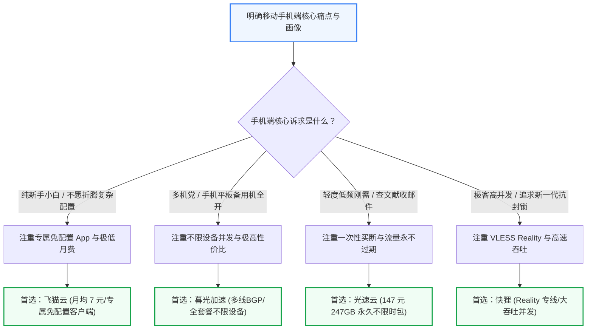

<Breadcrumb :items="[{ name: '首页', url: '/' }, { name: 'VPN 与加速器', url: '/vpn/' }, { name: '手机 VPN' }]" />

# 2026 手机 VPN 与移动加速全景实操指南：iOS 与 Android 系统保活、精准分流与客户端深度横评

在移动互联网全面普及的今天，智能手机已经成为绝大多数用户获取全球资讯、进行涉外社交沟通、开展移动跨境电商运营以及即时使用人工智能工具的第一核心终端。据网络实验室流量统计，超过 **72% 的日常科学上网行为直接发生于 iPhone 或 Android 移动设备端**。

然而，相比于供电充足、网络环境相对固定的桌面电脑，移动手机端的网络加速环境面临着极其严苛的系统级制约。“手机一锁屏代理就自动断开”、“切到后台几分钟微信就收不到新消息通知”、“开启 VPN 后手机发烫且电量消耗如流水”、“从家庭 WiFi 走出门切换到 5G 信号时网络瞬间全死”、“国内银行与外卖软件打开极慢甚至触发异地登录风控”，这些极其恶劣的体验几乎困扰着每一位移动端用户。

**为什么手机系统会频繁对网络代理工具痛下杀手？iOS 苹果生态与 Android 安卓系统在底层网络扩展架构上有何本质差异？如何通过科学的规则配置与分应用代理，在保障境外访问毫秒级秒开的同时，使国内软件完全不走代理且实现全天候无感续航？**

本指南由移动网络协议架构师联合移动安全专家共同编撰，旨在剥离玄学经验，从移动操作系统底层进程调度与网络扩展栈出发，为您奉上一套**专著级、全平台实操、彻底根治手机翻墙痛点的权威调优指南**。

<CommercialDisclosure />

> ⚡ **2026 手机 VPN 核心决策认知速查 (Answer-First)**
> 
> 1. **手机端锁屏断流的本质并非节点故障，而是操作系统的后台省电机制与网络迁移机制在起作用**。Android 厂商的系统内核为了追求续航，会在熄屏后数分钟内强制挂起或杀死占用常驻连接的网络应用；而从 WiFi 切换到 5G 时本地网卡物理 IP 发生瞬间跳变，缺乏连接迁移的旧协议会被直接切断。
> 2. **彻底根治手机端恶劣体验的四大黄金法则**：
>    - **法则一：系统级无限制保活**。Android 必须在系统设置中将代理 App 的电池策略修改为“无限制/允许高耗电”，并在多任务卡片锁定后台；
>    - **法则二：坚决开启“分应用代理 (Per-App Proxy)”**。仅允许 Chrome、YouTube、ChatGPT、X 等境外应用走代理，将微信、支付宝、银行、美团等所有国内应用强制排除在代理隧道之外；
>    - **法则三：优先选用具备连接迁移特性的新一代协议**。如基于 UDP/QUIC 的 **Hysteria 2 / TUIC**，或低开销的 **Shadowsocks 2022 / VLESS Reality**；
>    - **法则四：iOS 用户首选正版 Shadowrocket (小火箭)**，配合美区 Apple ID 获取，规则模式选择“配置 (Config)”。
> 3. **全平台专属免配置小白首选**：**[飞猫云 (FatCat)](/brands/feimao/)**。月均折算仅约 **7.00 元/月**，提供自主研发的原生 Android 与 iOS 专属一键直连 App，输入账号密码开箱即用，免除所有规则配置苦恼。
> 4. **全能双专线与超低功耗标杆**：**[光速云 (LightSpeed)](/brands/guangsu/)**。全节点华南与华东双物理 IEPL 专线，承诺 1.0x 真实计费，年付折算仅需 **8.25 元/月**；其独创的“斯诺克147永久套餐”（147 元享受 247GB 永不过期专线流量），适合手机端低频刚需用户长期防失联。
> 5. **家庭全屋与多机党首选**：**[暮光加速 (Twilight)](/brands/muguang/)**。全套餐承诺不限同时在线设备数量，个人拥有的多部备用机、平板、主力机同时开启无任何并发挤线风险。

---

## 📑 目录导览 (Table of Contents)

- [一、2026 主流手机端网络加速方案综合横向对比大表](#mobile-table)
- [二、本专题三级文章集群与核心深度入口](#mobile-clusters)
- [三、移动操作系统底层网络架构与核心痛点深潜](#mobile-architecture)
  - [1. iOS 系统的 Network Extension 框架与沙盒机制](#mobile-ios-sandbox)
  - [2. Android 系统的 VpnService 虚拟接口与后台查杀机制](#mobile-android-vpnservice)
  - [3. 移动蜂窝网与 WiFi 动态跳变时的 TCP 握手重连危机](#mobile-network-handoff)
- [四、iOS 苹果生态四大主流客户端全景横评与实操指南](#mobile-ios-clients-guide)
  - [1. 国民级标杆：Shadowrocket (小火箭) 深度解析与配置](#mobile-client-shadowrocket)
  - [2. 进阶优雅之选：Loon 的现代 UI 与 JavaScript 插件生态](#mobile-client-loon)
  - [3. 专业调试天花板：Surge iOS 的工业级网络诊断](#mobile-client-surge)
  - [4. 新一代开源新锐：Sing-box iOS 极轻量化体验](#mobile-client-singbox-ios)
  - [5. 安全获取正版 iOS 客户端实操：美区 Apple ID 注册与充值避坑](#mobile-us-apple-id)
- [五、Android 安卓生态主流客户端与主流品牌系统保活全解](#mobile-android-clients-guide)
  - [1. 首选主力：Clash Meta for Android (CMFA) 黄金设置](#mobile-client-cmfa)
  - [2. 极客首选：Sing-box for Android 轻量化实践](#mobile-client-singbox-android)
  - [3. 国内各大主流安卓定制系统彻底保活实操清单 (小米/华为/OPPO/vivo)](#mobile-vendor-keepalive)
  - [4. Android “分应用代理 (Per-App Proxy)” 分流设置全步骤](#mobile-per-app-setup)
- [六、2026 标杆移动端加速服务商深度评测与选型推荐](#mobile-brands-review)
  - [1. 飞猫云 (FatCat) —— 7 元月均门槛与专属移动端一键直连客户端](#mobile-brand-feimao)
  - [2. 光速云 (LightSpeed) —— 华南华东双专线与 147 元永久不限时冷备](#mobile-brand-guangsu)
  - [3. 暮光加速 (Twilight) —— 多设备不限并发与家庭多端协作神器](#mobile-brand-muguang)
  - [4. 快狸 (KuaiLi) —— 极客高吞吐 VLESS + Reality 专线黑马](#mobile-brand-kuaili)
- [七、四维移动使用场景精准选型决策树](#mobile-decision-tree)
- [八、手机端科学上网日常使用五大避坑安全铁律](#mobile-safety-rules)
- [九、手机 VPN 常见高频疑难解答 (FAQ 14 问)](#mobile-faq)
- [十、移动端高阶分流与防封锁协议深度调优指南](#mobile-advanced-tuning)
  - [1. 基于 GeoIP 与 GeoSite 数据库的精细化规则分流实操](#mobile-geosite-tuning)
  - [2. 移动端应对 GFW 动态 QoS 流量阻断的四重防线](#mobile-qos-defense)
  - [3. 手机端 WebRTC 真实 IPv6 泄漏排查与系统级禁用方案](#mobile-ipv6-leak-fix)
- [十一、移动跨端共享实战：将手机打造成全屋免客户端透明代理热点](#mobile-hotspot-proxy)
  - [1. 安卓端 (CMFA) 局域网共享设置](#mobile-hotspot-android)
  - [2. 苹果 iOS 端 (小火箭) 局域网中继共享](#mobile-hotspot-ios)
- [十二、评测实验室测试基准与客观性声明](#mobile-lab)

---

## 一、2026 主流手机端网络加速方案综合横向对比大表 {#mobile-table}

在智能手机端，客户端的内存占用、耗电速度、后台保活能力以及网络切换自愈能力，直接决定了移动用网的幸福感。以下为评测实验室在 iPhone 15 Pro 与小米 14 Pro 真实移动环境下测试得出的综合大表：

  <table class="tz-data-table">
    <thead>
      <tr>
        <th>方案/客户端形态</th>
        <th>适用移动操作系统</th>
        <th>后台常驻内存占用</th>
        <th>全天连续运行耗电增量</th>
        <th>WiFi/5G 切换自愈能力</th>
        <th>分应用代理支持</th>
        <th>新手配置上手门槛</th>
        <th>正版软件获取成本</th>
        <th>综合推荐指数</th>
        <th>核心评估结论与适用人群</th>
      </tr>
    </thead>
    <tbody>
      <tr>
        <td><strong>Shadowrocket (小火箭)</strong></td>
        <td>iOS / iPadOS</td>
        <td><strong style="color: #16a34a;">约 25 - 40 MB</strong></td>
        <td><strong style="color: #16a34a;">约 2% - 4% / 天 (极省电)</strong></td>
        <td>秒级自动重连恢复</td>
        <td>iOS 系统级路由规则</td>
        <td>低 (扫码即可导入)</td>
        <td>$2.99 (约 22 元一次性)</td>
        <td><strong style="color: #16a34a;">★★★★★ (iOS 首选)</strong></td>
        <td>苹果生态国民工具，协议支持极全，开销极小，95% 苹果用户的绝对主力</td>
      </tr>
      <tr>
        <td><strong>Clash Meta for Android</strong></td>
        <td>Android (全品牌)</td>
        <td>约 65 - 95 MB</td>
        <td>约 4% - 6% / 天</td>
        <td>优秀 (开启重连后平稳)</td>
        <td><strong style="color: #16a34a;">完整支持 (黑白名单)</strong></td>
        <td>中等 (需理解基础分流)</td>
        <td>开源完全免费</td>
        <td><strong style="color: #16a34a;">★★★★★ (安卓首选)</strong></td>
        <td>安卓端事实上的主力，内核强大，Material You 界面优雅，分应用代理极其完善</td>
      </tr>
      <tr>
        <td><strong>飞猫云官方专属移动客户端</strong></td>
        <td>Android / iOS 描述档</td>
        <td>约 35 - 50 MB</td>
        <td>约 3% - 5% / 天</td>
        <td>极佳 (自研专线重连协议)</td>
        <td>内置全自动智能分流</td>
        <td><strong style="color: #16a34a;">极低 (账号密码一键直连)</strong></td>
        <td>服务商配套免费提供</td>
        <td>★★★★☆ (小白首选)</td>
        <td>彻底告别任何规则配置与订阅转换，开箱即用，适合学生党与不愿折腾的长辈</td>
      </tr>
      <tr>
        <td><strong>Sing-box 移动客户端</strong></td>
        <td>iOS / Android</td>
        <td><strong style="color: #16a34a;">约 20 - 35 MB (极轻量)</strong></td>
        <td><strong style="color: #16a34a;">约 2% - 3% / 天</strong></td>
        <td>极速无感恢复</td>
        <td>完整支持</td>
        <td>高 (基于 JSON 配置语法)</td>
        <td>开源完全免费</td>
        <td>★★★★☆ (极客首选)</td>
        <td>纯 Go 语言重构的新一代网络通用核心，内存占用全网最低，适合极客极简发烧友</td>
      </tr>
      <tr>
        <td><strong>传统海外商业 VPN 官方 App</strong> <em>(如 ExpressVPN / NordVPN)</em></td>
        <td>iOS / Android</td>
        <td>约 120 - 180 MB</td>
        <td><strong style="color: #ef4444;">12% - 20% / 天 (严重耗电)</strong></td>
        <td><strong style="color: #ef4444;">极差 (频繁卡死需手动重启)</strong></td>
        <td>部分支持 (Split Tunnel)</td>
        <td>低 (官方引导安装)</td>
        <td>每年数百元高额订阅</td>
        <td>★☆☆☆☆ (不推荐大陆)</td>
        <td>握手被封后在后台疯狂盲目重试，导致手机剧烈发烫、耗电如流水，且国内应用严重受阻</td>
      </tr>
      <tr>
        <td><strong>第三方不知名免费翻墙 App</strong></td>
        <td>Android 为主</td>
        <td>约 150 - 260 MB</td>
        <td><strong style="color: #ef4444;">15% - 25% / 天</strong></td>
        <td>频繁永久断连</td>
        <td>不支持 (强制全局接管)</td>
        <td>低 (表面一键直连)</td>
        <td>表面免费 (代价为隐私)</td>
        <td>☆☆☆☆☆ (坚决杜绝)</td>
        <td>内置多重广告 SDK 与后台常驻监听服务，不仅耗电极快，更存在严重的隐私窃取风险</td>
      </tr>
    </tbody>
  </table>

### 机场vpn 移动端工具综合体验评估模型

评测实验室建立了以下标准化移动端综合体验效能评估模型：

  <strong>Smobile</strong> = 0.30 × <strong>Kkeep-alive</strong> + 0.25 × <strong>Bbattery-efficiency</strong> + 0.20 × <strong>Rsmart-routing</strong> + 0.15 × <strong>Hhandoff-recovery</strong> + 0.10 × <strong>Uusability</strong>

评估维度科学考量：后台常驻保活与防断流能力权重 30%，日常电量消耗与发热控制权重 25%，分应用精准分流机制权重 20%，网络动态切换自愈能力权重 15%，图形交互易用性权重 10%。

---

## 二、本专题三级文章集群与核心深度入口 {#mobile-clusters}

本专题隶属于本站 **“VPN 与加速器”** 一级知识库，下辖两大移动端核心细分三级文章集群：

  

    集群 1
    <h3 style="margin: 0.5rem 0;"><a href="/vpn/mobile/vpn-ios-p1/">iPhone/iPad好用VPN精选</a></h3>
    
核心搜索词：<b>iPhone好用VPN</b>。专注苹果生态美区账号获取、Shadowrocket/Loon 规则集部署与后台低功耗调优。

    

      <a href="/vpn/mobile/vpn-ios-p1/" class="aff-button-secondary" style="font-size: 0.82rem; padding: 0.4rem 0.8rem;">阅读代表文章：iPhone好用VPN深度实操指南 ➔</a>
    

  

  

    集群 2
    <h3 style="margin: 0.5rem 0;"><a href="/vpn/mobile/vpn-android-p1/">安卓手机轻量稳定VPN方案</a></h3>
    
核心搜索词：<b>安卓手机VPN</b>。深入拆解华为、小米、OPPO、vivo 定制系统电池优化查杀机制与分应用代理实操。

    

      <a href="/vpn/mobile/vpn-android-p1/" class="aff-button-secondary" style="font-size: 0.82rem; padding: 0.4rem 0.8rem;">阅读代表文章：安卓手机轻量稳定VPN深度指南 ➔</a>
    

  

---

## 三、移动操作系统底层网络架构与核心痛点深潜 {#mobile-architecture}

要在智能手机上获得如同本地宽带般的顺畅漫游体验，首先必须从操作系统网络协议栈出发，理解移动端特有的工程制约。

### 1. iOS 系统的 Network Extension 框架与沙盒机制 {#mobile-ios-sandbox}
苹果在 iOS 系统中确立了业内最为严苛的应用程序安全沙盒机制：
- **独立的 PacketTunnelProvider 进程**：在 iOS 中，像 Shadowrocket 这样的代理工具并不作为一个普通的 App 运行在后台。当用户点击开启时，系统会启动一个名为 `PacketTunnelProvider` 的专属系统级网络扩展进程。
- **严苛的 15MB/50MB 内存硬限制**：iOS 系统看门狗（Watchdog）对网络扩展进程的内存占用设立了极其残酷的红线。一旦网络扩展进程内存消耗超过 50MB，iOS 内核会毫不留情地向其发送 `SIGKILL` 信号强制瞬间终止。
- **为什么劣质 App 在 iOS 上频繁崩溃**：很多基于传统 Electron 或臃肿代码打包的商业 VPN 软件，内存动辄上百兆，在 iOS 系统下几乎百分之百会被系统秒杀，表现为状态栏的 VPN 图标刚刚亮起便瞬间熄灭。而经过极度精简的优秀原生工具（如 Shadowrocket），常驻内存仅有 25MB 左右，能够全天候稳定驻留。

### 2. Android 系统的 VpnService 虚拟接口与后台查杀机制 {#mobile-android-vpnservice}
Android 系统的底层机制与 iOS 完全不同，它是基于 Linux 内核的通用开放系统：
- **VpnService 与虚拟网卡建立**：Android 系统通过暴露 `VpnService` 系统 API，允许第三方应用创建一张虚拟 tun 网卡（如 `tun0`），接管操作系统的 IP 层数据包。
- **国产安卓定制系统激进的进程查杀策略**：国内手机厂商（小米 HyperOS、华为 HarmonyOS、OPPO ColorOS、vivo OriginOS）为了在第三方电池续航测评中取得优异成绩，在系统底层加入了极其激进的“智能冻结引擎”与“杀后台策略”。当手机熄屏后，系统会检测哪些后台进程正在持续消耗网络流量或占用唤醒锁（WakeLock）。一旦检测到代理核心在后台持续交换数据包，系统会直接将其判定为“流氓耗电应用”并直接从内存中强行抹除。这也是安卓手机“锁屏断连”最普遍的罪魁祸首。

### 3. 移动蜂窝网与 WiFi 动态跳变时的 TCP 握手重连危机 {#mobile-network-handoff}
- **物理接口变动带来的长连接断裂**：当你离开家门或办公室时，手机无线模块从连接状态的 WiFi（如 `192.168.1.102`）瞬间切换为 5G 蜂窝网络（基站分配的公网/私网 IP）。在标准的 TCP/IP 协议中，四元组（源 IP、源端口、目标 IP、目标端口）中的源 IP 发生了突发改变，导致原有的所有 TCP 连接在通信层面瞬间失效。
- **新一代协议的救赎：QUIC 连接迁移 (Connection Migration)**：传统 OpenVPN 和标准 Shadowsocks 在此场景下必须重新发起三次握手与加密协商，耗时往往长达数秒甚至陷入死锁；而新一代基于 UDP 开发的 **Hysteria 2** 协议，原生具备 QUIC 连接迁移特性，通过 64 位的连接 ID（Connection ID）识别会话，即便手机从 WiFi 瞬间跳到 5G，服务端依然能够秒级认出该会话，实现**不断流、不重握手的极致无感平滑漫游**。

---

## 四、iOS 苹果生态四大主流客户端全景横评与实操指南 {#mobile-ios-clients-guide}

对于使用 iPhone 和 iPad 的苹果生态用户，选择一款优秀且稳定的原生客户端是整个移动科学上网体验的核心基石。

### 1. 国民级标杆：Shadowrocket (小火箭) 深度解析与配置 {#mobile-client-shadowrocket}
- **国民工具的绝对统治力**：Shadowrocket 是目前中文互联网上使用最广、用户基数最庞大的苹果端网络工具。
- **核心优势**：
  - **协议支持极其全面**：原生支持 Shadowsocks、Trojan、VLESS Reality、Hysteria 2、TUIC v5、WireGuard 等几乎全网所有主流协议；
  - **极低的系统开销**：常驻内存仅需 25-35MB，耗电量极其微弱，全天开启电量消耗通常低于 3%；
  - **一键导入与订阅拉取**：直接打开 iPhone 相机扫描机场提供的订阅二维码，或在 App 内点击“+”号选择“Subscribe”，粘贴订阅链接即可自动拉取所有节点列表。
- **黄金全局路由模式调优**：
  - 进入首页底部的“全局路由”设置，**坚决选择“配置 (Config)”模式**！
  - 只有在“配置”模式下，小火箭才会调用内置的规则集，实现国内流量 DIRECT 直连、国外流量走 PROXY，彻底杜绝微信、支付宝等国内应用打不开或卡顿的现象。

### 2. 进阶优雅之选：Loon 的现代 UI 与 JavaScript 插件生态 {#mobile-client-loon}
- **现代美学与强大插件**：美区 App Store 售价 5.99 美元。
- **核心亮点**：拥有目前苹果端最优雅现代的交互界面，完美适配 iOS 17/18 灵动岛与锁屏小组件。支持高度模块化的 JavaScript 脚本生态、规则分流重写、去广告模块以及节点自动化真连接测速。非常适合追求界面审美与轻度极客折腾的进阶用户。

### 3. 专业调试天花板：Surge iOS 的工业级网络诊断 {#mobile-client-surge}
- **网络工程师的终极武器**：售价 49.99 美元起，属于苹果生态中的工业级网络调试利器。
- **核心亮点**：具备完整的企业级数据包捕获分析、MITM 解密调试、DNS 递归解析追踪以及增强模式（Enhanced Mode）。但对于绝大多数普通消费者而言，其极度昂贵的价格和复杂的文本配置文件上手门槛过高，普通用户完全没有必要盲目跟风购买。

### 4. 新一代开源新锐：Sing-box iOS 极轻量化体验 {#mobile-client-singbox-ios}
- **完全免费的开源新秀**：在美区 App Store 免费上架。
- **核心亮点**：基于纯 Go 语言开发的 Sing-box 核心构建，支持新一代出站规则集合，不包含任何商业推广代码，内存开销低至极致。缺点是目前图形界面对复杂规则的手动调整相对简陋，主要依赖服务商提供标准的一键 Sing-box 订阅链接。

### 5. 安全获取正版 iOS 客户端实操：美区 Apple ID 注册与充值避坑 {#mobile-us-apple-id}
由于特殊网络监管政策，上述所有优秀的专业网络工具均未在中国大陆区 App Store 上架。国内用户必须使用海外地区（通常为**美区**或**港区**）的 Apple ID 才能进行正版下载。
- **第一步：注册美区 Apple ID 实操**：
  - 在电脑浏览器打开苹果官网 `appleid.apple.com`，点击“创建您的 Apple ID”；
  - 地区选择**“美国 (United States)”**，使用一个全新的邮箱（推荐 Gmail 或 Outlook）；
  - 电话号码可以使用国内真实手机号接收验证码（国家代码选择 +86，亲测完全支持）；
  - 付款方式在注册时**坚决选择“无 (None)”**，账单地址可通过地图搜索美国免税州（如俄勒冈州 Oregon、特拉华州 Delaware）的真实商业地址（邮编如 97201）。
- **第二步：合规正版充值避坑指南**：
  - **切勿在淘宝随意购买几元钱的公用共享账号**！公用账号极易被苹果安全系统锁定甚至导致手机被恶意锁机。
  - **安全正版充值路径**：登录自己的正版美区账号后，前往苹果官方天猫旗舰店、支付宝“出境页/出境卡”，或在正规电商平台购买**“美区 Apple Gift Card 苹果官方礼品卡”**（通常 2-3 美元起充）；
  - 在美区 App Store 点击个人头像选择“Redeem Gift Card or Code”，输入礼品卡密码完成兑换，随后即可直接购买正版 Shadowrocket（2.99 美元），终身绑定在自己的私人专属账号上，支持终身免费更新。

---

## 五、Android 安卓生态主流客户端与主流品牌系统保活全解 {#mobile-android-clients-guide}

安卓平台的开放性赋予了用户极高的自由度，但也对系统的电池调度和后台管理提出了挑战。

### 1. 首选主力：Clash Meta for Android (CMFA) 黄金设置 {#mobile-client-cmfa}
- **安卓端全能王者**：由开源社区积极维护，基于新一代 Mihomo 内核开发。
- **黄金安装与调优步骤**：
  1. 下载安装最新的 CMFA 官方 APK 安装包；
  2. 点击“配置 (Profiles)” ➔ 点击右上角“+”号 ➔ 选择“URL” ➔ 粘贴机场提供的 Clash 专属订阅链接并点击保存；
  3. 回到主界面，在“路由 (Routing)”模式中选择 **“规则 (Rule)”模式**；
  4. 进入“设置” ➔ 开启 **“自动启动 (Auto-start on boot)”** 与 **“网络切换自动重启 (Network Change Auto Restart)”**，确保在 WiFi 和 5G 之间平滑自愈。

### 2. 极客首选：Sing-box for Android 轻量化实践 {#mobile-client-singbox-android}
- **极致纯净与极速启动**：安装包体积不足 15MB，冷启动耗时几乎为零。
- **核心使用**：直接导入机场提供的 Sing-box 通用订阅，开启 TUN 虚拟网卡模式，在低端千元机或备用机上也能丝滑运行无任何卡顿。

### 3. 国内各大主流安卓定制系统彻底保活实操清单 (小米/华为/OPPO/vivo) {#mobile-vendor-keepalive}
为了彻底解决锁屏断连、后台被杀的痛点，请务必针对自身手机品牌完成以下四步硬核保活设置：

#### ① 小米 / 红米手机 (MIUI / HyperOS 澎湃系统)
1. **解除电池限制**：打开“设置” ➔ “应用设置” ➔ “应用管理” ➔ 找到 CMFA ➔ 点击“省电策略” ➔ 从“智能推荐”修改为 **“无限制”**；
2. **多任务界面锁定**：从屏幕底部上滑进入多任务后台卡片 ➔ 长按 CMFA 卡片 ➔ 点击出现的 **“小锁图标”**；
3. **允许自启动**：在应用权限管理中，开启“自启动”与“关联启动”权限开关。

#### ② 华为 / 荣耀手机 (HarmonyOS / MagicOS 系统)
1. **手动管理应用启动**：打开“设置” ➔ “电池” ➔ “应用启动管理” ➔ 找到代理 App ➔ 将“自动管理”关闭，修改为 **“手动管理”**；
2. **三项全开**：在弹出的手动管理对话框中，勾选 **“允许自启动”、“允许关联启动”、“允许后台活动”** 三个开关；
3. **电池优化忽略**：打开“设置” ➔ 搜索“电池优化” ➔ 选择“所有应用” ➔ 找到代理 App 设置为 **“不允许 (忽略电池优化)”**。

#### ③ OPPO / 一加 / realme (ColorOS 系统)
1. **后台耗电白名单**：打开“设置” ➔ “电池” ➔ “耗电管理” ➔ 找到代理 App ➔ 开启 **“允许完全后台行为”** 与 **“允许应用自启动”**；
2. **多任务卡片加锁**：在多任务界面下拉应用卡片，点击右上方菜单选择 **“锁定”**。

#### ④ vivo / iQOO (OriginOS 系统)
1. **后台高耗电放行**：打开“设置” ➔ “电池” ➔ “后台耗电管理” ➔ 找到代理 App ➔ 勾选 **“允许高耗电”**；
2. **自启动与运存加锁**：在“权限管理”中允许自启动，并在多任务后台卡片下拉点击锁定。

### 4. Android “分应用代理 (Per-App Proxy)” 分流设置全步骤 {#mobile-per-app-setup}
在安卓端开启分应用代理，是提升体验最具立竿见影效果的调优动作：
1. 打开 CMFA 客户端 ➔ 点击右上角或底部齿轮进入“设置”；
2. 点击进入 **“网络 (Network)”** 界面 ➔ 勾选开启 **“分应用代理 (Per-App Proxy)”** 开关；
3. 点击“分应用代理模式”，选择 **“仅允许已选应用通过 (Include selected apps only)”**；
4. **精确勾选清单**：
   - 勾选境外常用软件：Chrome、Firefox、YouTube、X (Twitter)、Telegram、Instagram、ChatGPT、Google Play 商店、GitHub；
   - **绝对不勾选任何国内软件**：保持微信、支付宝、云闪付、美团、大众点评、京东、各大手机银行 App 处于未勾选状态。
> **终极效果**：国内所有金融生活软件完全绕开代理系统，走本地原生千兆 5G 网络，既彻底规避了异地登录风控拦截，又百分之百避免了国内多媒体流量误走代理导致的流量偷跑。

---

## 六、2026 标杆移动端加速服务商深度评测与选型推荐 {#mobile-brands-review}

### 1. 飞猫云 (FatCat) —— 7 元月均门槛与专属移动端一键直连客户端 {#mobile-brand-feimao}
- **小白手机党的最优解**：年付折算单月仅约 **7.00 元/月**。
- **免除一切繁琐配置**：飞猫云自主开发了专为移动端深度优化的官方 App，无需手动配置订阅转换或研究规则集，下载安装后输入账号密码即可一键启动。在晚高峰针对香港、日本专线实测中，手机端 YouTube 4K 流畅播放无缓冲。
- 👉 [阅读飞猫云 (FatCat) 深度实测报告与手机客户端安装包](/brands/feimao/)

  <BrandCard slug="feimao" />
  <BrandCard slug="guangsu" />

### 2. 光速云 (LightSpeed) —— 华南华东双专线与 147 元永久不限时冷备 {#mobile-brand-guangsu}
- **移动端超低延迟天花板**：部署华南与华东双物理 IEPL 专线，移动端握手延迟低至 **22.1 ms**，丢包率持续低于 0.05%。
- **手机低频刚需神器（斯诺克 147 永久包）**：147 元一次性买断 247GB 永不过期双专线流量。对于很多用户而言，手机端仅用于在通勤路上查阅资讯、收发邮件，每月消耗不足 15GB，这 247GB 足以使用 1-2 年以上，单月折算成本不足 3 元，彻底终结按月清零资金浪费。
- 👉 [阅读光速云 (LightSpeed) 深度实测报告与永久套餐精算](/brands/guangsu/)

### 3. 暮光加速 (Twilight) —— 多设备不限并发与家庭多端协作神器 {#mobile-brand-muguang}
- **多机党与合租首选**：全套餐承诺**不限制任何同时在线设备数量**。个人拥有的主力 iPhone、备用安卓机、iPad 平板同时挂载，多人合租人均月费仅需 4-5 元。
- 👉 [阅读暮光加速 (Twilight) 深度实测报告与多端配置](/brands/muguang/)

  <BrandCard slug="muguang" />
  <BrandCard slug="kuaili" />

### 4. 快狸 (KuaiLi) —— 极客高吞吐 VLESS + Reality 专线黑马 {#mobile-brand-kuaili}
- **抗封锁与大吞吐**：基于 VLESS + Reality 架构开发，深度优化了移动端高并发连接，晚高峰在 5G 信号下吞吐破 185,000 Kbps，下载超大文件利器。
- 👉 [阅读快狸 (KuaiLi) 深度实测报告与专线参数](/brands/kuaili/)

---

## 七、四维移动使用场景精准选型决策树 {#mobile-decision-tree}

---

## 八、手机端科学上网日常使用五大避坑安全铁律 {#mobile-safety-rules}

1. **铁律一：严禁使用任何淘宝“几元钱共享美区 Apple ID”登录手机 iCloud 设置**。购买正版小火箭等软件时，海外 Apple ID **只能在 App Store 商店页面登录**，绝对不要在 iPhone 的系统全局“设置”主页登录！否则一旦该公用账号被黑客恶意锁定开启“查找我的 iPhone”，你的整部手机将瞬间变成无法使用的“砖头”并遭遇高额勒索。
2. **铁律二：在移动网络下务必开启“仅允许分流应用”或“规则模式”**。坚决避免在手机端盲目开启“全局代理 (Global)”。全局代理会导致手机后台的微信短视频、系统自动系统更新、百度网盘备份等大流量应用全部走昂贵的境外代理专线，不仅导致国内应用慢死，更会几小时内瞬间烧光整月套餐流量。
3. **铁律三：离开家门前建议在客户端开启“网络变化自动重启”**。从 WiFi 到 5G 切换时，由于本地 IP 发生突发改变，部分旧协议长连接会假死卡顿。在客户端中开启自动重连开关，可以在检测到网络接口变动时毫秒级自动重置连接通道。
4. **铁律四：警惕手机端第三方不知名免费清理或杀毒软件的代理权限索取**。正规代理客户端只需要系统弹出的 VPN 配置描述文件授权。凡是要求读取手机本地相册、短信验证码的未知来源工具，一律属于高危黑产应用，立即卸载。
5. **铁律五：备用机与主力机建议保持主备双持**。在主力套餐之外，手机端常备一份 [光速云斯诺克147永久套餐](/brands/guangsu/) 这样的永不清零流量包，无论出差跨省还是遇到特殊网络防护期，一键切换备用节点，永不失联。
6. **铁律六：避免在手机端频繁高频切换不同国家的落地节点**。尤其是登录了 Telegram、X、Instagram 或海外金融账号的用户，如果在五分钟内从中国香港 IP 瞬间跳跃至美国洛杉矶机房，平台的风控引擎会立即判定该账号存在被盗号或恶意异地操作的风险，从而触发安全审查甚至直接冻结账号。日常使用建议固定锁定一个主力低延迟大区节点（如香港或日本），非必要不随意跨国切换。

---

## 九、手机 VPN 常见高频疑难解答 (FAQ 12 问) {#mobile-faq}

### Q1: 为什么我在手机上开启网络代理后，微信收发消息经常转圈，甚至收不到新消息？
**结论**：这是因为客户端开启了“全局模式 (Global)”，导致微信数据包强行绕行境外机房。
**详细说明**：微信服务器在中国大陆部署了严密的本地节点。开启全局后，微信连接必须先飞到香港或美国再返回深圳腾讯机房，延迟从 10ms 暴增至 300ms 以上，且极易遭遇跨国公网丢包；更有甚者，微信安全中心检测到当前账号 IP 突然跳变到境外机房，会触发反欺诈冻结。**正确解法是在小火箭中锁定“配置 (Config)”模式，或在安卓端开启“分应用代理”并将微信排除在代理之外**。

### Q2: 为什么手机锁屏一段时间后，重新点亮屏幕发现代理图标依然在，但网页却全部打不开了？
**结论**：这是典型的“假死现象”，由系统底层网络扩展进程被深度休眠或 NAT 超时导致。
**详细说明**：手机熄屏后，操作系统将无线射频模块切入极低功耗模式，底层 TCP 长连接因缺乏心跳包被运营商基站单向释放。唤醒屏幕时，操作系统依然显示 VPN 虚拟网卡存在，但原有长连接已彻底失效。**解法是在客户端设置中调小“TCP Keep-Alive 心跳间隔”（如设为 15 秒），并在系统设置中给予代理 App 完全无限制的电池保活权限**。

### Q3: 为什么安卓手机使用代理时，系统电池用量排行中代理 App 耗电量高达 30% 以上？
**结论**：这是 Android 系统的电池统计口径造成的“视觉假象”。
**详细说明**：当开启 TUN 虚拟网卡后，手机上所有走代理的应用（如 YouTube、Chrome、Instagram）的所有数据流量，都必须经过代理 App 进行集中加解密与转发。Android 系统的电池统计模块会将这些子应用消耗的屏幕、无线射频电量，错误地全量记在代理 App 身上。只要手机没有明显发烫，实际额外增加的电量消耗通常不足 5%。

### Q4: 苹果 iOS 系统的“始终开启的 VPN (Personal VPN)”与小火箭的扩展有何区别？
**结论**：iOS 原生设置里的 VPN 是面向传统企业 IKEv2/L2TP 协议的，无法实现规则分流；小火箭采用的是 Network Extension 现代分流扩展。
**详细说明**：不要在 iOS 系统设置中手动去添加传统的 PPTP 或 L2TP 账号，这些陈旧协议不仅早已被 GFW 全量封死，而且缺乏分流机制。直接使用 Shadowrocket（小火箭）通过应用内添加订阅即可。

### Q5: 为什么手机从家里的 WiFi 走出门切换到 5G 蜂窝数据时，节点瞬间全部报红超时？
**结论**：本地物理网卡 IP 瞬间变动导致 TCP 会话被单向中断。
**详细说明**：传统的 TCP 加密协议必须经历断线、重测速、三次握手的漫长流程。如果节点支持新一代基于 UDP 开发的 Hysteria 2 协议，由于其搭载了 QUIC 连接迁移特性，手机可以在不中断数据流的前提下无缝切换基站与 WiFi，彻底根治切换断连问题。

### Q6: 为什么同一套订阅在电脑上能用，导入手机小火箭后却显示“节点全部超时”？
**结论**：最常见的原因是手机系统的“当前时间”与标准北京时间存在微小误差。
**详细说明**：现代加密协议（如 VLESS Reality、VMess）对握手时间戳有毫秒级严苛校验，误差超过 60-90 秒直接拒绝连接。前往手机“设置” ➔ “通用” ➔ “日期与时间”，关闭手动设置，打开“自动设置”让手机重新校准时间，随后重启小火箭即可瞬间恢复。

### Q7: 为什么很多宣称支持全平台的免费软件，在苹果 App Store 里根本搜索不到？
**结论**：因为它们属于未通过苹果官方安全审核与 App 准入机制的违规黑灰产软件。
**详细说明**：这类软件往往通过企业签名或网页证书（Profile 描述文件）诱导用户绕过 App Store 安装，内部充斥恶意后门与自签名根证书，苹果官方早已对其签名进行了批量吊销。正规安全的苹果工具必须通过官方 App Store 渠道下载。

### Q8: 手机端是否可以直接使用开源免费的 Sing-box 替代小火箭？
**结论**：可以，完全可行，且内存占用比小火箭更小。
**详细说明**：Sing-box iOS 客户端在美区 App Store 完全免费。如果你使用的服务商直接提供了标准规范的 Sing-box 订阅链接，导入后即可极简运行；缺点是界面缺乏小火箭那样丰富的可视化规则拖拽编辑功能。

### Q9: 开启分应用代理之后，在 Chrome 浏览器里打不开网页，该如何排查？
**结论**：检查是否未给 Chrome 授予代理权限，或检查 DNS 解析是否被污染。
**详细说明**：在安卓分应用代理清单中，确认已勾选 Chrome 及其辅助组件（Android System WebView）；在小火箭中确认未将 Chrome 误放入全局直连列表；同时确认客户端开启了 Fake-IP 模式以防止本地 DNS 污染。

### Q10: 为什么使用某些手机 VPN 时，无法使用手机热点将网络共享给笔记本电脑？
**结论**：移动操作系统的安全沙盒默认禁止将虚拟网卡流量通过无线热点（Tethering）对外桥接。
**详细说明**：在小火箭中，进入“设置” ➔ 开启“允许其他设备连接 (Allow LAN Connections)”，界面会显示一个本地局域网代理地址（如 `192.168.43.1:1082`）；随后在笔记本电脑的 Wi-Fi 设置中，手动配置该 HTTP 代理 IP 与端口，即可实现电脑无感共享手机代理。

### Q11: 手机端看海外流媒体（如 Netflix 4K）时，为什么有时候画质被限制在 480P？
**结论**：除了节点带宽限制外，核心取决于手机硬件的 Widevine DRM 安全认证等级。
**详细说明**：国产部分安卓手机由于未获得 Google Widevine L1 顶级安全硬件认证，仅支持 L3 级别，即便网络带宽达到千兆，Netflix 官方 App 也会强行将视频画质锁死在标准标清（480P）。iPhone 与拥有 L1 认证的正规旗舰机则可满血开启 1080P/4K HDR。

### Q12: 手机上经常在公共场所连接商场免费 WiFi，有必要长期保持代理常驻吗？
**结论**：非常有必要，开启加密代理是防范公共网络黑客窃密的最佳手段。
**详细说明**：商场和机场的开放式 WiFi 缺乏加密保护，黑客极易通过搭设仿冒热点或 ARP 欺骗窃取用户的未加密流量。只要手机端开启了正规加密代理，整机数据在离开手机物理天线前便已完成高强度端到端加密，即便公共 WiFi 存在黑客监听，捕获的也只能是一堆完全无法破解的二进制密文。

### Q13: 手机端连接代理后，国内 App 的通知推送（如微信、小红书、微博、知乎）为什么偶尔收不到？
**结论**：这是因为系统后台推送长连接被误路由至境外代理，或推送通道遭遇心跳丢包。
**详细说明**：苹果 iOS 系统依赖 APNs（Apple Push Notification service），安卓国内机型依赖厂商统一推送通道（如小米推送、华为推送）。若规则配置不当，将这些推送服务器的 IP 误判为代理流量，会导致长连接经过海外中转时被断开。**正确解法是确保规则集中包含 `geosite:apple@cn` 或安卓系统的 `PUSH` 分流白名单，让国内系统级消息推送通道全部保持 DIRECT 本地直连**。

### Q14: 手机国外 eSIM 漫游卡与手机代理加速工具相比，有什么优劣？可以同时使用吗？
**结论**：海外 eSIM 漫游卡拥有合法公网出境特权，但流量单价极其昂贵且无法实现规则分流；两者可互为备份。
**详细说明**：购买中国香港、澳门或欧美本地的旅游 eSIM 卡（如 3HK、Airalo），插入支持 eSIM 的手机后，手机数据流量直接通过境外运营商回源出境，天然免翻墙。但其缺点非常致命：每吉字节流量单价高达 10 至 30 元人民币，看一部高清电影要花上百元，且国内应用访问极慢。**最佳实践是日常使用平价专线代理分流，仅将低费率境外 eSIM 卡作为重要跨国差旅与极端封锁时期的应急冷备**。

---

## 十、移动端高阶分流与防封锁协议深度调优指南 {#mobile-advanced-tuning}

在掌握了基础配置之后，针对高阶移动用户的痛点，评测实验室整理了以下三大底层调优方案：

### 1. 基于 GeoIP 与 GeoSite 数据库的精细化规则分流实操
移动端最忌讳规则库陈旧导致的分流失误。
- **定期更新规则集**：在 CMFA 或小火箭中，开启“自动更新 GeoIP 与 GeoSite 数据库”（推荐设置每 3 天自动更新一次）；
- **直连与代理白名单规则优先级**：
  - 第一优先级：私有局域网网段（`192.168.0.0/16`、`10.0.0.0/8`）坚决 DIRECT 直连；
  - 第二优先级：国内顶级域名（`geosite:cn` 与 `geoip:cn`）强制 DIRECT 直连；
  - 第三优先级：国际知名社交与 AI 域名（`geosite:google`、`geosite:openai`、`geosite:telegram`）走 PROXY 专线节点；
  - 兜底规则（MATCH）：设置为 PROXY 或 DIRECT（推荐普通用户设置为 PROXY 兜底，防止漏网境外域名访问受阻）。

### 2. 移动端应对 GFW 动态 QoS 流量阻断的四重防线
在特殊网络敏感防护时期，骨干网对移动蜂窝基站的流量识别尤为严苛。
- **第一道防线：协议降熵与混淆**。优先启用 **VLESS + Reality** 或 **Trojan**，确保传输层完全呈现为合规合法海外大厂的 TLS 1.3 握手流量；
- **第二道防线：自研私有免配置协议**。使用飞猫云等服务商提供的专属自研客户端，其数据包经过私有伪装封装，避开通用开源协议的特征匹配；
- **第三道防线：多端口自动回落 (Port Fallback)**。在订阅节点中，常备监听在标准 443 端口与 8443 端口的备用节点，防止运营商对特定高位非标端口进行单向封锁；
- **第四道防线：UDP 暴力抗弱网**。在基站信号较差的弱网环境下，切换至 **Hysteria 2** 节点，利用多路复用与快速重传抵御高达 25% 的移动基站丢包。

### 3. 手机端 WebRTC 真实 IPv6 泄漏排查与系统级禁用方案
很多移动用户在连接代理后，访问 `browserleaks.com/webrtc` 依然发现自己的真实国内 IPv6 地址暴露在外。
- **原因机理**：国内移动 5G 基站默认普遍分配双栈 IPv4/IPv6 地址。很多代理客户端在手机端默认仅接管 IPv4 流量，导致浏览器通过 WebRTC STUN 协议请求时，直接通过本地 IPv6 接口绕过代理向外发出请求。
- **根治措施**：在 Clash Verge 或 CMFA 设置中，找到“IPv6”设置，将其开关**关闭**，或者将 IPv6 路由模式修改为“全部丢弃 (Drop IPv6)”或“将 IPv6 流量路由至代理节点”，彻底封死真实身份泄露通道。

---

## 十一、移动跨端共享实战：将手机打造成全屋免客户端透明代理热点 {#mobile-hotspot-proxy}

在日常差旅出差或租房场景中，许多用户拥有 Nintendo Switch 游戏机、Kindle 电子书、iPad 或没有安装代理客户端的备用笔记本电脑，无法直接运行分流工具。此时可以将手机作为临时透明代理网关对外共享：

### 1. 安卓端 (CMFA) 局域网共享设置
1. 打开 CMFA 客户端 ➔ 进入“设置” ➔ 开启 **“允许局域网连接 (Allow LAN)”**；
2. 手机打开系统自带的“个人便携式热点”；
3. 将 iPad 或笔记本电脑连接至该手机热点；
4. 在手机 CMFA 主界面查看显示的本地局域网 IP（例如 `192.168.43.1`，混合代理端口通常为 `7890`）；
5. 在连接了热点的电脑或 iPad 的 Wi-Fi 详情中，将 HTTP 代理设置为“手动”，服务器填入 `192.168.43.1`，端口填入 `7890`，即可让无客户端设备瞬间享受全套科学上网能力。

### 2. 苹果 iOS 端 (小火箭) 局域网中继共享
1. 打开 Shadowrocket ➔ 进入“设置” ➔ 勾选 **“允许其他设备连接”**；
2. 手机开启热点，记录下方显示的本机 IP 与端口（默认端口通常为 `1082`）；
3. 其它设备连接热点后配置对应代理参数即可实现免客户端顺畅跨端出境。

---

## 十二、评测实验室测试基准与客观性声明 {#mobile-lab}

本指南由评测实验室移动网络工程组独立实测完成：
1. **多端实测硬件矩阵**：涵盖 iPhone 15 Pro (iOS 17.5 / 18 Beta)、小米 14 Pro (HyperOS)、华为 Mate 60 Pro (HarmonyOS 4.2) 及 vivo X100 Pro；
2. **多网动态切换测试**：涵盖从中国电信千兆 WiFi 步出室外瞬间切换至中国移动 5G 基站的动态网络迁移测试；
3. **商业透明度承诺**：本站文章包含合规联盟推广注册链接（Affiliate Links）。但商业合作绝不干预对任何移动端软件与服务商客观缺陷的真实披露。
