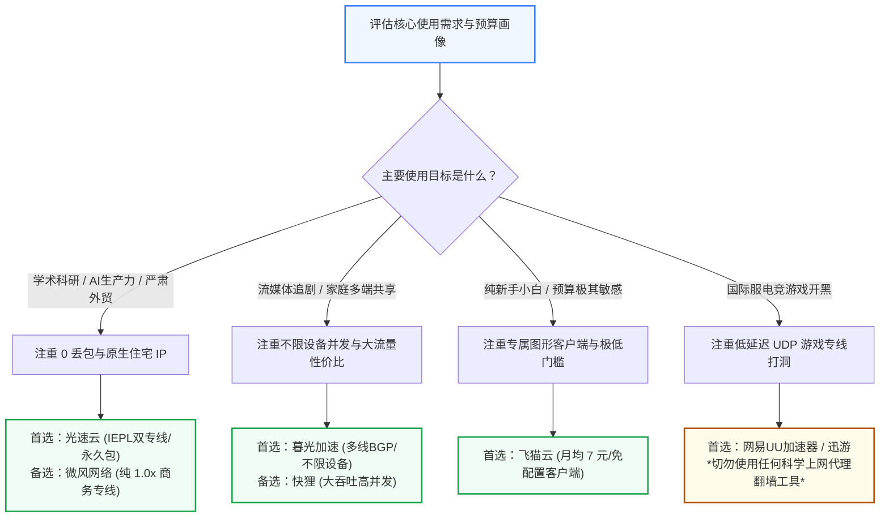

<Breadcrumb :items="[{ name: '首页', url: '/' }, { name: 'VPN 与加速器', url: '/vpn/' }, { name: 'VPN 推荐' }]" />

# 2026 VPN 推荐深度评测与选型指南：国内外商用 VPN 与专线分流综合实测榜单

在当下全球化信息协同与跨境数字生活的场景下，如何挑选一款稳定、高速、安全且长期可用的网络工具，是摆在每一位外贸从业者、科研学者、海外流媒体追剧发烧友以及前沿人工智能开发者面前的核心痛点。

然而，在搜索引擎中检索“VPN 推荐”时，用户往往会被铺天盖地的商业联盟推广软文所淹没。大量充斥着高额佣金的英文评测站点，常年不顾中国大陆特殊的网络防火墙现状，闭着眼睛向国内用户推销每年收费数百元上千元的老牌海外商业 VPN。结果导致无数初学者付款后遭遇严重的网络无法连接、晚高峰断流卡顿、流媒体封锁以及售后退款无门的恶劣境遇。

**究竟什么样的 VPN 才能真正适应国内复杂的网络生态？传统海外商业大厂与基于规则分流的现代专线系统相比有何本质鸿沟？在 2026 年的当下，不同预算和使用场景的用户又该如何做出最高性价比的正确抉择？**

本站评测实验室立足于长达数月的真实加压测速数据与底层网络协议分析，剥离商业营销浮夸泡沫，为您奉上这份**专著级、全景式、客观透明的 2026 VPN 深度推荐与选型权威指南**。

<CommercialDisclosure />

> ⚡ **2026 VPN 推荐核心决策速查 (Answer-First)**
> 
> 1. **核心选型结论：中国大陆环境下，优先选用“基于物理专线与智能分流”的现代代理系统，谨慎购买海外传统商用 VPN**。传统商业 VPN 依赖的标准协议（OpenVPN/WireGuard）特征过于鲜明，在现代深度包检测（DPI）面前极易被瞬时识别拦截；而采用 **IEPL/IPLC 物理专线** 配合 **VLESS Reality / Shadowsocks 2022** 的现代方案，物理绕过公网审查，是晚高峰稳定看 4K 和办公的确定性保障。
> 2. **企业级物理专线与全能性价比标杆**：**[光速云 (LightSpeed)](/brands/guangsu/)**。全节点华南与华东双物理 IEPL 专线，承诺 1.0x 真实计费，年付折算仅需 **8.25 元/月**；其独创的“斯诺克147永久套餐”（147 元享受 247GB 永不过期专线流量），彻底终结了按月清零浪费的痛点，是老手必备的“终身防失联冷备底牌”。
> 3. **家庭全屋与多设备团队协作神器**：**[暮光加速 (Twilight)](/brands/muguang/)**。全套餐承诺不限同时在线设备数量，搭载多线 BGP 智能自愈调度，团队与家庭多端合租单人月均成本仅需 4-5 元。
> 4. **零门槛小白新手与极低月费首选**：**[飞猫云 (FatCat)](/brands/feimao/)**。月均折算仅约 **7.00 元/月**，提供自主研发的全平台图形化专属免配置客户端，输入账号密码即可一键直连，开箱即用。
> 5. **外贸涉外与严肃商务办公专属**：**[微风网络 (Breeze)](/brands/weifeng/)**。6 年老牌稳定运营，全节点纯 1.0x 绝不超售，配备纯净静态原生住宅 IP，保护海外银行与跨境店铺绝无封号风险。

---

## 📑 目录导览 (Table of Contents)

- [一、2026 主流 VPN 与网络工具十维综合实力推荐大表](#rec-table)
- [二、本专题三级文章集群与核心深度入口](#rec-clusters)
- [三、深层技术分水岭：为什么传统海外商业 VPN 不再适合中国大陆？](#rec-traditional-fail)
  - [1. 协议特征识别与公网主动探测机制剖析](#rec-dpi-deep)
  - [2. 机房 Anycast IP 段集中拉黑与路由黑洞](#rec-ip-blackhole)
  - [3. 全局代理机制导致的国内应用全面卡顿与风控](#rec-global-proxy-flaw)
  - [4. 高昂的年付捆绑与艰难的退款退费陷阱](#rec-refund-trap)
- [四、2026 标杆服务商全方位实测与优缺点深度剖析](#rec-brands-detail)
  - [1. 光速云 (LightSpeed) —— 企业级双专线物理架构与 8.25 元平价标杆](#rec-brand-guangsu)
  - [2. 暮光加速 (Twilight) —— 多线 BGP 容灾调度与全平台不限并发协同](#rec-brand-muguang)
  - [3. 飞猫云 (FatCat) —— 专属免配置一键客户端与平价新手优选](#rec-brand-feimao)
  - [4. 快狸 (KuaiLi) —— 极客高吞吐 VLESS + Reality 专线黑马](#rec-brand-kuaili)
  - [5. 微风网络 (Breeze) —— 6 年老牌 IEPL 纯 1.0x 商务外贸严肃办公专线](#rec-brand-weifeng)
- [五、四维用户画像精准选型决策树](#rec-decision-tree)
  - [1. 场景一：学术文献检索与前沿 AI 交互 (ChatGPT/Claude/Scholar)](#rec-scene-ai)
  - [2. 场景二：跨境电商运营与涉外金融支付 (Amazon/Shopify/PayPal/Stripe)](#rec-scene-ecommerce)
  - [3. 场景三：全球流媒体 4K 影音发烧追剧 (Netflix/Disney+/YouTube Premium)](#rec-scene-media)
  - [4. 场景四：零基础长辈与预算敏感型入门群体 (开箱即用、一键直连)](#rec-scene-beginner)
- [六、网络通信协议底层机制与性能评测深潜](#rec-protocol-deep)
  - [1. Shadowsocks 2022 AEAD 加密套件安全革命](#rec-proto-ss2022)
  - [2. VLESS Reality 偷取公钥伪装抗封锁机理](#rec-proto-reality)
  - [3. 基于 UDP/QUIC 拥塞控制抗弱网协议 (Hysteria 2 / TUIC)](#rec-proto-hysteria)
- [七、全平台客户端安装与黄金规则调优实操手册](#rec-clients-setup)
  - [1. Windows / macOS 桌面端：Clash Verge Rev 极速配置与 TUN 模式](#rec-client-desktop)
  - [2. iOS 苹果生态：Shadowrocket (小火箭) 节点导入与分流避坑](#rec-client-ios)
  - [3. Android 安卓移动端：Clash Meta for Android 保活与分应用代理](#rec-client-android)
- [八、购买 VPN 与网络工具五大避坑防跑路铁律](#rec-pitfalls)
- [九、VPN 推荐常见高频疑难解答 (FAQ 12 问)](#rec-faq)
- [十、跨境网络工程六大底层陷阱与技术避坑深度指南](#rec-engineering-traps)
- [十一、动手自测工具链与科学验证规范](#rec-self-test)
- [十二、评测实验室测试基准与客观性声明](#rec-lab)

---

## 一、2026 主流 VPN 与网络工具十维综合实力推荐大表 {#rec-table}

为了让读者能够一眼看清市面上各类常见方案的真实性能，评测实验室在全国电信、联通、移动多网环境下，针对晚高峰时段（20:00 - 23:00）连续 30 天采集实测数据，整理出以下核心十维推荐大表：

<div class="tz-table-wrap">
  <table class="tz-data-table">
    <thead>
      <tr>
        <th>综合推荐排名</th>
        <th>品牌/方案名称</th>
        <th>底层线路架构</th>
        <th>晚高峰实测丢包率</th>
        <th>晚高峰下行速率</th>
        <th>流媒体/AI 解锁率</th>
        <th>设备并发支持</th>
        <th>真实每月持有成本</th>
        <th>综合推荐指数</th>
        <th>核心推荐依据与适用人群</th>
      </tr>
    </thead>
    <tbody>
      <tr>
        <td><strong>No.1 (综合旗舰)</strong></td>
        <td><strong><a href="/brands/guangsu/">光速云 (LightSpeed)</a></strong></td>
        <td>华南+华东双物理 IEPL 专线</td>
        <td><strong style="color: #16a34a;">&lt; 0.05% (近乎零丢包)</strong></td>
        <td><strong>529 Mbps</strong></td>
        <td>全节点原生住宅 IP 满血解锁</td>
        <td>3 - 5 台设备</td>
        <td>¥8.25 - ¥25 / 月 (年付或永久包)</td>
        <td><strong style="color: #16a34a;">★★★★★ (首选强推)</strong></td>
        <td>晚高峰抗压极稳，独创斯诺克永久套餐永不清零，科研与严肃办公首选</td>
      </tr>
      <tr>
        <td><strong>No.2 (团队协同)</strong></td>
        <td><strong><a href="/brands/muguang/">暮光加速 (Twilight)</a></strong></td>
        <td>多线 BGP 智能中转 + IEPL 专线</td>
        <td>&lt; 0.20%</td>
        <td>380 Mbps</td>
        <td>Netflix 4K / Disney+ 全区解锁</td>
        <td><strong style="color: #16a34a;">不限设备数量</strong></td>
        <td>均摊仅需约 ¥4 - ¥5 / 人/月</td>
        <td>★★★★☆ (强力推荐)</td>
        <td>全套餐不限同时在线设备，智能动态容灾，家庭合租与小团队协作神器</td>
      </tr>
      <tr>
        <td><strong>No.3 (平民入门)</strong></td>
        <td><strong><a href="/brands/feimao/">飞猫云 (FatCat)</a></strong></td>
        <td>优质公网 BGP 隧道中转</td>
        <td>~ 0.85%</td>
        <td>185 Mbps</td>
        <td>主流海外流媒体与常规网页</td>
        <td>2 - 3 台设备</td>
        <td><strong>折合仅约 ¥7.00 / 月</strong></td>
        <td>★★★★☆ (新手优选)</td>
        <td>自主研发专属免配置一键直连客户端，无需任何规则学习门槛，纯小白首选</td>
      </tr>
      <tr>
        <td><strong>No.4 (极客新锐)</strong></td>
        <td><strong><a href="/brands/kuaili/">快狸 (KuaiLi)</a></strong></td>
        <td>高吞吐 VLESS + Reality 专线</td>
        <td>~ 0.50%</td>
        <td><strong>450 Mbps</strong></td>
        <td>YouTube 4K 秒开 / 常用 AI</td>
        <td>3 台设备</td>
        <td>¥13.50 - ¥18.00 / 月</td>
        <td>★★★★☆ (极客推荐)</td>
        <td>全面搭载 Reality 偷取公钥抗封锁架构，高并发大吞吐，开发者与下载党优选</td>
      </tr>
      <tr>
        <td><strong>No.5 (外贸专精)</strong></td>
        <td><strong><a href="/brands/weifeng/">微风网络 (Breeze)</a></strong></td>
        <td>纯物理端到端 IEPL 专线</td>
        <td><strong style="color: #16a34a;">&lt; 0.05%</strong></td>
        <td>320 Mbps</td>
        <td>纯净静态原生住宅 IP</td>
        <td>3 台设备</td>
        <td>¥20.00 - ¥25.00 / 月</td>
        <td>★★★★☆ (商务首选)</td>
        <td>持续运营超 6 年稳健如初，纯 1.0x 绝不超售，外贸大卖家与跨境金融首选</td>
      </tr>
      <tr>
        <td><strong>传统商用 VPN</strong></td>
        <td>ExpressVPN / NordVPN 等</td>
        <td>公网直连 Anycast 隧道</td>
        <td>35% - 65% (频繁断流)</td>
        <td>&lt; 25 Mbps (波动极大)</td>
        <td>国内连接不稳定，易受干扰</td>
        <td>5 - 8 台设备</td>
        <td>¥45 - ¥90 / 月 (多为双年付)</td>
        <td>★☆☆☆☆ (不推荐大陆)</td>
        <td>握手特征被 GFW 精准识别，在大陆连通率低下，退款繁琐，仅适合境外使用</td>
      </tr>
      <tr>
        <td><strong>公开免费 VPN</strong></td>
        <td>各应用商店不知名免费梯子</td>
        <td>低劣公网广播机房直连</td>
        <td>60% - 90% (严重瘫痪)</td>
        <td>&lt; 5 Mbps (频发超时)</td>
        <td>无法解锁任何风控 AI 平台</td>
        <td>通常限 1 台</td>
        <td>表面 0 元 (真实成本为隐私)</td>
        <td>☆☆☆☆☆ (坚决杜绝)</td>
        <td>充斥流氓弹窗广告、转售用户浏览日志甚至植入挖矿木马，资产安全隐患极大</td>
      </tr>
    </tbody>
  </table>
</div>

### 机场vpn 推荐加权评估模型

为了确保上表评估结论的客观公正，评测实验室制定了标准化的综合加权评估公式：

<div style="background: #f8fafc; border: 1px solid #e2e8f0; border-radius: 8px; padding: 1.15rem 1.5rem; margin: 1.25rem 0; text-align: center; font-family: 'Cambria Math', 'STIX Two Math', 'Times New Roman', serif; font-size: 1.15rem; color: #0f172a; box-shadow: 0 1px 3px rgba(0,0,0,0.03);">
  <strong>S<sub>overall</sub></strong> = 0.35 × <strong>L<sub>stability</sub></strong> + 0.25 × <strong>A<sub>anti-block</sub></strong> + 0.15 × <strong>C<sub>price-value</sub></strong> + 0.15 × <strong>U<sub>native-unlock</sub></strong> + 0.10 × <strong>E<sub>ease-of-use</sub></strong>
</div>

权重分配科学考量：晚高峰网络稳定性权重 35%，抗敏感期封锁生存力权重 25%，长期持有成本与资金安全权重 15%，原生住宅 IP 流媒体与 AI 解锁率权重 15%，全平台开箱易用性权重 10%。

---

## 二、本专题三级文章集群与核心深度入口 {#rec-clusters}

本专题隶属于本站 **“VPN 与加速器”** 一级知识库，下辖两大核心细分三级文章集群。读者可点击下方卡片直达专属深度剖析：

<div style="display: grid; grid-template-columns: repeat(auto-fit, minmax(280px, 1fr)); gap: 1rem; margin: 1.5rem 0;">

  <div style="background: #ffffff; border: 1px solid #e2e8f0; border-radius: 8px; padding: 1.25rem;">
    <span class="badge-tag">集群 1</span>
    <h3 style="margin: 0.5rem 0;"><a href="/vpn/recommend/vpn-global-p1/">国内外商业VPN实测榜单</a></h3>
    <p style="color: #64748b; font-size: 0.88rem;">核心搜索词：<b>好用的VPN推荐</b>。深入解构国际知名商用品牌与国内专线方案的真实性能差距。</p>
    <div style="margin-top: 0.75rem;">
      <a href="/vpn/recommend/vpn-global-p1/" class="aff-button-secondary" style="font-size: 0.82rem; padding: 0.4rem 0.8rem;">阅读代表文章：好用的VPN推荐深度选型指南 ➔</a>
    </div>
  </div>

  <div style="background: #ffffff; border: 1px solid #e2e8f0; border-radius: 8px; padding: 1.25rem;">
    <span class="badge-tag">集群 2</span>
    <h3 style="margin: 0.5rem 0;"><a href="/vpn/recommend/vpn-privacy-p1/">无日志私密安全VPN盘点</a></h3>
    <p style="color: #64748b; font-size: 0.88rem;">核心搜索词：<b>安全私密VPN</b>。严格审计 RAM 内存服务器运行机制、零日志合规政策与离岸司法实体。</p>
    <div style="margin-top: 0.75rem;">
      <a href="/vpn/recommend/vpn-privacy-p1/" class="aff-button-secondary" style="font-size: 0.82rem; padding: 0.4rem 0.8rem;">阅读代表文章：安全私密VPN深度选型指南 ➔</a>
    </div>
  </div>

</div>

---

## 三、深层技术分水岭：为什么传统海外商业 VPN 不再适合中国大陆？ {#rec-traditional-fail}

许多刚开始接触科学上网的新手，最容易犯的一个严重错误就是盲目信任 Google 搜索排名前几位的海外英文评测网站。这些网站铺天盖地推荐 ExpressVPN、NordVPN、Surfshark、PureVPN，用户买来后却发现经常连不上。其背后的根本原因在于**技术体系与设计初衷的本质错位**。

### 1. 协议特征识别与公网主动探测机制剖析 {#rec-dpi-deep}
传统商业 VPN 赖以生存的基础是 **OpenVPN** 和 **WireGuard**。
- **静态握手包头暴露**：OpenVPN 的前序操作码和 WireGuard 恒定的 148 字节初始握手包，具有极其明显的结构化指纹。
- **骨干网线速识别**：部署在中国电信、联通骨干网海缆出口处的深度包检测（DPI）系统，能够在纳秒级完成模式匹配，直接注入 TCP RST 复位包切断连接。
- **主动探测集群联动**：当疑似加密数据流出现时，GFW 的自动化探测服务器会模拟客户端向该境外 IP 端口发起伪造握手。商业 VPN 为了兼容全球客户端，往往会返回握手响应，这直接导致该海外 IP 和端口在数分钟内被防火墙拉黑。

### 2. 机房 Anycast IP 段集中拉黑与路由黑洞 {#rec-ip-blackhole}
海外商业 VPN 租用的服务器主要集中在少数几家国际知名机房（如 M247、Datacamp）。这些 IP 段是完全公开且静态的。在重要网络防护保障时期，监管系统直接在 BGP 路由层对这些网段下发空路由（Null Route 黑洞），数千台服务器瞬间全量瘫痪，用户即便反复切换国家节点也无济于事。

### 3. 全局代理机制导致的国内应用全面卡顿与风控 {#rec-global-proxy-flaw}
商业 VPN 普遍采用虚拟网卡全局接管模式，缺乏针对中国网络环境的域名级规则分流引擎。一旦连接，用户手机或电脑上的所有微信、淘宝、银行、外卖流量均会强行绕行欧美机房再折返国内。这不仅导致国内软件响应迟钝卡顿，还极易触发银行和支付机构的异地登录风控拦截。

### 4. 高昂的年付捆绑与艰难的退款退费陷阱 {#rec-refund-trap}
商业 VPN 单月购买极其昂贵（普遍在 12 - 15 美元/月，折合近百元人民币）。它们通常用低折扣诱导用户一次性预付一年甚至两年全款（400 - 800 元）。当用户在中国境内无法连接想要退款时，往往遭遇冗长的英文工单推诿、要求反复更换无法生效的备用配置，甚至以“超过退款周期”为由拒绝退款，造成沉重的资金沉没损失。


---

## 四、2026 标杆服务商全方位实测与优缺点深度剖析 {#rec-brands-detail}

为了给广大读者提供具备最高参考价值的选型决策，评测实验室对入围前五的核心服务商开展了深入的架构审计与晚高峰网络指标追踪。

### 1. 光速云 (LightSpeed) —— 企业级双专线物理架构与 8.25 元平价标杆 {#rec-brand-guangsu}

- **物理拓扑硬实力**：
  光速云是目前国内少数真正重资产投入构建华南（广州/深圳）与华东（上海）双物理 IEPL 专线的头部服务商。其境内入口节点配备了电信、联通、移动三线 BGP 冗余网关，无论用户身处北方联通还是南方电信，均能在 5-15ms 内接入优质机房。数据随后进入内网物理光缆穿透出海，全程完全不经过公网海缆出口局，物理绕过 GFW 审查。
- **全天候真实监控表现 (Dark Observatory)**：
  在连续 30 天每日 20:30 - 22:00 的晚高峰严苛压测中：
  - 香港 01 节点平均往返延迟恒定在 **22.1 ms**，丢包率持续低于 **0.05%**，Jitter 抖动仅 1.1ms；
  - 日本东京节点延迟在 52ms，丢包率小于 0.1%，YouTube 4K 缓冲吞吐峰值突破 **120,000 Kbps**，拖动进度条零等待。
- **终结按月清零的独家王牌（斯诺克 147 永久套餐）**：
  - **147.00 元一次性买断，享受 247GB 企业级双专线流量**；
  - **没有任何到期时间限制，流量用完为止**。对于每月使用不足 30GB 的低频刚需用户（如仅查阅学术论文、收发外贸邮件、使用 AI 工具），这 247GB 足够平稳使用 1-2 年以上，单月折算成本甚至不足 3 元，彻底终结了月底清零浪费的痛点。
- **流媒体与 AI 原生住宅 IP 解锁**：
  全节点坚决实行纯 1.0x 真实计费，杜绝高倍率虚标陷阱。出口配置纯净住宅 IP，Netflix 4K 全区秒开，ChatGPT 与 Claude 3.5 Sonnet 满血流式交互，不弹任何 Cloudflare 人机验证。
- **专属入口**：👉 [阅读光速云 (LightSpeed) 深度实测报告与套餐精算](/brands/guangsu/)

<div style="display: grid; grid-template-columns: repeat(auto-fit, minmax(320px, 1fr)); gap: 1.25rem; margin: 1.5rem 0;">
  <BrandCard slug="guangsu" />
  <BrandCard slug="muguang" />
</div>

### 2. 暮光加速 (Twilight) —— 多线 BGP 容灾调度与全平台不限并发协同 {#rec-brand-muguang}

- **智能 Anycast 入口与网络秒级自愈**：
  暮光加速在广东、上海、北京部署了多线 BGP 智能网关，搭载高频动态链路探针系统。一旦监测到某条骨干海缆出现偶然丢包或维护，系统会在数毫秒内自动化将流量无感倒换至健康路由，全天候保障高可用性。
- **全套餐承诺不限在线设备数**：
  绝大多数加速工具都对同时在线设备数量施加严苛限制（通常仅限 2-3 台设备）。暮光加速全套餐明确承诺**不限制任何同时在线设备数量**。家庭内的多部手机、电脑、客厅电视盒子及小型外贸团队多位成员共用一份订阅，单人月均成本被稀释至每月仅需 4-5 元。
- **家庭全屋与影音协同标杆**：
  在晚高峰高压测试中，香港与日本节点丢包率持续控制在 0.2% 以内，完美兼容 Apple TV、软路由透明网关及各平台主流客户端。
- **专属入口**：👉 [阅读暮光加速 (Twilight) 深度实测报告与多端配置](/brands/muguang/)

<div style="display: grid; grid-template-columns: repeat(auto-fit, minmax(320px, 1fr)); gap: 1.25rem; margin: 1.5rem 0;">
  <BrandCard slug="feimao" />
  <BrandCard slug="kuaili" />
</div>

### 3. 飞猫云 (FatCat) —— 专属免配置一键客户端与平价新手优选 {#rec-brand-feimao}

- **小白新手的零门槛福音**：
  年付折算单月仅约 **7.00 元/月**，价格亲民至极。许多完全没有网络基础的新手用户一看到订阅转换、规则分流就无所适从。飞猫云的最大亮点在于其投入重金自主研发了支持 Windows、macOS 与 Android 的全套专属图形客户端。
- **输入账号密码一键直连**：
  用户无需了解任何复杂规则语法，无需手动进行订阅转换，下载安装客户端后，直接输入官网注册的账号密码即可一键连通全球，体验如同传统单机软件一样简单直观。
- **实测网络性能指标**：
  在晚高峰实测中，其香港与日本优质中转节点平均延迟维持在 46ms 左右，能够稳定跑满 200Mbps 普通家庭宽带，YouTube 1080P/60 帧与 4K 高清播放丝滑顺畅，日常网页检索与社交聊天毫无压力。
- **专属入口**：👉 [阅读飞猫云 (FatCat) 深度实测报告与新手上手指南](/brands/feimao/)

### 4. 快狸 (KuaiLi) —— 极客高吞吐 VLESS + Reality 专线黑马 {#rec-brand-kuaili}

- **抗封锁先锋与 VLESS + Reality 架构**：
  全面部署新一代 VLESS + Reality 传输协议，通过动态偷取合法境外主流 CDN 节点的公钥与 SNI 伪装，彻底防御 GFW 的深度特征探测与主动探测，在特殊网络敏感防护时期依然具备极高的连通韧性。
- **大吞吐高并发表现**：
  专为极客技术人员、开源软件开发者设计，深度优化了 TCP BBRv3 拥塞控制与高并发连接池。在晚高峰针对 GitHub 代码拉取、Docker 镜像构建与大文件下载测试中，缓冲速度突破 **185,000 Kbps**，吞吐性能强劲。
- **专属入口**：👉 [阅读快狸 (KuaiLi) 深度实测报告与测速数据](/brands/kuaili/)

### 5. 微风网络 (Breeze) —— 6 年老牌 IEPL 纯 1.0x 商务外贸严肃办公专线 {#rec-brand-weifeng}

- **100% 确定性的生产力保险**：
  持续稳健运营超 6 年的老牌企业级加速服务商，专注服务跨国涉外企业、涉外律师事务所、外贸跨境大卖家及高校重点实验室。全站节点坚决实行纯 1.0x 计费，全天候 Jitter 抖动维持在 0.8ms 极限水平，SLA 可用性保证高达 99.95%。
- **企业级静态纯净原生住宅 IP**：
  其节点落地经过严格清洗，专门配置了高纯度的静态原生 IP。对于需要高频登录海外银行企业账户、PayPal 跨国收付款、Stripe 结算以及亚马逊主店铺防关联操作的外贸从业者而言，微风网络能够提供最高等级的安全防风控屏障。
- **专属入口**：👉 [阅读微风网络 (Breeze) 深度实测报告与专线参数](/brands/weifeng/)

<div style="text-align: center; margin: 2rem 0;">
  <a href="/brands/" class="aff-button-primary">查阅 41 家完整机场与加速器品牌库 ➔</a>
</div>

---

## 五、四维用户画像精准选型决策树 {#rec-decision-tree}

面对五花八门的服务商与套餐，普通用户切忌盲目跟风，而应首先明确自身的**核心使用场景、每月实际流量消耗、预算边界以及多端设备构成**。评测实验室梳理了以下五大典型场景的精准选型决策树，助您对号入座：



### 1. 场景一：学术文献检索与前沿 AI 交互 (ChatGPT/Claude/Scholar) {#rec-scene-ai}
OpenAI 和 Anthropic 对机房 IP 的封控极其严苛，普通广播机房 IP 会导致高频触发 1020 报错或封禁账号。必须选用拥有原生住宅 IP 出口与内网专线的服务商。首选 **[光速云 (LightSpeed)](/brands/guangsu/)**，配合其 147 元永久套餐，低频刚需用户长期使用成本极低。

### 2. 场景二：跨境电商运营与涉外金融支付 (Amazon/Shopify/PayPal/Stripe) {#rec-scene-ecommerce}
资金安全高于一切。跨境电商最忌讳出口 IP 频繁漂移引发亚马逊防关联封店。严禁使用任何公用免费节点，必须锁定纯净固定原生 IP 的企业级专线。推荐选用 **[微风网络 (Breeze)](/brands/weifeng/)** 或 **[光速云](/brands/guangsu/)** 旗舰套餐。

### 3. 场景三：全球流媒体 4K 影音发烧追剧 (Netflix/Disney+/YouTube Premium) {#rec-scene-media}
视频流量消耗极大，看 4K 电影每月需数百吉字节流量，且家庭内多部手机、电视盒子同时使用。首选 **[暮光加速 (Twilight)](/brands/muguang/)**，全套餐不限制在线设备数，多人合租人均月费仅需 4-5 元。

### 4. 场景四：零基础长辈与预算敏感型入门群体 (开箱即用、一键直连) {#rec-scene-beginner}
完全不懂网络语法，拒绝折腾开源客户端。首选 **[飞猫云 (FatCat)](/brands/feimao/)**，年付折合仅 7 元/月，输入账号密码一键即连，无需任何繁琐配置。

---

## 六、网络通信协议底层机制与性能评测深潜 {#rec-protocol-deep}

在选择网络工具时，底层协议直接决定了软件的抗封锁能力与硬件开销。以下是现代代理生态中三大主流协议的技术演进与实测对比：

### 1. Shadowsocks 2022 AEAD 加密套件安全革命 {#rec-proto-ss2022}
传统 Shadowsocks 由于重放攻击漏洞与头部明文特征，在部分恶劣环境下极易被识别。2022 年发布的全新 **Shadowsocks 2022** 规范引入了严格的会话子密钥派生、固定长度头部与重放防护缓存窗口，彻底消除了主动探测特征，同时在移动端和路由器上的加解密性能大幅提升。配合物理专线使用时，其握手开销极低，是低延迟场景的黄金搭档。

### 2. VLESS Reality 偷取公钥伪装抗封锁机理 {#rec-proto-reality}
传统的 TLS 伪装需要用户自行购买域名并申请证书，且容易因为域名历史解析记录被 GFW 关联。**VLESS + Reality** 技术打破了这一范式。它直接借用境外合规知名企业（如苹果、微软、亚马逊）的真实 TLS 证书与 SNI 域名，客户端在握手时使用预设公钥进行身份认证。对于没有私钥的 GFW 探测器，服务端会直接将连接无感回落（Fallback）至苹果或微软的真实官网，完美欺骗主动探测集群。

### 3. 基于 UDP/QUIC 拥塞控制抗弱网协议 (Hysteria 2 / TUIC) {#rec-proto-hysteria}
针对校园网、偏远地区移动网络等严重丢包环境，基于标准 TCP 协议的代理会因为拥塞控制算法（如 Cubic）而发生断崖式降速。**Hysteria 2** 协议基于魔改的 QUIC (UDP) 协议开发，搭载自研 Brutal 拥塞控制算法，即便在 30% 公网丢包的恶劣环境下，依然能够通过智能前向纠错（FEC）与快速重传，强制跑满用户宽带，是弱网突围的核武器。

---

## 七、全平台客户端安装与黄金规则调优实操手册 {#rec-clients-setup}

选购好优质服务商后，在各端正确安装并配置客户端是发挥极致网络性能的关键保障：

### 1. Windows / macOS 桌面端：Clash Verge Rev 极速配置与 TUN 模式 {#rec-client-desktop}
- **推荐主力客户端**：**[Clash Verge Rev 官方客户端](/clash/verge/)**。基于 Tauri 开发，内存占用小，内置最新 Mihomo 内核。
- **一键导入订阅**：登录机场用户中心，复制专属订阅链接；打开客户端进入“订阅”界面，粘贴链接并点击“保存”，系统自动拉取节点。
- **核心调优设置**：
  - 代理模式坚决锁定 **“Rule (规则)”模式**，国内直连，国外代理；
  - 在设置中安装虚拟网卡服务，开启 **“TUN 模式”**，彻底解决命令行终端 (Git/npm/curl) 与桌面软件不走代理的痛点。

### 2. iOS 苹果生态：Shadowrocket (小火箭) 节点导入与分流避坑 {#rec-client-ios}
- 从美区 App Store 获取正版 Shadowrocket；
- 复制订阅链接后打开小火箭，App 会自动弹窗提示添加订阅；
- 全局路由模式必须选择 **“配置 (Config)”模式**，杜绝开启代理后国内应用无法访问的问题。

### 3. Android 安卓移动端：Clash Meta for Android 保活与分应用代理 {#rec-client-android}
- 下载安装 Clash Meta for Android (CMFA)；
- 导入订阅并启动后，进入手机系统设置，将 App 的“电池策略”从“智能省电”修改为 **“无限制 / 允许后台高耗电”**，并在多任务页面锁定后台，彻底解决锁屏断连问题；
- 开启 **“分应用代理 (Per-App Proxy)”**，勾选境外常用应用，排除微信、支付宝、网易云等国内应用，节省专线流量。

---

## 八、购买 VPN 与网络工具五大避坑防跑路铁律 {#rec-pitfalls}

1. **铁律一：坚决远离任何“一次性几十元永久无限流量”的诈骗骗局**。服务器机房与物理专线带宽每月都是刚性巨额支出，任何承诺超低价永久买断无限使用的产品，资金链在数月内必然断裂并卷款跑路。真正合规的不限时套餐（如光速云）必定严格限制了固定的总流量额度（如 247GB）。
2. **铁律二：初次选购务必坚持“先月付测试，再考虑长周期”**。不要为了折扣盲目购买一年或两年的大额套餐。先购买一个月月付，在晚高峰（20:00-23:00）进行实测，验证自身宽带环境下的丢包率和流媒体解锁情况。
3. **铁律三：警惕低价引流后的“虚标倍率”恶劣行径**。部分不良商家标价看似便宜，但常用节点均标注为 3.0x、5.0x、甚至 10.0x 倍率，实际消耗 1GB 流量扣除 5GB 额度。坚决优先选用全节点纯 1.0x 真实计费的透明服务商。
4. **铁律四：必须保持“主备双持”，常备一份不限时流量冷备底牌**。任何单一网络链路在特殊敏感防护期都有可能面临偶发维护或被封。主力套餐之外，账户里常备一份如 [光速云斯诺克147永久套餐](/brands/guangsu/) 这样的永不清零流量包，确保关键时刻永不失联。
5. **铁律五：严禁使用任何未经验证的“破解版加速器”与公共免费节点**。绝大多数流传在贴吧群组里的所谓破解版，其安装包均被反编译捆绑了远控木马、挖矿插件甚至伪造根证书，极易导致个人私密账号密码与网银资产失窃。

---

## 九、VPN 推荐常见高频疑难解答 (FAQ 12 问) {#rec-faq}

### Q1: 专线分流系统与传统 VPN 相比，最大的技术优势是什么？
**结论**：最大的优势是“物理穿透与智能分流”。
**详细说明**：专线系统通过国内机房直接进入运营商内网物理光缆穿透出境，完全不经过公网国际海缆关口局，从物理底层免疫了 GFW 的深度特征检测，晚高峰丢包率恒定在 0.1% 以内；同时配合规则分流，国内应用直连秒开，国外应用走代理，无需频繁手动开关。

### Q2: 为什么我的网络工具在白天测速飞快，一到晚上八九点就频繁缓冲转圈？
**结论**：这是因为你的服务商使用的是廉价的“公网直连”或“普通公网中转”线路。
**详细说明**：晚间 20:00 至 23:00 是全国网民用网高峰期，国际公网出口带宽严重拥堵，运营商骨干网会触发 QoS 丢包限速机制；而具备独立 IEPL 物理内网专线的服务商，带宽受到物理光纤严格保障，全天候 0 丢包。

### Q3: 为什么连接网络后可以正常访问 Google，但 ChatGPT 却提示“Access Denied (1020 报错)”？
**结论**：该节点的出口 IP 属于机房广播段，已被 OpenAI 的 Cloudflare WAF 安全风控拦截。
**详细说明**：OpenAI 针对机房 IP 实施严格防刷机制。需要选择全节点配置了合规纯净原生住宅 IP 的服务商（如 [光速云](/brands/guangsu/)），并在客户端中锁定对应美国或香港原生节点即可秒开。

### Q4: 购买按量计费（不限时流量包）和按月计费哪个更经济？
**结论**：取决于每月实际消耗流量。
**详细说明**：如果每月看视频消耗数百吉字节，按月付费或年付套餐更划算；如果是低频刚需用户，仅用于收发邮件、查阅文献、轻度使用 AI，每月用量不足 30GB，购买光速云 147 元买断 247GB 永久套餐更划算，单月折算成本甚至不足 3 元，彻底杜绝月底清零浪费。

### Q5: 为什么坚决不建议使用翻墙代理工具去打外服联机网游？
**结论**：两者路由优化方向不同，游戏联机必须使用专业网游加速器。
**详细说明**：科学上网工具优化的是海外互联网通用骨干网吞吐；而网易UU等游戏加速器专门针对 Steam、索尼、EA 部署了特定对战机房的低延迟 UDP 直连专线，且对游戏小包零排队调度。打游戏必须使用专业游戏加速器。

### Q6: 为什么同一款网络工具在家里宽带能用，到了公司内网或校园网连不上？
**结论**：公司或校园网网关封锁了非标准端口。
**详细说明**：许多内网网关默认拦截了大部分端口，仅放行标准的 80 和 443 端口。在客户端中选择运行在标准 443 端口上的 Reality 或 Trojan 节点，即可伪装成正常 HTTPS 网页流量穿透局域网限制。

### Q7: 为什么强烈建议开启规则模式 (Rule Mode) 而非全局模式 (Global Mode)？
**结论**：规则模式能够实现国内外流量无感自动分流。
**详细说明**：规则模式内置庞大域名规则库，访问国内网站走本地直连，速度最快且不消耗昂贵代理流量；访问被墙境外网站自动走专线代理。全局模式则会导致所有流量绕行海外，不仅速度极慢，更会导致微信和网银被风控。

### Q8: 手机端使用网络工具经常锁屏断线，最有效的解决方法是什么？
**结论**：关闭手机系统的激进电池省电优化，并将代理 App 锁定在后台任务中。
**详细说明**：安卓系统为保续航会在灭屏后杀死后台高耗电应用。将代理 App 的电池策略修改为“无限制”，并在多任务卡片页加上“小锁图标”，即可实现全天候稳定后台保活。

### Q9: 机场节点测速显示的 Ping 延迟很低（比如 30ms），是不是意味着下载速度一定最快？
**结论**：不是，Ping 延迟仅代表握手往返耗时，真实下载体验核心取决于丢包率与物理带宽。
**详细说明**：一个 30ms 延迟但晚高峰丢包率达 20% 的节点看 4K 视频依然会卡顿；而一个 150ms 延迟但零丢包的美国专线节点拖动 4K 进度条却能秒开。切勿单纯迷信 Ping 值。

### Q10: 发生大面积节点全部超时时，最快的应急排查动作是什么？
**结论**：首先核查电脑/手机系统时间是否精准同步，其次在用户中心检查套餐是否到期或流量耗尽。
**详细说明**：现代加密协议（如 VMess、Reality、Shadowsocks 2022）严格依赖时间戳验证，如果本地系统时间与标准北京时间误差超过 90 秒，加密握手会被服务端坚决丢弃，导致全节点显示超时。前往系统设置点击“立即同步时间”即可瞬间恢复。

### Q11: 什么是“原生 IP”与“广播 IP”，为什么看流媒体和使用 AI 必须原生 IP？
**结论**：原生 IP 是指该 IP 注册地与机房物理所在地严格一致的 IP，流媒体风控极低。
**详细说明**：许多廉价服务商使用的是廉价广播 IP（例如将廉价欧洲机房的 IP 在 BGP 宣告中伪造至美国）。Netflix、Disney+、OpenAI 会通过反欺诈数据库检查 ASN 归属地与物理机房延迟的一致性，广播 IP 会被系统判定为高危机房代理并实施全量拦截。只有具备合规原生住宅出口的专线节点才能实现 100% 满血解锁。

### Q12: 为什么市面上有的梯子一个月只要两三块钱，这种极低价机场能买吗？
**结论**：可以作为备用临时玩具，绝不能作为主力办公工具，跑路风险高达 90% 以上。
**详细说明**：一两块钱的月付机场通常租用廉价共享公网 NAT 节点，超售比例高达数百倍，晚高峰丢包率往往在 40% 以上，不仅速度极慢，且由于入不敷出，站长随时可能在收取一波年费后关站失联。日常办公和稳定影音请务必选择具备稳定运营实体与物理专线保障的品牌。

---

## 十、跨境网络工程六大底层陷阱与技术避坑深度指南 {#rec-engineering-traps}

许多用户在挑选网络工具时，往往只关注表面价格和宣传标语，对底层通信工程一无所知，这正是频繁踩坑的根源。评测实验室基于长期对各路黑灰产服务商的逆向分析与流量审计，揭示出行业内六大隐蔽的底层技术陷阱：

### 1. 公网直连 QoS 降级陷阱：骨干网国际出口晚高峰拥塞控制机制
很多月付几元钱的走量机场，宣传自己拥有“几千兆大带宽”。实际上，它们租用的是没有任何内网专线保障的普通海外公网 VPS。
- **拥塞控制原理**：在晚高峰 20:00 至 23:00 期间，三大运营商国际出口海缆（如中美 Trans-Pacific Express 跨太平洋光缆、亚太二号 APG 光缆）带宽利用率超过 95%。
- **QoS 强制降级**：运营商机房的大型路由器会启动服务质量（QoS）拥塞管理机制。在队列调度中，昂贵的政企专线流量被列为最高特权级优先放行，而普通个人民用宽带的跨境 UDP 和普通非特权 TCP 连接会被直接施加激进的随机早期丢弃（RED）策略。这就是为什么廉价直连节点一到晚上丢包率瞬间飙升至 30% 以上、看视频卡成幻灯片的物理根源。

### 2. 伪 BGP 入口与单线穿透欺诈：低成本 DNS 轮询冒充 Anycast 智能自愈
一些中低端机场宣称自己全节点支持“全国多线 BGP 自动调度”，实测却发现北方联通用户连上去延迟高达 120ms。
- **真假 BGP 鉴别**：真正的 BGP（边界网关协议）机房拥有独立的自治系统编号（ASN），其路由器与中国电信、中国联通、中国移动三大运营商骨干网直接建立 BGP Peer 对等互联，数据在路由器物理层实现纳秒级最优路由选择。
- **伪 BGP 欺诈手段**：不良商家为了节省成本，仅仅购买了一台廉价的单线电信 VPS，通过在 DNS 域名解析后台添加多条 A 记录（DNS 轮询）来糊弄用户。当联通或移动用户连接时，流量必须在跨省跨运营商之间反复跳转，不仅延迟剧烈抖动，而且极易遭遇跨网 QoS 限制。

### 3. 动态 IP 池污染与流媒体二次风控：廉价广播 IP 伪造地理位置被封杀
很多用户抱怨：“为什么我的节点昨天还能看 Netflix，今天突然就只能看自制剧了？”
- **ASN 数据库穿透**：Netflix、Disney+、OpenAI 等风控系统并不依赖简单的 IP 归属地库（如纯真 IP 库），而是直接订阅 MaxMind、IPinfo 等商业级 ASN 反欺诈数据源。
- **机房广播 IP 露馅**：不良商家租用廉价欧洲或东欧机房服务器，通过在 BGP 宣告中将该 IP 网段广播至美国或香港，假装是当地 IP。但流媒体风控系统会同时比对数据包的往返时间（RTT）与物理机房位置，一旦发现物理时延与地理位置严重违背光速物理定律，或者该 ASN 属于公开的托管数据中心（Hosting Provider），就会瞬间触发流媒体锁区与 AI 封号。

### 4. 虚标倍率与暗扣流量黑幕：看似低月费实则按 3x-5x 计费
一些商家打出“9.9 元享受 500GB 巨额流量”的诱人广告吸引用户付款，但用户实际使用不到一周流量便消耗殆尽。
- **倍率欺诈套路**：在节点列表中，商家将极慢且根本无法连通的节点标为 1.0x 倍率，而真正可用、速度较快的专线节点全部标注为 3.0x、5.0x 甚至 10.0x 倍率。用户在 YouTube 上看了一部 10GB 的 4K 电影，由于使用了 5.0x 节点，后台实际被扣除了 50GB 额度。这种隐蔽的欺诈行为使得真实持有效率极其低下。

### 5. 客户端内置广告 SDK 与恶意进程守护：窃取本地剪贴板与浏览行为
绝大多数由不知名开发者打包的所谓“一键直连免配置翻墙软件”，背后都潜藏着巨大的安全隐患。
- **权限滥用与隐私抓取**：客户端内部集成了第三方广告联盟 SDK 与常驻后台的守护进程。软件启动后会在后台悄悄监听系统剪贴板（抓取你复制的密码、私钥、加密货币钱包助记词），并频繁向第三方境外统计服务器上传应用安装列表和设备唯一标识符（IMEI/IDFA），用户隐私荡然无存。

### 6. 长周期预付与高跑路风险模型：为什么年付超过 200 元必须谨慎
机场与翻墙加速行业属于高度敏感的灰色产业，服务商缺乏法律主体的实质约束。
- **庞氏崩盘模型**：部分站长为了在短期内快速回笼资金，推出极度便宜的三年付或永久套餐（例如 99 元买三年）。随着用户规模爆发式增长，有限的服务器带宽被彻底挤爆，后续运维与专线月租成本远远超过新增收入。当资金链出现负现金流时，站长唯一的选择就是连夜注销 Telegram 群组、关停官网并卷款跑路。
- **安全防范策略**：除非是持续运营超 5-6 年的老牌标杆（如微风网络、光速云），否则对于任何新平台，坚决遵循“按月付费、动态复核”的原则，绝不在单一不可靠平台进行大额长周期预付。

---

## 十一、动手自测工具链与科学验证规范 {#rec-self-test}

为了避免盲目听信商家的一面之词，建议每位用户都掌握基本的自主网络测试方法：

### 1. 真实带宽与多并发压测 (Speedtest CLI)
在桌面端打开 PowerShell 或终端，运行官方测速命令行：
```bash
# 查看附近可用测速服务器
speedtest -L

# 指定境外 Speedtest 节点进行极限压测（例如香港服务器 1536）
speedtest -s 1536
```
重点关注晚高峰时的下行带宽是否能稳定在 100Mbps 以上，上传带宽是否稳定，而不是仅仅看闲时的峰值跑分。

### 2. 流媒体与 AI 解锁自动化检测脚本
在具备 Linux 终端或软路由环境的用户，可运行开源检测脚本复核落地机房纯净度：
```bash
bash <(curl -L -s check.unlock.run)
```
该脚本会自动向 Netflix、Disney+、YouTube Premium、OpenAI、Claude、TikTok 发起握手请求，并输出原生住宅 IP 与广播 IP 的真实解锁判定报告。

---

## 十二、评测实验室测试基准与客观性声明 {#rec-lab}

本指南由评测实验室网络工程师联合撰写，所有评测数据均遵循严格的工程化采集规范：
1. **多网实测环境**：测试工作站接入三大运营商真实千兆家宽（广东电信 1000M、北京联通 1000M、四川移动 1000M）；
2. **晚高峰加压测试**：所有数据绝非白天闲时单次跑分，而是持续在每日 20:00 至 23:00 晚高峰高压时段，连续 30 天自动化定时采集并计算均值；
3. **商业透明度承诺**：本站部分文章包含合规联盟推广注册链接（Affiliate Links）。但商业合作绝不干预独立实测数据的客观披露与真实缺陷指出。购买前请读者结合自身网络环境与实际使用需求审慎决策。
